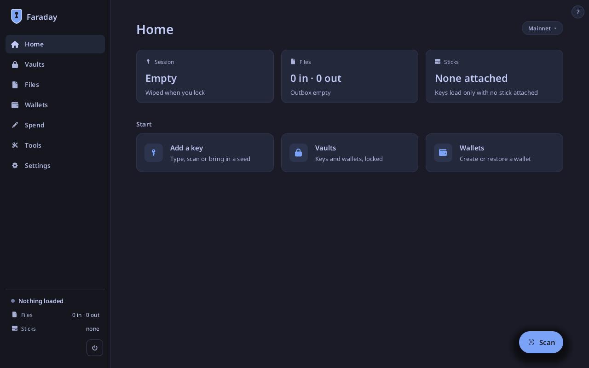
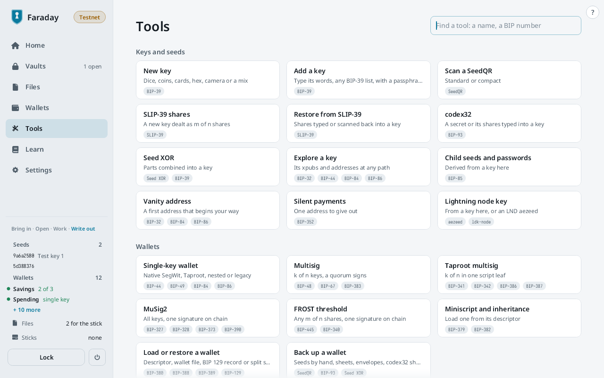
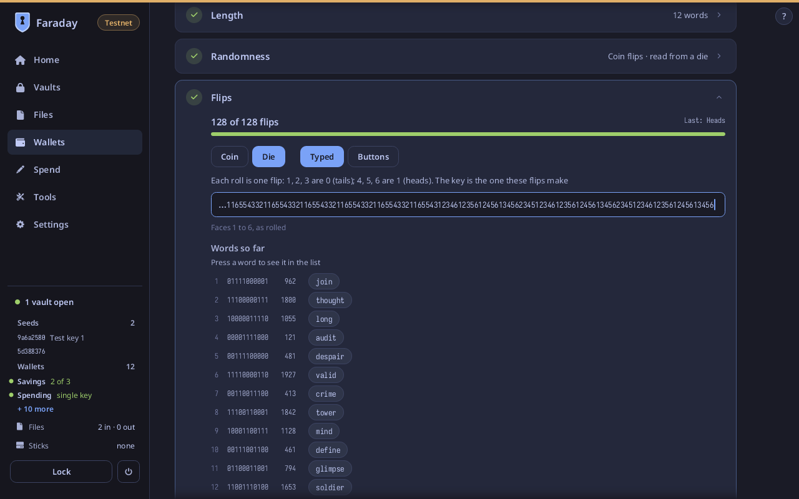
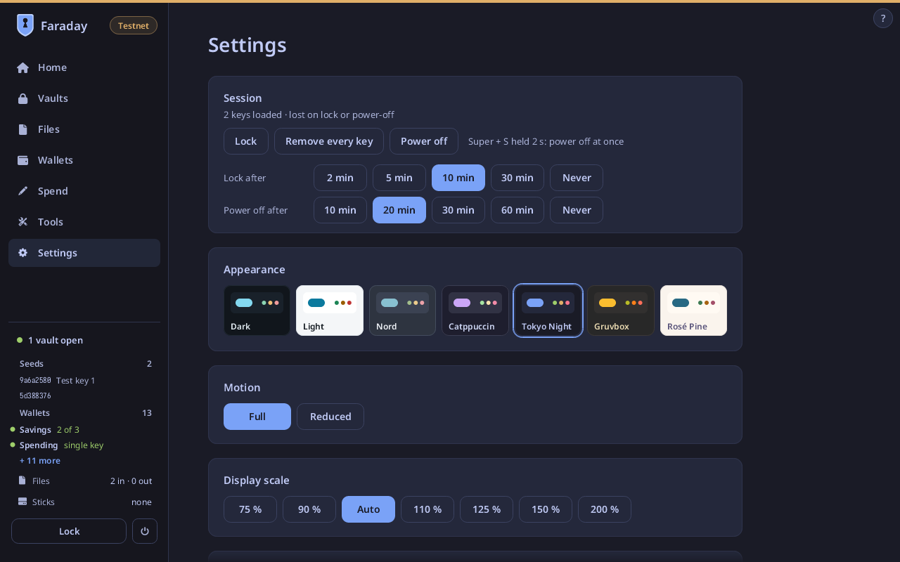
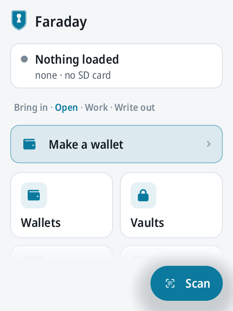
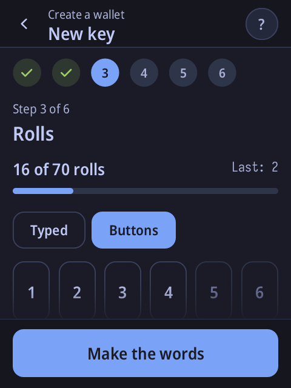
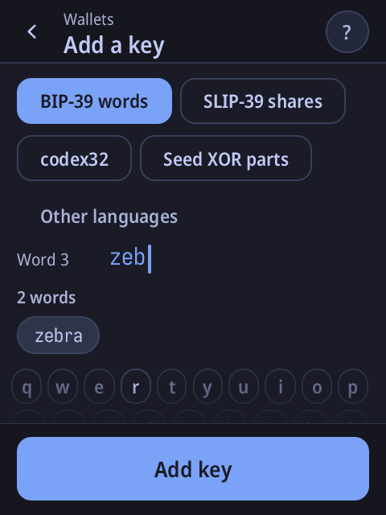
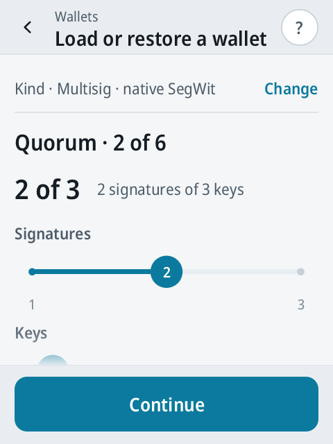

# Faraday

Faraday is an offline key appliance. It boots from a USB stick on an
x86-64 UEFI PC, or from its SD card on a Raspberry Pi, runs entirely from
RAM, and keeps nothing when it powers off. It holds Bitcoin keys,
wallets, passwords, GPG keys and Secure Boot keys in encrypted vaults and
signs with them on a machine that has no network.

Every document, and which one answers which question: `docs/README.md`.
Building it, checking it, reproducing a release and trying it on your
own hardware: `docs/DEVELOPING.md`.

> **Use at your own risk.** 0.1.8 is a pre-release. One outside audit,
> AI-assisted, has read its code; no person outside the project has
> reviewed its code, its cryptography or its builds, and no second
> builder has reproduced it. It comes with no warranty of any kind (see
> `LICENSE`). Check a download as [Verifying a
> release](#verifying-a-release) says before using it.

**Audits.** The outside audits and Faraday's reply to each, finding by
finding, are on the Audits page: <https://faradayoffline.app/audits/>.

**Reviews and feedback are wanted.** Read the code, boot an image, try
the flows, and say what you find in an
[issue](https://github.com/bitcoinpasada/faraday/issues): a bug, a
screen that is unclear, a flow that leads nowhere, or a claim in
[Security model](#security-model) or [Auditing
Faraday](#auditing-faraday) that does not hold. Where to start reading
is in [Auditing Faraday](#auditing-faraday).

## What it does

| Area | Jobs |
|---|---|
| Vaults | Create a passphrase-encrypted vault; unlock it after the boot stick is removed; hold Bitcoin keys, wallets, notes and recovery sheets, password entries with TOTP secrets, GPG keys and Secure Boot keys; seal it and write it back to a stick. TOTP codes for the entries in open vaults. |
| Wallets | Wallet creation, restore, backup and spending flows, built on the `core/` crates. |
| GPG | Create an Ed25519 certification key with an Ed25519 signing subkey, export the public certificate, make detached signatures, make a revocation certificate, renew expiry, write a paperkey backup. |
| Secure Boot | Generate PK, KEK and db keys and certificates, write enrolment files, sign and check `BOOTX64.EFI`. |
| QR | One scanner and one sender: fountain-coded `ur:bytes`, BBQr, and the `faraday-file-v1` envelope for any file. |
| Settings | Theme, display scale, reduced motion, idle lock and power-off times, kept on the boot stick between sessions. |

### Keys and seeds

Faraday says **key** for what is loaded and signs, and **seed** only
for the words that make it. A key is named by its fingerprint
(`9a6a2580`); a seed is the 12 or 24 words, written, scanned as a
SeedQR or kept in a vault. The two are not the same thing: one seed
with a BIP-39 passphrase makes another key than the same seed without
one, so the lists of what is loaded (the sidebar's **Keys**, Files'
**Keys with no wallet**, Restore's **Keys** card) count keys, and a key
loaded with a passphrase is marked **passphrase** in the sidebar. The
words stay seeds: **Scan a SeedQR**, **I have the seed**, a backup's
"Key 1 seed", the seed sheet. The passphrase itself is never kept.

## Screens

The stick image on a PC, at 1280×800.

<table>
<tr>
<td width="50%"></td>
<td width="50%"></td>
</tr>
<tr>
<td>Home</td>
<td>Tools: every flow, with its standards</td>
</tr>
<tr>
<td width="50%"></td>
<td width="50%"></td>
</tr>
<tr>
<td>A new BIP-39 key from 99 die rolls: the randomness check on the
entry card once the last roll is in</td>
<td>Settings</td>
</tr>
</table>

The Raspberry Pi image on its 2.8 inch panel, at 480×640, worked by
touch.

<table>
<tr>
<td width="25%"></td>
<td width="25%"></td>
<td width="25%"></td>
<td width="25%"></td>
</tr>
</table>

Left to right: Home; a new key from dice rolls; Add a key, typing a
seed's words; Restore's Quorum card, 2 of 3.

## Starting a session: the boot import

The boot stick's data partition can carry what a session needs: vaults,
wallet descriptors, PSBTs, seed words, pictures of QR codes. Faraday
lists it when it first sees the stick after power-on, reads only what
the person chooses to import, and does not leave it attached while
anything secret is open.

1. **Listed, not read.** When the stick first appears, Faraday reads
   only its list of files, each one's name and size (F130). None of
   the files is opened.
2. **Choose what to import.** A sheet reads "Read from {label}", one
   line counting the files by their names ("1 vault · 2 PSBTs · 4 other
   files, by their names"), and lists every vault and file by name and
   size, each ticked, a seed's file too, with **Unselect all**,
   **Later** and **Import** (F60). **Import** reads the ticked files and
   no other, then brings in what they hold: the files into Files, the
   wallets and keys they hold, and the vaults into Files, locked. A PNG
   is not kept as a picture: its QR codes are read, and what they hold
   is kept, a SeedQR as its seed words. A file Faraday reads as nothing
   it knows, up to 18 MiB, is kept as a File, which can be signed with a
   GPG key or sent as QR codes. A seed imported with the stick still in
   loads as the stick is pulled.
3. **Pull the stick, then unlock.** Keys never load and passphrases are
   never typed while a stick is attached. Each vault imported offers its
   passphrase field in turn, with **Unlock** and **Cancel**; Cancel
   leaves it locked in Files. A wrong passphrase stays on the sheet and
   says so.
4. **Choose what to load.** After an unlock, **Load from {vault}** lists
   a card for each wallet in the vault, with its seeds, and the keys of
   no wallet, ticked from each item's Load at unlock setting (F62).
   **Load ticked** loads them; **Not now** loads nothing and leaves the
   vault open.

**Later**, or a tap beside the sheet, reads and brings in nothing:
Home leads with the import, which opens the sheet again; the Sticks row
in the sidebar does too. Locking drops the import. Import needs the
stick in: pulled before Import, the sheet asks for it back, and putting
it back brings the sheet up again. Any other later insertion of the
boot stick in the same power-on is an ordinary stick visit; the desktop
app's Boot stick pill stands for the boot stick, so its first plugging
in a session runs the import.

## A second stick for storage

On a PC, any other USB stick can carry files to and from Faraday. It is
read and written on an ordinary stick visit, never at the boot import,
and only while no vault is open ([Security model](#security-model)).
Format it like this:

- **A partition table**, MBR or GPT, with the files in a partition. A
  filesystem written to the whole device with no partition table (what
  `mkfs.fat /dev/sdX` makes) is not seen: Faraday only ever opens
  partitions.
- **FAT32 or FAT16.** exFAT, NTFS, ext4 and APFS are not read, and
  neither is FAT12. Sticks larger than 32 GB usually come formatted
  exFAT and need reformatting; most smaller ones come as MBR and FAT32
  and work as they are.
- **Any label except `FARADAYBOOT`**, which marks a boot partition and is
  never opened.
- **Files at the top level.** Files inside folders are not read. The
  largest file read is 18 MiB. Files of any size are specified in
  `docs/LARGE-FILES.md` and not built yet.

Files are deleted from a stick on the stick visit, with no online
computer: **Delete files** is the one way in. Its sheet, marked as a
danger zone, chooses what: **Chosen files**, ticked on a list, each
overwritten with zeros, read back, and removed with its name; **The free
space**; or **The whole partition**. What zeros do not reach is said on the same
sheet: a USB stick or an SD card moves data around inside the chip and
can keep old copies of a block where no write reaches, so zeros stop
recovery tools but not a lab that reads the chip itself. If a seed or
other secret was ever saved to a stick unencrypted, the only sure way to
remove it is to destroy the stick.

The other two work on the whole files partition:

- **The free space** writes zeros over every part of the files
  partition no file uses, and reads them back. It clears what earlier
  deletes left, by Faraday or by any other computer, including deleted
  files' names and the bytes past each kept file's end. The files on the
  stick stay as they are.
- **The whole partition** deletes every file, makes the partition
  an empty FAT volume with the same layout and name, then writes zeros
  over all of it, once or twice. Two passes make a stick replace more of
  its old blocks.

Both run in steps with a progress bar and **Stop**; a stick pulled part
way is left whole, only part way zeroed. Only the files partition is
written: the stick's other partitions, its partition table and any space
outside a partition are never touched. That is the security boundary:
the process that reads sticks takes in whatever a stick brings, so it is
given the files partition and nothing else, and can never write a boot
partition or a partition table, where a bad stick could leave code for
the next computer to boot. Faraday itself only ever writes into that
partition, so zeroing it reaches everything Faraday ever wrote to the
stick. No zeroing is a certain erase, though: the stick's controller can
keep old copies of blocks where no write reaches, and only destroying
the stick is certain.

On Linux, with the stick at `/dev/sdX` (check with `lsblk` first; this
erases the stick):

```
sudo parted --script /dev/sdX mklabel msdos mkpart primary fat32 1MiB 100%
sudo mkfs.fat -F 32 -n FARADAY /dev/sdX1
```

On macOS, with the stick at `/dev/diskN` (check with `diskutil list`):

```
diskutil eraseDisk FAT32 FARADAY MBRFormat /dev/diskN
```

On Windows, Explorer's Format offers FAT32 only for 32 GB or less; for a
larger stick, use Disk Management to make a partition of 32 GB or less
and format it FAT32.

The Raspberry Pi image reads no USB stick: its kernel has no USB storage
driver, and the SD card it boots from is its only storage. Its screens say
"SD card" wherever the PC's say "stick": "SD card visit", "Lock and use
SD card", "Remove the SD card".

## Upgrading a stick

A Faraday stick is upgraded from a computer with Faraday Starter: Make
a Faraday stick → **Replace Faraday, keep data**. It checks the new
release's image against the release's manifest, writes the stick's boot
partition, reads it back and compares; the data partition, with its
vaults and settings file, is not read and not written. Faraday itself
writes no boot partition (`docs/DECISIONS.md` F128). Plugging the stick
into the computer is what exposes its data partition: the vaults there
are encrypted, the settings file is not.

A stick that already holds the same build is not written; an older
Faraday over a newer one is marked on Confirm. A stick whose boot
partition is smaller than 64 MiB (one made with a 48 MB one) has to be
written whole, which empties its data partition: copy its files to
another stick first. A Pi card is written whole.

**With Secure Boot.** The release's own `BOOTX64.EFI` does not carry
your db signature. Sign the new release's on Faraday: download the
release's `faraday-X.Y.Z-BOOTX64.EFI`, `SHA256SUMS` and `SHA256SUMS.asc`
onto a stick's data partition, copy the three in, sign
`faraday-X.Y.Z-BOOTX64.EFI` (Vaults → the vault holding the keys → **Secure Boot** → **Owner keys** → **Sign or check an image**) and write
the signed file back. Faraday signs a boot program only when it is a
release's own, at least as new as the Faraday signing it: the signature
must verify with the release key built into Faraday, and `SHA256SUMS`
must list the file (`docs/DECISIONS.md` F134). Put the signed file in
the computer's Downloads folder; then, on What to write, choose Boot
file → **One I signed** and the file. The Starter takes it only when it
is this release's own program with one signature that holds, shows the
signing certificate's name and SHA-256 (compare the SHA-256 with your db
key's), and writes the release's own bytes with that signature in place
of the release's file (`docs/DECISIONS.md` F133).

Without the Starter, once the stick holds the new release, copy the
signed file over `EFI/BOOT/BOOTX64.EFI` on its boot partition,
`FARADAYBOOT`. On Linux and macOS it mounts as any FAT partition. On
Windows it is an EFI system partition, which gets no drive letter: in
`diskpart`, run as administrator, `select volume` the one labelled
FARADAYBOOT and `assign letter=S`, copy the file to
`S:\EFI\BOOT\BOOTX64.EFI`, then `remove letter=S`.

## Choosing a computer

A laptop is the better machine for the stick image. Its screen,
keyboard and touchpad are inside the case: nothing outside it sees the
screen, and Faraday takes input from them without asking.

On a desktop PC, the monitor cable carries everything Faraday shows:
seed words, keys as QR codes, and the code typed to approve a new
keyboard. A plain monitor is fine. Avoid anything on the other end of
the cable that can record or send on what it shows:

- smart TVs, and monitors with network, casting or screenshot features;
- capture cards and recorders;
- KVM switches, and above all network KVMs. A network KVM both sees the
  screen and acts as a USB keyboard, so it can read the approval code
  and type it, and then operate Faraday from elsewhere.

Faraday's kernel has no Wi-Fi or Bluetooth driver, so a laptop's radios
stay off whatever card it has. Taking the card out as well means nothing
can turn them on, whatever runs on the machine. Cheap laptops whose
Wi-Fi and Bluetooth are on a separate card, in an M.2 or mini PCIe slot
behind a screwed panel, are widely available, used business models
especially.

## Security model

- **One program, not a desktop.** The stick runs the Linux kernel,
  BusyBox init and four Rust programs, each as its own unprivileged user.
  There is no window system, no network stack and no login.
- **Nothing is kept.** The system runs from RAM and keeps nothing when it
  powers off. A secret leaves only in a vault the person saves, or in a
  file the person chooses to write unprotected.
- **The stick's files are kept apart.** A second process reads and writes
  sticks and cards and never holds a key or a passphrase, and it cannot
  read the application's memory or files.
- **Not defended against:** a malicious Faraday binary (the defence is
  reproducible builds, checked by others), compromised firmware or
  hardware, cold-boot attacks on RAM, and a weak passphrase.

The whole model, with the kernel's configuration, the vault's
cryptography and why it holds up, is `docs/SECURITY-MODEL.md`.

## Auditing Faraday

Faraday is built so that the part that decides what a signature or a
ciphertext is can be read apart from everything that draws screens. The
cryptographic core is a set of library crates with no screens, no input
and no storage in them. Key use is one crate, `faraday-keys`: it holds
every key in memory and does every operation on one, and a secret
leaves it only for one of fourteen named reasons (`docs/KEYS.md`); `just`
fails if other code touches a key. `docs/AUDIT.md` lists every crate that touches a key,
what it computes, whether the code is written in this tree or taken from
a vetted crate, and what it is checked against.

**Bitcoin cryptography is in `core/`.** Every key derivation, mnemonic,
signature, PSBT and message signature is in the `core/` crates
(`faraday-crypto`, `faraday-bip`, `faraday-psbt`, `faraday-entropy`). The rest
is in Faraday's other crates, each a library with no interface: the
vault (`faraday-vault`), OpenPGP (`faraday-pgp`), Secure Boot
(`faraday-sb`).

Why this is better than one repository and one application:

- **A smaller thing to read.** An auditor of signing reads `core/`:
  libraries with no rendering, layout, fonts or event handling in them.
  The shells are input, storage and drawing. `faraday-core` is flows and
  wording, and holds handles to keys, not keys: key use is
  `faraday-keys`. `docs/AUDIT.md` says which crate computes what.
- **Every change traceable.** Faraday's own history records each
  change to `core/`.
- **No interface pressure on the cryptography.** A screen that wants a
  value in a new shape gets it from a library function written and
  tested against published vectors, not from a shortcut taken inside a
  view. The rule is that code that defines bytes, or answers a
  question with no screen in it, lives in `core/` (`docs/WALLETS.md` §1
  rule 5).
- **Checked against others.** Each cryptographic crate is tested against
  published vectors (`tools/vectors/`) and independent implementations:
  a Python reader opens Faraday's vaults, `gpg` and `paperkey` judge its
  OpenPGP packets, `openssl` and `sbverify` its Secure Boot output.

`unsafe` Rust is forbidden across the workspace. The exceptions in what
Faraday builds are `faraday-crypto` (locking secret pages in RAM), the camera crate
`faraday-v4l2` (its `ioctl`s), and `faraday-grant` (dropping
privileges); each says why in its crate documentation.

## Faraday Starter

Faraday Starter makes a Faraday stick or a Raspberry Pi card, shows how to
start a computer from the stick, and moves files to and from the device
by QR code. It is one file for your operating system, from 0.1.2. On
Linux:

1. Download `Faraday-Starter-X.Y.Z-Linux.tar.gz` from the release and extract it:
   double-click it in the file manager, or `tar xf Faraday-Starter-X.Y.Z-Linux.tar.gz`.
2. Open the file `Faraday-Starter-X.Y.Z-Linux` inside: double-click it, or run
   `./Faraday-Starter-X.Y.Z-Linux`. Nothing needs `chmod`.

On Windows, download `Faraday-Starter-X.Y.Z-Windows.exe` and open it.
It is not code-signed, since a certificate names a person or company and
Faraday is published under a pseudonym: Windows shows "Windows protected
your PC" the first time, and *More info*, then *Run anyway*, opens it.
Check it against the signed `SHA256SUMS` first.

A Faraday stick or Pi card needs a USB stick or SD card of 256 MB or
larger. Faraday's own boot file takes about 14 MB of the
stick's 64 MiB boot partition, and the Pi card's boot files about
16 MB of its 64 MiB; the rest of that partition is room for
later versions to grow. The 128 MiB data partition is storage for files:
vaults, PSBTs and anything else brought to the device.

It runs on Ubuntu 20.04 and later, Debian 11 and later, Fedora 32 and
later and Arch, on x86-64. Writing a stick needs udisks2, which desktop
distributions have; the system may ask for a password. Check the
download first, as [Verifying a release](#verifying-a-release) says.
**Install** in its window puts Faraday Starter in your app menu, in
`~/.local/bin/faraday-starter` (on Windows, in
`%LOCALAPPDATA%\Programs\Faraday Starter`, with a Start menu entry);
**Uninstall** removes exactly what that put there.

**Transfer**, a row on its Home, makes the computer the device's QR
link. **Send** lists `~/Downloads`, newest first; a file pressed is
shown as animated codes for the device's Scan, a PSBT as itself, a
wallet, key, message or share as text, and any other file up to 256 KiB
in the Faraday file envelope. **Receive** reads the codes the device's
Files shows through the webcam and saves each whole file into the same
folder, under its own name or `received-N`, never over a file already
there (`name (2).ext`).

Faraday Starter on Linux and Windows has Faraday Demo inside it
("Faraday Demo" below). **Open Faraday Demo**, a card on its Home,
shows it in the Starter's own window; the way back returns to Home. It
is not installed on its own: **Install**, update and **Uninstall**
remove the copy an earlier Starter installed beside itself. Faraday
Starter for macOS carries none.

Without Faraday Starter, Raspberry Pi Imager and balenaEtcher take the
`.img.xz` as it is; other tools need it decompressed (`xz -d` on Linux,
7-Zip on Windows).

## Faraday Demo

Faraday Demo runs Faraday in a window on an ordinary computer, for
trying it on testnet and for developing it. A release does not
publish it on its own: it runs inside the Linux and Windows Faraday
Starters (`docs/DECISIONS.md` F83, F126), and its theme there is the
Starter's. It has none of the stick's protections and is
never for a seed that holds funds. It starts in Practice, a mode on
testnet that takes only the public seeds (the user guide's key,
`3dca6805`, and each of `bacon`, `flag`,
`gas`, `great`, `slice`, `solution`, `summer`, `they`, `trade`, `trap`
and `zebra`, twenty-four times) and makes no secret a person could keep
(`docs/DEMO.md`). Testnet, Signet and Regtest, chosen from the mode pill
or Settings, take any seed. Every build starts in Practice with no warning
sheet; each screen that takes a seed or a secret says under its field
never to type a seed that holds real bitcoin there.

Prerequisites: stable Rust (see `rust-toolchain.toml`), a C compiler
(`secp256k1-sys` builds libsecp256k1 from source), and on Linux the X11
or Wayland client libraries at runtime, including `libxkbcommon-x11`.
The check, `just`, needs cargo-nextest and cargo-deny (`cargo install
--locked cargo-nextest cargo-deny`); the FAT tests use `mkfs.fat`,
`fsck.fat` and mtools, and skip with a note when they are missing.

For developers it also builds as a window of its own, which holds the
same host and the same Demo side as the Starter's (`faraday_desktop::Demo`,
`faraday/shells/desktop/src/lib.rs`); `cargo run -p faraday-starter-shell`
opens it inside the Starter.

```
cargo build -p faraday-desktop --release          # target/release/faraday
just faraday-linux-bin                            # one Linux file, out/linux/faraday
just faraday-windows-bin build out/windows out/build/run faraday-desktop faraday
./target/release/faraday [--sticks DIR] [--size WxH] [--transfer] [--downloads DIR]
```

Sticks are folders in `faraday-sticks` in the home folder
(`~/faraday-sticks` on Linux, `%USERPROFILE%\faraday-sticks` on Windows;
`--sticks DIR` moves them): `BOOTSTICK` is the boot stick, empty at
first: put there the files to boot with. `STICK-2` and on are backup
sticks. The pills in the strip at the window's foot plug each one in or pull it out.

Build the test kit on its own with:

```
cargo run -q -p faraday-testkit -- out/testkit
```

## Building and testing

```
just                                         the check: every test and lint
cargo run -p faraday-desktop --release       Faraday in a window, on testnet
just dev=1 faraday-stick-image               a stick image for trying a machine
just faraday-starter --image out/stick/faraday-x86_64-uefi-dev.img   write it to a stick
just crosscheck                              the crypto against independent references
just crosscheck-status --follow              a running cross-check, from another terminal
```

`docs/DEVELOPING.md` is the whole guide: what to install, the check,
the images, reproducing a release byte for byte, the dev image's boot
report (written to the stick every 30 seconds, for a machine that does
not work), QEMU, the cross-check and fuzzing.

## USB stick image

The image is built with Buildroot in a container (`DOCKER=podman` or
`docker`).

```
just faraday-stick-bin                    # the stick binary, static musl
just faraday-stick-image                  # out/stick/faraday-x86_64-uefi.img
just dev=1 faraday-stick-image            # + a serial console and root login, for development
just dev=1 faraday-stick-boot /dev/sdX    # development: rewrite a stick's boot partition alone
just faraday-starter --image out/stick/faraday-x86_64-uefi-dev.img   # write a dev image (below)
```

A build this way is a test release unless built with `release=1`, which
refuses a dev image, a version override and a tree that differs from its
commit (`docs/DECISIONS.md` F5):

```
just release=1 faraday-stick-image        # a published release
```

`faraday-stick-boot` writes the image's boot partition
(`out/stick/faraday-x86_64-uefi[-dev]-boot.vfat`) over a Faraday
stick's `FARADAYBOOT` partition and leaves its data partition as it is. It
refuses a disk that is not a Faraday stick on USB or has anything
mounted, and asks for the device to be typed back; `--dry-run` only
checks. It is for development only.

Flash the image to a stick and boot a PC from it; the stick image starts
on mainnet. `faraday/image/README.md` describes the image layout and
`faraday/image/run-build.sh` the build.

### Writing a developer's image

Faraday Starter writes an image built here in place of its own:

```
just dev=1 faraday-stick-image
just faraday-starter --image out/stick/faraday-x86_64-uefi-dev.img
```

`--image` takes an `.img`, an `.img.xz`, or a `-boot.vfat`, which only
*keep data* can write (the boot partition, with the vaults and settings
on the data partition left alone). The screens and the writer are the
release's: Confirm says the image is not Faraday Starter's own and shows its
SHA-256. A Faraday Starter built without a payload offers only `--image`. On
Linux the write goes through udisks2 and the desktop may ask for a
password; the Starter never runs as root. `docs/STARTER.md` §4.1 says what
the writer checks and in what order.

## Reproducible builds

The stick image is built in a container with the base image and every
compiler pinned by version, the commit date as `SOURCE_DATE_EPOCH`, and
host paths remapped out of the output, so that a second builder can
check that it gets the same bytes. Faraday's own binaries, built outside
that container, have their source paths rewritten the same way
(`faraday/image/path-remap.sh`). The kernel's release string carries
the Faraday build ID: a release's version alone, otherwise the version,
the commit's first twelve hex digits and the kind of build, test or dev
(and `.dirty-XXXXXXXX` for a tree that differs from its commit), never a
date (`docs/DECISIONS.md` F5). The Pi image carries the same string in
`faraday-build.txt` on its boot partition, since its kernel is
compressed; the Starter reads a Pi card's version from that
file, and a card made before it existed reads as it always did. Each
FAT filesystem in an image (the boot and the data partition, on the
stick and on the Pi) is stamped with a volume serial that is a function
of `SOURCE_DATE_EPOCH` and the partition's role
(`faraday/image/fat-serial.sh`, given to `mkfs.vfat -i` through the
board's `genimage.cfg`), so two builds of one commit have the same
serials; two sticks of one build have the same serials too. The same
`extraargs` carry `--invariant`: Buildroot builds dosfstools 4.2 for the
host, which does not read `SOURCE_DATE_EPOCH` (that came in a later
release), so `BR2_REPRODUCIBLE` and the exported variable did not reach
`mkfs.vfat`, and it stamped the root directory's volume-label entry with
the clock (creation and write time, 8 bytes per image). `--invariant`
makes it use a fixed time; it also fixes the volume ID, which the
following `-i` replaces. No second
builder has checked a Faraday image yet. The
Starter for Linux is built by `just faraday-linux-bin` in a pinned
Debian 11 container (`faraday/build/linux`), against glibc 2.31, with
the same path rewriting, so one file runs on Ubuntu 20.04 and later,
Debian 11 and later, Fedora 32 and later and Arch.

## Verifying a release

Each release on GitHub has the artifacts, `SHA256SUMS` listing their
SHA-256 sums and the commit they were built from, and `SHA256SUMS.asc`,
a detached signature over it. The release key was made in Faraday and
its secret part has never left a Faraday vault. Its public part is
[`faraday/release-key.asc`](faraday/release-key.asc), and its
fingerprint is:

```
D1AF A712 ABEF 9010 9A1B  587F F153 6BE0 7E23 4CFD
```

Import the key, check that `gpg --fingerprint` prints that fingerprint,
then check the signature and the sums of the files downloaded:

```
gpg --import release-key.asc
gpg --fingerprint F1536BE07E234CFD
gpg --verify SHA256SUMS.asc SHA256SUMS
sha256sum -c --ignore-missing SHA256SUMS
```

From 0.1.2 the images are published as `.xz` only. `SHA256SUMS` lists
each `.xz` and, under the `.img` name, the image inside it, so the same
command checks a download and, after `xz -d`, the image. It lists the
Linux Starter's `.tar.gz` and, under its own name, the file inside it, so
either can be checked. Faraday Demo has no file of its own; it is
inside each Starter (the Starter's own sum covers it). From the release
after 0.1.7 it lists `faraday-X.Y.Z-BOOTX64.EFI`, the stick's boot
program as it is, unsigned, published for a person with their own Secure
Boot keys to sign on Faraday ("With Secure Boot" above). Faraday checks
`SHA256SUMS.asc` more strictly than `gpg --verify` before it signs that
file (DECISIONS F134), so the release is signed as GnuPG's `gpg --armor
--detach-sign` or Faraday's own GPG signing does it: one armoured block
with its checksum line, a binary signature (not `--textmode`) by the
release key's one signing subkey, whose binding carries its back
signature.

On Windows, Gpg4win's `gpg` takes the same first three commands, and
PowerShell prints a file's sum to compare with its line in
`SHA256SUMS`:

```
Get-FileHash -Algorithm SHA256 .\faraday-stick-0.1.8-x86_64-uefi.img.xz
```

The release tags are signed with the same key: `git tag -v v0.1.8`.

## Repository layout

| Path | What it holds |
|---|---|
| `core/` | the libraries with no flow and no wording in them: the cryptography, the codecs, the drawing base and the shell contract |
| `faraday/` | Faraday itself: `faraday-core`, the shells (stick, Pi, desktop, Starter), the vault, GPG, Secure Boot, QR codes, the image build |
| `docs/` | what is true now or still to be built, indexed in `docs/README.md`; how it was built is in `docs/history/` |
| `tools/` | the lints, the cross-check, the vendored references and vectors, and the scripts `just` runs (`tools/README.md`) |
| `fuzz/` | the shared crates' fuzz targets (`faraday/fuzz/` holds Faraday's own) |
| `third_party/` | vendored crates, each with its patches |
| `supply-chain/` | cargo vet's audits and exemptions; `deny.toml` is cargo deny's policy |
| `design/` | the mark's drafts |
| `.github/` | the issue templates; there are no workflows |
| `.claude/` | the agent definitions a change may use |

The top level holds nothing else: `tools/lint-tree.sh` fails on a new
entry until it is named there and here. See `docs/FLOWS.md` for every
flow, and `docs/VAULT.md` and `docs/QR.md` for the vault and QR
formats.

## Repository rules

`CLAUDE.md` holds the rules every change follows, for people and agents
alike, and `just` enforces most of them: a change that breaks one fails
the check.

- No GitHub Actions or hosted CI. Everything builds and tests locally.
- Nothing private is committed.
- Every decision is numbered and kept (`docs/DECISIONS.md`); every
  document says whether it describes what is built or what is planned
  (`docs/README.md`).
- Every dependency is vetted (`cargo vet`, `docs/deps/`), and every
  cryptographic change is checked against published vectors or another
  implementation.
- The screens follow Material 3 (`docs/DESIGN.md`); every user-facing
  string is in one file; files and functions over their size limits
  only become fewer (`tools/README.md`, "The lints `just lint` runs").

## License

MIT. See `LICENSE`.
