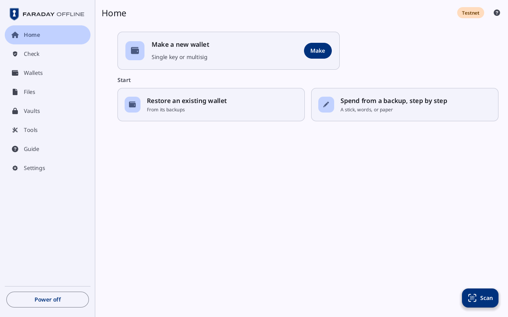
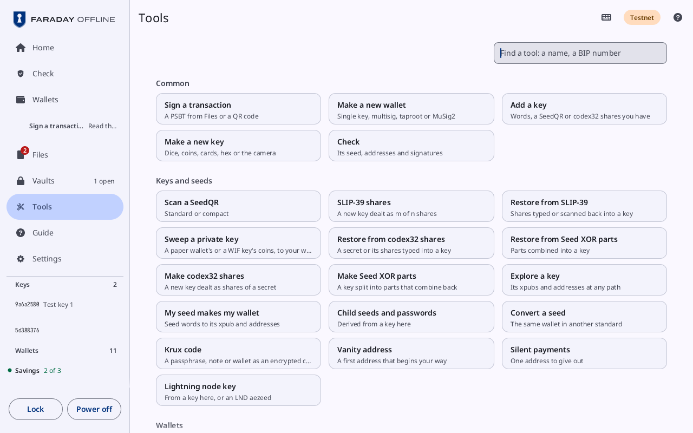
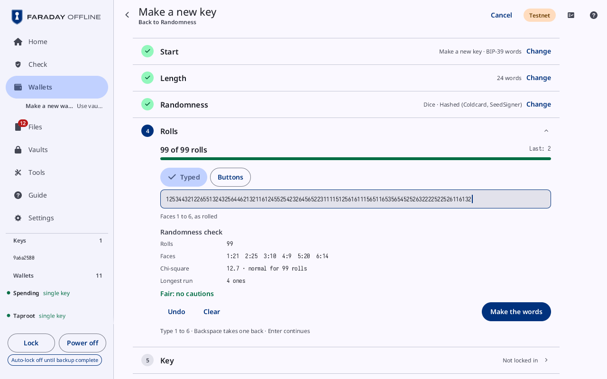
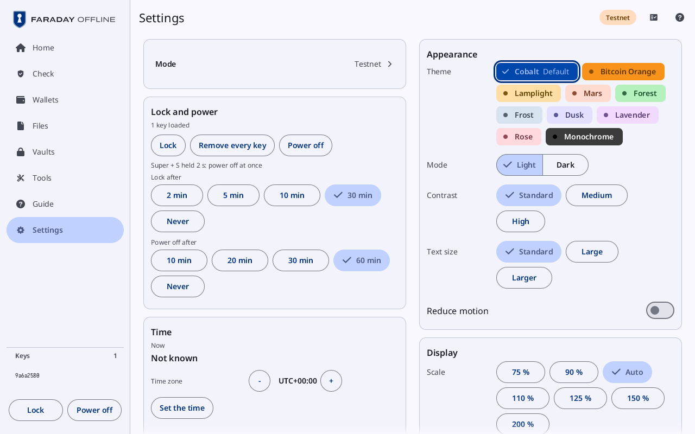
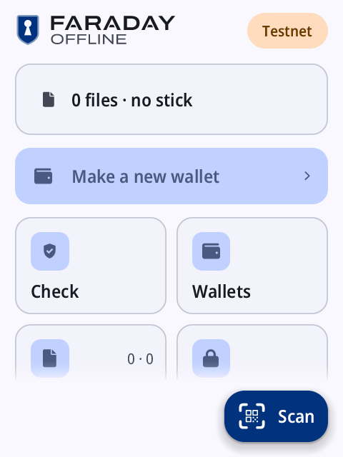
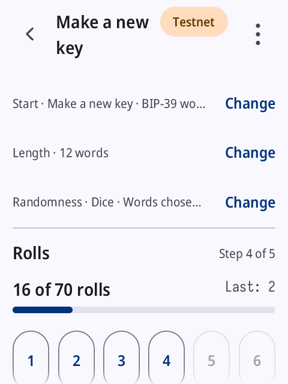
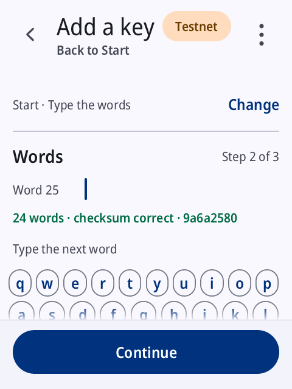
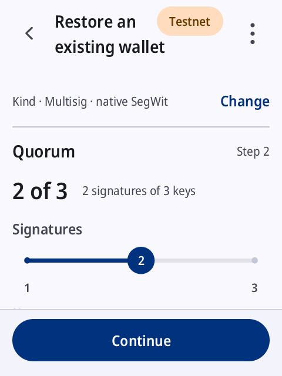

# Faraday

Faraday is an offline key appliance. It boots from a USB stick on an
x86-64 UEFI PC, or from its SD card on a Raspberry Pi, runs entirely from
RAM, and keeps nothing when it powers off. It holds Bitcoin keys,
wallets, passwords, GPG keys and Secure Boot keys in encrypted vaults and
signs with them on a machine that has no network.

Every document, and which one answers which question: `docs/README.md`.
Building it, checking it, reproducing a release and trying it on your
own hardware: `docs/DEVELOPING.md`.

> **Use at your own risk.** 0.2.0 is a pre-release and changes fast. No
> person outside the project has reviewed its code, its cryptography or
> its builds; one outside audit, AI-assisted, has read the code; no
> second builder has reproduced a release. Most of the code was written
> and reviewed with AI tools. A mistake in it could make a backup that
> does not restore, an address that cannot be spent from, or a signature
> for something other than what the screen showed. Until that changes:
> try it on testnet first, keep a backup of every seed that Faraday did
> not make or read (paper words checked in another wallet), and check
> every receive address in a second wallet before sending money to it.
> It comes with no warranty of any kind (see `LICENSE`). Check a
> download as [Verifying a release](#verifying-a-release) says before
> using it.

**Audits.** The outside audits and Faraday's reply to each, finding by
finding, are on the Audits page: <https://faradayoffline.app/audits/>.

**Reviews and feedback are wanted.** Read the code, boot an image, try
the flows, and say what you find in an
[issue](https://github.com/bitcoinpasada/faraday/issues): a bug, a
screen that is unclear, a flow that leads nowhere, or a claim in
[Security model](#security-model) or [Auditing
Faraday](#auditing-faraday) that does not hold. Where to start reading
is in [Auditing Faraday](#auditing-faraday).

## What it does

| Area | Jobs |
|---|---|
| Vaults | Create a passphrase-encrypted vault; unlock it after the boot stick is removed; hold Bitcoin keys, wallets, notes and recovery sheets, password entries with TOTP secrets, GPG keys and Secure Boot keys; seal it and write it back to a stick. TOTP codes for the entries in open vaults. |
| Wallets | Wallet creation, restore, backup and spending flows, built on the `core/` crates. |
| GPG | Create an Ed25519 certification key with an Ed25519 signing subkey, export the public certificate, make detached signatures, make a revocation certificate, renew expiry, write a paperkey backup. |
| Secure Boot | Generate PK, KEK and db keys and certificates, write enrolment files, sign and check `BOOTX64.EFI`. |
| QR | One scanner and one sender: fountain-coded `ur:bytes`, BBQr, and the `faraday-file-v1` envelope for any file. |
| Settings | Theme, display scale, reduced motion, idle lock and power-off times, kept on the boot stick between sessions. |

### Keys and seeds

Faraday says **key** for what is loaded and signs, and **seed** only
for the words that make it. A key is named by its fingerprint
(`9a6a2580`); a seed is the 12 or 24 words, written, scanned as a
SeedQR or kept in a vault. The two are not the same thing: one seed
with a BIP-39 passphrase makes another key than the same seed without
one, so the lists of what is loaded (the sidebar's **Keys**, Files'
**Keys with no wallet**, Restore's **Keys** card) count keys, and a key
loaded with a passphrase is marked **passphrase** in the sidebar. The
words stay seeds: **Scan a SeedQR**, **I have the seed**, a backup's
"Key 1 seed", the seed sheet. The passphrase itself is never kept.

## Screens

The stick image on a PC, at 1280×800.

<table>
<tr>
<td width="50%"></td>
<td width="50%"></td>
</tr>
<tr>
<td>Home</td>
<td>Tools: every flow, by group</td>
</tr>
<tr>
<td width="50%"></td>
<td width="50%"></td>
</tr>
<tr>
<td>A new BIP-39 key from 99 die rolls: the randomness check on the
entry card once the last roll is in</td>
<td>Settings</td>
</tr>
</table>

The Raspberry Pi image on its 2.8 inch panel, at 480×640, worked by
touch.

<table>
<tr>
<td width="25%"></td>
<td width="25%"></td>
<td width="25%"></td>
<td width="25%"></td>
</tr>
</table>

Left to right: Home; a new key from dice rolls; Add a key, typing a
seed's words; Restore's Quorum card, 2 of 3.

## Starting a session: the boot import

When the boot stick first appears, Faraday lists its files without
reading them, and imports only what the person ticks, before any key
loads. `docs/FLOWS.md` ("Home" and "Session") has the sheets and their
buttons, and `docs/guide/vaults.md` the unlock.

The boot stick holds the kernel and the application, and an online
computer it is plugged into can change what is on it. Anyone who wants
it kept offline after it is made carries files on a second plain stick
or by QR code instead (`docs/guide/start/replace-faraday.md`, "Keeping
the boot stick offline"; `docs/SECURITY-MODEL.md`).

## A second stick for storage

Any other USB stick, MBR or GPT with a FAT32 or FAT16 partition, carries
files on a stick visit, and Faraday can zero what it wrote to one
(`docs/guide/files.md`, "Formatting a stick" and "Delete files"; the
flow is `docs/FLOWS.md`, "The stick in Files").

## Upgrading a stick

Faraday Starter → Make a Faraday stick → **Replace Faraday, keep data**
writes the boot partition and leaves the vaults alone
(`docs/guide/start/replace-faraday.md`, with Secure Boot on and without
the Starter too; `docs/STARTER.md`).

## Choosing a computer

A laptop is the better machine for the stick image. Its screen,
keyboard and touchpad are inside the case: nothing outside it sees the
screen, and Faraday takes input from them without asking.

On a desktop PC, the monitor cable carries everything Faraday shows:
seed words, keys as QR codes, and the code typed to approve a new
keyboard. A plain monitor is fine. Avoid anything on the other end of
the cable that can record or send on what it shows:

- smart TVs, and monitors with network, casting or screenshot features;
- capture cards and recorders;
- KVM switches, and above all network KVMs. A network KVM both sees the
  screen and acts as a USB keyboard, so it can read the approval code
  and type it, and then operate Faraday from elsewhere.

Faraday's kernel has no Wi-Fi or Bluetooth driver, so a laptop's radios
stay off whatever card it has. Taking the card out as well means nothing
can turn them on, whatever runs on the machine. Cheap laptops whose
Wi-Fi and Bluetooth are on a separate card, in an M.2 or mini PCIe slot
behind a screwed panel, are widely available, used business models
especially.

## Security model

- **One program, not a desktop.** The stick runs the Linux kernel,
  BusyBox init and three Rust programs, each as its own account with no
  login; the one that hands out the stick's partitions starts as root and
  keeps only the right to change a file's owner.
  There is no window system, no network stack and no login.
- **Almost nothing is kept.** The system runs from RAM and keeps nothing
  when it powers off, except what is written to a stick: the vaults the
  person saves, a settings file on the boot stick, and, inside an opened
  vault, the nonce history (F227), which grows the vault by about 200
  bytes a signature and names inputs of wallets not held there. A secret
  leaves only in a vault the person saves, or in a file the person
  chooses to write unprotected.
- **The stick's files are kept apart.** A second process reads and writes
  sticks and cards and never holds a key or a passphrase, and it cannot
  read the application's memory or files.
- **Not defended against:** a malicious Faraday binary (the defence is
  reproducible builds, which will be checked by others once someone has
  reproduced a release), compromised firmware or
  hardware, cold-boot attacks on RAM, and a weak passphrase.

The whole model, with the kernel's configuration, the vault's
cryptography and why it holds up, is `docs/SECURITY-MODEL.md`.

## Auditing Faraday

Faraday is built so that the part that decides what a signature or a
ciphertext is can be read apart from everything that draws screens. The
cryptographic core is a set of library crates with no screens, no input
and no storage in them. Key use is one crate, `faraday-keys`: it holds
every key in memory and does every operation on one, and a secret
leaves it only for one of sixteen named reasons (`docs/KEYS.md`); `just`
fails if other code touches a key. `docs/AUDIT.md` lists every crate that touches a key,
what it computes, whether the code is written in this tree or taken from
a vetted crate, and what it is checked against.

**Bitcoin cryptography is in `core/`.** Every key derivation, mnemonic,
signature, PSBT and message signature is in the `core/` crates
(`faraday-crypto`, `faraday-bip`, `faraday-psbt`, `faraday-entropy`). The rest
is in Faraday's other crates, each a library with no interface: the
vault (`faraday-vault`), the backup plan's logic (`faraday-plan`), the printed sheets, EDID and build ID (`faraday-paper`), Faraday Demo's host (`faraday-host`), OpenPGP
(`faraday-pgp`), Secure Boot (`faraday-sb`).

Why this is better than one repository and one application:

- **A smaller thing to read.** An auditor of signing reads `core/`:
  libraries with no rendering, layout, fonts or event handling in them.
  The shells are input, storage and drawing. `faraday-core` is flows and
  wording, and holds handles to keys, not keys: key use is
  `faraday-keys`. `docs/AUDIT.md` says which crate computes what.
- **Every change traceable.** Faraday's own history records each
  change to `core/`.
- **No interface pressure on the cryptography.** A screen that wants a
  value in a new shape gets it from a library function written and
  tested against published vectors, not from a shortcut taken inside a
  view. The rule is that code that defines bytes, or answers a
  question with no screen in it, lives in `core/` (`docs/WALLETS.md` §1
  rule 5).
- **Checked against others.** Each cryptographic crate is tested against
  published vectors (`tools/vectors/`) and, where one exists, an
  implementation Faraday did not write: `gpg` and `paperkey` judge its
  OpenPGP packets, `openssl` and `sbverify` its Secure Boot output. Some
  parts are still compared only with second implementations Faraday's
  own authors wrote (the Python reader of Faraday's vaults among them),
  which are not checked against an outside source, and the vault and own
  randomness are of Faraday's own specification, not yet reviewed
  outside Faraday; `docs/CROSSCHECK.md` §10 says which (F160, F177).

`unsafe` Rust is forbidden across the workspace. The exceptions on the
device are three: `faraday-crypto` (locking secret pages in RAM and
wiping), `faraday-v4l2` (the camera's and the framebuffer's `ioctl`s) and
`faraday-grant` (dropping privileges). Off the device, Faraday Starter,
the Windows camera and the Windows and macOS clipboard and memory code
use it, as do two test tools; each says why in its crate documentation.

## Faraday Starter

Faraday Starter makes a Faraday stick or a Raspberry Pi card, shows how to
start a computer from the stick, and moves files to and from the device
by QR code. It is one file for your operating system, from 0.1.2. On
Linux:

1. Download `Faraday-Starter-X.Y.Z-Linux.tar.gz` from the release and extract it:
   double-click it in the file manager, or `tar xf Faraday-Starter-X.Y.Z-Linux.tar.gz`.
2. Open the file `Faraday-Starter-X.Y.Z-Linux` inside: double-click it, or run
   `./Faraday-Starter-X.Y.Z-Linux`. Nothing needs `chmod`.

On Windows, download `Faraday-Starter-X.Y.Z-Windows.exe` and open it.
It is not code-signed, since a certificate names a person or company and
Faraday is published under a pseudonym: Windows shows "Windows protected
your PC" the first time, and *More info*, then *Run anyway*, opens it.
Check it against the signed `SHA256SUMS` first.

A Faraday stick or Pi card needs a USB stick or SD card of 256 MB or
larger. Faraday's own boot file takes about 15 MB of the
stick's 64 MiB boot partition, and the Pi card's boot files about
16 MB of its 64 MiB; the rest of that partition is room for
later versions to grow. The 128 MiB data partition is storage for files:
vaults, PSBTs and anything else brought to the device.

It runs on Ubuntu 20.04 and later, Debian 11 and later, Fedora 32 and
later and Arch, on x86-64. Writing a stick needs udisks2, which desktop
distributions have; the system may ask for a password. Check the
download first, as [Verifying a release](#verifying-a-release) says.
**Install** in its window puts Faraday Starter in your app menu, in
`~/.local/bin/faraday-starter` (on Windows, in
`%LOCALAPPDATA%\Programs\Faraday Starter`, with a Start menu entry);
**Uninstall** removes exactly what that put there.

**Transfer**, a row on its Home, makes the computer the device's QR
link. **Send** lists `~/Downloads`, newest first; a file pressed is
shown as animated codes for the device's Scan, a PSBT as itself, a
wallet, key, message or share as text, and any other file up to 256 KiB
in the Faraday file envelope. **Receive** reads the codes the device's
Files shows through the webcam and saves each whole file into the same
folder, under its own name or `received-N`, never over a file already
there (`name (2).ext`).

Faraday Starter on Linux and Windows has Faraday Demo inside it
("Faraday Demo" below). **Open Faraday Demo**, a card on its Home,
shows it in the Starter's own window; the way back returns to Home. It
is not installed on its own: **Install**, update and **Uninstall**
remove the copy an earlier Starter installed beside itself.

Without Faraday Starter, Raspberry Pi Imager and balenaEtcher take the
`.img.xz` as it is; other tools need it decompressed (`xz -d` on Linux,
7-Zip on Windows).

## Faraday Demo

Faraday Demo runs Faraday in a window on an ordinary computer, for
trying it on testnet and for developing it. A release does not
publish it on its own: it runs inside the Linux and Windows Faraday
Starters (`docs/DECISIONS.md` F126), and its theme there is the
Starter's. It has none of the stick's protections and is
never for a seed that holds funds. It starts in Practice, a mode on
testnet that takes only the public seeds (the user guide's key,
`3dca6805`, and each of `bacon`, `flag`,
`gas`, `great`, `slice`, `solution`, `summer`, `they`, `trade`, `trap`
and `zebra`, twenty-four times) and makes no secret a person could keep
(`docs/DEMO.md`). Testnet, Signet and Regtest, chosen from the mode pill
or Settings, take any seed. Every build starts in Practice with no warning
sheet; each screen that takes a seed or a secret says under its field
never to type a seed that holds real bitcoin there.

Prerequisites: stable Rust (see `rust-toolchain.toml`), a C compiler
(`secp256k1-sys` builds libsecp256k1 from source), and on Linux the X11
or Wayland client libraries at runtime, including `libxkbcommon-x11`.
The check, `just`, needs cargo-nextest and cargo-deny (`cargo install
--locked cargo-nextest cargo-deny`); the FAT tests use `mkfs.fat`,
`fsck.fat` and mtools, and skip with a note when they are missing.

For developers it also builds as a window of its own, which holds the
same host and the same Demo side as the Starter's (`faraday_demo::Demo`,
`faraday/shells/demo/src/lib.rs`); `cargo run -p faraday-starter-shell`
opens it inside the Starter.

```
cargo build -p faraday-demo --release          # target/release/faraday
just faraday-linux-bin                            # one Linux file, out/linux/faraday
just faraday-windows-bin build out/windows out/build/run faraday-demo faraday
./target/release/faraday [--sticks DIR] [--size WxH] [--transfer] [--downloads DIR]
```

Sticks are folders in `faraday-sticks` in the home folder
(`~/faraday-sticks` on Linux, `%USERPROFILE%\faraday-sticks` on Windows;
`--sticks DIR` moves them): `BOOTSTICK` is the boot stick, empty at
first: put there the files to boot with. `STICK-2` and on are backup
sticks. The pills in the strip at the window's foot plug each one in or pull it out.

Build the test kit on its own with:

```
cargo run -q -p faraday-testkit -- out/testkit
```

## Building and testing

```
just                                         the check: every test and lint
cargo run -p faraday-demo --release       Faraday in a window, on testnet
just dev=1 faraday-stick-image               a stick image for trying a machine
just faraday-starter --image out/stick/faraday-x86_64-uefi-dev.img   write it to a stick
just crosscheck                              the crypto against its Python references
just crosscheck-status --follow              a running cross-check, from another terminal
```

`docs/DEVELOPING.md` is the whole guide: what to install, the check,
the images (a stick image is built with Buildroot in a container, and is
a test release unless built with `release=1`), writing a developer's
image, reproducing a release byte for byte, the dev image's boot
report, QEMU, the cross-check and fuzzing. `docs/IMAGES.md` §10
describes the image layout.

## Verifying a release

Each release on GitHub has the artifacts, `SHA256SUMS` listing their
SHA-256 sums and the commit they were built from, and `SHA256SUMS.asc`,
a detached signature over it. The release key was made in Faraday and
its secret part has never left a Faraday vault. Its public part is
[`faraday/release-key.asc`](faraday/release-key.asc), and its
fingerprint is:

```
D1AF A712 ABEF 9010 9A1B  587F F153 6BE0 7E23 4CFD
```

Import the key, check that `gpg --fingerprint` prints that fingerprint,
then check the signature and the sums of the files downloaded:

```
gpg --import release-key.asc
gpg --fingerprint F1536BE07E234CFD
gpg --verify SHA256SUMS.asc SHA256SUMS
sha256sum -c --ignore-missing SHA256SUMS
```

From 0.1.2 the images are published as `.xz` only. `SHA256SUMS` lists
each `.xz` and, under the `.img` name, the image inside it, so the same
command checks a download and, after `xz -d`, the image. It lists the
Linux Starter's `.tar.gz` and, under its own name, the file inside it, so
either can be checked. Faraday Demo has no file of its own; it is
inside each Starter (the Starter's own sum covers it). From the release
after 0.1.7 it lists `faraday-X.Y.Z-BOOTX64.EFI`, the stick's boot
program as it is, unsigned, published for a person with their own Secure
Boot keys to sign on Faraday ("With Secure Boot" above). Faraday checks
`SHA256SUMS.asc` more strictly than `gpg --verify` before it signs that
file (DECISIONS F134), so the release is signed as GnuPG's `gpg --armor
--detach-sign` or Faraday's own GPG signing does it: one armoured block
with its checksum line, a binary signature (not `--textmode`) by the
release key's one signing subkey, whose binding carries its back
signature.

Every image is published, one per
platform (`docs/IMAGES.md` §4):
`faraday-stick-X.Y.Z-x86_64-uefi.img.xz` and
`faraday-pi-X.Y.Z.img.xz`, which serves every screen the Pi lists. `IMAGES`, covered by
`SHA256SUMS`, lists each with the sum of its `.xz` and of the image
inside, and the platform, screen and boards it is for.

A card or stick already written, and in use, is checked by its boot
partition, its first, which nothing writes to: `SHA256SUMS` lists it
under the image's name with `-boot.vfat` for `.img`. On Linux, with the
card or stick plugged in and not mounted (`lsblk` names it; here
`/dev/sdX`):

```
sudo sha256sum /dev/sdX1
grep -- -boot.vfat SHA256SUMS
```

The first sum is the line of the image that was written (a card in the
computer's own reader is `/dev/mmcblk0p1`).

On Windows, Gpg4win's `gpg` takes the same first three commands, and
PowerShell prints a file's sum to compare with its line in
`SHA256SUMS`:

```
Get-FileHash -Algorithm SHA256 .\faraday-stick-X.Y.Z-x86_64-uefi.img.xz
```

The first line of `SHA256SUMS` names the release's commit: once the signature
checks, compare it with `git rev-parse vX.Y.Z^{commit}`. Tags up to `v0.1.10`
are signed with the same key as well (`git tag -v v0.1.10`).

## Repository layout

| Path | What it holds |
|---|---|
| `core/` | the libraries with no flow and no wording in them: the cryptography, the codecs, the drawing base and the shell contract |
| `faraday/` | Faraday itself: `faraday-core`, the shells (stick, Pi, desktop, Starter), the vault, GPG, Secure Boot, QR codes, the image build |
| `docs/` | what is true now or still to be built, indexed in `docs/README.md`; how it was built is in `docs/history/` |
| `tools/` | the lints, the cross-check, the vendored references and vectors, and the scripts `just` runs (`tools/README.md`) |
| `fuzz/` | the shared crates' fuzz targets (`faraday/fuzz/` holds Faraday's own) |
| `third_party/` | vendored crates, each with its patches |
| `supply-chain/` | cargo vet's audits and exemptions; `deny.toml` is cargo deny's policy |
| `.github/` | the issue templates, and the workflow that runs the check on GitHub |
| `.config/` | cargo nextest's configuration (`docs/DEVELOPING.md`) |
| `.claude/` | the agent definitions a change may use |

The top level holds nothing else: `tools/lint-tree.sh` fails on a new
entry until it is named there and here. See `docs/FLOWS.md` for every
flow, and `docs/VAULT.md` and `docs/QR.md` for the vault and QR
formats.

## Repository rules

`CLAUDE.md` holds the rules every change follows, for people and agents
alike, and `just` enforces most of them.

## License

MIT. See `LICENSE`.
