# Faraday user guide

**Kind:** Spec
**Status:** Sections 1 to 7 written, checked against the app's screens and strings
**Open:** a test by a reader new to Faraday

Each step is one thing to do, in the order it is done. A path in bold is
what the screen shows: **Wallets → Add a key** is the Wallets row in the
sidebar, then the Add a key tile. The pictures are the app's own
screens, drawn at 1280 × 800, the size Faraday Desktop opens at; a stick
on a larger screen draws the same pages wider.

The guide uses public test data only. The key made in section 3 is from
a published dice transcript, and its fingerprint is given to compare
against. Never keep funds on a key whose words are in this guide.

Sections 4 to 7 name places Place 1, Place 2 and Place 3.

## 1. Get Faraday on a PC

Faraday runs from a USB stick on a PC. Faraday Starter, an app for
Windows and Linux, writes the stick and helps start the PC from it.
Faraday Desktop (step 1.11) runs Faraday in a window on testnet, for
trying it out.

What is needed: a PC with a USB port, and a USB stick of 256 MB or
larger whose contents can be lost.

### 1.1 Download the Starter

From the release page, download `Faraday-Starter-X.Y.Z-Windows.exe` or
`Faraday-Starter-X.Y.Z-Linux.tar.gz`, and `SHA256SUMS` and
`SHA256SUMS.asc`. Check them as the README's "Verifying a release" says.

The check proves that the file is the one the release key signed. It
does not prove who holds the release key: compare the key's fingerprint
with one from a second place.

### 1.2 Open the Starter

- **Windows:** open the `.exe`. Windows shows "Windows protected your
  PC" the first time: press *More info*, then *Run anyway*.
- **Linux:** extract the `.tar.gz` and open the file inside.

The Starter opens on its Home.

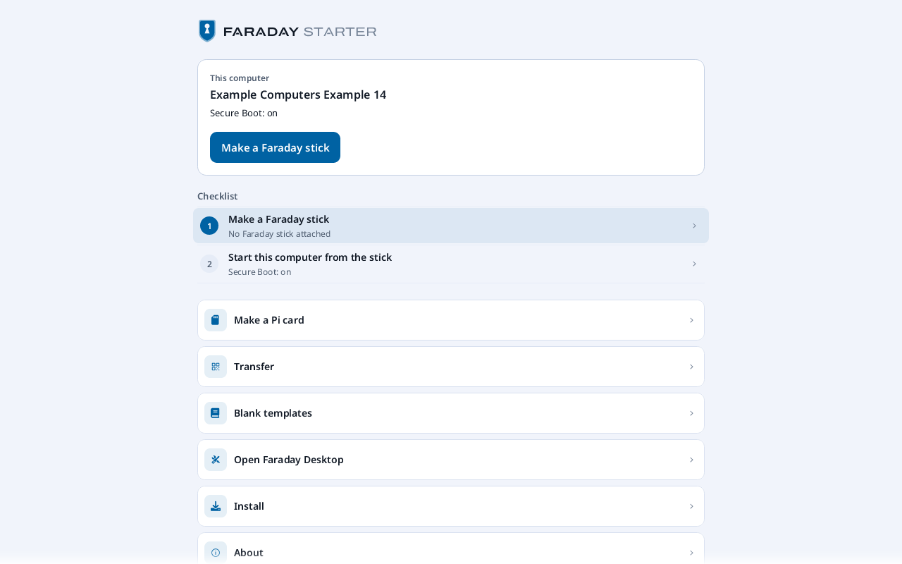

| On screen | Meaning |
|---|---|
| **This computer** | the PC's maker and model, and **Secure Boot: on** or **off** |
| **Checklist** | **1 Make a Faraday stick**, then **2 Start this computer from the stick**; the step to do now is highlighted |
| the button on the card | the next step for this PC: here **Make a Faraday stick** |

The card says so when this PC cannot start the stick, and when
something attached to it can record the screen or the keys:

| Card says | Meaning | Do |
|---|---|---|
| **This computer cannot start a Faraday stick** | an ARM PC, such as a Windows laptop with a Snapdragon processor | make the stick here and start another PC from it |
| **Started in legacy BIOS mode: UEFI has to be on** | the PC started in legacy mode | set the BIOS's boot mode to UEFI before step 1.8 |
| "… is a TV. A TV can record what it shows: use another screen or computer." | a screen is a TV | use another screen, then **Check again** |
| "… is a KVM switch. It can capture the screen and type: connect the screen and keyboard directly." | a KVM switch is attached | connect the screen and keyboard directly, then **Check again** |
| "… is a virtual machine. Faraday must start on the real computer, …" | the Starter runs in a virtual machine | run the Starter on the real PC |

While a TV, a KVM switch or a virtual machine is listed, the restart
buttons stay grey. **Continue anyway** lets the steps go on.

Press **Make a Faraday stick**.

### 1.3 Which stick?

Plug the stick in. Every USB disk attached is listed with its size and
what is on it. Nothing is chosen for you.

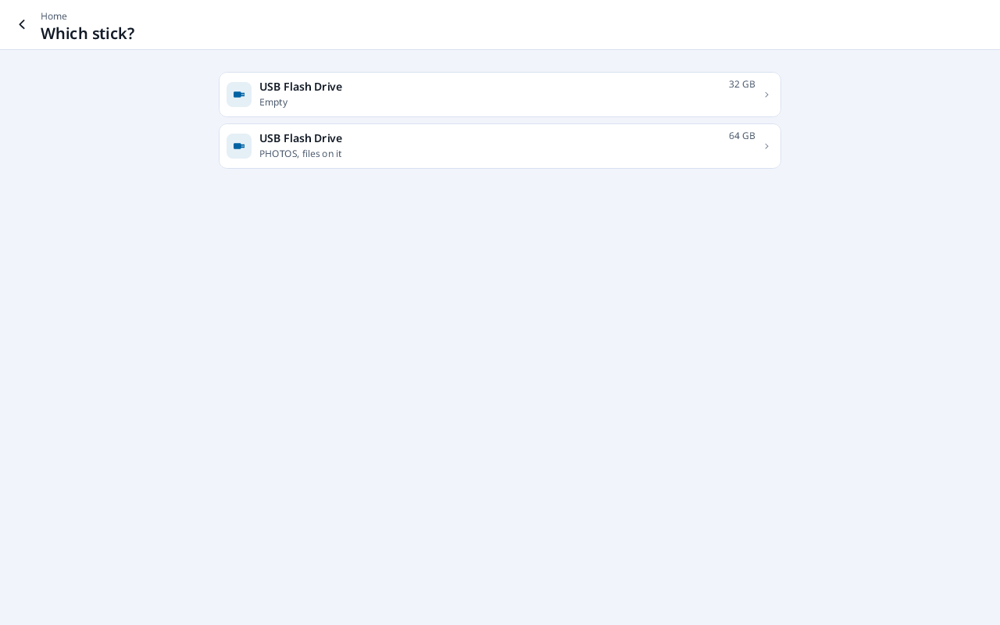

Press the stick to write. Check the size: a backup drive is listed the
same way as a stick.

| Row says | Meaning |
|---|---|
| **Empty** | nothing is on the stick |
| a volume name, then **files on them** | the stick holds files; writing erases them |
| **Faraday stick ·** and a version | the stick already holds Faraday |
| dimmed, **Smaller than the image: needs …** | the stick is too small; it cannot be pressed |
| dimmed, **Used by this computer: mounted at …**, **Used by this computer: swap** or **Holds this computer's system** | the PC uses this disk; it cannot be pressed |

With no USB disk attached the page reads **No USB stick attached · 256
MB or larger**. The list follows sticks as they are plugged in and
pulled out: a stick not listed is pulled out and plugged in again.

### 1.4 What to write?

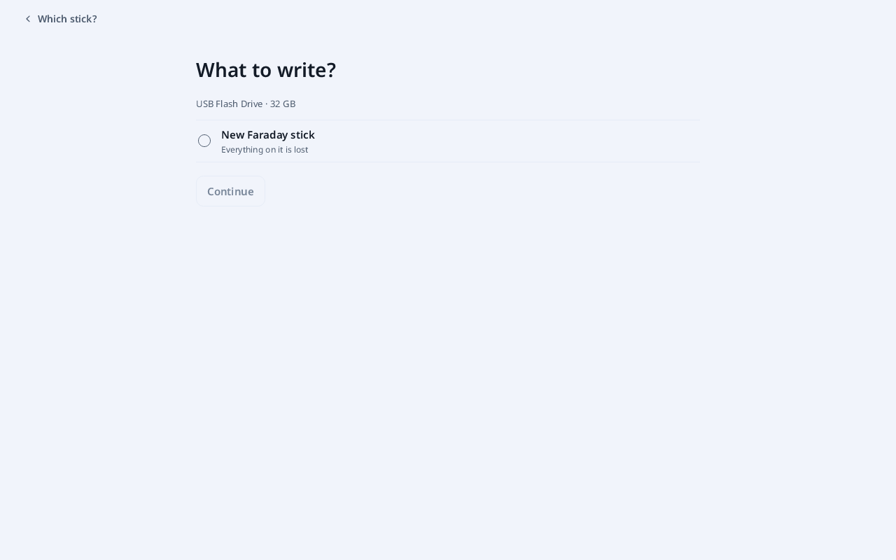

**New Faraday stick** (Everything on it is lost) is ticked, the only
choice for this stick. Press **Continue**.

A stick that already holds Faraday also offers keeping its data; that
is for upgrading, and is not covered here.

### 1.5 Confirm

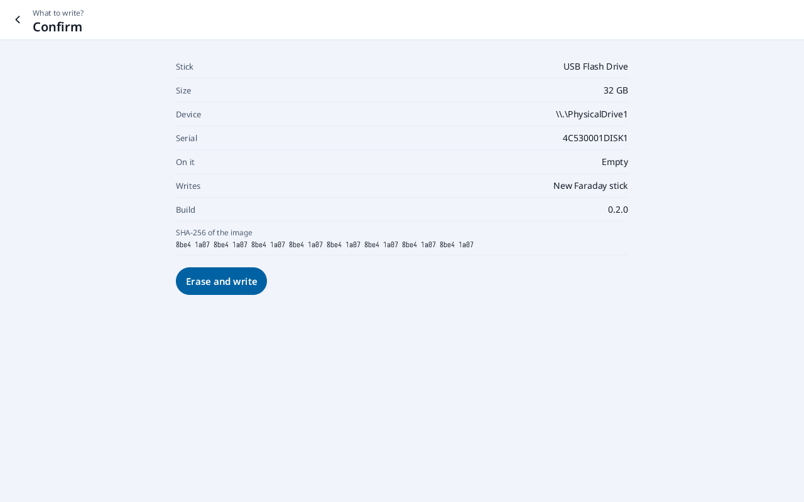

Check **Stick**, **Size** and **On it** against the stick in your hand,
then press **Erase and write**. On Windows, Windows asks for
administrator permission: answer *Yes*. On Linux the system may ask
for your password.

| Row | What it is |
|---|---|
| **Device**, **Serial** | the system's name for the disk, and its serial number |
| **Writes** | **New Faraday stick** |
| **Build** | the Faraday version written |
| **SHA-256 of the image** | the image's sum; it is the `.img` line of the release's `SHA256SUMS` |

**Not the stick confirmed: it was removed or changed** under the rows
means the stick was pulled out or another disk took its place. The
button is grey. Press **Choose again** and choose the stick again.

### 1.6 Writing, then Written

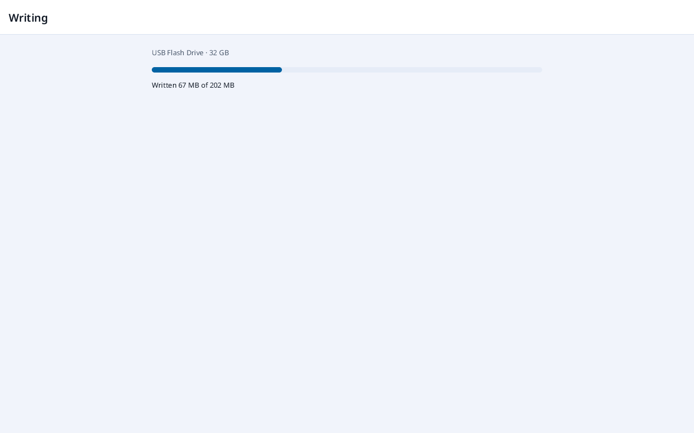

The Starter writes the image, then reads it back to check it. Leave the
stick in until the result shows.

| Result | Meaning | Press |
|---|---|---|
| 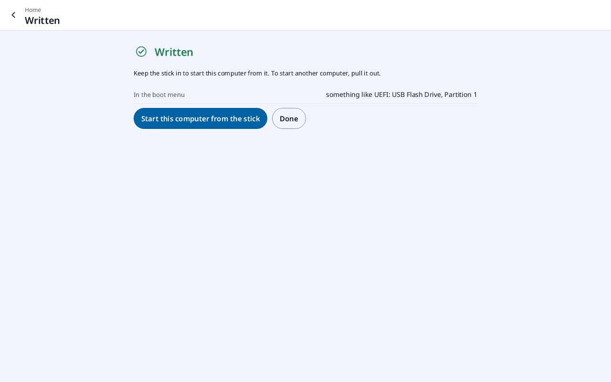 | **Written**: the stick holds Faraday and was read back. "Keep the stick in to start this computer from it. To start another computer, pull it out." **In the boot menu** is roughly the name the PC's boot menu will show for the stick. | **Start this computer from the stick**, with the stick still in |
| 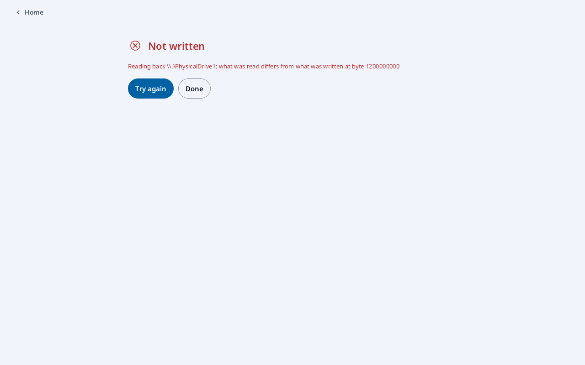 | **Not written**: the reason is in red (below). Nothing on the stick can be trusted. | as the reason's row says |

| Red line begins | Meaning | Do |
|---|---|---|
| "Reading back …: what was read differs from what was written at byte …" | the stick did not keep what was written | **Try again**; if it fails again, use another stick |
| "Reading back … failed", "Writing failed", "Flushing … failed" | the system reported an error from the stick | pull the stick out, plug it in, **Try again**; then another USB port or stick |
| "… is no longer the disk that was confirmed …", "The disk is no longer attached." | the stick was pulled out or replaced; nothing was written | plug it in and start again from **Make a Faraday stick** |
| "A partition on it is mounted at …", "Unmounting it failed" | the system is using the stick; nothing was written | close any window showing the stick's files, **Try again** |
| "Administrator permission was declined. Nothing was changed." | the permission prompt was declined | **Try again** and answer *Yes* |
| "The payload file does not match the manifest", "The .xz file is damaged", "The decompressed image's SHA-256 is …, not the expected one" | the Starter's own copy of Faraday is damaged | download the Starter again and check it (step 1.1) |

### 1.7 Start this computer from the stick

Leave the stick in. **Start this computer from the stick** on the
Written page, or item 2 of Home's checklist, opens this page:

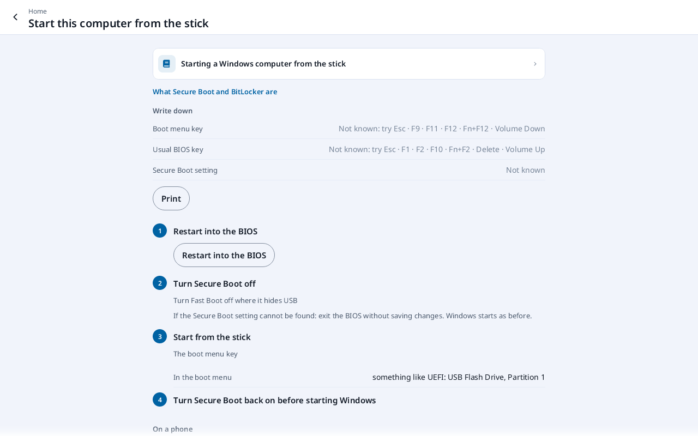

Under **Write down**, copy **Boot menu key**, **BIOS key** and **Secure
Boot setting**, or press **Print** for a sheet with them and the steps.
The PC restarts later and the Starter is then off the screen. For a PC
the Starter does not know, the key rows read **Not known: try** and
the keys most makers use; the printed sheet lists them too.

The stick cannot start while Secure Boot is on. Back on Home (**Home**
at the top left), the card's button shows which case this PC is in:

| Secure Boot on | Secure Boot off |
|---|---|
| 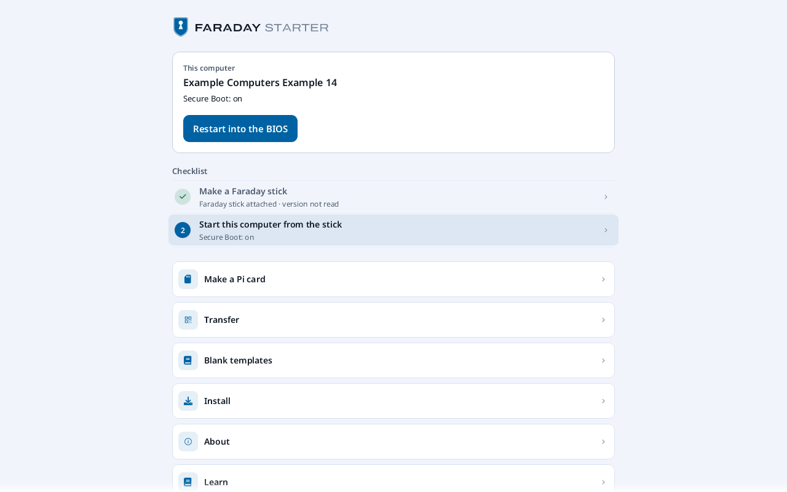 | 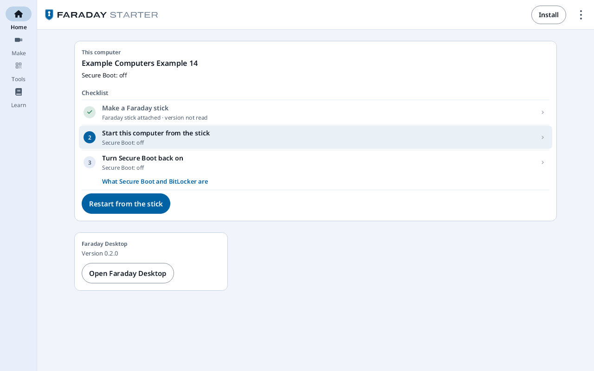 |
| Button: **Restart into the BIOS**. Go to step 1.8. | Button: **Restart from the stick**. Go to step 1.9. |

On Windows the first checklist line reads **Faraday stick attached ·
version not read**: the Starter reads a stick's version on Windows only
with administrator permission. Nothing here needs it.

**BitLocker (Windows).** With BitLocker on, the Start page shows a row
**BitLocker, drive C:** under **Print**. Nothing here is required:
with Secure Boot back on before Windows starts (step 1.10), Windows
usually starts as before. A PC whose BIOS changes its Secure Boot keys
when the setting is turned off and on makes Windows ask for the
48-digit BitLocker recovery key.

| BitLocker on | Suspended |
|---|---|
| 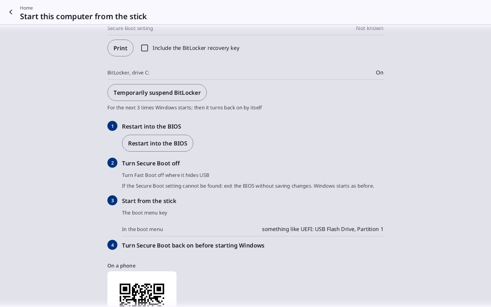 | 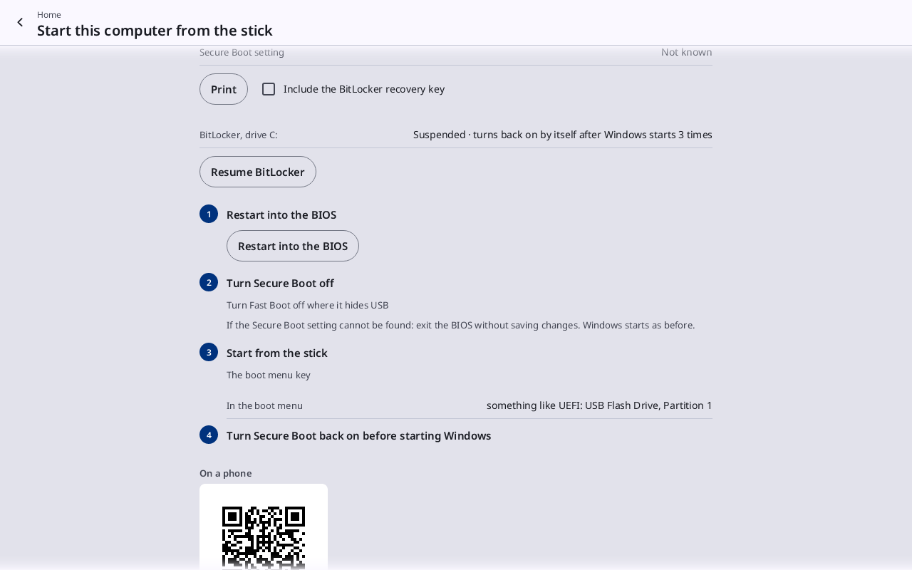 |
| **Temporarily suspend BitLocker** (For the next 3 times Windows starts; then it turns back on by itself): Windows then does not ask for the recovery key. Windows asks for administrator permission once. | The row reads **Suspended · turns back on by itself after Windows starts 3 times**. **Resume BitLocker** turns it back on now. |

**Include the BitLocker recovery key**, beside **Print**, puts the
recovery key of drive C: on the printed sheet. Windows asks once for
administrator permission; the key is never shown on the page. Keep
that sheet as you keep the key.

| Red line | Meaning |
|---|---|
| "BitLocker was not suspended (…). This computer's BitLocker is managed: its administrator has to suspend it." | an employer or school manages this PC; ask its administrator, or go on without suspending |
| "An administrator of this computer has to do this step." | your Windows account is not an administrator's |
| "The drive has no BitLocker recovery key." | there is nothing to print |

If Windows asks for the recovery key: Control Panel → BitLocker Drive
Encryption → Back up your recovery key shows where it is kept; on a PC
signed in with a Microsoft account, also aka.ms/myrecoverykey. If it
asks while Secure Boot is still off, turn the PC off, turn Secure Boot
back on (step 1.10), and Windows starts without it.

On Linux, a disk that the TPM unlocks shows **A disk here is unlocked
by the TPM: have its passphrase ready** at the top of the Start page.

### 1.8 Restart into the BIOS (Secure Boot on)

1. Press **Restart into the BIOS**, on Home's card or as step 1 of the
   Start page. A sheet asks first:

   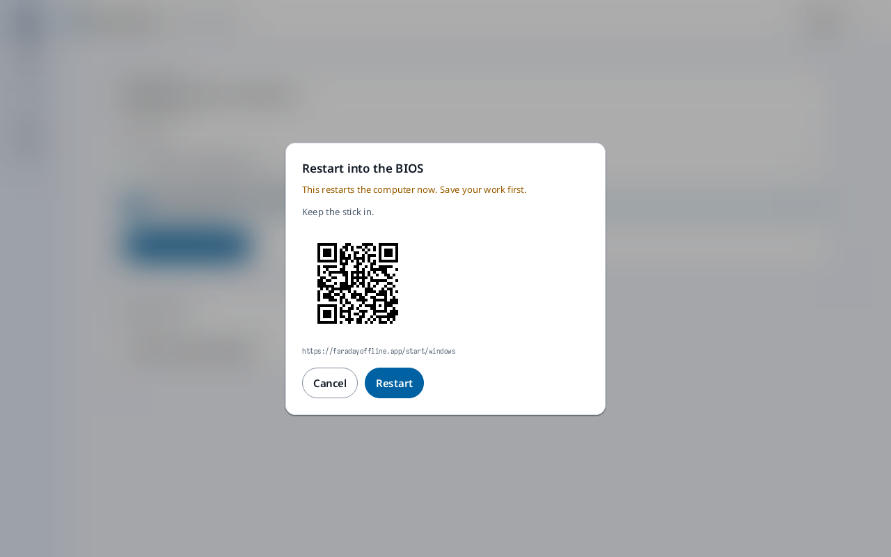

   The QR code opens the same steps on a phone. **Keep the stick in.**
   Press **Restart**.
2. In the BIOS, turn Secure Boot off, at the **Secure Boot setting**
   written down. Turn Fast Boot off too if it hides USB devices. If the
   setting cannot be found, exit the BIOS without saving changes:
   Windows starts as before.
3. Save and exit. As the PC restarts, press the **Boot menu key** and
   choose the stick (the **In the boot menu** name from step 1.6). It
   is not *Windows Boot Manager*, a Linux name such as *ubuntu*, or the
   PC's own disk. Listed twice, it is the entry that begins with UEFI.
   A stick not listed: the table at the end of step 1.9.

### 1.9 Restart from the stick (Secure Boot already off)

Press **Restart from the stick**.

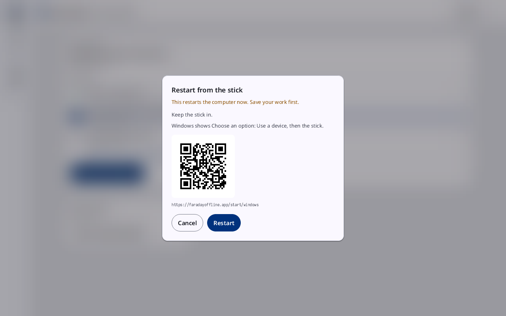

Keep the stick in and press **Restart**. On Linux the system asks for
your password, then the PC starts from the stick by itself. On Windows
the sheet says what follows: "Windows shows Choose an option: Use a
device, then the stick."

On Windows the Start page's step 3 offers the same restart as **Restart
to choose a device**.

On Linux, when the restart cannot be set up, Home's card reads
**Restart from the stick did not happen:** and the reason, and its
button becomes **Restart into the BIOS**: go to step 1.8.

Faraday shows its logo a few seconds after the stick starts, then its
first screen (section 2). If it does not (the Starter's Learn page
**When the stick does not start** has the same table):

| What happens | Do |
|---|---|
| the stick is not in the boot menu | set the BIOS's Fast Boot to Disabled, or to Thorough; turn on a setting such as Enable USB Boot Support where there is one |
| the stick is in a USB-C or Thunderbolt port | use a USB-A port, or turn on the BIOS's USB-C or Thunderbolt boot support |
| the PC is set to legacy BIOS or CSM | set the BIOS's boot mode to UEFI; turning CSM on does not help |
| choosing the stick returns to the menu, or shows a Secure Boot message | Secure Boot is still on: step 1.8 |
| the screen stays black, with no logo | the BIOS did not start the stick: check that Secure Boot is off, try another USB port |
| the logo, then a black screen for more than a minute | Faraday did not start its screen on this PC: hold the power button until the PC turns off |
| the BIOS asks for a password you do not have | only whoever set it can open it; this PC cannot start the stick |

### 1.10 Before starting Windows again

When done with Faraday, turn Secure Boot back on in the BIOS before
starting Windows (the Start page's step 4, **Turn Secure Boot back on
before starting Windows**). Faraday's power sheet says the same (step
2.3).

1. Power off from Faraday (step 2.3) and pull the stick out.
2. Turn the PC on and press the **BIOS key** written down.
3. Set Secure Boot to Enabled. Save and exit.

If Secure Boot cannot be enabled, or Windows does not start with it on,
load the PC's own Secure Boot keys in the BIOS (Restore Factory Keys,
or the setting that loads the keys built into the PC). Back in Windows,
the Starter's Home lists **Turn Secure Boot back on** until it is on.

### 1.11 Faraday Desktop, the alternative

Faraday Desktop is Faraday in a window, for trying it. It is inside the
Starter on Linux and Windows: **Open Faraday Desktop** on the Starter's
Home runs it, and **Install** puts it in the app menu beside the
Starter. It runs on an online computer, so it has none of the stick's protections: never
type a seed that holds real bitcoin into it.

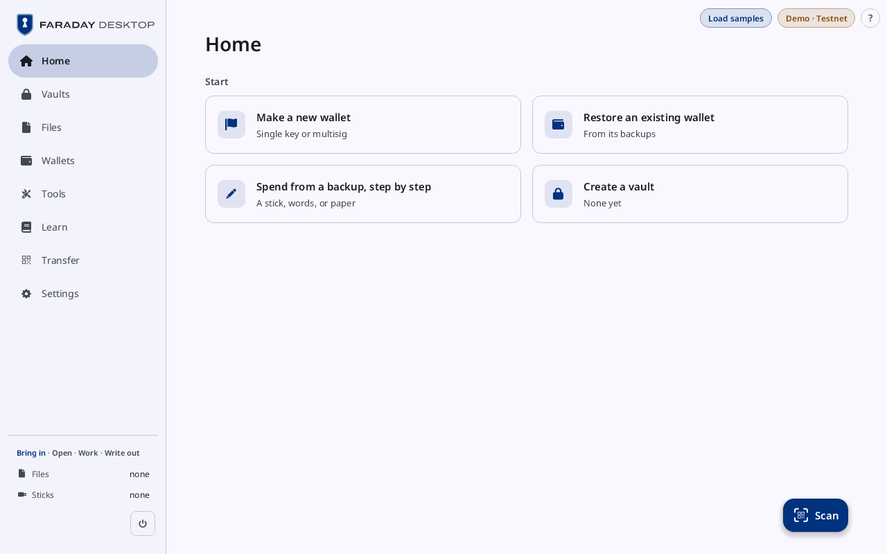

It opens in **Demo · Testnet**, the pill at the top right. Demo takes
only the public sample seeds; **Load samples** loads them. The pill
opens the **Mode** sheet, where **Testnet**, **Signet** and **Regtest**
take any seed.

In Demo, **Make a new key · Codex32** (step 3.3) runs whole: your rolls
or characters fill the sheets as anywhere, and **Use a sample** on the
entry fills it with BIP 93's sample set instead. Once the entry is
finished, the sample takes the place of the strings entered, and every
card after it says so. **Lock in** loads the sample's key: strings from
your own rolls never leave the entry.

| The entry | After it |
|---|---|
| 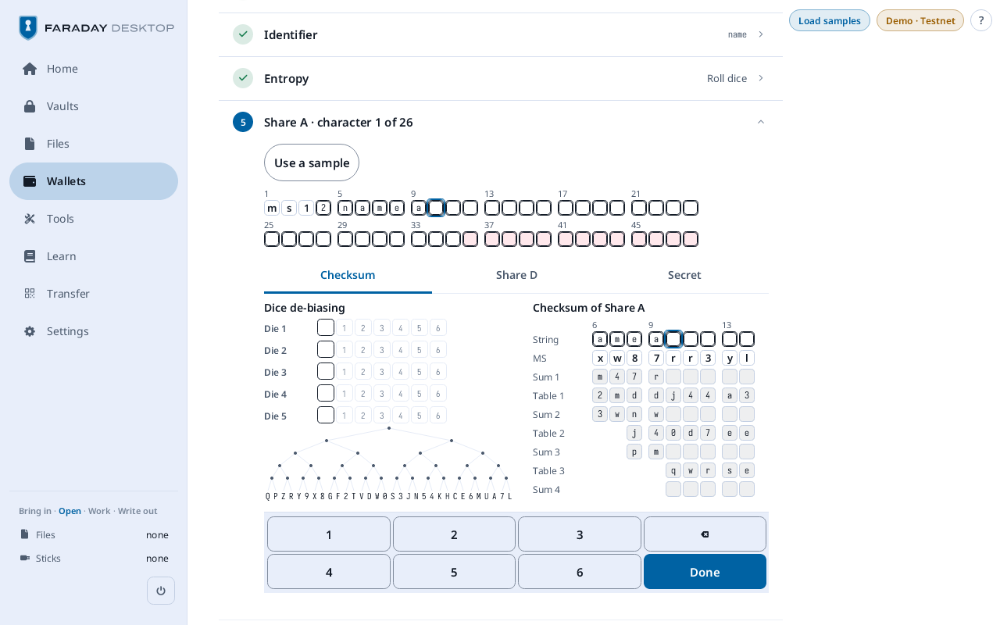 | 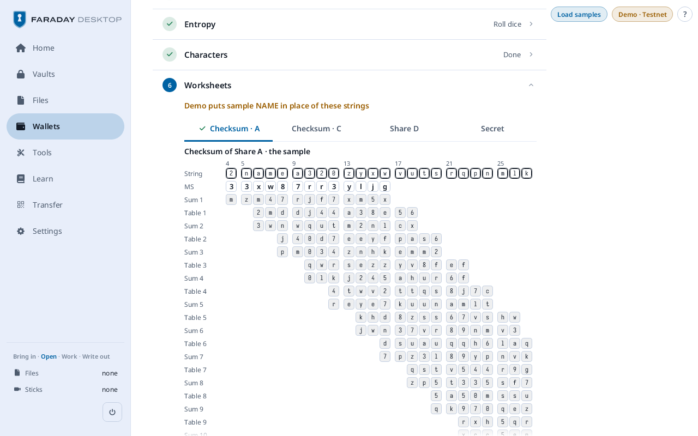 |
| **Share A · character 1 of 26**, with **Use a sample** above the boxes. | **Demo puts sample NAME in place of these strings**, over the sample's worksheets. |

Sections 2 and 3 apply to Faraday Desktop too, with the differences
noted there.

## 2. First boot and Home

### 2.1 Home

The stick starts Faraday into memory. Before Home it checks itself and
what is attached to the PC:

| Screen | Meaning | Press |
|---|---|---|
| **Self-test failed**, with the **Check** that failed, over the whole window | Faraday's own cryptography did not reproduce a published test vector | **Exit**. Do not use this stick: write a new one (section 1) and report the check's name. |
|  **Attached to this computer**, naming a KVM ("a KVM can show this screen and type on this computer from elsewhere") or a TV ("a TV can record what it shows") | that device can record the screen or type | unplug it and press **Check again**. **Continue anyway** asks once more (**What is listed stays possible while they are attached.**) with **Yes, continue**. |
| the same sheet naming a virtual machine ("a virtual machine's host sees and can change everything in it") | Faraday is not running on the PC itself | **Power off**: Faraday must start on a real computer |

A keyboard or mouse plugged in after Faraday starts does nothing until
it types the code Faraday shows, or clicks the target it draws.

A new stick holds no files, so nothing is offered to import.


| Tile | Opens |
|---|---|
| **Make a new wallet** | a wallet from new keys, single key or multisig (section 5) |
| **Restore an existing wallet** | a wallet from its backups (section 7) |
| **Spend from a backup, step by step** | spending from a stick, words or paper (section 6) |
| **Create a vault** | an encrypted file for keys and secrets, kept on a stick (section 4) |
| **Stick visit** | the files on the stick, while a stick is attached and no key is loaded |
| **Scan** | the camera, for a QR code |

### 2.2 The sidebar

The rows are **Home**, **Vaults**, **Files**, **Wallets**, **Tools**,
**Learn**, **Stick visit** (while a stick is attached) and **Settings**;
the page on show is on a pill. A flow under way, such as **Make a new
wallet**, is a row under its page with the card open beside it: pressing
it goes back to the flow.

In a narrower window the same pages are a rail of icons at the left,
with **Learn** and **Settings** under a line and **Lock** and the power
button at its foot; Home then opens with a strip of what is under way,
the keys, the wallets, Files and the sticks. A tall narrow window has a
bar at the foot instead (**Home**, **Wallets**, **Files**, **Vaults**,
**Tools**), and **Settings** and **Power off** in the **⋮** menu at the
top right.

At the sidebar's foot:

| On screen | Meaning |
|---|---|
| **Bring in · Open · Work · Write out** | the stage of the session; the current one is in blue. Pressing it opens Files. |
| **Files** | files brought in, or **none** |
| **Sticks** | **Boot stick** while the stick Faraday started from is in; **none** once it is pulled |
| **Keys** | the keys loaded, each by its fingerprint (once a key is loaded) |
| **Lock** | wipes the session from memory (once a key is loaded) |
| the power button | the power sheet |

The **?** at the top right opens Learn's page for the screen on show.

### 2.3 Lock and Power off

Faraday keeps everything in memory. What is not in a vault on a stick,
or on paper, is gone after a lock or a power-off.

| | Lock | Power off |
|---|---|---|
| Where | **Lock** at the foot of the sidebar, once a key is loaded; **Settings → Session** | the power button at the foot of the sidebar; **Power off** in **Settings → Session**; Super + S held 2 seconds |
| What it does | wipes the session (every key and wallet loaded), seals open vaults, and starts again on Home | turns the PC off |
| What stays | the stick's files, and the Inbox and Outbox | the stick's files only |

**Lock** asks first only while a lock would end something under way
(a wallet being made, a vault with changes). The sheet lists what is
not saved and what ends:


**Lock** wipes them; **Back to the vault** closes the sheet. With
nothing under way, Lock wipes at once, without a sheet: a key made in
section 3 and not yet backed up is lost.

A stick plugged in while a key is loaded opens **A stick is attached**:
**Lock and use stick** locks and opens the stick's files; **Not now**
keeps working, and a banner says to remove the stick.

**Settings → Session** also sets **Lock after** (30 min at first) and
**Power off after** (60 min at first). From **Make a new wallet** until
its backup is done there is no idle lock, and the sidebar reads
**Auto-lock off until backup complete**.

Power off: press the power button at the foot of the sidebar.


On a PC started with Secure Boot off, the sheet leads with **Turn Secure
Boot back on in the BIOS before starting Windows.** and the QR code of
the steps. With keys loaded it also lists what is kept and what is
wiped from memory. Press **Power off**, **Restart**, or **Cancel**.

Faraday Desktop has no power sheet: close the window.

## 3. New key

A key is a list of words (a BIP-39 seed). This section makes one on the
device, writes it down and checks the copy. It loads the key; a wallet
from it is section 5, and backing it up is section 4.

The test data: EntropyLab's published BitBox dice transcript for twelve
words (`tools/reference/dice/README.md` names the source). Its first 70
rolls are:

```
1234112341223412334123441234152341263412314123421234132341243412354321
```

They make these words, with fingerprint `3dca6805`:

```
brand hobby ranch shoulder brass hockey ranch short brand hockey random torch
```

Rolls of a real die make other words and another fingerprint.

### 3.1 Wallets → Add a key

Press **Wallets** in the sidebar, then **Add a key** (Keys first,
wallets later).

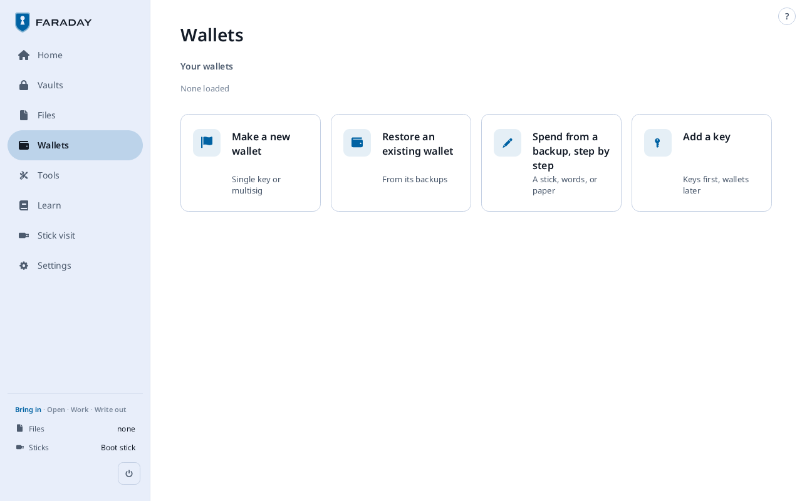

### 3.2 Pull the stick

A key loads only with no stick attached. The sheet **Pull the stick to
add a key** opens while the boot stick is in.

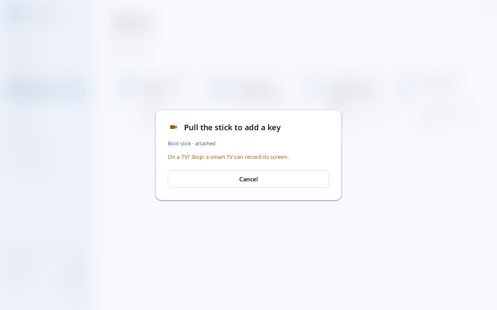

Pull the stick out. Faraday keeps running from memory, and Add a key
opens. A reminder line can show on this sheet, such as **On a TV? Stop:
a smart TV can record its screen.**; act on it before going on.

Faraday Desktop shows this sheet only while one of its sticks is
plugged in.

### 3.3 Start

The page is **Add a key**, one card per step. A finished card shows its
choice and **Change**. It opens with **Start** closed on **Make a new
key · BIP-39 words** and **Length** open, so for this guide go straight
to step 3.4. **Change** on Start opens it:

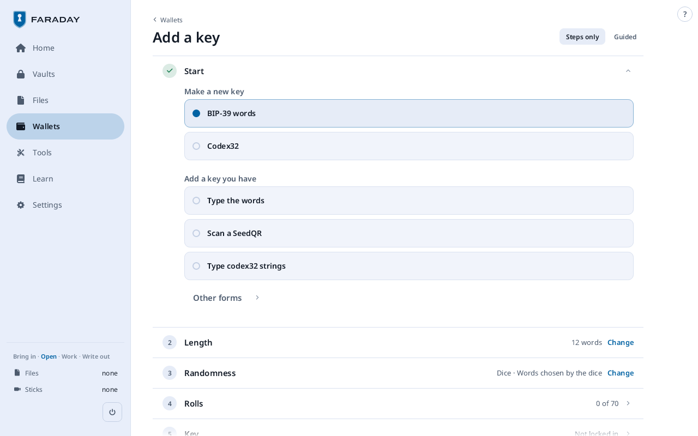

| Group | Choices |
|---|---|
| **Make a new key** | **BIP-39 words** (this guide); **Codex32**, a key made by hand as codex32 shares |
| **Add a key you have** | **Type the words**, **Scan a SeedQR**, **Type codex32 strings** |
| **Other forms** | SLIP-39 shares, made here or typed; Seed XOR parts, typed |

A choice moves on to the next card by itself; **BIP-39 words**, pressed
again, goes back to Length.

**Codex32** makes the key by hand as codex32 shares: a scheme, an
identifier, your own dice or characters, the worksheets filled in as on
paper, then each string to write down and type back. Step 4.11 makes a
wallet that way; Learn's page **Backups in other forms** walks through
every card. **Type codex32 strings** opens the codex32 form of step 5.1.

**Steps only** and **Guided**, a pair of buttons at the top right,
switch a short walk-through on each card off and on; the one on is
ticked.

The link at the top left is named after the card before the one open
(**Start**, with Length open): it opens that card again, with its choice
kept. On Start it goes back to **Wallets**. **Escape** does the same.
Once the key is locked in (step 3.7) the link no longer opens a card
before **Key**.

### 3.4 Length

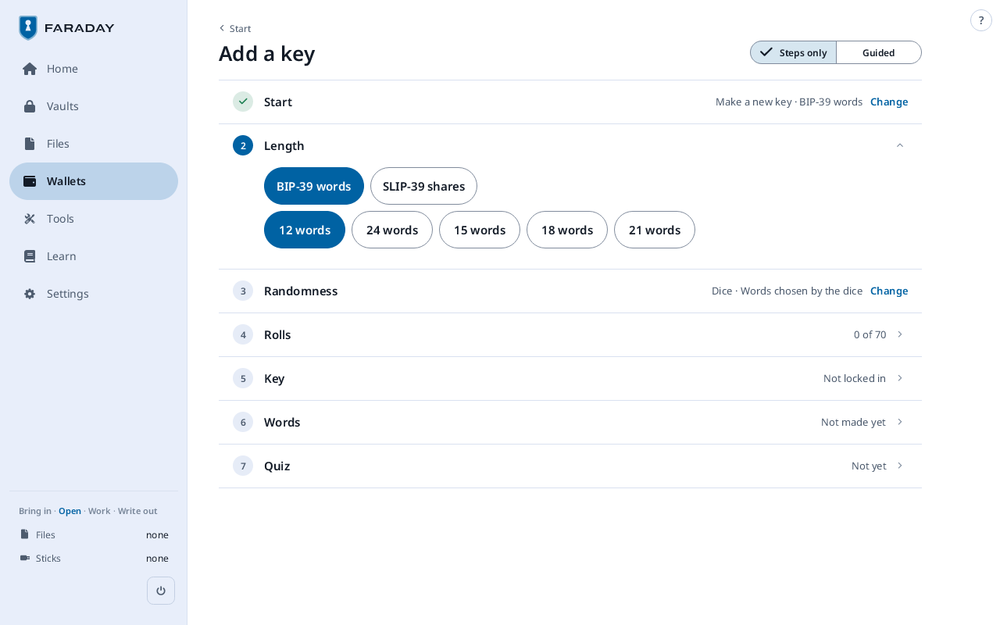

**BIP-39 words** is chosen. Press **12 words**: the card closes and
**Randomness** opens. (24 words takes more rolls; the steps are the
same.)

### 3.5 Randomness

Choose where the randomness comes from. A choice moves on to its entry
card by itself; **Change** on Randomness opens it again with the choice
kept.

| Dice (this guide) | This device |
|---|---|
| 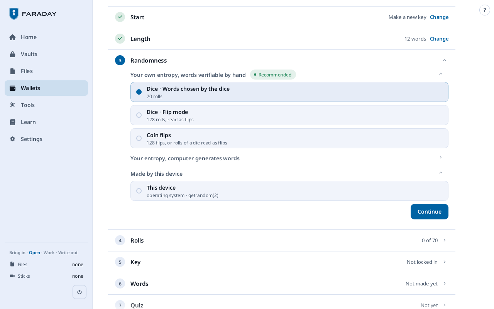 | 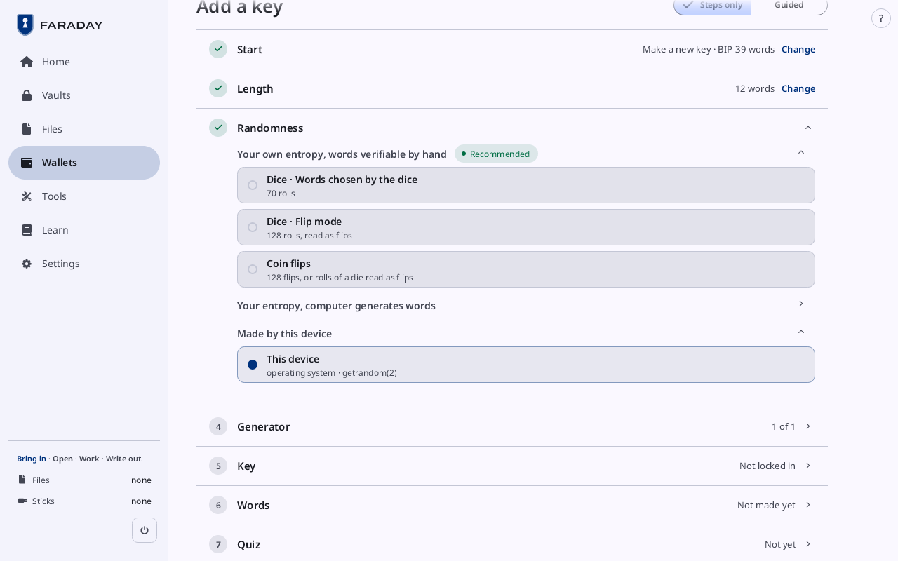 |
| **Dice · Words chosen by the dice** (70 rolls) is ticked, under **Your own entropy, words verifiable by hand**. Each word can be worked out from the rolls by hand. | Open **Made by this device** and press **This device**. The words come from the operating system's generator and cannot be checked. |
| Press **Dice · Words chosen by the dice**: **Rolls** opens. Go to step 3.6. | **Generator** opens. Go to step 3.6, right-hand column. |

The other options (flip mode, coins, hashed dice as Coldcard and
SeedSigner do it, hex, cards, camera, a mix) follow the same steps with
their own entry card. A mix ticks its sources under its row and keeps
**Continue**.

### 3.6 Rolls

| Dice | This device |
|---|---|
| 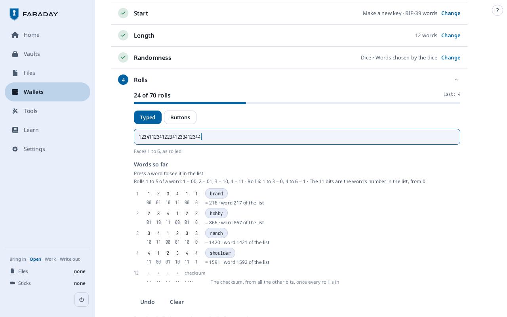 | 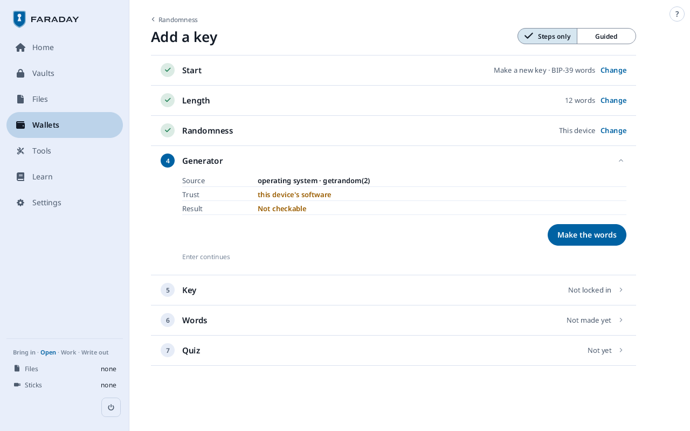 |
| **Typed** is chosen: type the rolls into the box. **Buttons** shows a button for each face instead. Each word appears as its six rolls come in. | The **Generator** card shows **Source**, **Trust** (this device's software) and **Result** (Not checkable). Press **Make the words**, then go to step 3.7. Until the operating system's randomness is in, the button reads **Waiting for randomness**. |

For this guide, type the 70 rolls above. The 70th roll ends the entry;
the word list shows **torch** as word 12 (its checksum filled in).

In a word's first five rolls only 1 to 4 count. A 5 or a 6 there is not
taken, and the card says so:

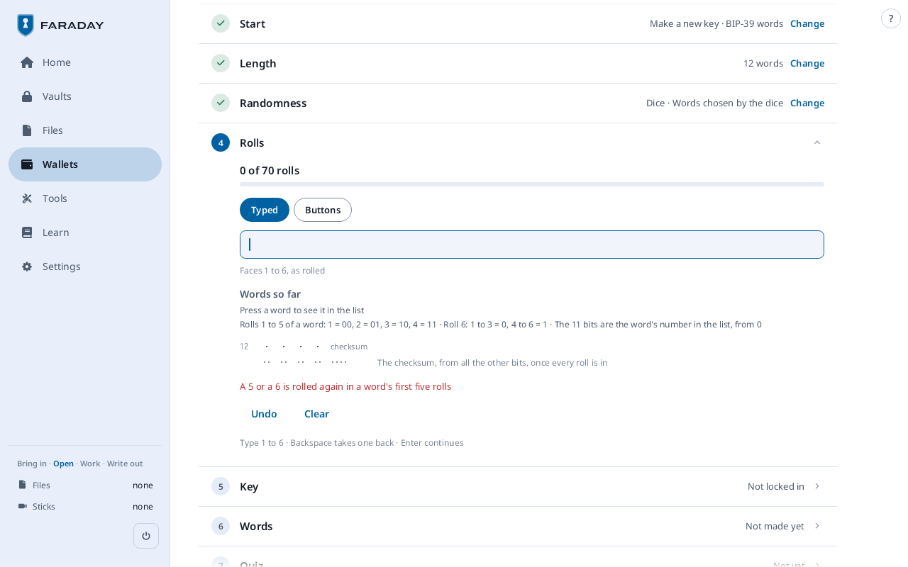

Roll again and type the new roll.

On Faraday Desktop a die beside the box, **Rolled by this computer**,
rolls in place of a real die: **Roll**, with **Rolls per click** (1, 5,
10 or To the end). Each face it rolls is marked as this computer's, and
the closed Rolls card reads **Entropy · simulated dice** (or **Entropy ·
simulated dice and your dice**) in place of **Complete**. Use it only to
try the steps out.

With the last roll in, the card ends with **Randomness check**:

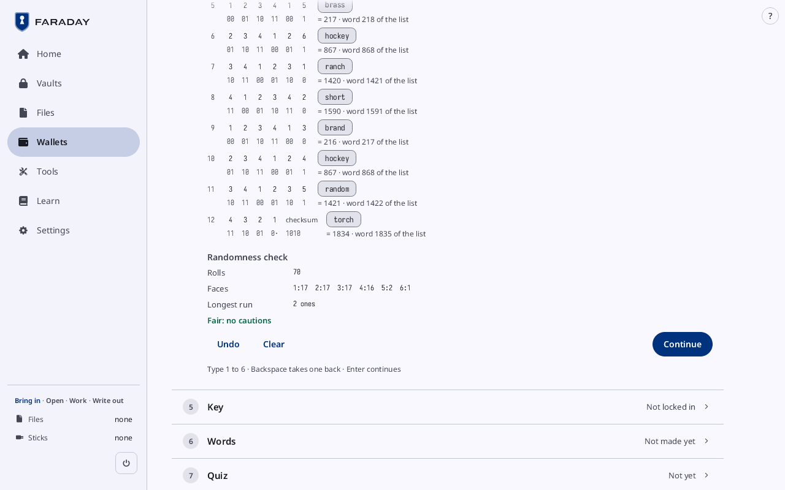

| Verdict | Meaning | Press |
|---|---|---|
| **Fair: no cautions** | the counts and runs look like a fair die | **Continue** |
| **A long run of one result**, with **Roll again** | the same face many times in a row | if you rolled them, **Continue**; if not sure, **Roll again** |
| **Far from even: one result came up much more than the others** | one face is far more common: a worn die, or a typing habit | the same |
| **A long run counting up or down** | rolls such as 1 2 3 4 5 6, counted out rather than rolled | the same |

A caution does not stop the key. The check catches mistakes hands
make; it cannot prove the rolls were random.

**Undo** takes the last roll back; **Clear** removes every roll.

### 3.7 Key: lock it in

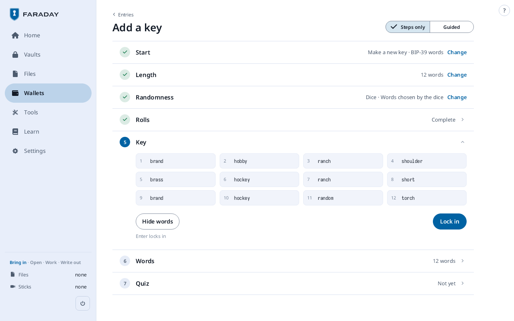

The 12 words are shown. Check them against the words above. Press **Lock
in**.

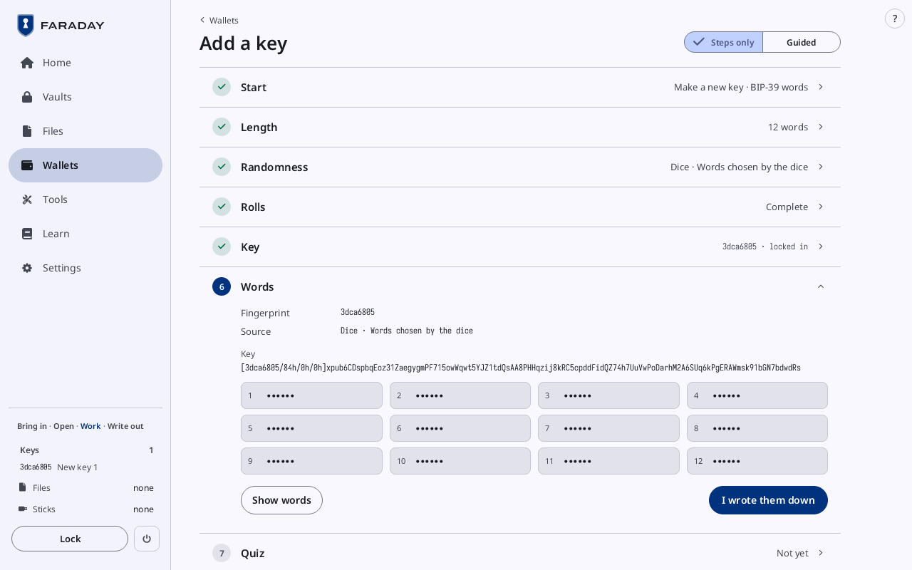

The Key card closes on `3dca6805 · locked in` and **Words** opens, with
**Fingerprint** `3dca6805`, **Source** and the key's account key
(**Key**); the words are hidden. The key is now loaded: the sidebar
lists it under **Keys** as `3dca6805 New key 1`.

A fingerprint of `3dca6805` proves that the words on screen are the
test words and the key loaded is the one they make. It does not prove
that the paper copy is right: the quiz (step 3.9) checks that.

In Faraday Desktop's Demo, Lock in adds a public sample in place of the
words made, and the card names the sample; the fingerprint is the
sample's, not `3dca6805`.

### 3.8 Words: write them down


Press **Show words**. Write the 12 words on paper, numbered, in order.
Check the copy word by word, then press **Hide words** and **I wrote
them down**.

### 3.9 Quiz

The quiz asks for words by number, four choices each, until all 12
are right.

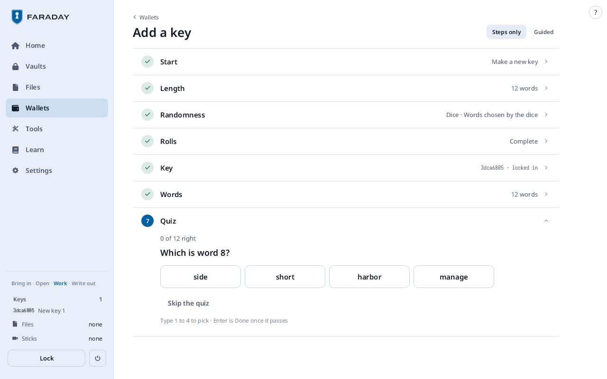

Answer from the paper copy, not from memory.

| Answer | Screen | Press |
|---|---|---|
| right | the next question; **0 of 12 right** counts up | the next answer |
| wrong | 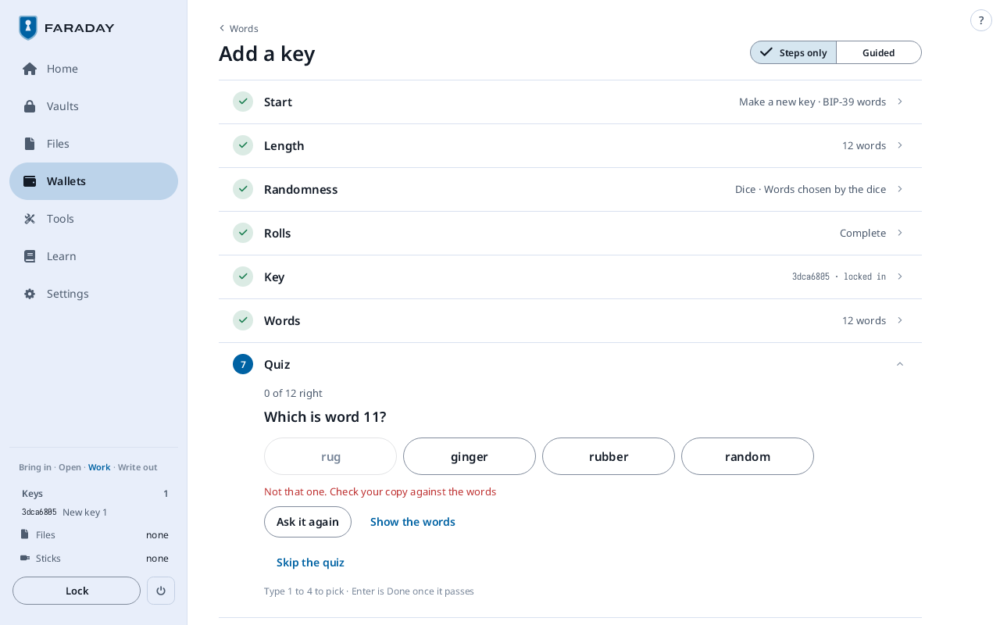 **Not that one. Check your copy against the words** | **Show the words** to correct the copy, then **Ask it again** |
| all right | 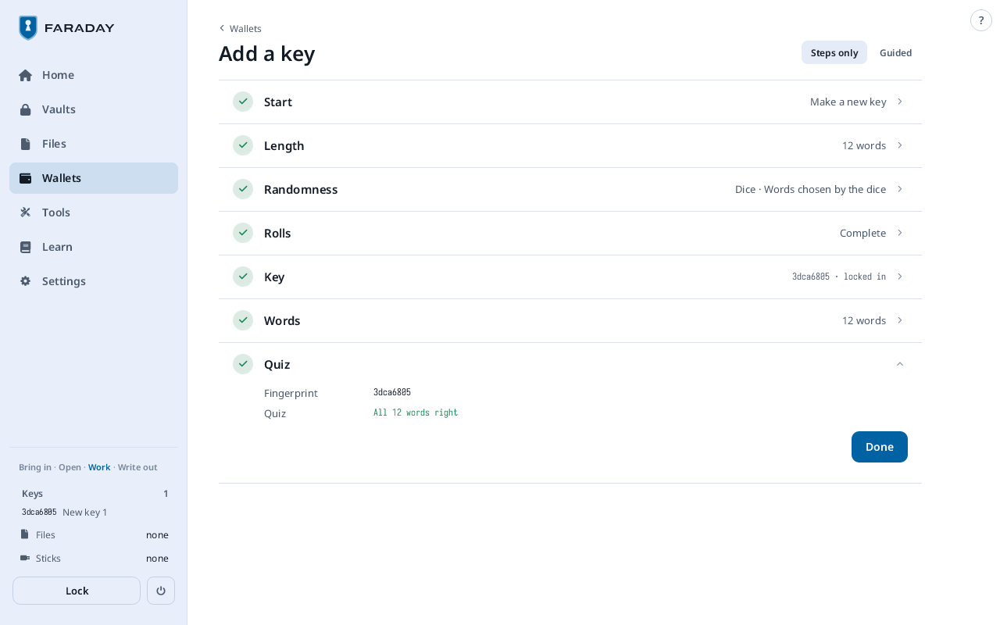 **All 12 words right** | **Done** |

**Skip the quiz** asks once more ("Without the quiz, a word copied
wrongly is found only when the backup is needed"); skipped, the card
reads **Skipped: the copy is not checked**. Do not skip it for a real
key.

### 3.10 After Done

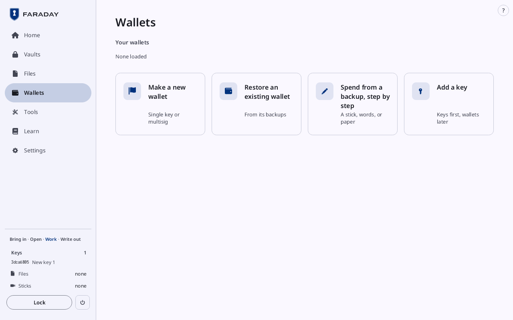

Faraday returns to Wallets. The key is loaded and shows in the sidebar
under **Keys**. It is in memory only: Lock or Power off wipes it, and
the paper copy is then the only one.

Next: section 4 makes a wallet from the key and backs it up.

## 4. Back it up

What you will do: make a single-key wallet from key `3dca6805`, plan
its backup on the backup board, and carry the plan out with its
checklist: the words and the SeedQR copied by hand and checked, a vault
made, and the sticks written. Faraday backs up a wallet, not a key on
its own, so the wallet comes first (step 4.1).

What you need:

- Faraday with key `3dca6805` loaded (section 3) and no stick attached.
- A blank template for 12 words, printed from the Starter (**Blank
  templates** on its Home), and a pen.
- Two USB sticks formatted FAT32, other than the Faraday stick: one for
  the vault, one for the public files.
- An envelope.

A single key has one place, **Place 1**: everything in this section is
kept there. A copy kept anywhere else is made outside the plan, and the
plan does not track it.

### 4.1 Make the wallet

Press **Wallets** in the sidebar, then **Make a new wallet**. The page
is **Make a new wallet**, one card per step. It opens with **Kind**
closed on **Single key · native SegWit** and **Use vaults** open; a
choice moves on to the next card by itself.

| Kind | Use vaults |
|---|---|
|  |  |
| **Change** on Kind opens it: **Single key · native SegWit** (One key, its words on paper) is ticked; **Single key, backup in shares** makes its one key as codex32 shares instead of words (step 4.11), and **Multisig · native SegWit** is section 5; **More kinds** lists the rest. Pressing the kind ticked closes the card on it. | **Will you use vaults as part of this backup?** Press **No**: the card closes on **No** and **Keys** opens. The vault in this section is a new one, made in the checklist; **Yes** is for a vault already on a stick, which is brought in here. |

| Keys | Check |
|---|---|
|  |  |
| Under **Key 1**, press **3dca6805 · New key 1**; the row reads **3dca6805 · New key 1 · loaded here**. Press **Make the wallet**. | **Descriptor** reads **Single key · native SegWit · 3dca6805** and a checksum; **Path** reads **m/84'/0'/0'**. Under **The wallet's first addresses** it reads **Back up before you receive**: a key made on this device shows no address until its backup is done. Press **It matches**. |


The wallet is **New wallet 1** in the sidebar. Press **Back up this
wallet**.

### 4.2 The board, the standard way

Back up opens on the board with the standard way placed: the seed's
words and the wallet description on paper at Place 1. Nothing can be
moved yet.


| On screen | Meaning |
|---|---|
| **Place 1** | the place's card; the tags beside the name say what someone who finds this place alone gets: **Sees the balance**, **Can spend alone** |
| **Paper** | what the place keeps on paper: **3dca6805 · Words**, the seed's 12 words, and **Whole**, the whole wallet description, as the printed wallet sheet |

Under the board, three lines check the plan:

| Line | Here | Meaning |
|---|---|---|
| **Any one place lost: the rest rebuild the wallet** | **No: a single place** | losing Place 1 loses the wallet |
| **One place found: can spend** | **Yes** | whoever finds Place 1 can spend |
| **One place found: sees the balance** | **Yes** | whoever finds Place 1 sees every address and the balance |

**Add a passphrase** adds a BIP-39 passphrase to the key; this guide
uses none. In the right-hand column, **Add watch-only software** adds a
place for a watch-only wallet (step 5.4), and **Customize backup** makes
the board editable.

To keep the standard way, press **Continue**, then go to step 4.6.

### 4.3 Customize backup

Press **Customize backup**.


| On screen | Meaning |
|---|---|
| the list on the right | everything the backup can keep: **Seeds**, **Wallet description** (**Whole**), **Vaults** with **+ new vault**, **Watch-only software**; "1 place" beside each says how many places keep it |
| **3dca6805 as codex32 strings** | keeps the seed as codex32 strings instead of its words, each placed on its own; for a key of words they are 127 characters, not for checking by hand. A key made as codex32 shares is step 4.11 |
| on a placed chip, **Words** and **SeedQR** | the forms it is kept in; a press turns one on or off, and the last one on stays on |
| **×** | takes the chip off that place |
| **⋮** | its menu (step 4.5) |
| **+ stick** | adds an empty stick to the place |
| the mark after a chip | a check under the board names it |

A chip from the list is never used up: placing it places a copy.

### 4.4 A vault on a stick

A vault is a file sealed with a passphrase, kept on a stick. Press
**+ new vault**: **Vault 1** joins the list. Drag it onto Place 1's
card. The place under it is edged while it takes the vault:

| Dragging | Dropped |
|---|---|
|  |  |

Place 1 now has **Stick 1**, with two boxes: **Vault 1 · new** (made in
the checklist) and **Files · not sealed** (files kept on the same stick
outside the vault). The line **Vault 1 holds nothing** shows until
something is put in it.

Without dragging: press a chip, then press the box it goes in. A press
anywhere else lets it go.

| Box | Keeps | Tag on the map |
|---|---|---|
| **Paper** | the words, the SeedQR, the printed wallet sheet | secret; the sheet public |
| **Vault 1** | the seed and the description, sealed in the vault file | sealed |
| **Files** | the seed as a `.txt` or `.png` file, the description as a file | secret: a seed file is not sealed |

### 4.5 The ⋮ menu, and the SeedQR

Press **⋮** on the seed chip in the list. **Add to…** lists every box
that takes the seed, under its place:


Press **Stick 1 · Vault 1**. Put **Whole** into Vault 1 the same way.
On a chip already placed, ⋮ offers **Move to…**, **Copy to…** and
**Take off**.

On the seed chip in **Paper**, press **SeedQR**: the paper copy is now
the words and the SeedQR.


A drop never refuses: a plan that keeps something unwise shows a
warning line and a mark on the chip it names. On a wallet of several
keys a drop can also open a sheet (step 5.5). Only **Seed … is kept
nowhere** holds the plan back.

Press **Continue**, then **Make the checklist** on **The plan**.

### 4.6 The checklist

The checklist has an item for each thing the plan needs, in the order
they are done. An item opens once the one before it is done ("After:
…"). The **Map** on the right shows each place and the vault, and what
each keeps; a dot turns green when that copy is made. **Change the
plan** returns to the board.


**Print 1 blank template**: **Words on the seed** is **12**. Faraday
prints nothing: the template comes from the Starter (**Blank
templates**, 12 words), on another computer. Press **Done**.

**The wallet sheet** is ticked already: it is a PDF, **For the stick**,
written in step 4.10 and printed from the stick on another computer.

### 4.7 Copy the seed by hand, and Check my copy

| Copy seed 3dca6805 by hand | Show the seed |
|---|---|
|  |  |
| Press **Show the seed**. | The 12 words, each with its number in the word list, and the SeedQR's grid. On the template, write the words in order, then fill the SeedQR square by square; the grey squares are printed already. **Compact SeedQR** shows the smaller grid. Press **Hide the seed**. |

**Keep the words only** takes the SeedQR off the plan; the item then
asks for the words alone.

Press **Check my copy** and type your copy's words back, from the
paper:


Each word shows as dots once typed. Then hold the SeedQR you drew up to
the camera (**Scan your copy**). Once the copy matches, the item reads
**Checked** and the checklist moves on to the vault by itself; opened
again, the item shows what matched:

| Result | Meaning | Do |
|---|---|---|
|  **Your copy scans and matches the seed** and **Your copy matches the seed** | the words typed and the SeedQR scanned are this seed's | nothing: the vault's item is open |
| **Word … differs from the seed** | that word on the paper is wrong | correct the paper from **Show the seed**, **Clear**, type it again |
| **Your copy scans but word … differs** | that word's squares are wrong | correct those squares and scan again |

A match proves the paper holds this seed. It does not prove the paper
will stay readable: keep it dry, and check it again from time to time.

### 4.8 The vault


**Into the vault** lists **Seed 3dca6805** and **Wallet description**.
**Load at unlock** (ticked) loads them whenever the vault is unlocked.
Press **Make a vault**.


**Create a vault** opens with **Size** chosen (**PCs and a Raspberry Pi
· 64 MiB · 3 passes**). Under **Name and passphrases**:

1. **Name**: leave it empty for `vault.ofv`, or type what the vault
   holds; the name is visible to anyone who sees the stick.
2. **Passphrase 1**: type it in the first field, then again in the
   second, or press **Generate with dice**. The eye button at the end
   of a field shows what is typed in it. Write it down: the vault
   cannot be opened without it.
3. Press **Create vault**.

Faraday makes the vault, then asks its passphrase once to unlock it.
Back on the checklist:


Press **Save into vault.ofv**. The item reads **In vault.ofv**, and the
checklist moves on to **The wallet sheet**, ticked already: press
**Continue**. The vault is in memory until step 4.10 writes it.

### 4.9 One envelope per place


The item lists what goes into Place 1's envelope: the seed's words, the
wallet sheet, the seed's SeedQR, and the stick with Vault 1. Press
**Done**.

### 4.10 Write to sticks


The item lists what the lock keeps (**Kept**: the vault and the files
for the stick) and what it wipes (**Wiped from memory**: the key and
the wallet, which are in the vault; **Make a new wallet · ends**), then
the sticks to write. Press **Lock and write**.

The session locks. The page becomes the backup's own steps, open on
**Write the sticks**:

| Insert | Stick read | Written |
|---|---|---|
|  |  |  |
| **Insert Stick 2: Vault 1 (Place 1)**. The pills at the top name every stick: the Faraday stick is **Boot stick**, the board's Stick 1 is **Stick 2** here, and the public files go on **Stick 3**. Plug in a stick. | Press **This is the stick for Vault 1 (Place 1)**, or **Use another stick**. | **Written and checked on** and the stick's name. Write "Stick 2" on the stick (**Mark it as Stick 2**), then pull it (**Pull the stick**). |

Then **Insert Stick 3: Public files** the same way.

| Line | Meaning | Do |
|---|---|---|
| **Not a FAT32 stick. Format it as FAT32, or use another stick** | the stick cannot take the files | format it on another computer, or use another |
| **Not enough room: … needed, … free** | the stick is full | another stick |
| **Not the stick read for …** | a different stick from the one read for this slot | the stick read before |
| **Pulled before the copy was checked. Nothing counted** | the stick came out too soon | plug it in again |
| **… did not read back from …; try another stick** | the stick did not keep what was written | another stick |


**Done** lists each stick written and what it holds. **Unlock Vault 1**
opens the vault with its passphrase and loads the wallet and the key
again.

What "Written and checked" proves: the stick read back what was
written. It does not prove the stick will last: keep the paper copy as
well.

### 4.11 Back up in codex32 shares

Instead of steps 4.1 to 4.10, a single-key wallet can have its one key
made as codex32 shares: strings worked from your own dice, any 2 of 3
of which rebuild the key, and 1 alone shows nothing of it. Each string
goes to a place of its own, so no one place holds the key. Section 5
does not need this step.

The test data: BIP 93's published vector 2, identifier `name`. Its
characters make key `fab6868a`. Never keep funds on it.

**Wallets → Make a new wallet**, then **Change** on Kind and **Single
key, backup in shares**:

| Quorum | Keys |
|---|---|
| 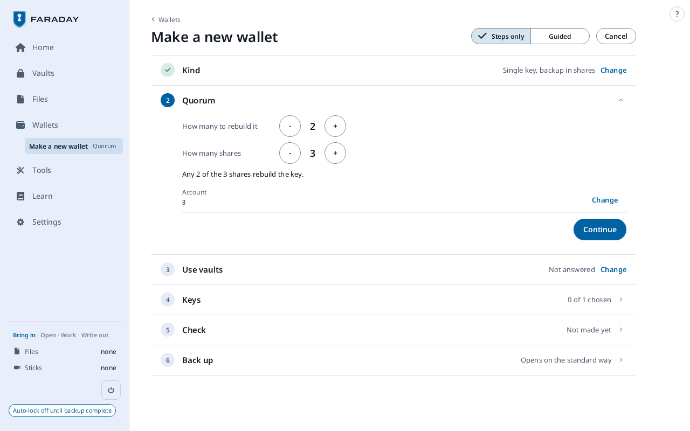 | 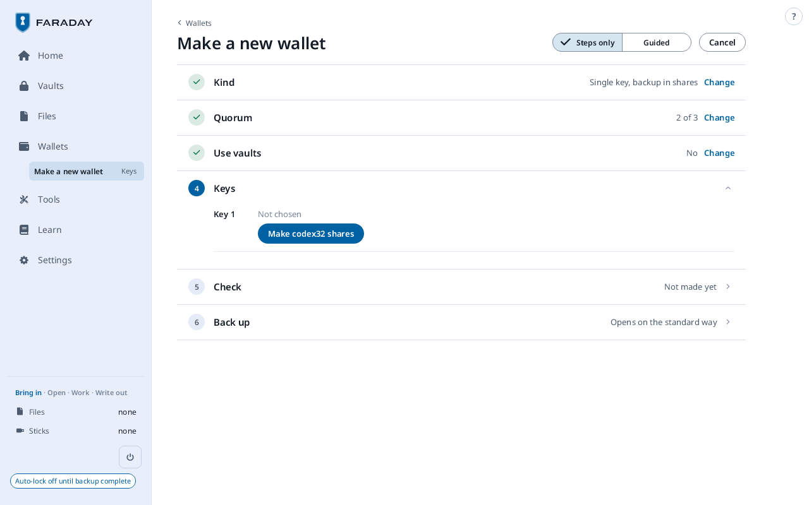 |
| **How many to rebuild it** 2 and **How many shares** 3; the line under them reads **Any 2 of the 3 shares rebuild the key.** Press **Continue**, then **No** on **Use vaults**. | **Key 1** offers one button, **Make codex32 shares**. Press it. |

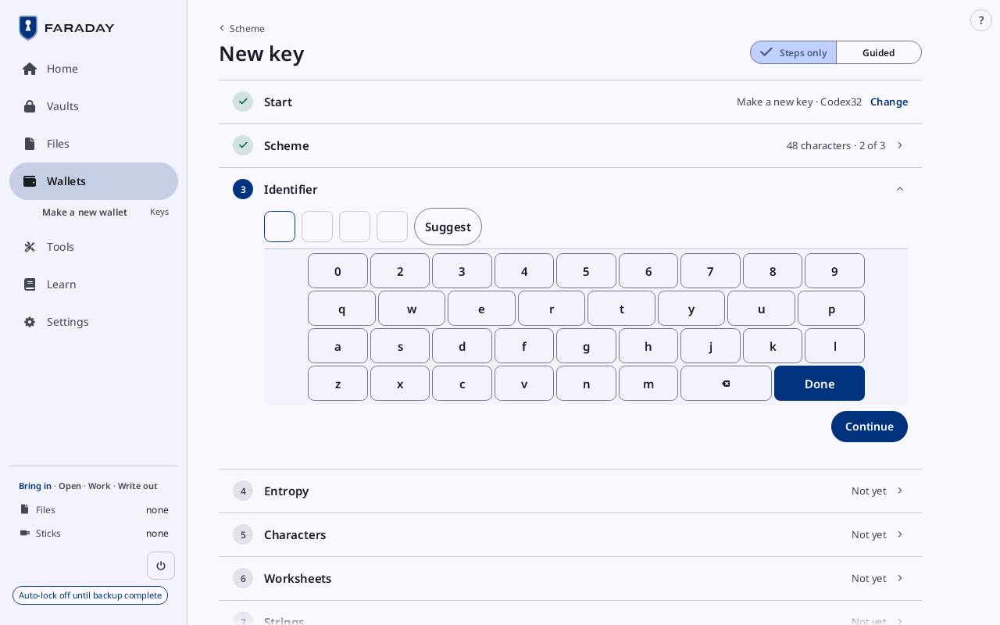

The page is **New key**, open on **Identifier**: **Start** reads **Make
a new key · Codex32** and **Scheme** **48 characters · 2 of 3**, from
Quorum. Type four characters that name the set (**Suggest** fills four),
then **Continue**. **Entropy** offers **Roll dice**, **Type the
characters** (made on paper) and **Type shares made by hand**. Each
roll or character drops into its box and the worksheets fill as on
paper; **Worksheets** then shows each sheet whole, and **Strings** each
string to write down and type back. Learn's page **Backups in other
forms** walks through these cards.

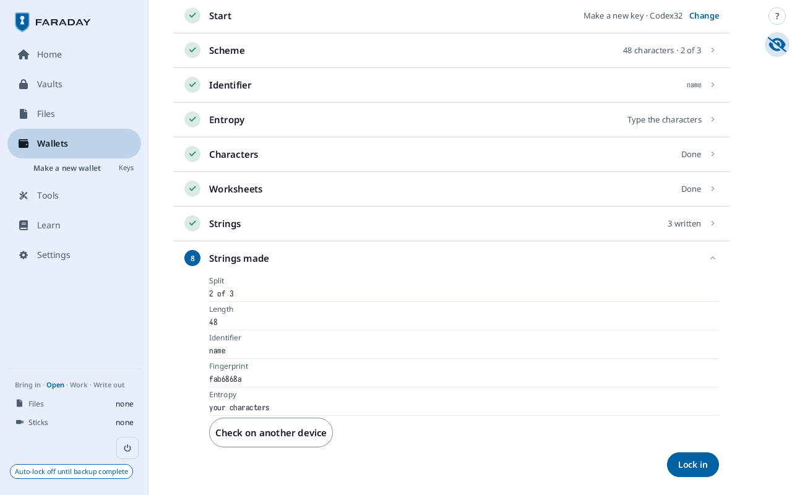

**Strings made** lists **Split**, **Length**, **Identifier**,
**Fingerprint** (`fab6868a` for the test data) and **Entropy**.
**Check on another device** lists sets of strings to load on another
implementation; every set must give the same fingerprint. Press **Lock
in**: the key fills Key 1 and the wallet is made.

| Check | The board, the standard way |
|---|---|
| 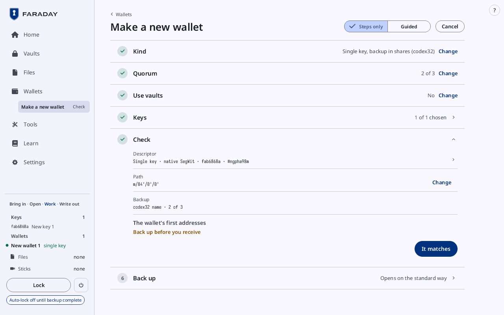 | 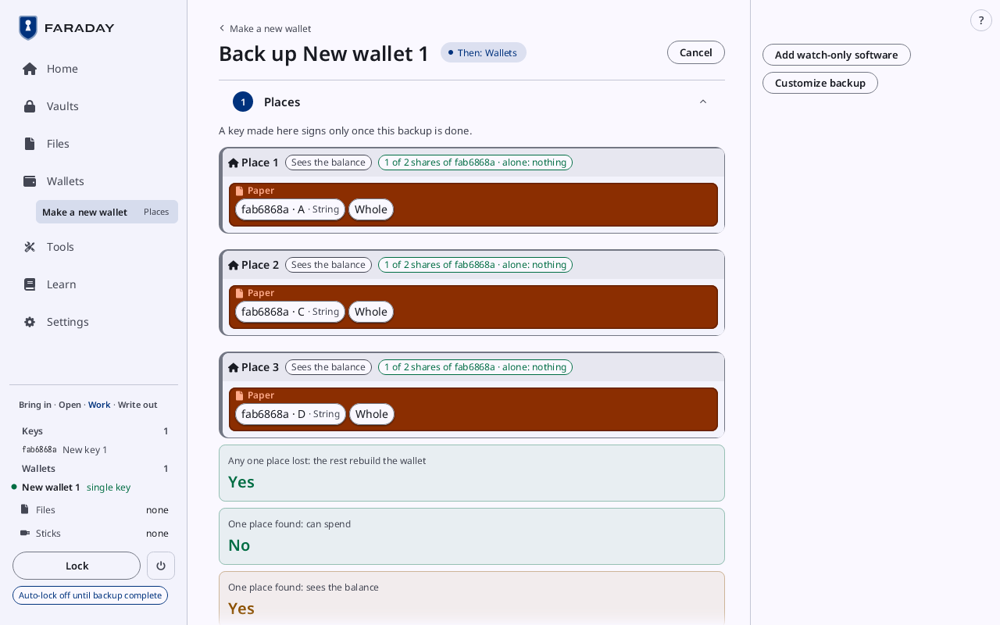 |
| **Descriptor** reads **Single key · native SegWit · fab6868a** and a checksum, and **Backup** **codex32 name · 2 of 3**. Press **It matches**, then **Back up this wallet**. | One string per place, on paper, each beside **Whole**, the wallet description: **fab6868a · A** at Place 1, **C** at Place 2, **D** at Place 3. Each place reads **1 of 2 shares of fab6868a · alone: nothing**. **Any one place lost: the rest rebuild the wallet** reads **Yes**; **One place found: can spend**, **No**. |

**Customize backup** changes the board as in steps 4.3 to 4.5: a string
can go into a vault or a stick's files as well. Press **Continue**, then
**Make the checklist**.

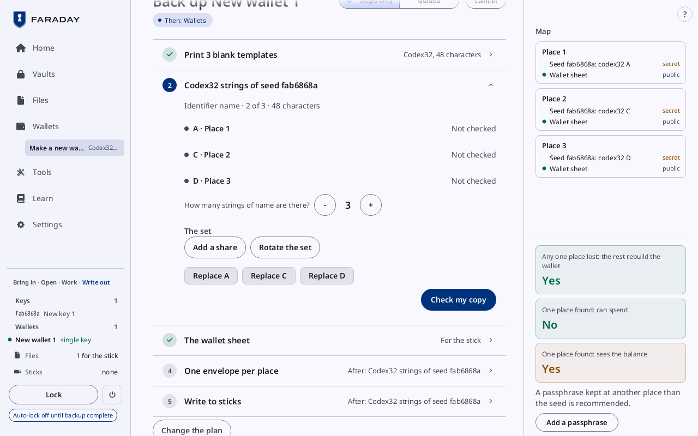

**Print 3 blank templates** asks for **Codex32, 48 characters** from the
Starter. **Codex32 strings of seed fab6868a** lists each string and its
place, **Not checked** until it is typed back. **How many strings of
name are there?** counts the strings that exist, if more were made.
Under **The set**, **Add a share** makes one more string of the same
set, **Rotate the set** makes a new set in place of this one, and
**Replace A** replaces a lost string. Press **Check my copy** and type
each string back from its paper; a box copied wrong is named. The rest
of the checklist goes as in steps 4.9 and 4.10.

A string can be kept on more than paper. Here, after **Change the
plan** and **Customize backup**, string A also goes into Vault 1 on a
stick at Place 1, and string C onto a new stick at Place 2, its forms
**Text file** and **QR picture** both on. Each place still reads **1 of
2 shares of fab6868a · alone: nothing**.

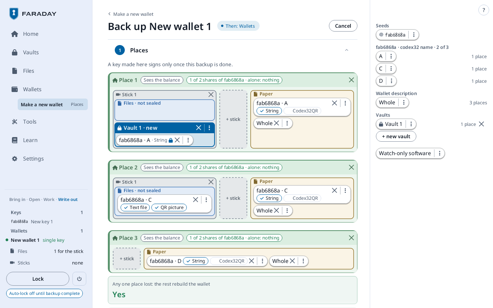

**Save into vault.ofv** (step 4.8) saves each string the plan puts in
the vault as a share record. The vault lists it under **Bitcoin keys**:
**Share A of fab6868a**, **codex32 name · threshold 2**. At unlock,
strings of one set from the vaults open together load the key once
there are enough of them; a string typed in counts with them.

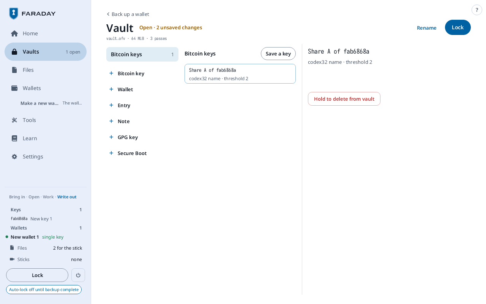

At **Lock and write** (step 4.10), a string kept in a stick's files is
written as `codex32-fab6868a-c.txt`, and its Codex32QR picture as
`codex32qr-fab6868a-c.png`; the picture is read back against the string
before the stick counts. One such file shows nothing of the key, but
enough of them together are the key: the stick's files are **not
sealed**.

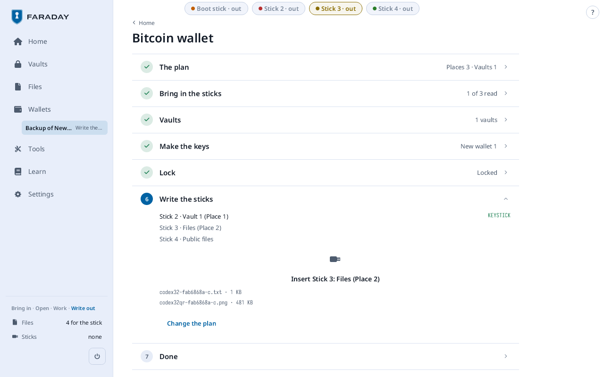

## 5. A wallet

What you will do: load three keys, make a 2-of-3 multisig wallet from
them, read its wallet card, show it to a watch-only wallet and compare
an address, plan its backup, and add a missing key by scanning its
SeedQR.

What you need:

- Faraday with no key loaded (press **Lock** if one is) and no stick
  attached.
- The paper copy of key `3dca6805` from section 4.
- Two more public test keys: twenty-four times **zebra**
  (fingerprint `5d388376`) and twenty-four times **summer**
  (`cf2e083d`).
- Sparrow, or another watch-only wallet, on an online computer
  (step 5.4).

The places of this section are Place 1, Place 2 and Place 3.

### 5.1 Load the keys

Press **Wallets**, then **Add a key**.

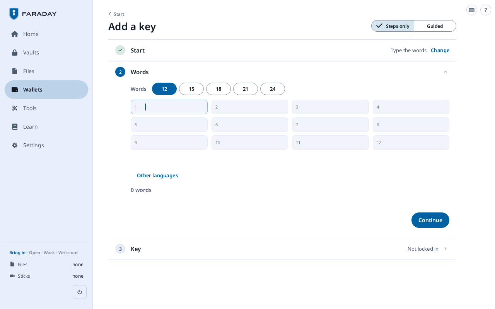

| On screen | Meaning |
|---|---|
| **Scan a SeedQR** | reads a SeedQR with the camera |
| **Words** **12 · 15 · 18 · 21 · 24** | how many words; typing past the boxes adds more |
| **Other forms** | SLIP-39 shares, codex32, Seed XOR |
| **Other languages** | word lists other than English |
| **BIP-39 passphrase** | **No passphrase** unless one is typed |
| **Add key** | loads the key |

**Other forms** opens the other forms of a key as tabs: **BIP-39
words**, **SLIP-39 shares**, **codex32** and **Seed XOR parts**. On
**codex32**, also reached by **Type codex32 strings** on New key's Start
card, each string typed or scanned is checked at once. This section
needs none of it; for codex32 strings in full, see Learn's page
**Backups in other forms**.

| A string in | Check a string |
|---|---|
| 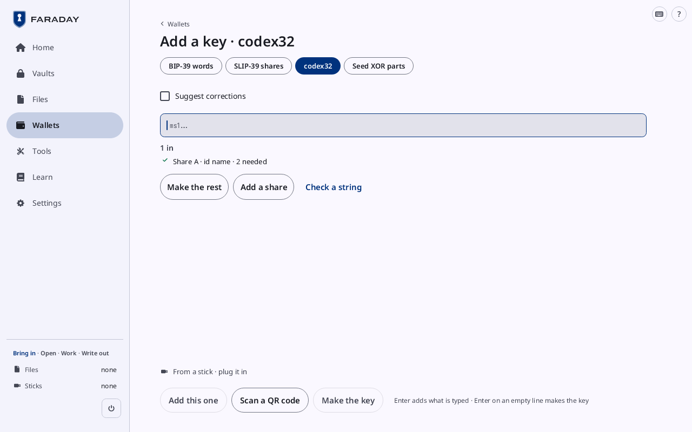 | 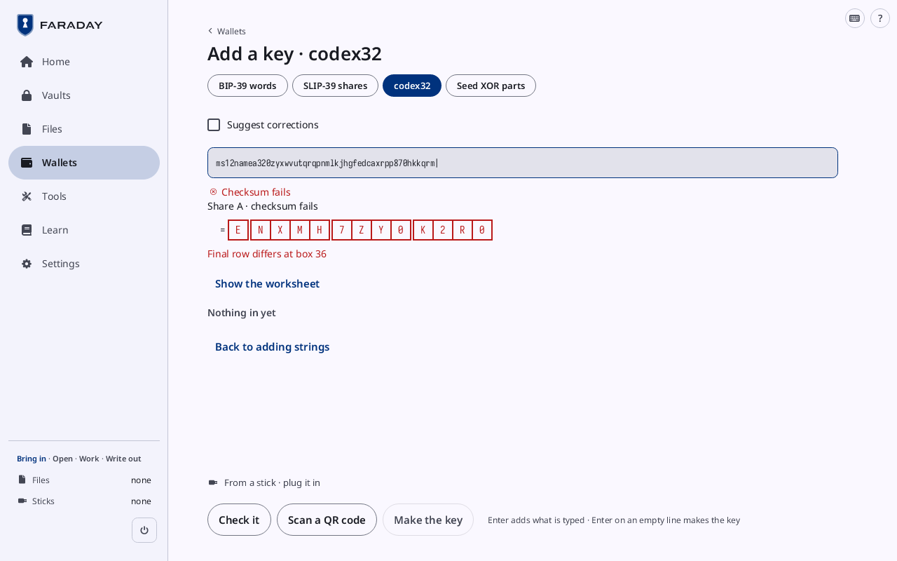 |
| **1 in** and **Share A · id name · 2 needed**. Once 2 strings of the set are in, the key loads. **Make the rest** makes the set's other strings from the ones typed; **Add a share** makes one more string at an unused index. Where an open vault keeps strings of the same set, the line **1 more of this set in open vaults** says so, and they count. | **Check a string**, then **Check it**: **Checksum holds** or **Checksum fails**, with the checksum worksheet's **Final** row beside what it **Must read**, and where it first differs (**Final row differs at box 36**). Nothing is loaded or kept. **Back to adding strings** returns. |

| The worksheet | Make the rest |
|---|---|
| 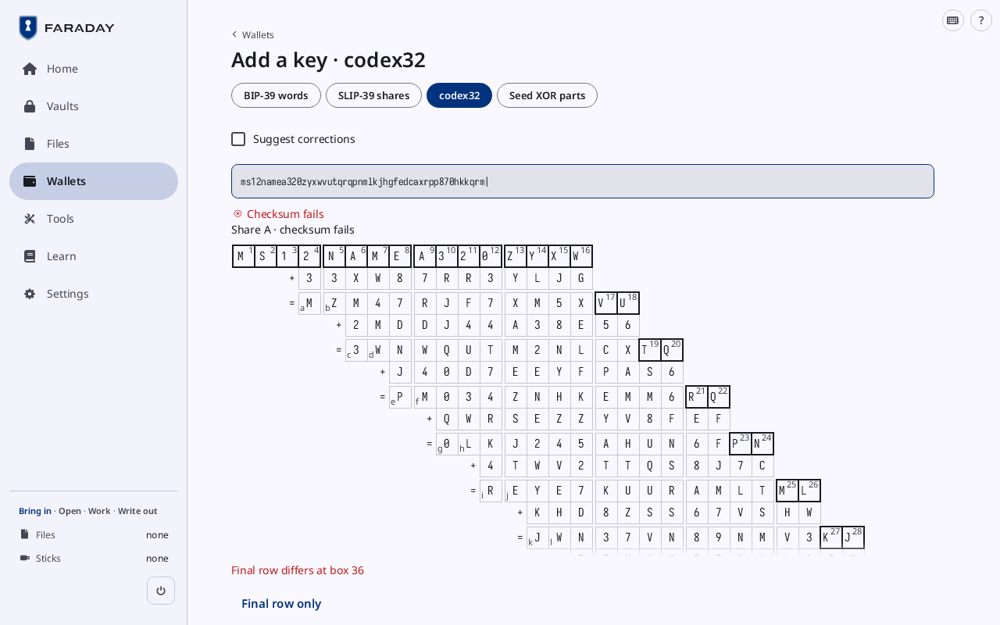 | 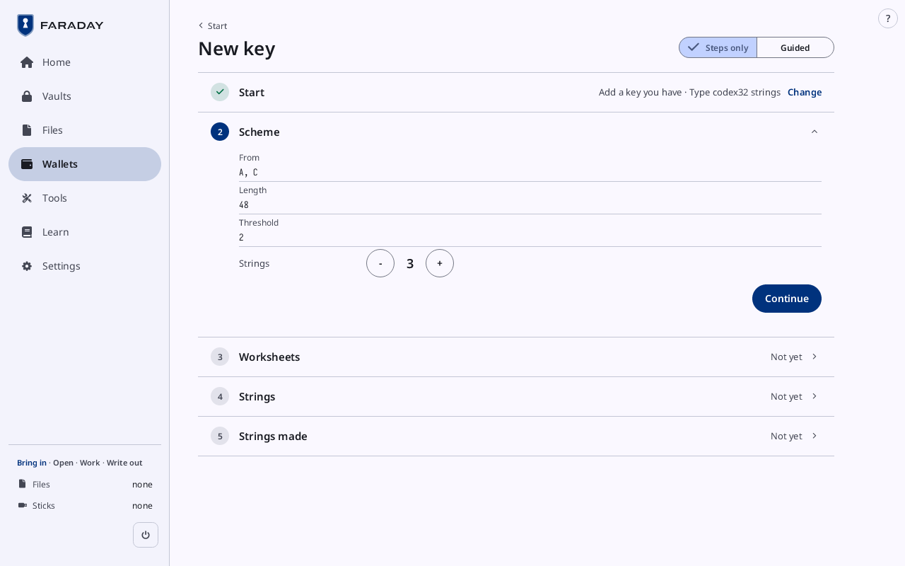 |
| **Show the worksheet** shows every row of the string's checksum worksheet, to compare row by row with the paper; **Final row only** goes back. | **Make the rest**, then the second string: New key opens on **Scheme**, **From A, C**, with **Strings** to choose. **Worksheets**, **Strings** and **Strings made** follow, as in step 4.11. **Add a share** opens the same way on **Index**, offering the next unused one. |

With **Suggest corrections** ticked, a string whose checksum fails
gets a correction to compare with the paper; Learn's page covers it.
A key loaded from corrected strings keeps a line beside its
fingerprint, **Share entry corrected** (**I mistyped**) or **Share
repairs unchecked**:

| New key's Key card | Wallets |
|---|---|
| 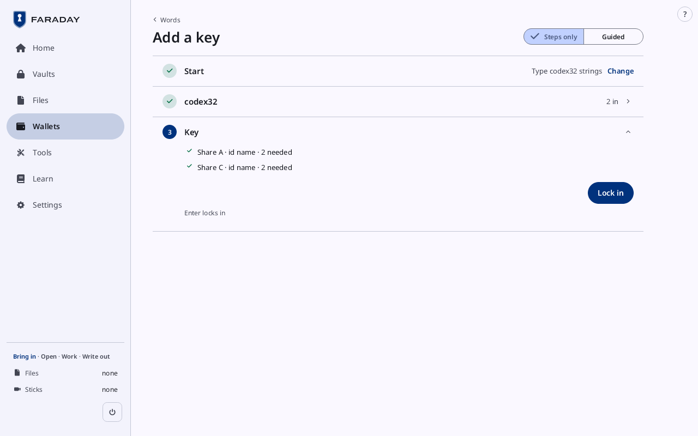 | 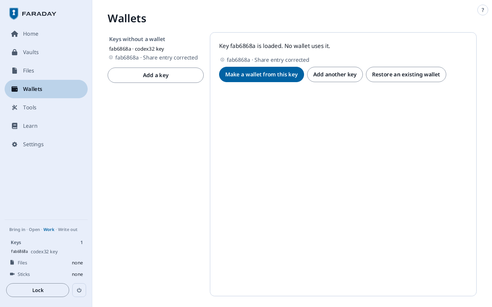 |
| From **Type codex32 strings**, **Key** lists the strings in (**Share A · id name · 2 needed**). **Lock in** loads the key and opens Wallets. | Under **Keys without a wallet**, and on the key's card: **fab6868a · Share entry corrected**. |

Type key `3dca6805`'s 12 words from the paper, then press **Add key**.


**Key 3dca6805 is loaded. No wallet uses it.** The fingerprint proves
the words typed are the test words. Press **Add a key** in the left
column again, press **24**, type **zebra** twenty-four times and press
**Add key**; then the same with **summer**. The sidebar lists three
keys: `3dca6805`, `5d388376`, `cf2e083d`.

### 5.2 Make a new wallet

Press **Home**, then **Make a new wallet**.

| Kind | Quorum |
|---|---|
|  |  |
| Press **Change** on Kind, then **Multisig · native SegWit** (3 keys, any 2 sign): **Quorum** opens. | **Signatures needed** 2 and **Keys** 3 (**-** and **+** change them). The line under them says what the quorum means: **Any 2 of the 3 keys can spend. Losing 1 key still leaves the money spendable; 2 keys together can take it.** **Account** 0. Press **Continue**. |

On **Use vaults**, press **No**: **Keys** opens.

| Keys | Check |
|---|---|
|  |  |
| Each **Key** row offers the keys loaded. Press `3dca6805` for Key 1, `5d388376` for Key 2, `cf2e083d` for Key 3. **Show xpub QR**, **Xpub PNG for the stick** and **Xpub file for the stick** give a key's public part to another wallet; **New key** makes one here. Press **Make the wallet**. | **Descriptor** reads **2 of 3 · native SegWit multisig · 3dca6805, 5d388376, cf2e083d** and a checksum; **Path** **m/48'/0'/0'/2'**. **The wallet's first addresses**: **Receive 0/0**, **Receive 0/1** and **Change 1/0**. With these test keys, Receive 0/0 begins `bc1q rfhg t7dv` and ends `ecxs 0246 6p`. Press **It matches**. |

Then **Back up** (step 5.5).

### 5.3 The wallet card

Press **Wallets**, then the wallet in the left column.


| On screen | Meaning |
|---|---|
| **New wallet 1**, **2 of 3 · native SegWit multisig** | the name and the kind; **Rename** changes the name |
| **Not backed up** | no backup plan yet (step 5.5) |
| **2 of 2 signatures possible here**, **Can spend** | the quorum is 2, and 2 of the keys that sign are loaded |
| **At a glance** | the wallet, each key (**Can sign here** while loaded), and the backup |
| **First receive address · 0/0** | the address to compare (step 5.4) |
| **Spend from this wallet** | section 6 |
| **Show wallet QR** | the wallet description as a QR code (step 5.4) |
| **Remove from session** | takes the wallet out of memory |

### 5.4 Show the wallet to a watch-only wallet

A watch-only wallet, such as Sparrow on an online computer, shows the
balance and makes the transactions Faraday signs. It needs the wallet
description, which holds no key that can spend. Press **Show wallet
QR**.


The sheet is **New wallet 1 · wallet descriptor**, **Public · safe to
scan**, with the descriptor written under the code. **UR**, **BBQr**
and **Parts** (numbered codes of plain text) are the formats, the one
chosen ticked; use the one the other wallet reads.
**PNG for the stick** puts the code on a stick as a picture.

1. In Sparrow: File, New Wallet, then scan the wallet QR.
2. Compare Sparrow's first receive address with **First receive
   address · 0/0** on the card, character by character.
3. Press **Done**.

| Result | Meaning |
|---|---|
| the addresses match | both programs derive the same addresses from the same description |
| they differ | something was scanned or chosen wrongly; do not receive to this wallet until they match |

A match does not prove the backups are right: that is the copy check
of section 4. The description shows the wallet's whole history to
whoever has it: do not post it.

### 5.5 Back it up

Press **Back up** on the card. The board opens with the standard way
for a 2-of-3: one place per key, each keeping one seed's words and the
whole description.


Each place reads **Sees the balance** and **Spends with 1 more place**.
The three lines read **Yes**, **No** and **Yes**: any one place lost,
the other two rebuild the wallet; no place alone can spend; any place
alone sees the balance.

After **Customize backup**, a drop that changes what a place alone can
do asks first:

| Seeing the balance | Spending |
|---|---|
|  |  |
| **Place 3 can see the wallet's balance**: what was dropped there completes the description at that place. | **Anyone with access to Place 1 can spend**: Place 1 now keeps as many seeds as a spend needs. |
| **Keep it** keeps the drop; **Take it off** undoes it. | the same |

The rest is section 4: the checklist, a copy checked per seed, any
vaults, and the sticks, each place in its turn.

### 5.6 Scan a key

A key does not have to stay loaded: its SeedQR is scanned when it is
needed, as on a SeedSigner. **Settings → Session → Remove every key**
takes every key out of memory and leaves the wallet.


The card reads **0 of 2 signatures possible here**, each key **Not
here**, and **A vault on a stick, a paper backup or a SeedQR may hold
them**. Press **Scan a key** (or **Scan a key for New wallet 1** in the
left column).


The sheet lists the keys still missing. Hold a SeedQR up to the camera.
Faraday works out which key it is; no choice is made first.

| After | Screen | Meaning |
|---|---|---|
| Key 2's SeedQR |  **Key 2 added · 1 more** | the camera stays on for the next key |
| Key 1's SeedQR, from Place 1's paper |  **Key 1 added · Can spend**, in a bar at the foot of the page that goes by itself | enough keys to sign; the camera closes. Key 3 reads **Cosigner · xpub only**. |
| a key loaded already | **Key … · already here** | scan another |
| a seed of no key of this wallet | "… is not one of New wallet 1's keys", on the passphrase sheet | a passphrase that gives one of the missing keys loads it; otherwise **Cancel** |
| anything else | **Not a SeedQR or a CompactSeedQR** | scan the seed's SeedQR |

No SeedQR carries a passphrase: a key with a passphrase is typed with
**Type the words instead**, which also takes keys with no SeedQR, such
as the test keys' twenty-four words.

## 6. Receive and spend

What you will do: check a receive address of section 5's 2-of-3 before
money is sent to it; then spend from it: the watch-only wallet writes the
transaction (a PSBT), Faraday reads it, two keys sign, and the signed
transaction goes back to the watch-only wallet, by QR code or on a stick.

What you need:

- Faraday as section 5 left it: **New wallet 1** loaded, with keys
  `3dca6805` and `5d388376` (**Can spend**).
- Sparrow on an online computer, with the wallet loaded (step 5.4), and
  a camera on the PC that runs Faraday. For the stick, a USB stick other
  than the Faraday stick.

The guide's transactions spend a coin that does not exist: each pays
0.015 BTC to `bc1qcr8te4kr609gcawutmrza0j4xv80jy8z306fyu` (BIP 84's
first test address) from an input of 0.1 BTC. Faraday reads and signs
them; the network would refuse them.

### 6.1 Receive: check the address

Faraday never sends; it shows which addresses are the wallet's. In
Sparrow, open the Receive tab: it shows the next unused address and its
QR code. On Faraday, press **Scan** (at the foot of Home, or **Tools →
Check an address**) and hold Sparrow's code up to the camera.


| Line under the picture | Meaning | Do |
|---|---|---|
| "That address is New wallet 1's receive address 0" | the address derives from the wallet's keys, as Sparrow's does | give it to the payer |
| "That address is not among the first 100 of any loaded wallet" | no loaded wallet makes this address in its first 100 receive and change addresses | do not receive to it until the wallet is found |
| "That address is not on Mainnet" | the address is for another network | the same |
| "That address fails its checksum: a character in it is wrong" | the code was read but the address is not valid | scan it again |

The camera stays on for the next address; **Cancel** closes it.

Without a camera, compare the address character by character with the
card's **First receive address · 0/0** (receive address 0), as in step
5.4. For receive address 0 the wallet here reads `bc1q rfhg t7dv … 0246
6p`.

A match proves the address belongs to the wallet whose keys are loaded
here. It does not prove the payer sends to it: a payer copies the address
from Sparrow, and malware on that computer can change what is copied.
Compare what the payer received with what Faraday found.

### 6.2 Spend from this wallet

Press **Wallets**, then **New wallet 1**. The card's first button is
**Spend from this wallet**.


The page **Spend from New wallet 1** opens, one card per step.


| On screen | Meaning |
|---|---|
| **I have the PSBT from Sparrow ready: Scan it** | for a wallet already in Sparrow: the camera, then step 6.4 |
| **Show the wallet QR** | the wallet description, as in step 5.4 |
| **Receive address 0** | the address Sparrow lists first |
| **It is loaded** | Sparrow has the wallet; the next card opens |

Press **It is loaded**. The link at the top left is named after the
card before the one open (**Load the wallet in Sparrow**, once the next
card is open): it opens that card again, with what was done there kept.
On the first card it goes back to the wallet's card.

### 6.3 Write the payment, and bring it here


In Sparrow, on the Send tab: the address to pay, the amount and a fee;
then *Create Transaction*, *Finalize Transaction for Signing* and *Show
QR*. Bring the PSBT to Faraday one of two ways:

| By QR code | On a stick |
|---|---|
|  |  |
| Press **Scan the PSBT** and hold Sparrow's animated code up to the camera. The line under the picture counts the parts (**UR: 2 of 8 · missing 3, 4, …**); the camera closes when every part is in. Go to step 6.4. | In Sparrow, *Save Transaction* to the stick. **On a stick** is grey until a stick is in (**Plug the stick in**). Plug the stick in: **A stick is attached** lists what the lock keeps and what it wipes. Press **Lock and use stick**. |

**Lock and use stick** wipes the keys and the wallet. What was not in a
vault is listed in red, **· nowhere else**: here both keys and the
wallet, which then come back only from their backups (section 7). With
the wallet and its keys in a vault, **Unlock** brings them back.

After the lock the stick visit opens:


**On the stick** lists the PSBT (`payment.psbt`) and the wallet's
description (`new-wallet-1-descriptor.txt`), both ticked. Press **Import
2 files**, pull the stick, and load the wallet and its keys again
(section 7, or **Unlock** for a vault). The card then reads **Sign the
PSBT from the stick**, and a bar above it, **payment.psbt in Files ·
Review**:


Press **Sign the PSBT from the stick**: the review of step 6.4 opens at
once. This picture, step 6.5's right-hand column and the stick
pictures of steps 6.6 and 6.7 show the wallet as section 7 restores
it, named **new-wallet-1-descriptor**, with key `3dca6805` alone; its
PSBT pays a fee of 1,850 sat. The other pictures of this section show
the QR way, with both keys.

### 6.4 Read the transaction


| Row | Here | Meaning |
|---|---|---|
| **Sends** | 0.01500000 to `bc1q cr8t … 6fyu` | what leaves the wallet, and to where |
| **Change** | 0.08497860 to 1/0, **Verified** | what comes back: change address 1/0 of this wallet, derived again from its keys |
| **Fee** | 0.00002140, 2,140 sat · 11.3 sat/vB | what the miners get |
| **Spends** | 0.10000000, 1 input | the coins spent |
| **Txid** | `1757 6707 … d6ee`, **Unchanged by signing** | the transaction's id, the same in Sparrow |
| the chips | **No warnings**, **Mainnet** | nothing found to warn of; the network |

Compare the address, the amount and the fee with what was typed into
Sparrow. **Show the table** lists each input and output whole:


Press **Continue**. Step 6.8 has what the card shows when something is
wrong.

**Verified** proves the change goes back to this wallet. Nothing proves
the address paid is the one meant: Faraday cannot know it, so compare it
with the payee's.

### 6.5 The keys that sign, and Sign it

The next card, **Add the seeds that can sign**, lists the wallet's keys:

| Both keys here | One key here |
|---|---|
|  |  |
| `3dca6805` and `5d388376` read **Signs here**, `cf2e083d` **Not here**; **2 of 2 signatures here** and **Can spend**. | `3dca6805` reads **Signs here**, the others **Not here**; **1 of 2 signatures here · 1 more needed**. **Scan a key** loads the second key (step 6.6). |

With both keys here, press **Continue**; with one, step 6.6 first.


Press **Sign with 3dca6805, 5d388376**. Signing cannot be taken back:
press it only when step 6.4 read right. The next card, **The other
signatures**, reads **2 of 2** and closes by itself.

### 6.6 The second key

Both keys sign on this Faraday. With one here, load the second before
signing: on **Add the seeds that can sign**, press **Scan a key** and
hold that key's SeedQR up to the camera, as in step 5.6 (**Type the
words instead** for a key with no SeedQR).

| Scan a key | The second key in |
|---|---|
|  |  |
| **Scan a key for new-wallet-1-descriptor** lists the keys still away (**Key 2 · 5d388376**, **Key 3 · cf2e083d**). | **Key 2 added · Can spend**, in a bar at the foot of the page; the row of `5d388376` reads **Signs here**, and the card **2 of 2 signatures here** and **Can spend**. |

Then **Continue** and **Sign with 3dca6805, 5d388376**: one press signs
with both keys, and **The other signatures** reads **2 of 2**.

### 6.7 Send it


| Card | What it is | Press |
|---|---|---|
| **Signed PSBT** (For the wallet that wrote it · not finalised) | the PSBT with every signature, for Sparrow | **Show as QR** |
| **Finished transaction** (Ready to broadcast) | the transaction the network takes, with its txid and size | **Show the finished transaction as QR**, under the cards |

Both wait **For the stick** as well (**Remove** takes one off). Under the
cards, **Nonce check · 2 signatures valid · 2 recomputed here** says the
two signatures were checked here.

| Signed PSBT | Finished transaction |
|---|---|
|  |  |
| In Sparrow, on the same transaction: *Scan QR*, hold it up to the webcam, then *Broadcast Transaction*. **UR** and **BBQr** are the formats; **2/s** to **5/s** the speed; **Small** to **Large** the size. | One code, for a wallet or a block explorer that reads a whole transaction. |

The finished transaction is safe to hand to anyone: changing where it
pays breaks its signatures. Whatever broadcasts it should report the
txid Faraday showed (`1757 6707 … d6ee`); if it reports another, what
was sent is not what was signed here.

On the stick way, the files take the PSBT's name
(`payment-signed.psbt`, `payment-final.txn`):

| Send it | Files |
|---|---|
|  |  |
| Both cards read **For the stick**; under **Nonce check**, one row per signature, **Valid · nonce recomputed, low R**. | **Files** lists them under **For the stick**, each **Ready**, with **Waiting for a stick**. Plug a stick in: the stick visit writes them. In Sparrow, open the signed PSBT from the stick (*File → Open Transaction → File…*), then *Broadcast Transaction*. |

Then **Put everything away**:


It lists the files waiting for the stick (`scanned-1-signed.psbt`,
`scanned-1-final.txn`). **Lock** wipes the session and keeps them; plug
a stick in and the stick visit writes them (**Write 2 files**). Then
**Power off**.

### 6.8 When the transaction is not right

The card of step 6.4 says so in its rows and under them, each warning
in its own words, in red for danger. A PSBT opened from Files (its
**Sign**) opens **Sign a transaction**, the same review:

| A fee of 0.012 BTC | Another wallet's PSBT |
|---|---|
|  |  |
| **fee 1200000 is 80% of the amount sent** and **fee rate is about 6349 sat/vB**. | **Wallet** reads **No loaded wallet matches**; **Change** reads **Unverified**, with **output 1 claims to be change of a wallet you are using, but the script is not that address**. |

| On the card | Meaning | Do |
|---|---|---|
| **Change** with **Unverified**, "output … claims to be change of a wallet you are using, but the script is not that address" | an output claims to be change but does not derive from this wallet's keys | do not sign: the "change" may pay someone else |
| "fee … is …% of the amount sent" | the fee is a large share of the amount, or above 0.01 BTC | do not sign; write the payment again in Sparrow with a lower fee |
| "fee rate is about … sat/vB" | 1,000 sat/vB or more | the same |
| **Wallet** with **No loaded wallet matches**; on its card, "No loaded wallet matches this transaction. Change cannot be verified until its wallet is loaded." | the PSBT spends from a wallet not loaded here | load the right wallet, or the right PSBT |
| **Amount unchecked** on **Spends** | an input's amount is only stated, not proved by its previous transaction | do not sign a transaction of several inputs; Faraday refuses one, with no way past |
| **No key in this session signs this transaction** | none of the keys here is one of the transaction's | load the wallet's keys |

Declining costs nothing: press **Cancel** at the top right, and nothing
is signed.

### 6.9 Spend from a backup, step by step

For someone spending for the first time, from what a backup left
(a stick and its vault, words on paper, a wallet sheet), Home's **Spend
from a backup, step by step** walks through the same spend with an
explanation on every page: **How to spend bitcoin** (the map, then
**Start**), **What do you have?** (headed by what starting from the
stick means; unlock the vault, or scan and type what is in the envelope;
Faraday works out the wallet, and a wallet that opens moves on by
itself), **Check the money is really there** (in Sparrow, **Yes, my
money shows**), **Write the payment**, **Bring the transaction here**,
**Read the transaction**, **Sign it**, **Send it** and **Put everything
away**. Each page is done
as steps 6.2 to 6.7 do it here.

## 7. Restore

What you will do: rebuild section 5's 2-of-3 from its backups, first
from its wallet description and its keys, then from a vault; and check
it before trusting it.

What you need:

- Faraday with no key loaded.
- The wallet description: here `new-wallet-1-descriptor.txt`, brought
  into Files from a stick (step 6.3); a printed wallet sheet's QR code
  or the description's QR picture works the same way with **Scan it**.
- The paper copy of key `3dca6805`. Keys `5d388376` and `cf2e083d` stay
  away: two of three keys are enough to sign, and one is enough to
  restore the wallet with its description.

### 7.1 Restore an existing wallet

Press **Home**, then **Restore an existing wallet**. The page is
**Restore an existing wallet**, one card per step.


With the description at hand, Kind is not chosen by hand: press **From
Files** beside **I have the wallet description** (or **Scan it** for its
QR code). With more than one description in Files, the **Description**
card lists them; press one.

The description fills **Kind** (**2 of 3 · native SegWit multisig**),
**Quorum** (**2 of 3**) and **Description** (the file's name), and the
wallet loads under that name, here **new-wallet-1-descriptor** (**Rename**
on its card changes it). Without a description, pressing a kind closes
**Kind** and opens the next card.


**Will you use vaults as part of this backup?** Press **No**: the card
closes on **No** and **Keys** opens.

### 7.2 The keys


One row per key of the description, by fingerprint, each **Empty**.
**Use vaults** reads **No**, with **Change**; the link at the top left,
**Use vaults**, opens that card again with **No** kept. The buttons
stand over the row they fill:

| Button | Does |
|---|---|
| **Type the words** | opens Add a key; the words typed, **Add key** |
| **Scan a SeedQR** | the camera; a passphrase is asked after the scan |
| **Not here** | the key stays away; the wallet signs with the others |

Press **Type the words**, type key `3dca6805`'s 12 words from the paper,
and press **Add key**.

| Result | Screen | Meaning | Do |
|---|---|---|---|
| a key of the wallet |  **Key 1 of the wallet**, in green | the words make the key the description names in that row | the next row |
| any other seed |  **Not a key of this wallet: check the words or the passphrase**, in red | the words, or the passphrase, make a key the description does not name; nothing is loaded | check the copy, type it again |

The second picture is of a seed of no key of this wallet (BIP 39's
"abandon … about"). A word copied wrongly makes another key and is
refused the same way.

Press **Not here** for rows 2 and 3.


Each row reads **Not here**, with **Change**. Press **Make the wallet**.

### 7.3 Check, then Done


**Descriptor** reads **2 of 3 · native SegWit multisig · 3dca6805,
5d388376, cf2e083d · #kudx02aw**; under **The wallet's first addresses**,
**Receive 0/0** reads `bc1q rfhg t7dv … 0246 6p`, the same as in step
5.2.

Compare before pressing **It matches**:

| Compare | With | A match proves |
|---|---|---|
| the descriptor's checksum (`#kudx02aw`) | the one on the wallet sheet or the card from before | the description is the one backed up, character for character |
| **Receive 0/0** | the first receive address in Sparrow, or on the printed wallet sheet | the wallet makes the same addresses as before: the money is in it |
| the fingerprints | the ones on the wallet sheet | each key is the one the backup names |

If Receive 0/0 differs, do not receive to or spend from this wallet:
the description is another wallet's, or was changed. Press **It
matches**.


**Done** offers **Sign the PSBT from the stick** (with a PSBT for this
wallet in Files; otherwise **Spend from this wallet**), **Back up this
wallet**, **Another wallet from these seeds** and **Wallets**. A
restored key is not held for a backup: it signs at once. The card reads
**1 of 2 signatures possible here**, with **Scan a key** for the second
(step 5.6).

A match proves the description and the keys typed are the wallet's. It
does not prove the balance: check that in Sparrow, which sees the
blockchain.

### 7.4 From a vault

A wallet backed up into a vault (section 4) comes back from the vault's
stick:

1. Start Faraday from the Faraday stick that holds the vault, or plug
   the vault's stick in on Home with no key loaded. Faraday reads the
   stick (**Read from …**), lists **Locked · vault.ofv**, and asks
   **Pull the stick to continue**.
2. Pull the stick, type the vault's passphrase and press **Unlock**.
3. **Load from vault.ofv** lists what the vault holds, each seed and
   wallet saved with **Load at unlock** (step 4.8) ticked. Press **Load
   ticked**: the wallet and its keys load, and Wallets opens.

Then check it as in step 7.3: the checksum, Receive 0/0 against Sparrow
or the wallet sheet, the fingerprints. **Unlock Vault 1** on the backup's
**Done** (step 4.10) is the same unlock.

A vault holds what was saved into it: a seed not saved there is
restored from its paper copy as in step 7.2.
