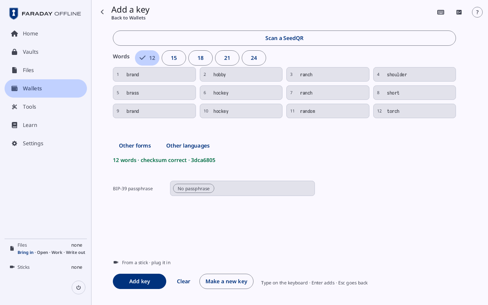

# Add a key: typing a key

**Kind:** Reference
**Status:** Checked against the app's pictures in docs/guide/pictures/ (drawn by just guide-pictures) and its code and strings (`faraday/faraday-core/src/screens/entry.rs`, `faraday/faraday-core/src/word_entry.rs`, `faraday/faraday-core/src/forms.rs`, `faraday/faraday-core/src/codex32_correct/screen.rs`)
**Screen:** `Entry`
**Group:** Wallets

**Opened from:** **Type the words** on a key's row of [Restore an
existing wallet](restore.md#keys); **Type the words you have** on the
[Spend](spend-tab.md) tab; a SeedQR or seed words read by Home's
**Scan**, or Tools' **Scan a SeedQR**, which open it with the words
in; a SLIP-39 share, codex32 string or Seed XOR part read by the camera,
which opens it on that form with the part in; **Add its key** on a
silent payments wallet's card; a backup that asks for a key typed from
its copy. With a stick attached, [Pull the stick](prompts.md#pull-the-stick)
opens first.

The page is where a key is typed: its words, or its shares, strings or
parts. [Add a key](new-key.md) on Wallets is the card flow, whose typing
card is this page's form.

*The published test seed's twelve words typed: the status reads "12 words · checksum correct · 3dca6805", and **Add key** is outlined.*

## On this screen

| Control | What it does |
|---|---|
| the way back | at the top left: **Wallets**, or **Spend** when the Spend tab opened it. <kbd>Escape</kbd> does the same |
| the title | **Add a key**; "Add a key · SLIP-39 shares" on another form; "Add key 3dca6805" for a wallet's missing key; "Add a key for New wallet 1"; "Type share C of name" for a codex32 string a backup asked for |
| the keyboard | at the top right, where the keyboard on screen is offered: shows or hides it (**Keyboard**) |
| **Other forms** | under the word boxes: opens the forms as buttons: **BIP-39 words**, **SLIP-39 shares**, **codex32**, **Seed XOR parts**, the one on show filled |

## The words

| Control | What it does |
|---|---|
| **Scan a SeedQR** | across the top: opens the camera for a SeedQR; for a wallet's missing key, the camera for that wallet's key. The leading button until a word is typed |
| **Words** | the count: **12**, 15, 18, 21 or **24** |
| the word boxes | numbered; a word is typed into each. **No word starts with that** under a box that matches none, and "· Tab completes a single match" |
| **Other languages** | beside **Other forms**: opens the word lists as buttons: **English**, **Spanish**, **French**, **Italian**, **Czech**, **Portuguese**, **Japanese**, **Korean**, **Chinese (Simplified)**, **Chinese (Traditional)** |
| the status | "12 words", then "12 words · checksum correct · 3dca6805" once they make a key; why not, in the error tone ("Word 3 is not on the English list") |
| **BIP-39 passphrase** | the field, with **No passphrase** in it while it is empty: the passphrase typed with the words. Another passphrase is another key |
| "From a stick · plug it in" | while no stick is attached; with one, **Copy files in** in its place, which opens the [stick visit](stick-visit.md): a key file copied in loads once the stick is pulled |
| **Add key** | loads the key and goes back: to Wallets, the Spend tab, Restore or the backup that opened the page. The toast says "Key 3dca6805 added" |
| **Clear** | empties the boxes |
| **Make a new key** | opens [New key](new-key.md) |
| "Type on the keyboard · Enter adds · Esc goes back" | the keys' hint |

A list not written in Latin letters (Japanese, Korean, the Chinese lists)
shows those keys on screen: the words taken so far in a grid, the keys
typed for the next, and the words they can be, **Press a word to take
it**. For Chinese, each word's pinyin or 注音, then its tone.

## The other forms

One share, string or part at a time.

| Control | What it does |
|---|---|
| the field | the share's words (**Words of one share**), a codex32 string, or a part's BIP-39 words |
| **Add this one** | takes what is typed; <kbd>Enter</kbd> does the same |
| the count | **Nothing in yet**, **1 in**, "2 in", and a line for each: "Share A · id name · 2 needed", "Group 1 of 1, member 2 · 2 of the group needed · id 1234", "Part 1 · 12 words" |
| **Passphrase** | the SLIP-39 backup's passphrase, or a Seed XOR key's BIP-39 one |
| **Scan a QR code** | the camera, for one more |
| **Make the key** | puts them together and loads the key. <kbd>Enter</kbd> on an empty line does the same ("Enter adds what is typed · Enter on an empty line makes the key") |

A part refused says why under the field: "Not a SLIP-39 share: …",
**That share is in already**, **That string is of another seed: its id
differs**, **Every part has the same number of words**.

## codex32

| Control | What it does |
|---|---|
| **Suggest corrections** | a tick over the field: a string whose checksum fails gets a [correction](#a-correction) to compare with the paper |
| **Check a string** | the field checks one string and keeps nothing (**One string, checked. Nothing is loaded or kept.**): **Check it**, then **Checksum holds** or **Checksum fails**, **Of the set typed in** or **Not of the set typed in**. **Back to adding strings** returns |
| **Show the worksheet** | the string's checksum worksheet whole, as the booklet draws it; **Final row only** shows its last row beside what it must read |
| **Already in** | under the field, for a string in already |
| "1 more of this set in open vaults" | strings of the same set an open vault keeps; they count |
| **Make the rest** | once a string of a split set is in: opens [Make codex32 shares](new-key.md#make-codex32-shares) on the set's other strings |
| **Add a share** | the same, for one more string at an index the set has not used |
| **Repaired, not checked** | under a string that went in by a correction left unchecked |

A string at an index already in, and different, stands in place of the
field: "Share A is in already, and differs", **Held** and **This one**
one over the other, "Boxes 3, 17 differ", and **Keep the one held** or
**Replace it**.

### A correction

| Control | What it does |
|---|---|
| **Possible correction** | each box it changes, "Box 17 · q → p", a page at a time ("Page 1 of 2", **Previous**, **Next**) |
| **This assumes every other box is right** | under it |
| **I mistyped**, **The paper is damaged**, **Unreadable on the paper** | what went wrong. The last two lead to **Repairs to write on the paper** |
| **Type the changed boxes from the paper** | the boxes changed, typed again: "2 of 3 boxes typed"; **The boxes typed differ from the correction** when they do not match |
| **Check the boxes** | checks what is typed against the correction |
| **Take the correction** | takes the string as corrected ("These characters come from the checksum, not from the paper") |

A key loaded from a corrected string keeps a line beside its
fingerprint: **Share entry corrected**, or **Share repairs unchecked**
in the warning tone.

## On a narrow window

Every list's words are typed on the word keyboard on screen, and the
buttons stand under the form.

## Why

- [Seed words](../../learn/02-words.md)
- [Passphrases](../../learn/05-passphrases.md)
- [Backups in other forms](../../learn/18-other-backups.md)
