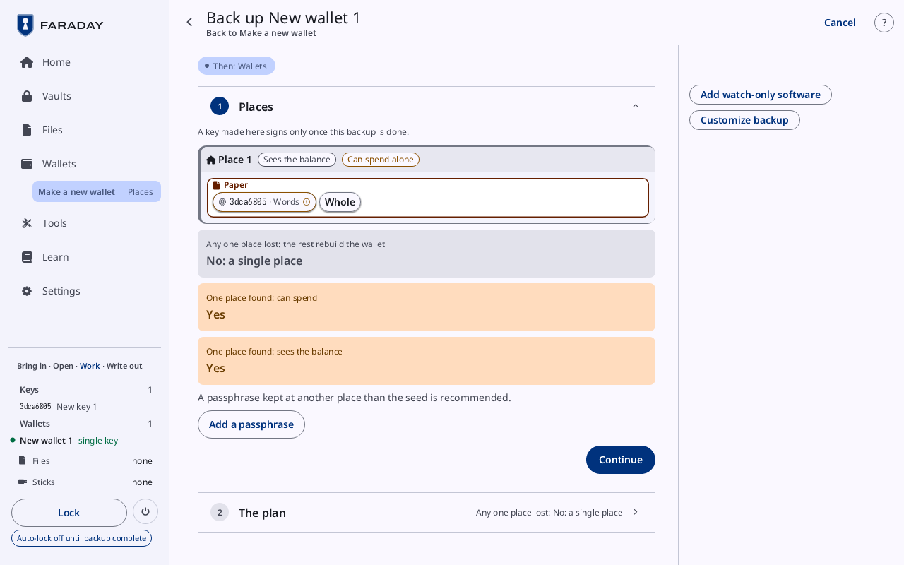
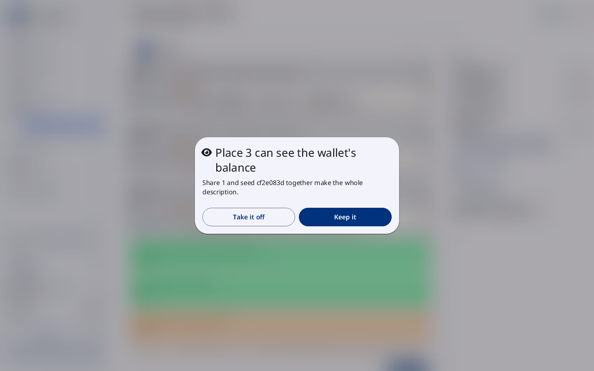
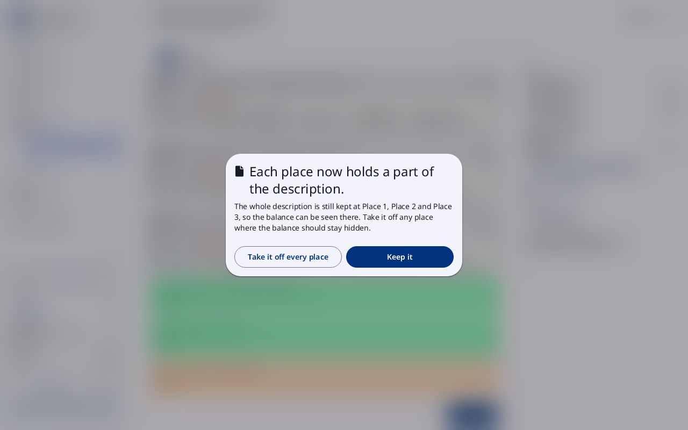
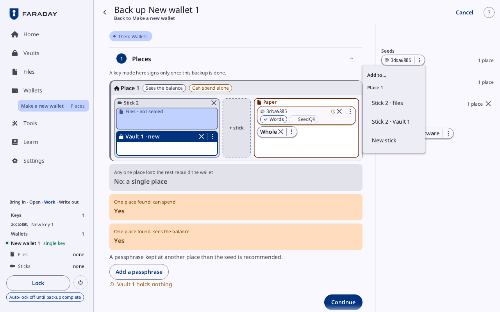

# Back up a wallet

**Kind:** Reference
**Status:** Checked against the app's pictures in docs/guide/pictures/ (drawn by just guide-pictures) and its code and strings (`faraday/faraday-core/src/screens/backup.rs`, `faraday/faraday-core/src/plan/cards.rs`, `faraday/faraday-core/src/board/screen.rs`, `faraday/faraday-core/src/board/mod.rs`, `faraday/faraday-core/src/board/lines.rs`, `faraday/faraday-core/src/glance/mod.rs`)
**Screen:** `Backup`, `BoardList`, `BoardSees`, `BoardPartials`, `BoardMenu`
**Group:** Wallets

A wallet's backup: the plan, made on the backup board, then the
checklist that carries it out, and the four sheets the board opens.
Faraday backs up a wallet, not a key on its own.

**Opened from:** **Back up** (**Continue the backup** for one left part
way) on a wallet's card and on [Backups](backups.md); **Back up
wallet** at the end of Make a new wallet; **Back up this wallet** at the
end of Restore an existing wallet; **Change the plan** on the
wallet's [chart](backups.md#the-chart); a wallet in [Vault
contents](vault.md). Its title is "Back up New wallet 1", or **Back up
a wallet** with more than one wallet loaded, where the wallet's name is
a chip that lists the others to choose from. The way back at the top
left is named after the card before the one open, else the screen it
was opened from: **Wallets**, **Vault contents**, or **Make a new
wallet**, where a chip reads **Then: Wallets** in the wallet's chip's
place.

*A single-key wallet just made, its board the standard way: Place 1 tagged **Sees the balance** and **Can spend alone**, its **Paper** keeping "3dca6805 · Words" and **Whole**; under it **No: a single place**, the passphrase line, and at the right **Add watch-only software** and **Customize backup**.*

## The plan

The plan is up to three cards: **Places**, the board; **Software**,
where a place is watch-only software; and **The plan**, the map with its
checks. Closed, **Places** reads "1 place" or "3 places", and **The
plan** "Any one place lost: Yes".

"A key made here signs only once this backup is done." stands over the
board while a key made on this device waits for this backup.

### Places: the board

A new plan opens on the board with the standard way placed: each seed's
words and the whole wallet description on paper, one place per key.
Nothing on it moves until **Customize backup**.

| Control | What it does |
|---|---|
| a place's card | its name, "Place 1"; its tags, what someone who finds that place alone gets: **Sees the balance**, **Can spend alone**, **Can spend alone with the vault's passphrase**, **Spends with 1 more place**, "Spends with 2 more places"; once customized, a press on the name makes it a field, and **×** removes the place |
| **Paper** | what the place keeps on paper: a seed's words ("3dca6805 · Words"), its SeedQR, **Whole** (the printed wallet sheet), "Share 1" |
| "Stick 2" | a stick at the place, named by the number its pill has at the top of the window (the Faraday stick is Stick 1), with its boxes: a vault ("Vault 1 · new", "Vault 1 · sealed", "Vault 1 · sealed · made in the checklist") and **Files · not sealed**, the files kept outside a vault |
| **+ stick** | adds an empty stick to the place |
| **+ place** | adds a place |
| **Watch-only software** | the software place, while there is one: **Scanned in**, the description scanned into the software, and a stick of its files |
| **Add watch-only software**, **Take off watch-only software** | in the right-hand column, before **Customize backup**: adds or takes off the software place |
| **Customize backup** | under it: makes the board editable; the list of what the backup can keep takes their place |

A chip on the board is one thing kept at one box:

| Part | What it does |
|---|---|
| the name | "3dca6805 · Words"; a seed's chip starts with the fingerprint, a passphrase's with its glyph, a vault's with a closed lock |
| the forms | **Words** and **SeedQR** on a seed's paper copy; **Text file** and **QR picture** on a file; a press turns one on or off, and the last one on stays on |
| the warning mark | a check under the board names this chip |
| the link mark | a vault kept on sticks at more than one place |
| **×** | takes the chip off that box |
| **⋮** | its [menu](#the-menu-of-a-chip) |

Drag a chip from the list onto a box, or press it and then press the
box; a press anywhere else lets it go. A chip from the list is never
used up: placing it places a copy. A drop that lets a place see the
balance, or brings it nearer a spend, asks first
([Keep it or Take it off](#keep-it-or-take-it-off)).

### The list

Beside the board once it is customized (the right-hand column at
1280 × 800):

| Group | What it holds |
|---|---|
| **Seeds** | each seed's chip, with how many places keep it at the row's end ("1 place"); **Not here** for one not loaded |
| a seed's codex32 strings | "3dca6805 · codex32 w0za · 2 of 3", a chip per string, for a key made as codex32 shares or loaded from strings |
| **Passphrases** | each seed's passphrase, where it has one |
| **Wallet description** | **Whole**; for a multisig that splits, **Add partial descriptions to this backup** (**Remove partial descriptions** once added) and **What is a share?**; for one that does not, why: "Partial descriptions: only for a sortedmulti or tr(NUMS, sortedmulti_a) wallet" |
| **Vaults** | each vault, **×** to remove it, and **+ new vault** |
| the software | **Watch-only software**, where the plan has it |

### Under the board

| Line | Here |
|---|---|
| **Any one place lost: the rest rebuild the wallet** | **Yes**, **No**, **No: a single place**; why it is No, in the error tone ("Seed 3dca6805 is kept only at Place 1", "Without Place 1, the rest do not rebuild the wallet") |
| **One place found: can spend** | **Yes**, **No**, **Only with the vault's passphrase** |
| **One place found: sees the balance** | the same |
| "Every secret of this wallet is at Place 1. Separate places are strongly recommended." | where every secret is at one place |
| **A passphrase kept at another place than the seed is recommended.** | a single key with no passphrase, with **Add a passphrase**, which adds one to the key |
| the warnings | each with its mark: "Place 1 alone can spend the wallet", "Place 2 holds no seed", "Vault 1 holds nothing", "Vault 1's stick needs a place", "Seed 3dca6805 is kept nowhere", "The description cannot be put back together: add the whole description" |

A drop never refuses: a plan that keeps something unwise shows a line
and a mark on the chip. Only what holds the way on stops **Continue**
on **The plan**: a seed made here kept nowhere, or a vault that holds
nothing.

After the lock that writes the sticks, a change to files and paper is
refused: "Files and paper stay as made after the lock; finish the
writes, then Back up again to change them".

### Software

| Control | What it does |
|---|---|
| **Sparrow**, **Coldcard, Keystone, Passport**, **Nunchuk**, **Bitcoin Core**, **Not sure** | the software the watch-only wallet runs in; more than one can be ticked |
| **Form** | **QR picture**, **Text** |
| **Continue** | closes the card |

### The plan

The map: a box per place, then each vault, the stick of files, the
software and **On its own device**, each listing what it keeps and its
tag (**secret**, **sealed**, **public**), then the three lines.

| Control | What it does |
|---|---|
| **Make the checklist** | approves the plan and opens the checklist |
| "Vault 1's stick needs a place" | in the warning tone: a vault already made whose stick no place keeps |
| "Vault 1 holds nothing", "Seed 3dca6805 is kept nowhere" | in the warning tone, in place of **Make the checklist** |

## The checklist

An item for each thing the plan needs, in the order they are done. An
item opens once the one before it is done; until then its line reads
"After: Copy seed 3dca6805 by hand". **Map**, the right-hand column at
1280 × 800, shows each place and what it keeps, a dot each, green once
that copy is made. **Change the plan** under the items goes back to the
board.

| Item | Closed | Its controls |
|---|---|---|
| "Print 1 blank template" | "Template for 12 words" | **Words on the seed**: **12** or **24**; the line naming what to print from Faraday Starter ("Print 1 from Faraday Starter: Blank templates, 12 words, Both"); **Done**. Faraday prints nothing |
| "Copy seed 3dca6805 by hand" | **Checked**, **Not checked** | **Show the seed**, **Hide the seed**: the words, each with its number in the word list, and the SeedQR's grid (**Standard SeedQR**, **Compact SeedQR**); **Other paper forms**: **Seed XOR, 2 parts**, **Seed XOR, 3 parts**; **Check my copy**; **Keep the words only** |
| "Codex32 strings of seed fab6868a" | **Checked**, **Not checked** | each string and its place, **Check my copy** ([codex32 shares](../walk/codex32.md)) |
| "Write the passphrase of seed 3dca6805 on paper" | **Checked**, **Not checked** | **Show the passphrase**, **Hide the passphrase**; **Check my copy** opens **Your copy's passphrase**, then **Compare** |
| "Vault 1 · 3dca6805" | "In vault.ofv", **Not saved** | **Into the vault** ("Into Vault 1" with a vault open): "Seed 3dca6805", **Wallet description**, a dot each, green once the vault holds it; **Load at unlock**; **Make a vault**, "Save into vault.ofv", or **Lock it and make a new vault** where the open vault is another plan vault's ("vault.ofv holds another vault's seed") |
| **The seeds as files** | **Not made** | a row per seed, **For the stick** once made; **Make it** |
| **The wallet sheet** | **A PDF to print** | **Backup sheet**, **A PDF to print**, **Make it** |
| **The shares** | "3 shares, 2 keys each" | for a multisig split into shares: **Keys left off each share**, the shares and the keys on each ("Any 2 shares rebuild the wallet"), then **The shares**, **Sheets to print, text files and pictures**, **Make them** |
| **The public files** | the software ticked | a row per file: **Descriptor** (**Any wallet software**), **Wallet file** (**Sparrow, Specter**), **Multisig config** (**Coldcard, Keystone, Passport**), and others under **More options**; **Make the file** on each, **Make them** |
| **Show the descriptor to the software** | **Shown**, **Not shown** | **Show as QR** |
| **One envelope per place** | "1 envelope" | each place and what goes into its envelope; **Back to the wallet**, **Done** |
| "Write to sticks" | **Not written**, "1 of 2 written" | **Kept** and **Wiped from memory**, what the lock keeps and wipes; a row per stick, its files under it, ticked once written; **Lock and write**, which opens [the backup flow](backup-flow.md) on its sticks |

### Check my copy

| Control | What it does |
|---|---|
| **Your copy's words** | the words typed back from the paper, "Word 3 of 12", each shown as dots once typed |
| **Clear** | empties what was typed |
| the line | "Word 4 differs from the seed", in the error tone, or **Your copy matches the seed** in the ok tone |
| **Scan your copy** | for a SeedQR copy: the camera, after the words |
| "Seed 3dca6805's SeedQR, drawn in part, stays on the map until destroyed" | after **Keep the words only** on a grid begun |
| "3 scans without a match" | after three scans that do not match; **Keep the words only** moves beside the way on |

Once the copy matches, the item reads **Checked** and the next item
opens.

### Backup done

Once every item is done: **Backup done**, the three lines, the wallet's
[chart](backups.md#the-chart), and **Open the wallet** and **Change the
plan**. In Guided mode, a line on copies made outside the plan, with
**Extra copies**, Learn's page.

## The list as a sheet

**Opened from:** **Add**, which takes the list's place on a narrow
column. Its title is **Add**.

The list, as above. A press on a chip closes the sheet with the chip
chosen; then a press on a box places it. **Close** closes it.

## Keep it or Take it off

**Opened from:** a drop on the board that lets a place see the balance
it could not before, or brings it nearer a spend.

*A drop at Place 3 that completes the description there: "Share 1 and seed cf2e083d together make the whole description."*

| Title | Shown when |
|---|---|
| "Place 3 can see the wallet's balance" | what was dropped completes the description at that place ("The whole description is kept there.", "Share 1 and Share 2 together make the whole description.", "Share 1 and seed cf2e083d together make the whole description.") |
| "Anyone with access to Place 1 can spend" | the place keeps as many seeds as a spend needs: "Place 1 keeps 2 of the 2 seeds a spend needs." |
| "Anyone with access to Place 1 needs only 1 more place to spend" | the place is one place from a spend; "… and the vault's passphrase …" where a vault is counted |

| Control | What it does |
|---|---|
| **Take it off** | undoes the drop |
| **Keep it** | keeps it |

## Each place now holds a part of the description

**Opened from:** **Add partial descriptions to this backup** in the
list.

*Partial descriptions added to a 2-of-3 plan whose three places each still keep the whole description.*

| Control | What it does |
|---|---|
| the line | "The whole description is still kept at Place 1, so the balance can be seen there. Take it off any place where the balance should stay hidden." where it is; "… at Place 1, Place 2 and Place 3, …" where more places keep it |
| **Take it off every place** | takes the whole description off; shown while a place keeps it |
| **Keep it** | keeps the parts and the whole |

## The menu of a chip

**Opened from:** a chip's **⋮**: a menu under it at 1280 × 800, a sheet
on a narrow window.

*A seed's **⋮** in the list, with Place 1 holding Stick 2 and its paper: **Add to…** lists "Stick 2 · files", "Stick 2 · Vault 1" and **New stick**; its paper, which keeps the seed already, is not listed.*

| Chip | Menu |
|---|---|
| in the list | **Add to…** |
| on the board | its name; **Move to…** and **Copy to…** where there is a box to go to (a share has no **Copy to…**), and **Take off** |

**Add to…**, **Move to…** and **Copy to…** list each box that takes the
thing and does not keep it already, under each place's name: **Paper**,
"Stick 2 · files", "Stick 2 · Vault 1", and **New stick**; under the
software, **Scanned in** and its stick's files. A vault's chip lists the
sticks it can go on. At 1280 × 800 a press outside the menu closes it;
on a narrow window the sheet has **Cancel**.

## On a narrow window

The map is a page of the plan, and **One envelope per place** lists
the places. The board is one column of places, with **Add** in the
list's place.

## Why

- [Backups](../../learn/04-backups.md)
- [A backup plan's check](../../learn/faraday/backup-plan-check.md)
- [Shares of a wallet description](../../learn/faraday/shares.md), for a multisig whose description splits
- [Backups in other forms](../../learn/18-other-backups.md)
