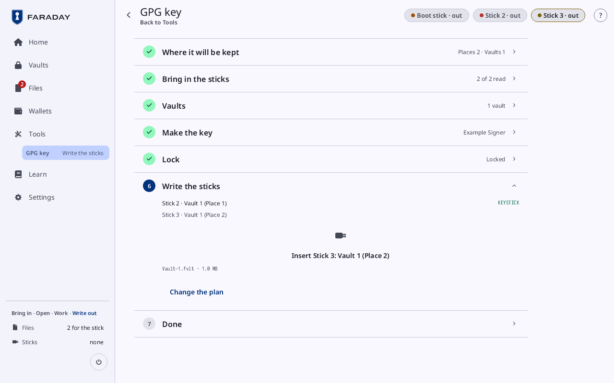
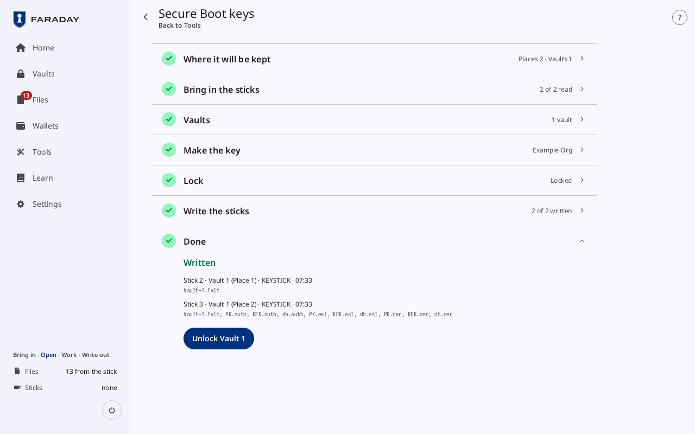

# The backup flow

**Kind:** Reference
**Status:** Checked against the app's pictures in docs/guide/pictures/ (drawn by just guide-pictures) and its code and strings (`faraday/faraday-core/src/backup_flow/screen.rs`, `faraday/faraday-core/src/backup_flow/wallet_screen.rs`, `faraday/faraday-core/src/backup_flow/steps.rs`, `faraday/faraday-core/src/backup_flow/mod.rs`, `faraday/faraday-core/src/stick/pills.rs`)
**Screen:** `BackupFlow`
**Group:** Wallets

The flow that makes a key where its backup is planned first: where it
will be kept, its sticks read and its vaults made or unlocked before
the key exists, then the key, one lock, and each stick written. Its
title is what it makes: **GPG key**, **Secure Boot keys**, or **Bitcoin
wallet** for a wallet's vaults and sticks.

**Opened from:**

- **Tools → GPG key** and **Secure Boot keys** with no vault open, and
  **Make a key** or **Make keys** in [Vault contents](vault.md);
- **Use vaults** with **Yes** in [Make a new wallet](make-a-wallet.md#use-vaults)
  or Restore: the sticks and the vaults, before the keys;
- **Lock and write** on a wallet backup's checklist
  ([Back up a wallet](back-up-wallet.md#the-checklist)): the lock and
  the sticks;
- Home's lead, or **Continue the backup**, for a flow left part way.

Its way back, at the top left, is named after the card before the one
open, else the screen it was opened from, else **Tools** for a GPG key
or Secure Boot keys (after the lock too) and **Home** for a wallet's; it
keeps the flow as it is. **Cancel**, at the top right, is offered until the key is
made; after that the flow ends only by finishing.

On the Faraday stick a strip across the top holds a pill per stick the
flow uses ("Boot stick · out", "Stick 2 · out", "Stick 3 · out"), lit
while that stick is in, and the lines name each stick by its pill; on
Faraday Demo and the desktop app the sticks are folders, and the lines
say "the stick for Vault 1 (Place 1)". The pictures are the Faraday
stick's.

*The flow for a GPG key, opened from Tools: two places, each a stick with Vault 1, Place 1 also carrying the public files, and "Vault 1 · new" kept at both.*

## The cards

| Card | Closed | Shown |
|---|---|---|
| **Where it will be kept** (**The plan** for a wallet) | "Places 2 · Vaults 1" | always |
| "Bring in the sticks" | "1 of 2 read"; once passed with sticks of new vaults still to read, "Read as written" or "1 of 3 read, the rest as written": those are read on **Write the sticks** | where the plan has a stick |
| **Vaults** | "0 of 1 unlocked", then "1 vault" or "2 vaults" | where the plan has a vault |
| **Make the key** (**Make the keys** for a wallet) | the key's name ("Example Signer"), or **Not made** | always |
| **Lock** | **Not locked**, **Locked** | where the plan has a stick |
| "Write the sticks" | "1 of 2 written" | where the plan has a stick |
| **Done** | **Written** | always |

A wallet's setup, before its keys, is two cards: the sticks and the
vaults; in Guided mode each says what it is for, with a link to Learn.
**Change the plan**, under the card open after the first, goes back to
**Where it will be kept**.

## Where it will be kept

A row per place: "Place 1", and what its stick keeps ("A stick with
Vault 1"), with buttons under it:

| Control | What it does |
|---|---|
| "Vault 1" | the vault this place's stick holds; filled while chosen |
| **A new vault** | gives the place a vault of its own |
| "Also Vault 2" | adds a second vault to the place |
| "One stick for both" | with two vaults at the place: both on one stick |
| **Public files here** | the place whose stick also carries the public files |
| **Remove** | removes the place, while there are more than the fewest |
| **I destroyed this copy** | on a place already written: takes it off the plan |
| **Add a place** | adds a place |

Under the places, a row per vault: "Vault 1 · new" or "Vault 1 · an
existing vault", its places, and **An existing vault** (or **A new
vault**) to change which, until its stick is read. With too few places,
"At least 2 places" and **Continue** is grey.

For a wallet, this card is **The plan**: Back up's own board and cards
([Back up a wallet](back-up-wallet.md#the-plan)), then **Continue**.

## Bring in the sticks

| Control | What it does |
|---|---|
| "Lock and bring in the sticks" | while a key is loaded or a vault is open: locks first, then the flow goes on |
| the slots | a row per stick: "The stick for Vault 1 (Place 1)", or on the Faraday stick "Stick 2 · Vault 1 (Place 1)" by the stick's pill; the stick's label once read |
| "Insert the stick for Vault 1 (Place 1)" | the stick it asks for next; on the Faraday stick "Insert Stick 2: Vault 1 (Place 1)", by the stick's pill |
| "Use Boot stick, read at 14:02" | the Faraday stick, where the plan can use it |
| "Reading Stick 2" | while the stick is read |
| "This is the stick for Vault 1 (Place 1)" | takes this stick for that slot |
| "Hold: this is the stick for Vault 1 (Place 2)" | the same as a hold, where the stick reads as one read before ("This reads as Stick 2") |
| "One stick for both" | takes one stick for two slots |
| "Use another stick" | refuses this stick and asks again |
| "Which vault is Vault 1?" | a stick that holds vaults already: one of them, or **A new vault beside them** |
| "Stick 2's copy of Vault 1 differs from Stick 1's" | two copies that differ: "Use Stick 2's copy" or "Use Stick 1's copy" |
| "Pull the stick" | once a stick is read: pull it before the next |
| "One stick at a time" | in the warning tone, with two in |

Why a stick is refused, in the error tone:

| Line | Means |
|---|---|
| "Not a FAT32 stick. Format it as FAT32, or use another stick" | the stick cannot take the files |
| "This is a boot partition. Use another stick" | the stick starts a computer |
| "Cannot be written. Use another stick" | the stick is read-only |
| "This stick cannot be read. Use another stick" | nothing could be read |
| "Not enough room: 64 MiB needed, 12 MiB free" | the stick is too full |
| "No vault for Vault 1 on this stick" | an existing vault, not on this stick |

## Vaults

| Control | What it does |
|---|---|
| "Create Vault 1" | a new vault: opens [Create a vault](create-vault.md) in the flow's place, its name set |
| "Open Vault 1" | an existing vault: its passphrase field, and "Unlock Vault 1" |
| **Unlocking** | while it unlocks |
| "Vault 1 · Unlocked" | once it is open |
| "12 MiB free" | the room on the vault's stick |
| **I do not have its passphrase** | offers **A new vault beside it** or "Use another stick" |
| "Pull the stick to unlock" | in the warning tone, while a stick is attached |

## Make the key

| Kind | Fields | Once made |
|---|---|---|
| a GPG key | **Name**, **Email**, **Expires** | **User ID**, **Fingerprint**, **Revocation certificate** ("Kept with the key · made 2026-10-27"), **Show as QR** |
| Secure Boot keys | **Owner name** | **Owner GUID**, **Show as QR** |
| a wallet | none: once the sticks and vaults are in, the flow goes back to [Make a new wallet](make-a-wallet.md#keys), whose **Keys** card makes them | the wallet's name |

**Make the key** makes it; **Making the key** while it is made; "In
Vault 1" for each vault it is saved into, then **Continue**. A vault
added once the key is made takes it from a vault that holds it: **The
new vault takes the key from one that holds it**, **Copy the key**; for
a key kept only on paper, "3dca6805 is kept only on paper" and **Add the
key from its copy**.

## Lock

**Kept** and **Wiped from memory**: what the lock keeps and what it
wipes; a key kept nowhere else is in the error tone. **Lock and write**
locks once: every vault is sealed with the key in it, and every key is
wiped.

## Write the sticks

The slots again, each ticked once written, and the stick asked for
next, with the files it gets:

*Stick 2 written (its label "KEYSTICK" beside it), and the flow asking for the next: "Insert Stick 3: Vault 1 (Place 2)", the file "Vault-1.fvlt · 1.0 MB" under it.*

| Control | What it does |
|---|---|
| "Insert the stick for Vault 1 (Place 1)" | the stick to plug in, as on Bring in the sticks |
| "Writing Vault-1.fvlt" | each file written, read back and compared |
| "Written and checked on Stick 2" | in the ok tone, then "Pull the stick" |
| "Hold: this is a second stick" | where the stick reads as one written before: held until it fills, it writes it |
| "Use another stick" | refuses this stick |

| Line | Means |
|---|---|
| **Pulled before the copy was checked. Nothing counted** | plug it in again |
| "The copy did not check on Stick 2. Nothing counted" | the copy read back differs |
| "Vault-1.fvlt did not read back from Stick 2; try another stick" | the stick did not keep what was written |
| "This stick has the first copy" | the stick already written for another place |
| "Not the stick read for Vault 1 (Place 1)" | a different stick from the one read for this slot |

## Done

*The flow for Secure Boot keys done: each stick's line, its files under it, and "Unlock Vault 1", which is outlined.*

**Written**, a line per stick: the stick, its place, its label and the
time ("Stick 2 · Vault 1 (Place 1) · KEYSTICK · 07:33"), and under it
the files written to it. "Unlock Vault 1" opens the vault with its
passphrase; for a GPG key or Secure Boot keys the key's page follows,
for a wallet its card. A wallet with no vault has **Home**. In Guided
mode a wallet's **Done** has the line on extra copies.

## On a narrow window

One card a page, its title with "Step 2 of 7" beside it, counted over
the flow's cards.

## Why

- [Vaults](../../learn/faraday/vaults.md)
- [Passphrases](../../learn/05-passphrases.md)
