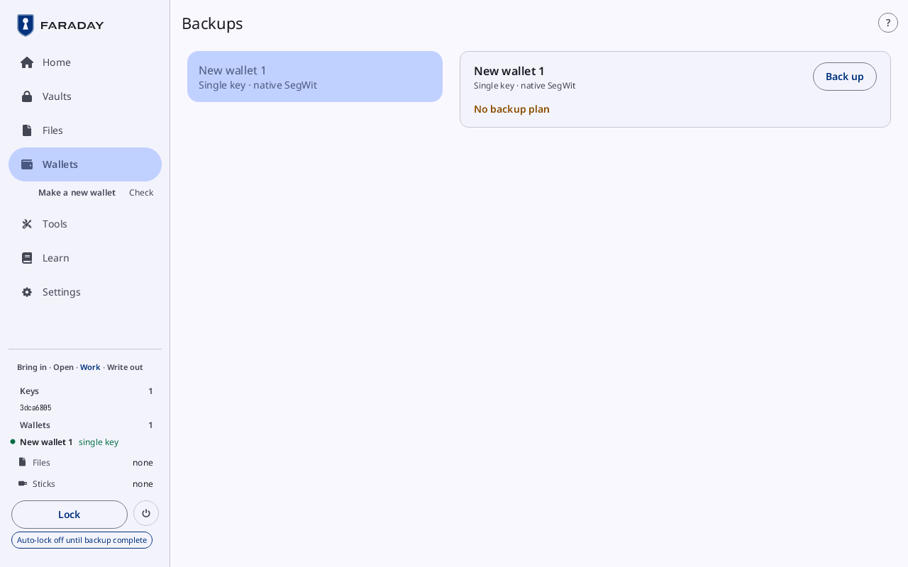
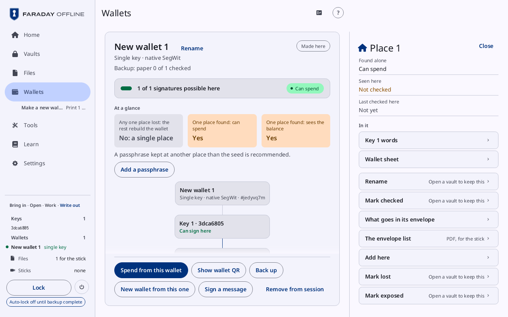

# Backups and the chart

**Kind:** Reference
**Status:** Checked against the app's pictures in docs/guide/pictures/ (drawn by just guide-pictures) and its code and strings (`faraday/faraday-core/src/backups/screen.rs`, `faraday/faraday-core/src/backups/mod.rs`, `faraday/faraday-core/src/glance/sheet.rs`, `faraday/faraday-core/src/chart_edit.rs`)
**Screen:** `Backups`, `Chart`
**Group:** Wallets

Every wallet known and where its backup is, and the sheet a press on a
wallet's chart opens: what a thing is, where it is, what was seen of it
here, and what can be done with it.

## Backups

**Opened from:** Home's **Backups** tile ("3 with a plan", "1 not
backed up"), shown once a wallet is known; the backup line on a
[wallet's card](wallets.md#the-card).

*Backups with one wallet, made here and not backed up yet: its card reads **No backup plan**, with **Back up** at its top right.*

At 1280 × 800 the page is the wallets on the left and the one chosen on
the right. A wallet is listed once, whether it is loaded, in an open
vault, or remembered from a vault now locked.

| Control | What it does |
|---|---|
| a wallet's row | its name and shape; a press shows it |
| the wallet's name and shape | at the top of its card |
| **Back up** | at the card's top right: opens [Back up a wallet](back-up-wallet.md) on it; **Continue the backup** for one left part way. Shown for a loaded wallet |
| **No backup plan** | in the warning tone, where no plan is known for the wallet |
| a place's row | where ("Place 1", **Vault**, "Stick of files", **Watch-only software**, **Own devices**), what it holds, its tag (**secret**, **sealed**, **public**), and what was seen of it |

What was seen of a place:

| State | Means |
|---|---|
| **Checked**, **Not checked** | a place's paper copies, checked here or not |
| "vault.ofv · unchanged", "vault.ofv · changed since written" | the vault holding the seeds, and where its file stands; **Not saved yet**, or **A vault is locked** where its vault is not open |
| "On Stick 2, 14:02" | files written on the last stick visit; **For the stick** while they wait; **Not made** |
| "For the stick, unprotected" | in the error tone: a seed's file outside a vault, made or written |
| **Shown**, **Not shown** | the descriptor shown to the watch-only software |
| **Not here** | a seed kept on its own device |
| **Not seen** | nothing seen of it this power-on |
| "Plan" with "In vault.ofv · locked" | a wallet a locked vault holds a plan for |

The wallet card's backup line reads from the same: "Backup: paper ×2
checked · vault.ofv · unchanged" (every paper copy checked), "Backup:
paper 0 of 1 checked" (some not yet), **Not backed up**, or "Backup:
planned" where the plan has no paper, vault or files yet.

### States

| State | What Backups shows |
|---|---|
| no wallet | **No wallet** |
| a wallet with no plan | its card, **No backup plan** and **Back up** |

## The chart

The chart is a wallet at a glance: the wallet, each key, and each place
of its backup with what it keeps. It is drawn under **At a glance** on
a [wallet's card](wallets.md#the-card), at the end of a backup
([Backup done](back-up-wallet.md#backup-done)), and on a wallet in
[Vault contents](vault.md).

**Opened from:** a press on a node of the chart (the wallet, a key, a
place, a vault, the files, the software) or on a line inside one. At
1280 × 800 the sheet stands at the right of the page, **Close** at its
top right; the wallet's card stays beside it whole, and on Wallets the
list gives way while the room left cannot hold both. On a narrow window
the sheet covers the page, and **Back** closes it. Opening it
changes nothing; each action leads into the flow that does it.

*Place 1 of a single-key wallet's plan, pressed on its chart: **Found alone** "Can spend", **Seen here** **Not checked**, **Last checked here** **Not yet**, **In it** "Key 1 words" and "Wallet sheet", then the place's rows; with no vault open, those that keep something read **Open a vault to keep this**.*

Names, dates and marks are kept in the open vault. With none open, a
row that keeps one reads **Open a vault to keep this** and leads to one.

### The wallet

Its name, **Shape** and **Checksum**.

| Row | What it does |
|---|---|
| **Open in Wallets** | for a wallet in a vault: loads it |
| **Show wallet QR** | **The descriptor** as a [QR code](qr-and-scan.md#a-qr-code) |
| **Check addresses** | **The first three**, shown in the sheet |
| **Public files** | **For the software**: the checklist's public files |
| **Print the wallet sheet again** | its PDF, **For the stick**; **Print the shares again** (**PDFs, text and pictures**) for a wallet split into shares |
| **Rename the wallet** | its name, on the card |
| **Change the plan** | the backup's plan, with the chart's changes in it |

### A key

"Key 1 · 3dca6805": **Label**, **Where** it is, **Holder**, **Last
checked**, and **Its seed is at** the places that keep it.

| Row | What it does |
|---|---|
| **Show xpub QR**, **Xpub file** | the key's xpub, as a code or a file **For the stick** |
| **Explore this key** | opens Explore on it |
| **Where it is** | draws that key's lines bold on the chart and dims the rest |
| **Make another backup of this seed** | **Words, by hand** and **SeedQR, by hand** (**Then a place**), **Seed XOR or codex32** (**By hand**), "Into Vault 1", **As a file** |
| **Check a copy of this seed** | **Scan my copy**, **Type my copy** |
| **Its passphrase** | **Check it** (**By the key it makes**), **Another copy** |
| **Show its xpub** | a cosigner's key: its xpub as a code |
| **Name its holder**, **Mark checked** | a cosigner's key: who holds it, and its backup confirmed today |
| **Load this key** | a key not here, with the way in |

### A place, a vault, the files, the software

The node's name; **Stick**, **Found alone** (what someone who finds it
gets), **Seen here** and **Last checked here** (**Not yet**). **In it** lists
each thing kept there; a press on one opens [a line](#a-line).

| Node | Rows |
|---|---|
| a place | **Rename**; **Mark checked**; **What goes in its envelope**; **The envelope list** (**PDF, for the stick**); **Add here**; **Mark lost**, **Mark exposed**; **Remove the place**, last, only while the plan has more than one place |
| a vault | the way to open it; **Rename**; **Save its seeds into it**; **Copy to another stick**; **Save more into it**: "Key 1 seed", **The description** |
| the files | **Write the seed files again**, **Write the public files again**, **Remove from the plan** (**Destroy its copies by hand**) |
| the software | **Show the descriptor QR again**, **Public files for this software** |

### A line

One thing kept at one place: **Kept at**, **Seen here**, **Last
checked here**, and **Marked** (**Lost**, **Exposed**, **Drawn in part**).

| Thing | Rows |
|---|---|
| a seed's words or SeedQR | **Scan my copy**, **Type my copy** (**Check this copy**); **Make another copy** (**Elsewhere**) |
| a file | **Write it again** (**For the stick**) |
| codex32 strings | **Check my copy** (**Codex32 strings**), **Add, replace or rotate the set** |
| the wallet sheet | **Print it again**, **As a QR picture**, **As text** (**The descriptor**), **Another copy** |
| a share | **Print the shares again**, **Keys left off each share** |
| a vault's stick | the way to open it; **Copy the vault to another stick**; **Write it out again** (**Changed since written**) while the vault has changed |
| the description | **Show wallet QR** |
| a seed not here | **Load this key** |

At a place, every line also has **Move** (**To another place**), **I
destroyed this copy** (**Remove from the plan** once marked), and
**Lost** and **Exposed** to mark it. A copy drawn in part has only **I
destroyed this copy**.

### A change asked first

A change to where something is kept (a move, another copy, a thing
added or destroyed, a place removed) shows the plan's three lines before
and after, then **Confirm**. One that takes something off the plan says
**Destroy what goes off the plan by hand**. "Move Words to", "Another
copy of Key 1 words" and "Add at Place 1" list the places, and **A new
place**. "Remove Place 2" asks where each thing in it goes ("Words goes
to"): another place, or **Nowhere** (**Destroyed**); the button is grey
until each has one.

A thing marked lost or exposed says what follows, in order:

| Line | Row |
|---|---|
| **Someone can now spend**, **Someone could spend with a vault's passphrase** | **Move the money** (**New wallet**) |
| **The wallet can no longer be rebuilt from what is left** | **Back up again now** |
| **Someone can see the balance** | |
| **Nothing lost that is not elsewhere** | **Make a replacement copy** |
| **Nothing it holds spends or shows the balance** | |

### Names and passphrases

| Sheet | Controls |
|---|---|
| a holder's name, a vault's name | **Holder** or **Name**, then **Keep** |
| "Passphrase 1" | **Passphrase** (**Type it**), **Check**: "Matches: it makes key 3dca6805" or **Does not match**; **Show it** (**To copy by hand**) |

## On a narrow window

Backups shows one wallet a page, "Wallet 1 of 3", with **Previous** and
**Next**; each place's state on its own line under its name. The chart's
sheet covers the page.

## Why

- [Backups](../../learn/04-backups.md)
- [A backup plan's check](../../learn/faraday/backup-plan-check.md)
- [Vaults](../../learn/faraday/vaults.md)
