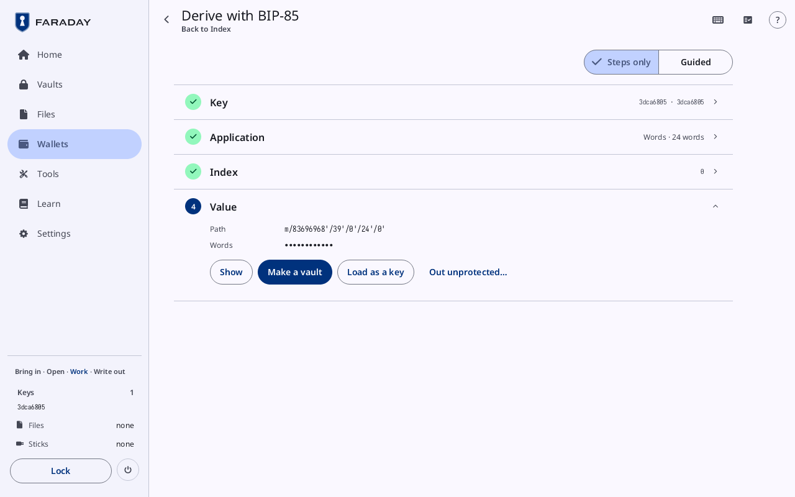

# Derive with BIP-85

**Kind:** Reference
**Status:** Checked against the app's pictures in docs/guide/pictures/ (drawn by just guide-pictures) and its code and strings (`faraday/faraday-core/src/bip85/screen.rs`, `faraday/faraday-core/src/bip85/mod.rs`, `faraday/faraday-core/src/vault/mod.rs`)
**Screen:** `Bip85`, `ChildRecord`
**Group:** Tools

**Opened from:** **Tools → Child seeds and passwords**, which reads
**Load a key first** and does not open while no key is loaded.

Child seeds, keys and passwords made from a loaded key the way BIP-85
specifies, so the key's backup covers them all. A column of four
cards; with one key loaded it opens on **Application**, that key
chosen, with **Words**, 24 words and index 0.

*Derive with BIP-85 on key 3dca6805, **Words** · 24 words at index 0: the **Value** card open at m/83696968'/39'/0'/24'/0', the words hidden, **Show**, **Make a vault**, **Load as a key** and **Out unprotected…**.*

## On this screen

| Control | What it does |
|---|---|
| the way back | at the top left, its name under the title: where the page was opened from on the first card, the card before on a later one |
| **Steps only**, **Guided** | at the top right: the short text on each open card, off or on; on **Key** with a link to Learn's **Seed words** |
| a card | its title and what was chosen; a press opens it again once the cards before it are done |

## The cards

### Key

Closed, the key's fingerprint and name, or **Not chosen**.

| Control | What it does |
|---|---|
| a key's button | one per key loaded, by fingerprint and name; the chosen one filled |

### Application

Closed, the application and its length ("Words · 24 words").

| Control | What it does |
|---|---|
| **Words**, **WIF**, **Extended private key**, **Hex**, **Password (base64)**, **Password (base85)** | what is made. **WIF** and **Extended private key** have no length and move on when pressed |
| **-**, **+** | the length: "24 words" (12 to 24, three at a time), "32 bytes", "21 characters"; the range beside it ("12 to 24") |
| **Continue** | closes the card and opens **Index** |

### Index

Closed, the index.

| Control | What it does |
|---|---|
| **-**, the index, **+** | the index; digits typed go into it (**Type the digits · Enter continues**) |
| **An index is 0 to 2147483647** | in red, while the number typed is past it; the card does not close |
| **Continue** | closes the card and opens **Value** |

### Value

Closed, the path.

| Control | What it does |
|---|---|
| **Path** | the path BIP-85 derives it at, "m/83696968'/39'/0'/24'/0'" |
| the application's name (**Words**) | the value, hidden as dots until **Show** |
| **Show**, **Hide** | the value on screen, or hidden; it is hidden again once the card is left |
| "Save into Vault 1" | into the open vault, by its name: a password as an entry and anything else as a note, each named "BIP-85 Password (base64) · 3dca6805 · index 0"; child words as a key, after [Record it as a child seed?](#record-it-as-a-child-seed) |
| **Make a vault**, "Unlock Vault-1.fvlt", **Unlock a vault** | in its place while no vault is open: **Make a vault** while Files holds none, "Unlock" and the file's name for one locked vault in Files, **Unlock a vault** for several; each comes back here |
| **Load as a key** | for **Words**: loads the child words as a key of this session ("Key … added"), after [Record it as a child seed?](#record-it-as-a-child-seed) |
| **Out unprotected…** | the value to the stick unprotected, through [This is a secret](files.md#this-is-a-secret); child words go as a seed's words file named by the child's own fingerprint ("…-words.txt"), holding the words alone |

## Record it as a child seed?

A dialog before child words go into the vault or load as a key: whether
Faraday keeps that they are BIP-85 index 0 of key 3dca6805.

| Control | What it does |
|---|---|
| **Don't record** | the words go in as an ordinary seed: nothing in the vault or the session ties them to their parent |
| **Record** | the vault keeps the parent's fingerprint and the index with the key (or, loaded, the session does, and any vault the key is saved into), and Keys shows it as "BIP-85 Words · 3dca6805 · index 0" |

A press beside it, or Escape, puts the words nowhere. The key is named
by its own fingerprint either way, and nothing written for its backup
says it is a child seed. A wallet made over a key recorded as one says
so once, in **A BIP-85 child seed**, with **OK**.

In Faraday Demo the value is not made: it stays dots.

## On a narrow window

The top bar holds the way back and the name, **BIP-85**; the value is
under its name, and the length's **+** at the row's end.

## Why

- [Seed words](../../learn/02-words.md)
- [Passphrases](../../learn/05-passphrases.md)
- [Glossary](../../learn/15-glossary.md)
