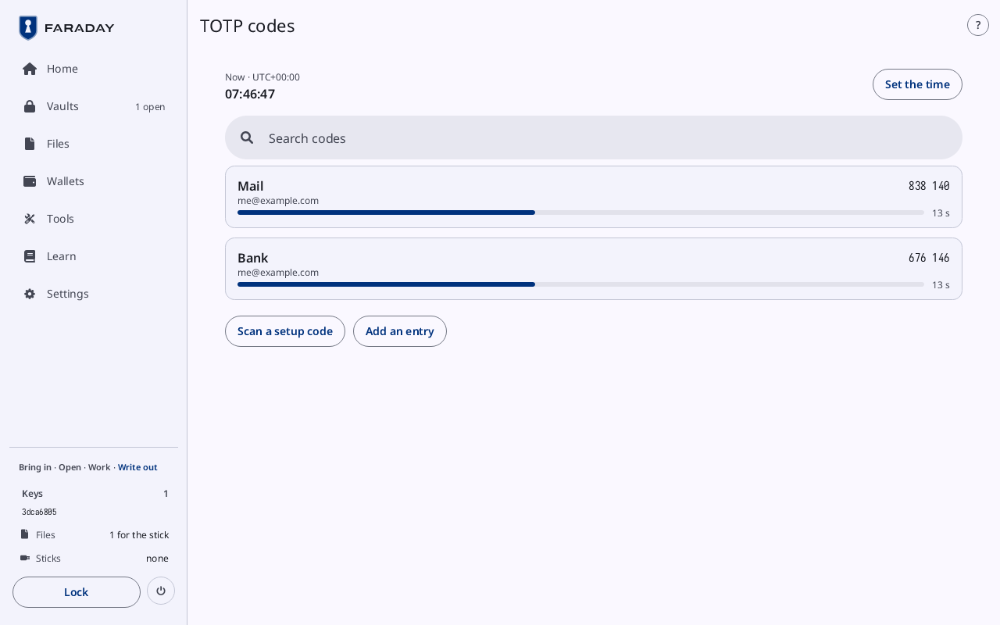

# TOTP codes

**Kind:** Reference
**Status:** Checked against the app's pictures in docs/guide/pictures/ (drawn by just guide-pictures) and its code and strings (`faraday/faraday-core/src/codes/screen.rs`, `faraday/faraday-core/src/codes/mod.rs`, `faraday/faraday-core/src/vault/mod.rs`, `faraday/faraday-core/src/catalog.rs`)
**Screen:** `Codes`
**Group:** Vaults

**Opened from:** **Tools → TOTP codes**, and **TOTP codes** on a
vault's Entries. With no vault open, the tool leads to Create a vault
or Unlock first, and comes back here once one is open. While the clock
has not been set this power-on, Set the time opens first.

One row for each entry that holds a TOTP secret, across every open
vault, vault by vault in the order they were opened.

*Two rows, Mail and Bank, each with its account, its code and 13 s left; above them "Now · UTC+00:00", **Set the time** and **Search codes**; under them **Scan a setup code** and **Add an entry**.*

## On this screen

| Control | What it does |
|---|---|
| "Now · UTC+00:00" | the time of day, with seconds, and its zone; **Not known** while the clock is not set |
| **Set the time** | opens Set the time |
| **Search codes** | the search bar, shown while there are rows or it holds something: keeps the rows whose title holds what is typed |
| a row | the entry's title; its account, and the vault's name while more than one is open; the code, and a bar with the seconds it has left. A press opens the entry in its vault ([Vault contents](vault.md#an-entry)) |
| **Scan a setup code** | opens the camera for a TOTP setup code; what it reads fills a new entry's form here |
| **Add an entry** | opens the entry form under the rows: **Title**, **Username**, **Password**, **URL**, **Notes**, **TOTP secret**, then **Save** and **Cancel**. The entry goes into the open vault that Vault contents last showed |

| A row's badge | Shown for |
|---|---|
| **Set the time first** | every row, while the clock is not known |
| **HOTP** | a counter-based secret, for which no code is made here |
| **Unreadable** | a secret that does not read |

## States

| State | What the screen shows |
|---|---|
| no entry with a TOTP secret | **No entries with a TOTP secret** |
| a search that finds nothing | **No codes match** |

## On a narrow window

One column: Now first, then the rows, the account line dropped where it
does not fit. While typing goes to the search bar, the bar and the rows
it finds take the page.

## Why

- [Time and TOTP codes](../../learn/faraday/time.md)
