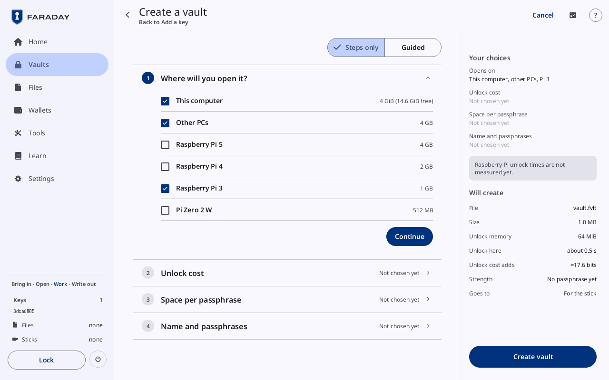
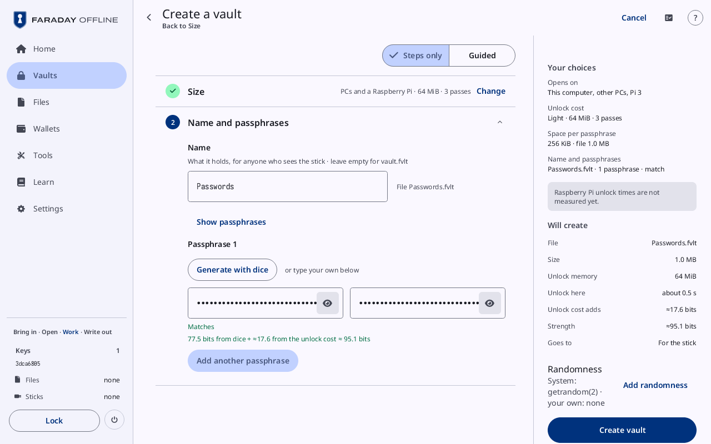

# Create a vault

**Kind:** Reference
**Status:** Checked against the app's pictures in docs/guide/pictures/ (drawn by just guide-pictures) and its code and strings (`faraday/faraday-core/src/vault/screen.rs`, `faraday/faraday-core/src/vault/dice_screen.rs`, `faraday/faraday-core/src/vault/area.rs`, `faraday/faraday-core/src/vault/mod.rs`)
**Screen:** `CreateVault`
**Group:** Vaults

**Opened from:** **Create a vault** on Home, on Vaults and on Unlock;
**Make a vault** where a flow needs a vault and Files holds none: a
backup's checklist, and a secret on its way out
([This is a secret](files.md#this-is-a-secret)). Its way back at the
top goes to **Home**, **Vaults**, or the flow it was opened from; then
a chip beside the title names the flow it goes back to ("Then: …").

The page is a column of cards, one open at a time, with **Your
choices** in a panel at the right. Above the cards, **Steps only** and
**Guided** choose whether each card carries its explanation. A card's
head, once it is answered, shows the answer and **Change**; pressing
the head opens it again.

## The cards

By default two cards: **Size**, then **Name and passphrases**.
**Customise** on **Size** replaces it with three cards, walked in
order: **Where will you open it?**, **Unlock cost** and **Space per
passphrase**.

### Size

| Control | What it does |
|---|---|
| **PCs only** | 512 MiB and 3 passes: opens on PCs. A press chooses it and moves on |
| **PCs and a Raspberry Pi** | 64 MiB and 3 passes: opens on PCs and a Raspberry Pi 3 as well. Chosen at first |
| each row's line | "Unlocks in about 2.4 s here", or **Unlock time not measured yet**; "This computer has 1.2 GiB free" in the warning tone where this computer is short of the memory |
| **Customise** | opens the three cards below, on the size's values |

### Where will you open it?

*After **Customise**: **Where will you open it?** with **This computer**, **Other PCs** and **Raspberry Pi 3** ticked, **Continue**, and **Your choices** with **Will create** at the right.*

| Control | What it does |
|---|---|
| **This computer** | its line gives the most unlock memory it gives a vault and what is free ("4 GiB (14.6 GiB free)"), or **Memory not reported** |
| **Other PCs**, **Raspberry Pi 5**, **Raspberry Pi 4**, **Raspberry Pi 3**, **Pi Zero 2 W** | each ticks or unticks a kind of machine, with its memory at the right (4 GB, 4 GB, 2 GB, 1 GB, 512 MB) |

The card opens with the machines the size was made for ticked: from
**PCs and a Raspberry Pi**, **This computer**, **Other PCs** and
**Raspberry Pi 3**.
| **Continue** | closes the card and opens the next |

The cost suggested on the next card fits the machine with the least
memory ticked.

### Unlock cost

| Control | What it does |
|---|---|
| **Light**, **Standard**, **Medium**, **Strong**, **Maximum** | 64 MiB and 3 passes, 256 MiB and 3, 512 MiB and 3, 1 GiB and 4, 2 GiB and 2; each row's line gives the cost and the bits it adds ("512 MiB · 3 passes · ≈… bits"). A press chooses it and moves on |
| the note at a row's right | **Suggested**, **Fits**, or "Too large for Raspberry Pi 3" in the warning tone |
| **Custom** | **Choose memory and passes**: opens two rows of buttons under the list |
| **Memory** | 64 MiB to 4 GiB, for **Custom** |
| **Passes** | 2 to 10, for **Custom** |
| "Unlock memory 512 MiB" | the memory chosen, against what the weakest machine gives ("Raspberry Pi 3: up to 512 MiB"), with a bar |
| "Unlocks in about 2.4 s here" | the time measured on this computer |
| "Adds ≈… bits to every passphrase" | what the cost adds |
| **Continue** | for **Custom**: closes the card and opens the next |

### Space per passphrase

| Control | What it does |
|---|---|
| **64 KiB**, **256 KiB**, **1 MiB**, **4 MiB** | the space each passphrase's contents get, with the file's size under it ("file …"). 256 KiB is chosen at first. A press chooses it and moves on |

### Name and passphrases

*The vault named Passwords ("File Passwords.ofv"), **Passphrase 1** from dice in both fields, **Matches**, and its strength; **Size** answered above with **Change**. **Create vault** is outlined.*

| Control | What it does |
|---|---|
| **Name** | what the vault holds, for anyone who sees the stick; the file's name follows it ("File Passwords.ofv"). Left empty, the file is `vault.ofv` and the vault's title is "Vault" |
| **Show passphrases**, **Hide passphrases** | shows or hides every passphrase typed |
| **Passphrase 1** | the first passphrase: two fields, typed, then typed again |
| **Generate with dice** | opens the dice panel under the fields; "or type your own below" beside it |
| the line under the fields | **Matches**, **Does not match yet** in the warning tone, or **Type it, then type it again** |
| the strength line | "77.5 bits from dice + ≈17.6 from the unlock cost ≈ 95.1 bits" for words from dice; "Typed: its own bits are not measured · the unlock cost adds ≈…" for a typed one |
| **Remove** | beside a second, third or fourth passphrase: removes it |
| **Add another passphrase** | adds one, up to four. Each passphrase opens its own contents |
| "Remove the stick, then type the passphrases" | in place of the fields while a stick is attached |

#### Generate with dice

| Control | What it does |
|---|---|
| **Which list?** | **Long list** (**7776 words · five dice**), **Short list** (**1296 words · four dice**), **Short list 2** (**1296 words · 3 edits apart**) |
| "Roll 5 dice for each word and type the numbers" | the field the rolls are typed into |
| the words | each word as its rolls make it, a pill that opens it in its list; **No word yet** before the first |
| the strength | the words so far, their bits and the bits with the unlock cost, and "· 3 of 5 dice for the next word" part-way |
| **Use these words** | puts the words in both fields |
| **Cancel** | closes the panel |

## Your choices

The panel at the right lists **Opens on**, **Unlock cost**, **Space per
passphrase** and **Name and passphrases**, each with its answer or
**Not chosen yet**; a press on one opens its card. Under them:

| Control | What it does |
|---|---|
| a warning | "This computer cannot allocate 4 GiB. A vault it could not open is never written." in the error tone; "Medium needs 512 MiB. Pi Zero 2 W gives a vault … at most." and "Unlocking takes about 14 s here." in the warning tone; **Raspberry Pi unlock times are not measured yet.** |
| **Will create** | **File**, **Size**, **Unlock memory**, **Unlock here**, **Unlock cost adds**, **Strength** (**Weakest passphrase** with more than one) and **Goes to** (**For the stick**) |
| **Create vault** | makes the vault and puts it in Files, for the stick. Grey while a stick is attached. What stops it is named under **Will create**, and nothing is made: **Every passphrase needs a value**, **Each passphrase must be typed the same twice**, **Two passphrases are the same. Each must differ**, "Finish step 1 first" |

| State | What the page shows |
|---|---|
| making | "Creating · about 2.4 s" in place of **Create vault** |
| made | "Vault created", then [Unlock](vaults.md#unlock) on the new vault, with **Type the passphrase once more to open it**. Made inside a backup flow, it opens at once and the flow goes on |

## On a narrow window

There is no panel: **Will create** and **Create vault** follow the last
card.

## Why

- [Vaults](../../learn/faraday/vaults.md)
- [Passphrases](../../learn/05-passphrases.md)
