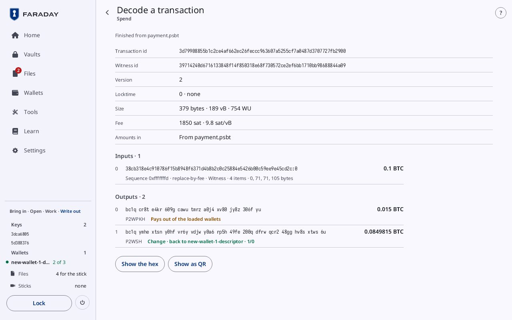

# Decode a transaction

**Kind:** Reference
**Status:** Checked against the app's pictures in docs/guide/pictures/ (drawn by just guide-pictures) and its code and strings (`faraday/faraday-core/src/screens/decode.rs`, `faraday/faraday-core/src/decode.rs`, `faraday/faraday-core/src/catalog.rs`)
**Screen:** `Decode`
**Group:** Tools

**Opened from:** **Decode** on a finished transaction in
[Files](files.md#a-file-from-the-stick); **Decode it** on the last card
of [Sign a transaction](sign.md); **Tools → Decode a transaction**,
which opens the first finished transaction in Files, or the
[camera](qr-and-scan.md#scan) while there is none.

A signed, finished transaction taken apart: what it is, what goes in,
what comes out and to whom, and its bytes. Nothing on it changes the
transaction.

*The 2-of-3 wallet's payment.psbt, signed and finished, opened with **Decode it** on Spend's last card: "Finished from payment.psbt", **Fee** "1850 sat · 9.8 sat/vB", **Amounts in** "From payment.psbt", "Inputs · 1" of 0.1 BTC, and "Outputs · 2": 0.015 BTC to bc1q cr8t … 306f yu, **Pays out of the loaded wallets**, and the change, "Change · back to new-wallet-1-descriptor · 1/0".*

## On this screen

| Control | What it does |
|---|---|
| the way back | at the top left, named after where the page was opened from: **Sign a transaction**, **Spend**, **Files**, **Wallets**, **Tools** or **Back** |
| the source | under the title: the file's name, or "Finished from payment.psbt" |

### The facts

| Row | What it shows |
|---|---|
| **Transaction id** | the txid |
| **Witness id** | the id with the witness counted |
| **Version** | the transaction's version |
| **Locktime** | **0 · none**, "… · block height" or "… · Unix time" |
| **Size** | "… bytes · … vB · … WU" |
| **Fee** | "1850 sat · 9.8 sat/vB"; **Not stated: the amounts going in are not here** |
| **Amounts in** | where the amounts going in were read: "From payment.psbt", a PSBT of this transaction here; **Not here**; or **PSBTs of it state different amounts**, and none is used |

### Inputs and outputs

| Control | What it shows |
|---|---|
| "Inputs · 1" | each input by its number from 0: the output it spends, its amount where known, then "Sequence …" with what the sequence means (**final**, **locktime on, no replace-by-fee**, **relative time lock, replace-by-fee**, **relative block lock, replace-by-fee**), its witness ("Witness · 2 items · 71, 33 bytes", or **No witness**) and a scriptSig's size where it has one |
| "Outputs · 2" | each output by its number: its amount in BTC, its address, its kind, and whose it is |
| "Change · back to New wallet 1 · 1/0" | in the ok tone: a loaded wallet's change address |
| "Back to New wallet 1 · receive 0/…" | in the ok tone: a loaded wallet's receive address |
| **Pays out of the loaded wallets** | in the warning tone: an address no loaded wallet gives |

### The bytes

| Control | What it does |
|---|---|
| **Show the hex**, **Hide the hex** | the whole transaction as hex, in a box under the buttons |
| **Show as QR** | the transaction as a [QR code](qr-and-scan.md#a-qr-code), for a wallet that broadcasts it |

## On a narrow window

The top bar holds the way back and the name, **Transaction**; each fact is under
its name, and an input's outpoint and an output's address are whole.

## Why

- [Verifying](../../learn/06-verifying.md)
- [Tools](../../learn/16-tools.md)
