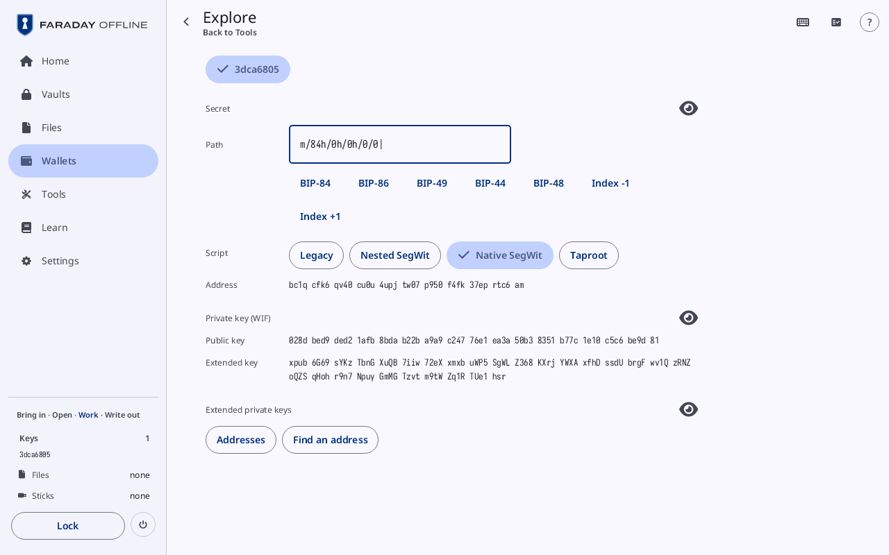
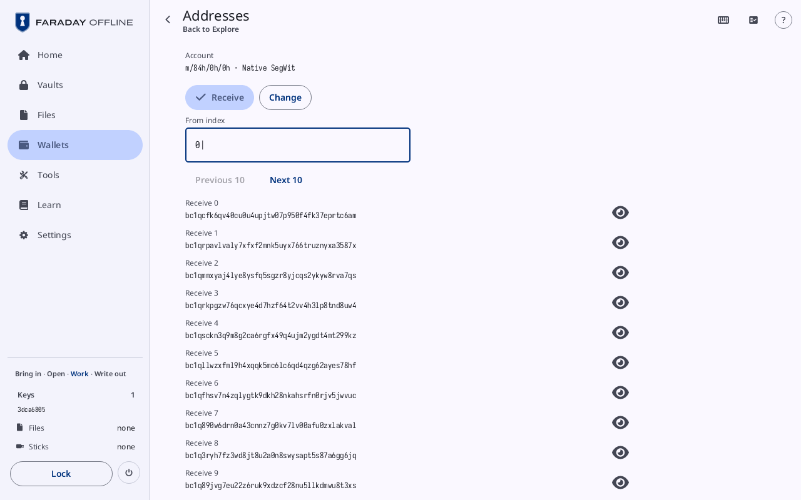

# Explore

**Kind:** Reference
**Status:** Checked against the app's pictures in docs/guide/pictures/ (drawn by just guide-pictures) and its code and strings (`faraday/faraday-core/src/explore/screen.rs`, `faraday/faraday-core/src/explore/pages.rs`, `faraday/faraday-core/src/explore/mod.rs`, `faraday/faraday-core/src/explore/addresses.rs`)
**Screen:** `Explore`
**Group:** Tools

**Opened from:** **Tools → Explore a key**, which reads **Load a key
first** and does not open while no key is loaded; a key under **Keys**
in the sidebar; **Explore this key** on a key's sheet in
[Backups](backups.md).

A loaded key's public side at any path: the address, the public key
and the extended key there, to compare with what another wallet shows
for the same path. The key's secret and its private keys show only
behind their eyes. It opens on the first key loaded (or the key
pressed) at BIP-84's first receive address.

*Explore on key 3dca6805 at m/84h/0h/0h/0/0, **Native SegWit**: the address bc1q cfk6 qv40 … rtc6 am, its public key and its extended key, the secrets behind their eyes.*

## On this screen

| Control | What it does |
|---|---|
| the way back | at the top left, named after where the page was opened from, under the title **Explore** |
| "The public side of a loaded key at any path: …" | under the title with **Guided** on, with a link to Learn's **Xpubs and privacy** |
| a key's button | one per key loaded, by fingerprint, and name where it has one; the one explored filled |
| **Secret** | an eye: shows the key's words in their numbered grid, and its **Passphrase** where it has one; for a key with no words, its **Master seed** in hex, its **codex32 secret** and each "codex32 share A" held |
| **Path** | the path, after `m/`; whatever is typed goes into it. A path that cannot be read has its edge in red and why under it |
| "BIP-84", "BIP-86", "BIP-49", "BIP-44", "BIP-48" | set the path to that standard's first receive address (BIP-48: its account) |
| **Index -1**, **Index +1** | step the path's last number |
| **Script** | **Legacy**, **Nested SegWit**, **Native SegWit**, **Taproot**: the kind of address, where the path does not name it |
| **Address** | the address at the path |
| **Private key (WIF)** | an eye: the address's private key under it |
| **Public key** | the public key at the path |
| **Extended key** | the extended public key at the path |
| **Extended private keys** | an eye: the **Root** key's, and the account's ("m/84h/0h/0h") where the path is in one |
| **Addresses**, **Find an address** | where the path is in an account: open the [Addresses](#addresses) and [Find an address](#find-an-address) pages |

A value is whole, in groups of four. An eye is open while what it shows
is hidden; pressed, it is struck through and filled. What an eye shows
is dropped once it is off screen.

## Addresses

**Opened from:** **Addresses** on Explore. Its way back is **Explore**.

*Addresses of the account m/84h/0h/0h · Native SegWit, **Receive** from index 0: Receive 0, bc1qcfk6qv40…rtc6am, to Receive 9, each with its private key behind an eye.*

| Control | What it does |
|---|---|
| **Account** | "m/84h/0h/0h · Native SegWit": the account the list is of |
| **Receive**, **Change** | the chain listed |
| **From index** | the first index listed |
| **Previous 10**, **Next 10** | the page before or after; **Previous 10** grey from index 0 |
| a row | "Receive 0" over the address, whole, and an eye on its **Private key (WIF)** |

## Find an address

**Opened from:** **Find an address** on Explore. Its way back is
**Explore**.

| Control | What it does |
|---|---|
| **Account** | the account searched |
| **Address** | the field: the address, or its start, typed; **Not an address** in red where it cannot be one |
| **Paste** | where the computer has a clipboard: pastes into the field; **Nothing to paste** |
| **Look through** | **First 100**, **First 1,000**, **First 10,000**: how many of each chain |
| **Search**, **Stop** | starts the search; **Stop** while it runs |
| "Searched 400 of 1,000 on each chain" | while it runs, over a progress bar |
| "1 found" | in the ok tone; each match as a row ("Receive 0"), the part typed in the accent; "3 more not listed" past the rows kept |
| "Not in the first 1,000 receive and change addresses" | in the warning tone, where none matched |

## On a narrow window

The top bar holds the way back and the name, **Explore a key**; each
value is under its name, not grouped, the words two to a row, and the
explanation is at the foot.

## Why

- [Xpubs and privacy](../../learn/11-xpubs.md)
- [Glossary](../../learn/15-glossary.md)
