# Files

**Kind:** Reference
**Status:** Checked against the app's pictures in docs/guide/pictures/ (drawn by just guide-pictures) and its code and strings (`faraday/faraday-core/src/screens/files.rs`, `faraday/faraday-core/src/file_menu.rs`, `faraday/faraday-core/src/screens/sheets.rs`, `faraday/faraday-core/src/secrets.rs`, `faraday/faraday-core/src/screens/visit.rs`, `faraday/faraday-core/src/visit_taken.rs`, `faraday/faraday-core/src/stick/wipe.rs`)
**Screen:** `Files`, `Taken`, `NameTaken`, `WriteOut`, `Delete`, `Zeroing`, `FileMenu`, `Rename`, `Details`, `Potential`, `SecretOut`
**Group:** Files

**Opened from:** the sidebar's **Files**, and its **Files** row at the
foot; a stick plugged in while Faraday holds no secret, which opens it on
the stick; the sidebar's stick rows and Home's **Files on {stick}** lead;
Home's **Written to …** lead; an empty vault's "Write it to a stick";
**Lock and use stick** on
[A stick is attached](lock-and-power.md#a-stick-is-attached); and **Copy
files in from a stick** in Restore, Add a key and the Spend tab. The boot
stick alone, at its first look in a power-on, leaves Home on screen
instead, with [Read from the boot stick](prompts.md#read-from-the-boot-stick)
over it when it holds files. **Import and load** leaves the files just
copied in in the list.

Files is what Faraday holds in memory: **From the stick**, the files
copied in, and **For the stick**, the files waiting to be written.
Both are emptied at power-off.

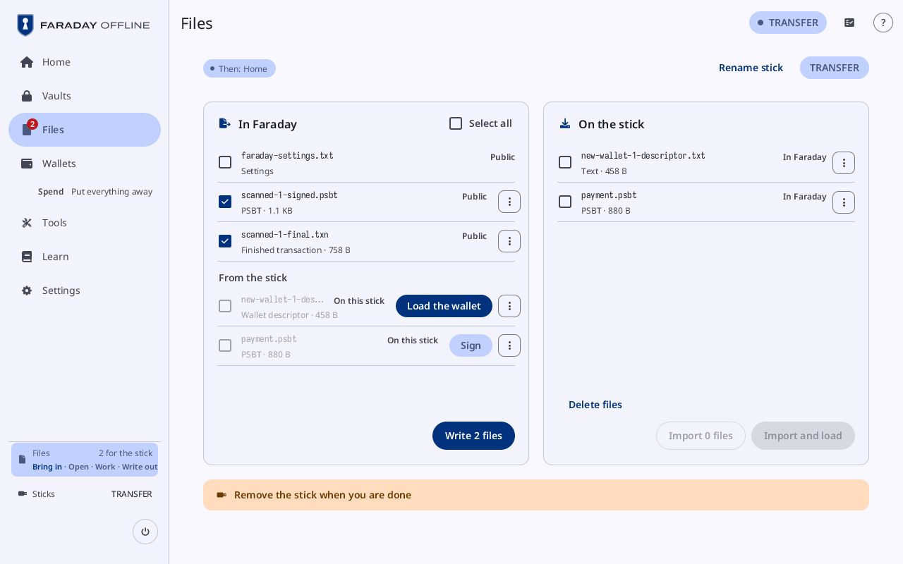

*Files: **From the stick** holds a wallet's description and a PSBT, with
**Load the wallet** and **Sign**; **For the stick** holds a signed PSBT
and a finished transaction, each **Ready**.*

## On this screen

| Control | What it does |
|---|---|
| the stick chip | at the top right: "Waiting for a stick"; "Lock to use {stick}" while a secret is held, which locks; "Visit" and the stick's name ("Visit TRANSFER"), which shows the [stick pane](#the-stick-in-files) |
| **Scan a QR code** | opens the camera ([Scan](qr-and-scan.md#scan)); what it reads lands in **From the stick** |
| **In memory · emptied at power-off** | a label beside it |
| "Two sticks of this build are in", "The stick Faraday started from was not found" | in the error tone, on a PC, when the stick it started from is not known: two sticks of the running build were in at start, or none was found. No data partition is then the device's own, and no settings are kept ([Why](#why)) |
| "Remove the stick when you are done" | in the warning tone, after **Import and load**, while the stick is still in: the keys copied in load once it is out ("1 key copied in · remove the stick to load it") |
| an open vault's panel | see [An open vault](#an-open-vault) |
| what the files give | a panel headed **From the stick**, above the two lists: see [What the files give](#what-the-files-give) |
| **From the stick** | the files copied in, with their count; each row its name, what it is and its size, its button, and its **⋮** |
| **For the stick** | the files waiting to be written, with their count, in three groups |
| "Power off asks first while files wait for the stick" | at the foot, while **For the stick** holds a file |

### A file from the stick

Each row has one button for what its kind is for, and **⋮** for the rest.

| Kind | Button | What it does |
|---|---|---|
| a PSBT | **Sign** | starts its spend: [Sign a transaction](sign.md) |
| a PSBT signed elsewhere that no key here is left to sign | **Nonce check** | opens its [nonce check](../walk/check-and-decode.md#4-nonce-check) |
| a PSBT of the spend under way, from another file | **Add to signatures** | adds its signatures to the spend |
| a wallet | **Load the wallet** | loads it and opens its card |
| seed words | **Load this key** | loads the key |
| a vault | **Unlock**, or **Contents** while it is open | opens its [Unlock](vaults.md#unlock) or its [contents](vault.md) |
| entries | **Import into the vault** | adds them to the open vault. Shown while a vault is open |
| a text file | **Add to vault** | adds it to the open vault as a note. Shown while a vault is open |
| a finished transaction | **Nonce check** | opens its [nonce check](../walk/check-and-decode.md#4-nonce-check), with **Decode it** on it |
| a PSBT | ⋮ → **Check a signer** | opens [Check a signer](signer-check.md) with it as the PSBT returned |
| a PSBT or a finished transaction | ⋮ → **Compare** | opens [Compare two PSBTs](compare.md) with it as the Second |
| a signed message | **Check the signature** | opens Check a signed message on it |
| shares of a wallet | "Restore the wallet · 3 shares" | opens Restore with them; "2 of 3 keys in hand" while some are missing |
| a recovery sheet | **Make PDF** | Faraday Demo only: makes its PDF |

Any other file has only its **⋮**. An xpub's way on is **Make it a
watch-only wallet**, under **Xpubs with no wallet** in the panel above.

**Empty · files are copied in on a stick visit** while there is none.

### Files for the stick

| Group | Line | A row's state |
|---|---|---|
| **Public** | **Anyone may read these** | **Ready** |
| **Written sealed** | **Sealed under their passphrases before they reach a stick** | **Ready**; **Written after Lock** for an open vault, whose row reads "Vault, open · 2 unsaved changes · sealed and locked at Lock" |
| **Unprotected secrets** | **Anyone who has the stick can use these**, in the error tone | **Unprotected** |

A file there has no button; its **⋮** holds the rest. **Empty** while
there is none. After a stick visit wrote, the receipt follows under
it, in the ok tone: "Written to KEYSTICK" (with "at 14:02" once the
clock is set), then each file with **verified** or why it was not.

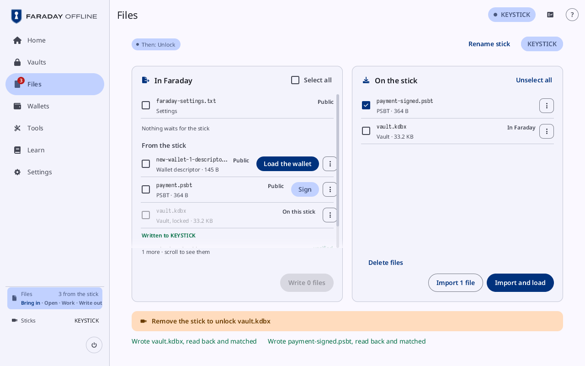

*After a stick visit wrote: **For the stick** is **Empty**, and the
receipt reads "Written to KEYSTICK", each file **verified**; the vault
written stays in **From the stick**, locked, to **Unlock** again.*

## An open vault

A panel for each open vault, headed by its file and name ("vault.kdbx ·
Vault 1 · open").

| Control | What it does |
|---|---|
| **Select all** | ticks every key and wallet not loaded yet, or none |
| **Wallets with their seeds** | each wallet the vault holds with its seeds: "2 of 3 keys in this vault", and **Ready to sign once loaded** where they are enough; a press ticks it |
| **Load wallet with keys**, **Load 1 wallet with keys**, "Load 2 wallets with keys" | loads the wallets ticked, with their seeds. **Nothing chosen** while none is |
| "Each seed and wallet · 5" | opens the full list, each row ticked to load or **Loaded**; **Hide each seed and wallet** closes it |
| "Load 2 keys and 1 wallet" | loads what the full list ticks. **Everything is loaded** once nothing is left |
| **Go to Wallets** | shown once something has loaded |

## What the files give

A panel headed **From the stick**, above the two lists, shown while the
files from the stick give something to load. Its parts are
**Wallets**, **Keys with no wallet**, **Xpubs with no wallet** and
**Not complete or sealed**, each shown where it has a row.

| Control | What it does |
|---|---|
| **Wallets** | each wallet the files describe, once each: its shape, "2 of 3 keys here", "· 2 files say it" or "· from split sheets", and **Ready to sign once loaded**; a press ticks it |
| **Load the wallet with its seeds**, **Load the wallet**, "Load 2 wallets with their seeds" | loads the wallets ticked. **Nothing chosen** while none is. "Keys load once the stick is out" while a stick is in |
| **Keys with no wallet** | each seed no wallet names, by fingerprint, with **Make it a wallet**, which opens [Make it a wallet](#make-it-a-wallet) |
| **Xpubs with no wallet** | each xpub, by its fingerprint or **no origin**, with **Make it a watch-only wallet** |
| **Not complete or sealed** | a backup short of parts, or sealed |

## The ⋮ menu

**Opened from:** a file row's **⋮**: a menu under it, a sheet on a
small window.

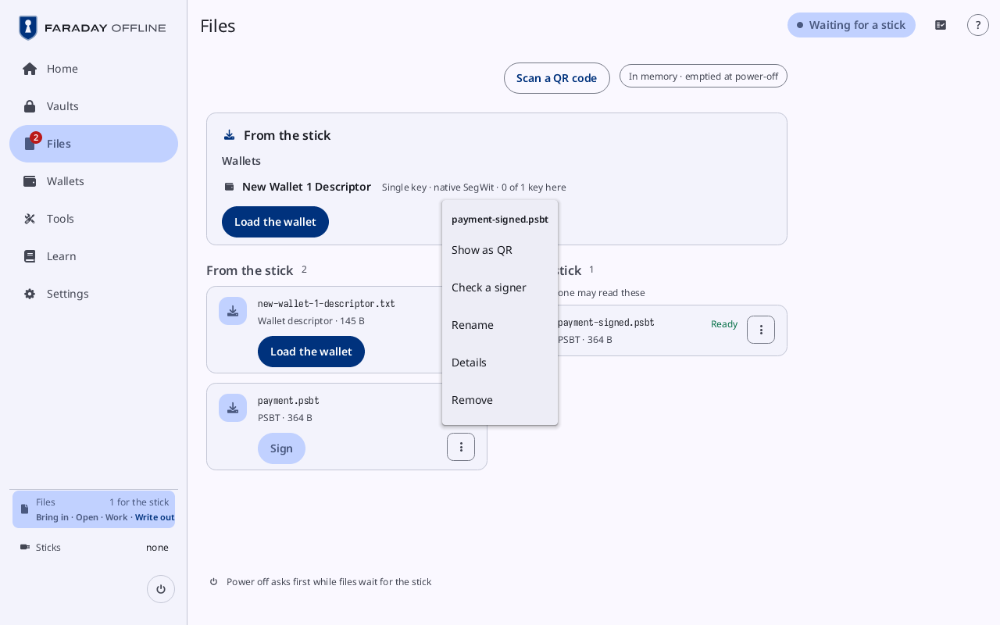

*A file's **⋮** on **For the stick**: the file's name over **Show as
QR**, **Check a signer**, **Rename**, **Details** and **Remove**.*

| Row | Choices |
|---|---|
| a file from the stick | **Add to vault** (a wallet or seed words, while a vault is open), **Check a signer** and **Compare** (a PSBT), **Details**, **Remove** |
| a file for the stick | **Make PDF** (a recovery sheet, Faraday Demo only), **Show as QR** (where it fits in codes; never a vault), **Check a signer** and **Compare** (a PSBT), **Rename**, **Details**, **Remove** |
| a file on a stick visited | **Rename**, "Delete from the stick", **Details** |

**Remove** takes the file out of Files. "Delete from the stick" opens
[Delete files](#delete-files) with that file alone
chosen.

### Rename

Its title is **Rename …** and the file's name.

| Control | What it does |
|---|---|
| the field | the name before its extension; the extension stays as it is |
| the line under it | why a name cannot be used: **Type a name**, **A name cannot start with a dot**, the characters a stick's names cannot hold, **A name is at most 255 characters with its extension**, "Another file for the stick is named …" |
| **Rename** | renames the file; on a stick, a line says "… renamed …", or why not |
| **Cancel** | closes the sheet |

### Details

| Field | What it is |
|---|---|
| **Name** | the file's name |
| **Kind** | what it is |
| **Size** | "… bytes" |
| **SHA-256** | its hash in groups of eight; **Reading…** while a stick is read for it; "Not read: …" |
| **Close** | closes the sheet |

## Make it a wallet

**Opened from:** **Make it a wallet** beside a seed with no wallet, and
**Make it a watch-only wallet** beside an xpub. Its title is "A wallet
from 3dca6805", "A watch-only wallet from 3dca6805", or **A watch-only
wallet from an xpub**.

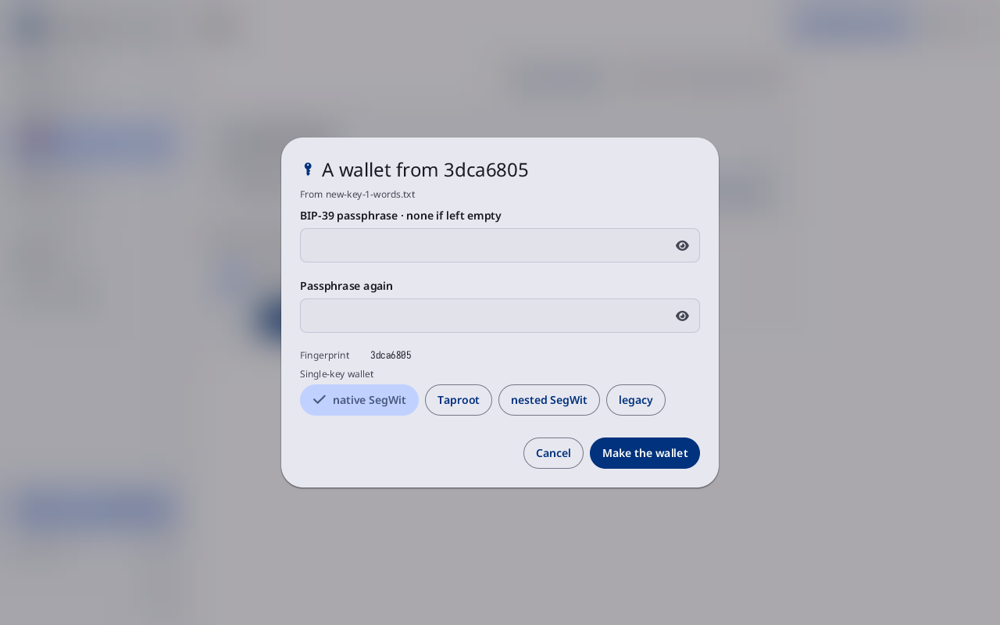

*"A wallet from 3dca6805", from new-key-1-words.txt: **BIP-39
passphrase · none if left empty**, the **Fingerprint**, **Single-key
wallet** with native SegWit chosen, and **Make the wallet**.*

| Control | What it does |
|---|---|
| "From …" | the files the seed came from |
| **BIP-39 passphrase · none if left empty** | the seed's passphrase field (**SLIP-39 passphrase · none if left empty** for SLIP-39 shares); its eye shows what is typed. **Fingerprint** under it gives the key it makes |
| "A key of New wallet 1: it loads with that wallet" | in the ok tone, where the key is one of a wallet's |
| **Single-key wallet** | otherwise, with the kinds to choose: native SegWit, **Taproot**, nested SegWit, legacy |
| the xpub | for an xpub: the key, and its kind, chosen, or "… · as its path says" |
| **Make the wallet**, or "Load New wallet 1" | makes the wallet, or loads the wallet the key belongs to |
| **Cancel** | closes the sheet |

## This is a secret

**Opened from:** a secret about to leave Faraday: a seed's file from a
backup's checklist, a child seed, a Lightning or silent payments key, a
GPG revocation, and a secret file ticked on a stick visit to be copied
to another stick. Its title is **This is a secret**, or **This may be a
secret** for text Faraday cannot tell about.

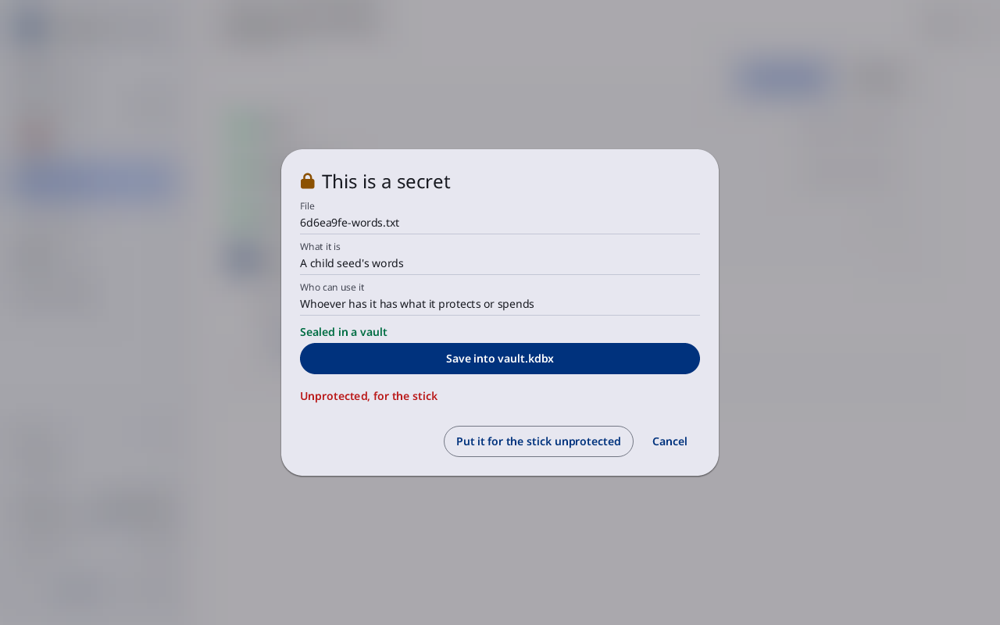

*The sheet **This is a secret** for 6d6ea9fe-words.txt, a child seed's
words: **Sealed in a vault** over "Save into vault.kdbx", then
"Unprotected, for the stick" over "Put it for the stick unprotected".*

| Control | What it does |
|---|---|
| **File**, **What it is**, **Who can use it** | the file's name, what it holds, and who can use it |
| **Sealed in a vault** | in the ok tone, where the secret can go into a vault |
| "Save into vault.kdbx" | puts the secret into the open vault, sealed; the button names the open vault by its file. "In vault.kdbx" in its place where the vault holds it already |
| "Make a vault", "Unlock vault.kdbx", **Unlock a vault** | with no vault open: opens [Create a vault](create-vault.md) or [Unlock](vaults.md#unlock); the sheet opens again after |
| "Unprotected, for the stick" | in the error tone: what the other way is; "Unprotected, on the stick" for a file a stick visit copies |
| the forms | where the secret has more than one form (a seed's **Words** or **SeedQR**), a button each |
| "Put it for the stick unprotected" | at the foot: opens [Save without encryption?](#save-without-encryption) |
| **Cancel** | beside it: closes the sheet; the secret goes nowhere |

### Save without encryption?

| Control | What it does |
|---|---|
| the two lines | "… goes on the stick as a plain file, outside any vault. Anyone who has the stick can read it." and "That is as safe as writing it on paper: …" |
| **Hold to save without encryption** | held until it fills: puts the file in Files under **Unprotected secrets**; a file from a stick visit is ticked there instead, and written with the rest |
| **Put it in a vault** | while a vault is open: puts the secret into it instead |
| **Cancel** | closes the sheet |

The same sheet comes before a key's words or SeedQR are saved to a
stick from a vault, before a backup's plan keeps a seed as a plain file
at a place, and before Transfer saves a secret.

A stick visit, a stick open to Faraday, writes what waits for the stick and
copies in what is needed from it. Each file written is read back and
compared before it counts. Keys load only once the stick is out.

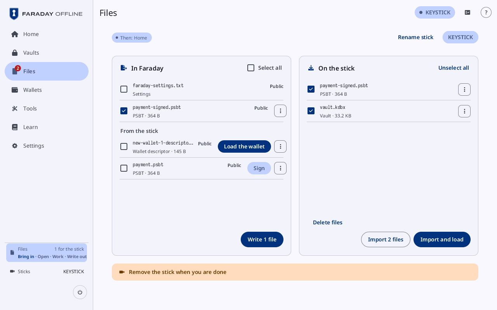

*Files with KEYSTICK open, **Then: Home**: **In Faraday** lists
**Settings**, a signed PSBT ticked and, under **From the stick**, two
files, with "Write 1 file"; **On the stick** lists a PSBT and a vault,
both ticked, with **Delete files**, "Import 2 files" and **Import and
load**; the band reads **Remove the stick when you are done**.*

## The stick in Files

While a stick is open, Files carries a pane for it, beside the two lists on
a wide window and as the tab **On {stick}** (the lists are the tab **In
Faraday**) below that; the stick's arrival opens it. Each row of the lists
takes a checkbox for writing. With a secret held the pane is not drawn and
the chip reads "Lock to use {stick}".

### On the stick pane

| Control | What it does |
|---|---|
| **Then: Home** | the chip under the title, at the left: where pulling the stick goes, **Then: Home**, **Then: Unlock**, or "Then: …" naming the flow that opened it |
| **Rename stick** | left of the sticks' chips (beside **Delete files** on a small panel): opens [Rename stick](#rename-stick) for the stick shown |
| a stick's chip | one per stick attached, by its name, at the right of the same row, the one shown selected: a press shows that stick |
| "Write what waits for the stick …" | in Guided mode |
| **In Faraday** | the lists: what can be written to the stick, each row ticked or not |
| **On the stick** | the stick pane: the stick's files, each row ticked to copy in or not |
| the warning band | under the cards: "Remove the stick when you are done", "Remove the stick to unlock vault.kdbx", "1 key copied in · remove the stick to load it" |
| the last two lines | what the stick did, in the ok or error tone. After a write, a line per file: "Wrote payment-signed.psbt, read back and matched", or "Wrote payment-signed.psbt as payment-signed-2.psbt, read back and matched" where **Keep both** gave it another name; otherwise "… not written: …", "… renamed …", "… deleted, zeros over it first", "… removed by name, its bytes left" |

#### In Faraday

| Control | What it does |
|---|---|
| **Select all** | ticks every row, or none; an unprotected secret is ticked one at a time |
| **Settings** | Faraday's settings file (faraday-settings.txt), tagged **Public**; a press ticks it |
| a file for the stick | its name and what it is, tagged **Public**, **Sealed** or **Unprotected secret**; **In the backup** for a file a backup flow writes, which cannot be unticked here |
| **From the stick** | under the files for the stick: the files copied in, which can be written to this stick too. Tagged **Public**, **Sealed**, **May be a secret** or **Secret**; **On this stick** for one it holds already. Ticking a secret opens [This is a secret](files.md#this-is-a-secret) first |
| "Nothing waits for the stick" | while nothing does |
| "Write 2 files" | writes what is ticked. Before it, [Already on the stick](#already-on-the-stick) where a name is taken, or [Write to a stick](#write-to-a-stick) while a secret has been held |

#### On the stick

| Control | What it does |
|---|---|
| **Unselect all** | unticks every file; everything is ticked at first |
| a file's row | its name and what it is, or "Being read · 2 MB", **Larger than 18 MB: not read**; **In Faraday** for one Files holds already; a press ticks it |
| **⋮** | **Rename**, "Delete from the stick", **Details** ([the ⋮ menu](files.md#the--menu)); not on the settings file |
| "No files on this stick" | while it holds none |
| **Delete files** | opens [Delete files](#delete-files) |
| "Import 3 files" | copies the ticked files into Files |
| **Import and load** | copies them in, opens Files, and loads them once the stick is out |

With more rows than fit, a scrollbar runs beside each list and "3 more ·
scroll to see them" under it.

| State | What the visit shows |
|---|---|
| no stick | "No stick attached" |

## Already on the stick

**Opened from:** "Write 2 files" when a file's name is on the stick
already, ignoring case. Its title is **Already on the stick**.

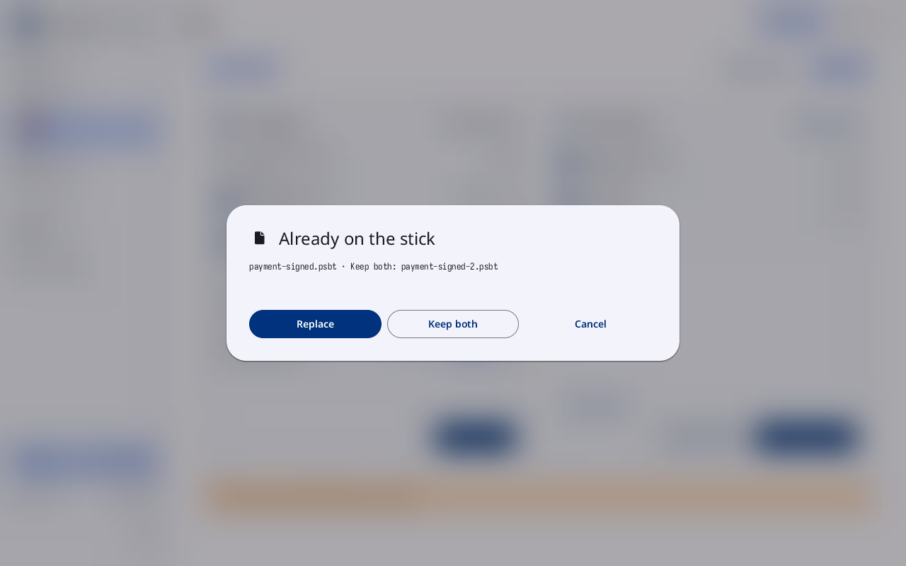

*The sheet **Already on the stick**: "payment-signed.psbt · Keep both:
payment-signed-2.psbt". **Replace** is outlined. It lists files that are
not vaults; a vault's name taken is asked on its own sheet, below.*

| Control | What it does |
|---|---|
| each row | "wallet.txt · Keep both: wallet-2.txt" |
| **Replace** | writes over the files of the same name |
| **Keep both** | writes each under the name its row gives |
| **Cancel** | closes the sheet; nothing is written |

## A vault's name is taken

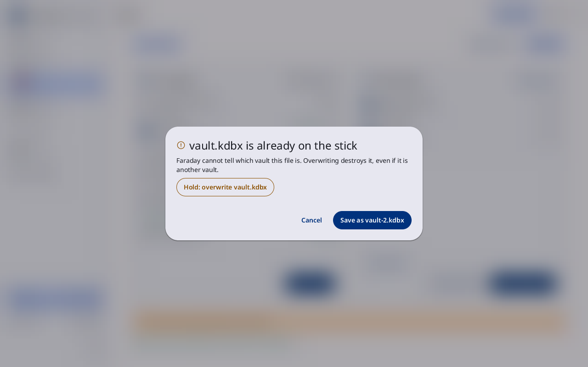

**Opened from:** "Write" on a visit, or the backup flow's write to an
existing vault's stick, when a file on the stick has the vault's name,
ignoring case, and nothing proves that file a copy of this vault. Its
title is "vault.kdbx is already on the stick". Nothing is written until
it is answered.

The sheet says that Faraday cannot tell which vault the file is and that
overwriting destroys it, even if it is another vault; a file that is a copy
of another vault Faraday knows is named so, and one that cannot be read
says so.

| Control | What it does |
|---|---|
| "Hold: overwrite vault.kdbx" | the new vault is written under a hidden name and read back, then the old file is removed and the new one takes its name; refused if the file changed since the sheet showed it. Absent for a file that cannot be read |
| "Save as vault-2.kdbx" | writes the vault beside the file under that free name |
| **Cancel** | writes nothing; the vault stays For the stick, and the log says "its name is taken"; with nothing else written, the receipt of an earlier write stays as it was |

A vault Faraday proves is a copy of this one (the same file it wrote or
opened) is replaced with no sheet, and a name no file has is written with
none. With several vaults in one write, the sheet asks them in turn.

## Write to a stick

**Opened from:** "Write 2 files" on a visit, or a wallet's chart's
stick, while Faraday has held a secret since it started: a stick is
written only from a fresh start. Its title is "Write to a stick".

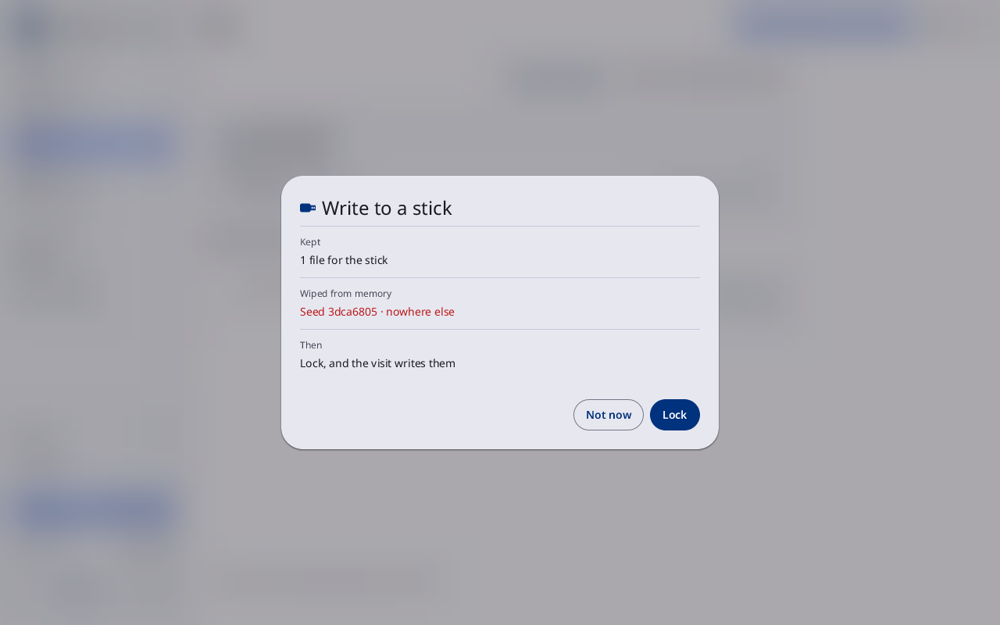

*"Write to a stick": **Kept** 1 file for the stick, **Wiped from
memory** Seed 3dca6805 · nowhere else, **Then** **Lock, and the visit
writes them**, over **Not now** and **Lock**.*

| Control | What it does |
|---|---|
| **Kept**, **Wiped from memory**, **Then** | as on [Lock](lock-and-power.md); **Then** reads **Lock, and the visit writes them**, or "Lock, plug in a stick, and the visit writes them" |
| **Dropped from Files** | the files from the stick the lock drops: each that may be a secret |
| **Not now** | closes the sheet |
| **Lock** | locks; the visit after it writes the files |

## Rename stick

**Opened from:** **Rename stick**. Its title is
**Rename stick** ("Rename SD card" on the Pi).

| Control | What it does |
|---|---|
| the field | the stick's name, at most 11 characters: letters, digits, spaces, the backtick and `! # $ % & ' ( ) - @ ^ _ { } ~`. Empty takes the name away |
| "Written as COFFEE 1" | under the field when what is typed is written otherwise: a name is written in capitals, as FAT keeps it |
| "No name" | under the field when it is empty |
| "At most 11 characters", "Letters, digits, spaces and … only", "EFI, bootfs and FARADAYBOOT are boot partitions' names" | why the name cannot be used; **Rename** is dimmed |
| **Rename** | writes the name; the visit's line says "This stick is named COFFEE 1" or "This stick has no name" |
| **Cancel** | closes it, nothing written |

The name is the one a computer shows the stick by. A Faraday stick has
none until one is given (`docs/STICK-IDENTITY.md` §6).

## Delete files

**Opened from:** **Delete files** on a stick visit, and "Delete from the
stick" in a file's **⋮**. Its title is "Delete files from Boot stick".

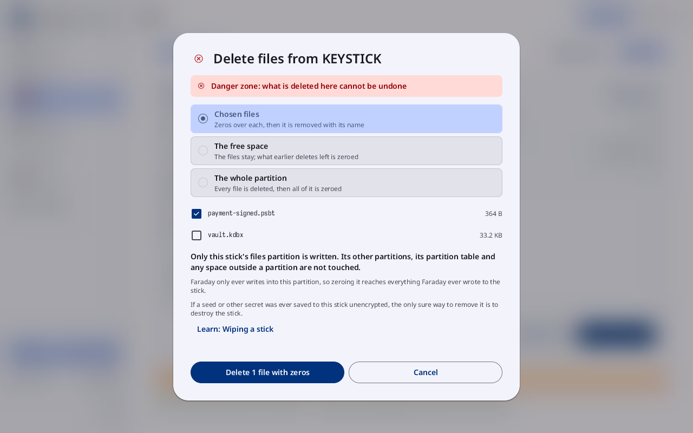

*"Delete files from KEYSTICK" on **Chosen files**: payment-signed.psbt
ticked, vault.kdbx not, and "Delete 1 file with zeros" beside
**Cancel**.*

| Control | What it does |
|---|---|
| **Danger zone: what is deleted here cannot be undone** | the band at the top |
| **Chosen files** | **Zeros over each, then it is removed with its name**: the stick's files, under the three choices, each ticked or not, with its size |
| **The free space** | **The files stay; what earlier deletes left is zeroed**: with the amount to write and the time ("1.8 GB to write · about 6 minutes on a typical stick") |
| **The whole partition** | **Every file is deleted, then all of it is zeroed**: with **One pass** and **Two passes** |
| the lines under them | that only the stick's files partition is written, why, and what zeros do not reach |
| "Delete 2 files with zeros", **Zero the free space**, **Zero the whole partition** | does it |
| "Hold to delete 1 file with zeros", **Hold to zero the free space**, **Hold to zero the whole partition** | in place of the button when a vault is chosen, and for the free space and the partition: held until it fills |
| **Cancel** | closes the sheet |

**Reading the stick's space** shows until the stick has said how large
it is. Each file deleted is listed on the visit: "… deleted, zeros over
it first", or "… not deleted: …".

## Zeroing

**Opened from:** the free space or the partition, started on Delete
files. Its title is "Zeroing the free space on Boot stick" or "Zeroing
the whole partition on Boot stick". No press beside the sheet closes
it.

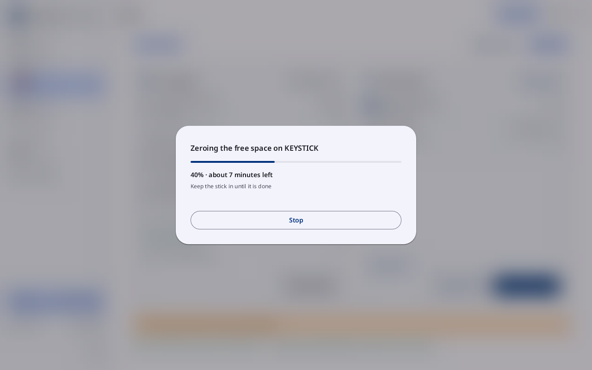

*"Zeroing the free space on KEYSTICK": "40% · about 7 minutes left",
"Keep the stick in until it is done", and **Stop**.*

| Control | What it does |
|---|---|
| the bar | how far: "40% · about 7 minutes left", and "Pass 1 of 2" for two passes |
| "Keep the stick in until it is done" | a line |
| **Stop** | stops after the step under way (**Stopping**); the visit says "Stopped at 40%" |

When it ends, the visit says "Free space on Boot stick zeroed" or "Boot
stick's partition zeroed".

## On a narrow window

One column: the stick's status and **Scan a QR code**, the vault panels
and what the files give, then **From the stick**, then **For the
stick**, each row's button under its name. With a stick open, the tabs
**In Faraday** and **On {stick}** are at the top: the first holds the
lists above, the second the stick, its warning band, then what to copy in,
each a list with its buttons under it.

## Why

- [The air gap](../../learn/07-air-gap.md)
- [Coordinator files](../../learn/19-coordinators.md)
- [Replacing Faraday on a stick](../../learn/faraday/boot/replace-faraday.md)
