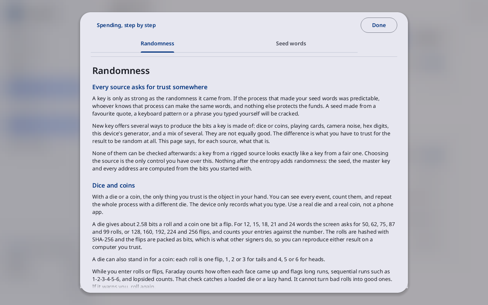

# Learn

**Kind:** Reference
**Status:** Checked against the app's pictures in docs/guide/pictures/ (drawn by just guide-pictures) and its code and strings (`faraday/faraday-core/src/learn.rs`, `faraday/faraday-core/src/screens/sheets.rs`, `faraday/faraday-core/src/screens/learn_pane.rs`, `faraday/faraday-core/src/flow.rs`)
**Screen:** `Learn`
**Group:** Learn

**Opened from:** **Learn** in the sidebar; the **?** at the top right of
a page; **Learn** in a narrow window's **⋮** menu; a Guided card's
"Learn: Seed words" link, which opens on that page.

The pages that explain the screen on show, one tab each. Learn says
why; the screens say what. Its text is the same as the Learn pages in
the repository (`docs/learn/`).

*Learn over New key: **Done** at the top right, the tabs Randomness and
Seed words, and the Randomness page.*

## On this screen

| Control | What it does |
|---|---|
| **Spending, step by step** | above the tabs, on the [Spend](spend-tab.md) tab only: closes Learn over the Spend tab's steps |
| a page's tab | one per page the screen gives, by the page's title (Where keys are kept's reads **Key storage**); the one on show underlined. Each label shows whole: where the tabs do not all fit, a chevron at an end of the row shows the next tab past it. A Guided card's link opens on its page's tab, or on that page alone where the screen does not give it |
| the page | its title, then its sections; the wheel and the arrow keys scroll it |
| a step's circle | on a page of numbered steps: ticks the step, or clears its tick. The ticks last until the session ends |
| **Done** | at the top right: closes the sheet; <kbd>Escape</kbd> does the same |

## Beside the page

On a window 1600 wide and over, Learn opens as a pane beside the page
instead of a sheet over it, closed until **Learn**, the **?** or
**Cryptography** is pressed. Its header row reads **Learn**, with the
pin (**Keep open**) and a **Close** button at its end; the same tabs
stand under it, across the pane's width. Moving to another screen
closes the pane, unless it is pinned: the pin pressed fills, its
tooltip reads **Unpin**, and the pane stays open on each screen after,
showing that screen's pages on the same tab where it has it. Closing
the pane takes the pin off; a lock or power-off does too. **Learn** or the **?**
pressed again, **Close**, <kbd>Escape</kbd> and the mouse's back button
put it away. Make codex32 shares, Back up a wallet and the backup flow
keep that place for their own panes, and show Learn as the sheet.

## The pages each screen gives

| Screen | Pages, in order |
|---|---|
| Home | [Start here](../../learn/01-start-here.md), [The air gap](../../learn/07-air-gap.md) |
| Wallets, its first page | [Kinds of wallets](../../learn/17-wallet-kinds.md), Start here |
| Wallets, a wallet chosen | by its kind: a single key, Kinds of wallets and [Seed words](../../learn/02-words.md); a multisig, [Multisig](../../learn/09-multisig.md), [Xpubs and privacy](../../learn/11-xpubs.md) and [Coordinator files](../../learn/19-coordinators.md); a Taproot multisig, Multisig and [Spend paths and timelocks](../../learn/10-spend-paths.md); a miniscript or a taproot tree, Spend paths and timelocks, [Inheritance](../../learn/12-inheritance.md) and Kinds of wallets; MuSig2, [Nonces](../../learn/13-nonces.md) and Multisig; silent payments, [Silent payments](../../learn/20-silent-payments.md) and Kinds of wallets |
| Make a new wallet | by the kind chosen, as for a wallet; a single key adds [Backups](../../learn/04-backups.md); shares, [Backups in other forms](../../learn/18-other-backups.md), Kinds of wallets and Backups |
| Sign a transaction | [Verifying](../../learn/06-verifying.md), Nonces for MuSig2, [Mistakes and scams](../../learn/08-scams.md) |
| Spend | Inheritance, Verifying, The air gap, Mistakes and scams |
| Add a key, New key | [Randomness](../../learn/03-randomness.md), Seed words; Backups in other forms first for codex32 |
| Add a key's typing page | Seed words, [Passphrases](../../learn/05-passphrases.md); Backups in other forms first for codex32 strings |
| Add randomness | Randomness |
| Back up a wallet | Backups, [A backup plan's check](../../learn/faraday/backup-plan-check.md), [Shares of a wallet description](../../learn/faraday/shares.md) for a multisig, Backups in other forms |
| Backups | Backups, A backup plan's check, [Vaults](../../learn/faraday/vaults.md) |
| Restore an existing wallet | Backups, A backup plan's check, Inheritance |
| Sign a message, Check a signed message | [Signing a message](../../learn/14-message.md) |
| Files, Stick visit, Transfer | The air gap, Coordinator files |
| Vaults, Create a vault, Unlock, the backup flow, Vault contents | Vaults, Passphrases; [GPG keys](../../learn/faraday/gpg.md) first on a vault's GPG keys |
| TOTP codes, Set the time | [Time and TOTP codes](../../learn/faraday/time.md) |
| Settings | [Where keys are kept](../../learn/faraday/keys-kept.md), [Glossary](../../learn/15-glossary.md) |
| Tools, the calculators, Lightning node key | [Tools](../../learn/16-tools.md), Glossary |
| Decode a transaction | Verifying, Tools |
| Explore | Xpubs and privacy, Glossary |
| Silent payments | Silent payments, Xpubs and privacy |
| Vanity address | Passphrases, Kinds of wallets |
| Derive with BIP-85 | Seed words, Passphrases, Glossary |

In Faraday Demo, [Practice and its public seeds](../../learn/faraday/demo.md)
comes first on Home, Add a key, New key and Settings, and on every screen
whose actions the Demo greys.

## On a narrow window

Learn fills the window, its tabs wrapped, with **Done** at the top
right.

## Why

- [Start here](../../learn/01-start-here.md)
