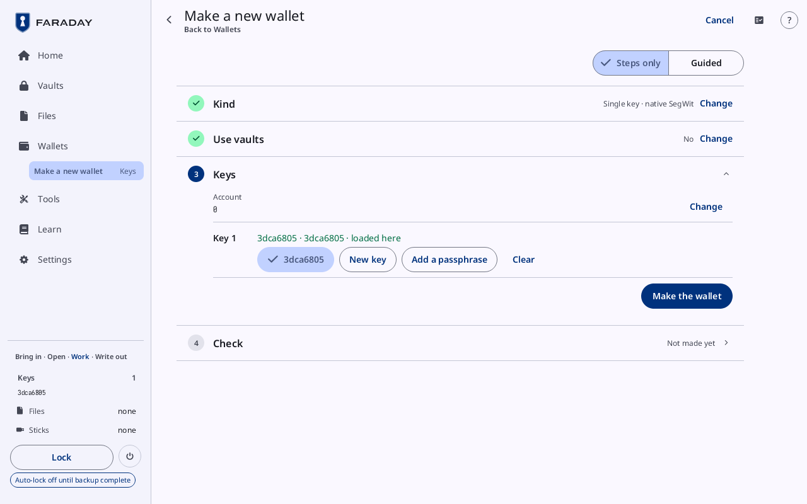
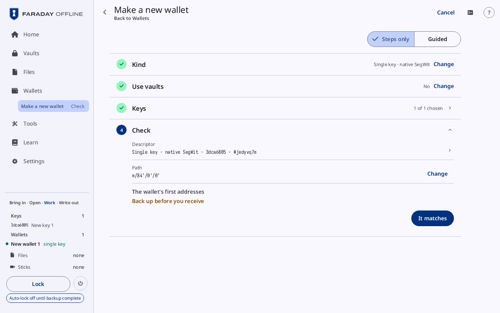

# Make a new wallet

**Kind:** Reference
**Status:** Checked against the app's pictures in docs/guide/pictures/ (drawn by just guide-pictures) and its code and strings (`faraday/faraday-core/src/screens/create.rs`, `faraday/faraday-core/src/create.rs`, `faraday/faraday-core/src/backup_flow/wallet_screen.rs`, `faraday/faraday-core/src/screens/parts.rs`)
**Screen:** `Create`
**Group:** Wallets

**Opened from:** **Make a new wallet** on Home and on Wallets' first
page; Tools' wallet tiles (**Single-key wallet**, **Multisig**,
**Taproot multisig**, "MuSig2"), each with its kind chosen; **New wallet
from this one** on a wallet's card, filled from that wallet.

One card per step, from the kind to the first addresses. The wallet is
made at **Make the wallet**; its backup follows from **Back up wallet**.

*A single-key wallet: **Kind** and **Use vaults** closed, **Keys** open with **Account** 0 at its head and **Key 1** reading "3dca6805 · 3dca6805 · loaded here". **Make the wallet** is outlined.*

## On this screen

| Control | What it does |
|---|---|
| the way back | at the top left, the arrow with a name under the title: **Home** or **Wallets**, where it was opened from; once a card is closed, the card before the one open |
| **Steps only**, **Guided** | at the top right: the short text on the open card, off or on |
| a card | its title, what was chosen, and **Change** |
| **Cancel** | at the top right, while the wallet is in progress: asks, then leaves ([Cancel a flow](prompts.md#cancel-a-flow)) |

The cards: **Kind**, **Quorum** (for a kind of several keys, and for a
backup in shares), **Use vaults**, **Number of vaults**, "Bring in the
sticks" and **Vaults** (while the backup uses vaults), **Keys**,
**Check**.

## Kind

A row pressed is chosen and the next card opens. **Single key, backup in
shares (codex32)** is ticked at first.

| Row | Line |
|---|---|
| **Single key, backup in shares (codex32)** | "One key, its backup in 3 shares, any 2 rebuild it" |
| **Single key · native SegWit** | **One key, its words on paper** |
| **Multisig · native SegWit** | "3 keys, any 2 sign" |
| **More kinds** | opens the rest: **Single key · Taproot**, **Single key · nested SegWit**, **Single key · legacy**, **Multisig · nested SegWit**, **Multisig · legacy**, **Multisig · Taproot**, **All keys · MuSig2**, each with its line |
| the ⓘ after "(codex32)" | the pointer resting on it or on the word, or a press: the tip **codex32 is the only method that makes a seed and its shares fully by hand, the checksum included.** |
| **Start over** | while a wallet is part made: forgets it and starts again |

## Quorum

| Control | What it does |
|---|---|
| **Signatures needed**, **Keys** | steppers, **-** and **+**. For **All keys · MuSig2**, **Keys** alone |
| the line under them | what the quorum means: "Any 2 of the 3 keys can spend. Losing 1 key still leaves the money spendable; 2 keys together can take it.", or "All 3 keys sign together, …" |
| **Account** | the account the keys are taken at, 0 at first; **Change** opens its stepper |
| **Continue** | the next card |

For a backup in shares the card asks the codex32 scheme instead: **How
many to rebuild it** (2 to 9), **How many shares**, the line "Any 2 of
the 3 shares rebuild the key.", **Account** and **Continue**.

A kind with no **Quorum** has **Account** at the head of **Keys**.

## Use vaults

| Control | What it does |
|---|---|
| **Will you use vaults as part of this backup?** | **Yes** or **No**. "Vaults already on sticks are brought in here, not later." |
| **How many vaults will be part of this backup?** | on **Number of vaults**, after **Yes**: **Vaults**, a stepper, and **Continue** |

For a backup in shares, **No** goes straight on to [New key](new-key.md#make-codex32-shares)
at its **Identifier** card, the scheme taken from **Quorum**; **Keys**
closes on the key once its strings are locked in.

After **Yes**, "Bring in the sticks" ("1 of 2 read") and **Vaults** ("1
of 2 unlocked") bring the vaults in before the keys; [Back it
up](../walk/back-up.md) walks through them.

## Keys

A row per key, **Key 1**, **Key 2** …, each with what fills it: **Not
chosen**, "3dca6805 · New key 1 · loaded here" (the fingerprint twice,
"3dca6805 · 3dca6805 · loaded here", for a key with no name of its
own), "5d388376 · a cosigner's xpub", or **A cosigner adds it later · waiting for its xpub file**.
**Locked in** stands at the row's end for a key given a passphrase here.

| Control | What it does |
|---|---|
| a key loaded | a button with its fingerprint, ticked while it fills the slot: fills it. A key in another slot is not offered |
| an open vault's keys | under the vault's name: loads the key and fills the slot. "Unlock vault.fvlt" for a locked vault in Files |
| **New key** | opens [New key](new-key.md) for the slot; the leading button on the first empty slot. For a backup in shares it is **Make codex32 shares**, the slot's only way |
| "From cosigner.txt" | an xpub file in Files fills the slot. A file whose key does not fit the kind is listed after the slots, greyed, with why |
| **Scan its xpub** | for a wallet of several keys: the camera, for a cosigner's key |
| **Someone else adds it later** | for a wallet of several keys: the slot waits for the cosigner's xpub file |
| **Add a passphrase** | for a key from BIP-39 words with none: opens **Passphrase** and **Passphrase again**, then **Lock in** |
| **Clear** | empties the slot |
| **Show xpub QR** | for a wallet of several keys, on a key loaded: its xpub as a QR code, for the cosigners, titled "Xpub 3dca6805 · Multisig · native SegWit" above the code |
| "Xpub PNG for the stick", "Xpub file for the stick" | the same, as a picture or a text file waiting in Files |
| **Make the wallet** | once every slot is filled: makes the wallet. Then **Continue** |

The card closes on "3 of 3 chosen", or "2 of 3 chosen · 1 to come".

## Check

*Check for a single-key wallet whose key was made here: **Descriptor** "Single key · native SegWit · 3dca6805 · #jedyvq7m", **Path**, **Back up before you receive** in place of the addresses, and **It matches**.*

| Control | What it does |
|---|---|
| **Descriptor** | the wallet's kind, keys and checksum: "2 of 3 · native SegWit multisig · 3dca6805, 5d388376, cf2e083d". A press shows the wallet's code with the descriptor's full text |
| **Backup** | for a backup in shares: the set, "codex32 name · 2 of 3" |
| **Path** | the derivation path, "m/48'/0'/0'/2'"; **Change** goes back to **Account** while the wallet can still be taken back |
| **The wallet's first addresses** | **Receive 0/0**, **Receive 0/1**, **Change 1/0**, to compare with a watch-only wallet; **Back up before you receive**, in the warning tone, in their place while a key made here waits for its backup |
| **It matches** | marks the wallet checked; the card stays open |
| **Back up wallet** | in place of **It matches** once pressed: opens the wallet's backup, its board open on the standard way |
| "Move the money from Old wallet" | for a wallet made to move another wallet's money to: opens the spend of every coin from the old one |

The card closes on "New wallet 1 · first addresses". Until the wallet is
made it reads **Make the wallet first**.

## On a narrow window

The cards fill the window; a slot's buttons wrap under its row.

## Why

- [Kinds of wallets](../../learn/17-wallet-kinds.md)
- [Multisig](../../learn/09-multisig.md)
- [Xpubs and privacy](../../learn/11-xpubs.md)
- [Backups in other forms](../../learn/18-other-backups.md)
