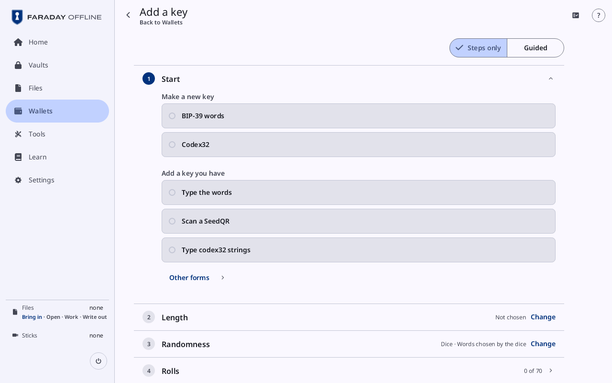

# Add a key

**Kind:** Reference
**Status:** Checked against the app's pictures in docs/guide/pictures/ (drawn by just guide-pictures) and its code and strings (`faraday/faraday-core/src/keygen/screen.rs`, `faraday/faraday-core/src/keygen/mod.rs`, `faraday/faraday-core/src/codex32/screen.rs`, `faraday/faraday-core/src/flow.rs`)
**Screen:** `KeyGen`, `KeyLengths`
**Group:** Wallets

**Opened from:** **Add a key** on Wallets and on Tools; Tools' tiles for
one form (**SLIP-39 shares**, **Restore from SLIP-39**, "codex32",
**Seed XOR**), each opening with that choice made; **New key** or
**Make codex32 shares** on a slot of [Make a new wallet](make-a-wallet.md#keys);
**Make a new key** on the [typing page](add-a-key.md). With a stick
attached, [Pull the stick](prompts.md#pull-the-stick) opens first.

The page makes a key here, or takes one typed or scanned, one card per
step. Its title is **Add a key**, or **New key** when it was opened for
a slot of Make a new wallet or from the typing page.

*Add a key as it opens: **Start** open with nothing ticked, and the cards after it closed.*

## On this screen

| Control | What it does |
|---|---|
| the way back | at the top left, the arrow with a name under the title: the card before the one open; on the first card, after where the page was opened from: **Make a new wallet**, **Add a key**, **Tools**, or **Back**. <kbd>Escape</kbd> does the same. Once the key is locked in, it no longer opens a card before **Key** |
| **Steps only**, **Guided** | at the top right: the short text on each open card, off or on, with its Learn link |
| a card | its number, its title and what was chosen, and **Change**, which opens it again with its choice kept; a card not reached yet says so (**Not locked in**, **Not made yet**, **Not yet**). A finished card before **Key** has no **Change** once the key is locked in |
| **Cancel** | at the top right, only while the page was opened for a slot of Make a new wallet, that wallet is not made yet and the key is not locked in: asks when rolls, characters, words or a passphrase would be lost, then goes back to Make a new wallet at its **Keys** card ([Cancel a flow](prompts.md#cancel-a-flow)) |

The cards that show depend on Start:

| Start | Cards |
|---|---|
| **BIP-39 words** | **Start**, **Length**, **Randomness**, the entry card, **Key**, **Words**, **Quiz**; for a slot of Make a new wallet, no **Words** and **Quiz** (the backup shows the words) |
| **Make SLIP-39 shares** | **Start**, **Length**, **Randomness**, the entry card, **Check**, **Words**, **Quiz** |
| **Type the words**, **Type SLIP-39 shares**, **Type codex32 strings**, **Type Seed XOR parts** | **Start**, the typing card, **Key** |
| **Scan a SeedQR** | **Start**, **Key** |
| **Codex32** | **Start**, then [Make codex32 shares](#make-codex32-shares)' own cards |

## Start

Open at first, with no choice ticked: a choice is pressed to go on.

| Group | Choices |
|---|---|
| **Make a new key** | **BIP-39 words**; **Codex32**, a key made by hand as codex32 shares |
| **Add a key you have** | **Type the words**, **Scan a SeedQR**, **Type codex32 strings** |
| **Other forms** | a press opens the list: **Make SLIP-39 shares**, **Type SLIP-39 shares**, **Type Seed XOR parts** |

A choice moves on to the next card by itself. **Change** on Start opens it again with the choice made ticked.

## Length

| Control | What it does |
|---|---|
| **12 words**, **24 words** | the count; a press moves on to **Randomness**. No count is chosen at first |
| **Other** | opens [Other](#other) with 15, 18 and 21 words; once one is chosen there, the button reads it ("18 words") |

For SLIP-39 shares (**Make SLIP-39 shares** on Start, under Other forms) the counts are a share's (20 or 33 words), and the
card adds:

| Control | What it does |
|---|---|
| **Shares needed**, **Shares dealt** | steppers, **-** and **+** |
| "Any 2 of the 3 shares restore the key" | what the two counts give |
| **What shares reveal** | seven lines on what a share tells its holder and what it does not |
| **Continue** | takes the counts and moves on |

### Other

**Opened from:** **Other** on the Length card: a menu under it.

| Control | What it does |
|---|---|
| **15 words**, **18 words**, **21 words** | chooses the count and moves on |
| **Back** | closes the menu |

## Randomness

The ways, in three groups that open and close; a closed group names the
way chosen in it. A choice moves on to its entry card.

| Group | Ways |
|---|---|
| **Your own entropy, words verifiable by hand** (**Recommended**) | **Dice · Words chosen by the dice**, "Dice · Flip mode", **Coin flips** |
| **Your entropy, computer generates words** | "Dice · Hashed (Coldcard, SeedSigner)", "Dice · Six as zero, hashed (Keystone)", **Hex entropy**, **Playing cards**, **Mixed sources** |
| **Made by this device** (closed at first) | **This device** |

Each row's second line says what it asks for at this length: "70
rolls" for 12 words by dice, "… flips, or rolls of a die read as
flips", "… cards from a shuffled deck", "32 digits made elsewhere",
**Two or more of these, combined**. For SLIP-39 shares the words-by-dice way is not offered.

## The entry card

Its title is what it takes: **Rolls**, **Flips**, **Cards**, **Digits**,
**Pictures** or **Generator**; for a mix, "Rolls · source 1 of 2".

| Control | What it does |
|---|---|
| the box | where the entries are typed; the keys' hint under it ("Type 1 to 6 · Backspace takes one back · Enter continues") |
| **Typed**, **Buttons** | type the entries, or press a button for each face, side or card |
| **Coin**, **Die** | for flips: a coin's sides, or a die read as flips (**Heads is 1, tails is 0**) |
| **Words so far** | for words chosen by the dice: each word as its rolls come in, its bits counted ("7 of 11 bits"); a word pressed opens it in the [word list](tools.md#the-word-list) |
| "Last: 4" | the last entry |
| **Undo**, **Clear** | takes the last entry back, or every entry |
| **Randomness check** | once every entry is in: **Fair: no cautions**, or each caution in the warning tone, with **Roll again** (**Draw again**, **Take again**, **Start again**) |
| **Continue** | goes on to **Key**, where the words come from the entries themselves; **Make the words** where the computer makes them from the entries |
| **Next source** | in a mix: the next source's entries |

The **Generator** card has **Source** (the operating system's source),
**Trust** (**this device's software**) and **Result** (**Not
checkable**), and takes randomness of yours mixed in. Its foot has
**Skip** at the start, which adds none, and **Make the words** at the
end; **Waiting for randomness**, grey, while the system's is not in yet
([Make a key, step 3.6](../walk/new-key.md#36-rolls)). It has no
**Undo** or **Clear**.

## Check

For SLIP-39 shares made here: the counts and statistics of the entries,
and the cautions. Closed, it reads **No cautions**, **1 caution**, "2
cautions", **trusts this device** or "2 sources combined".

## Key

| Control | What it does |
|---|---|
| the words | numbered, hidden; **Show words** and **Hide words** |
| **Passphrase**, **Passphrase again** | for a slot of Make a new wallet: the key's BIP-39 passphrase, typed twice; none unless typed in both |
| **Lock in** | loads the key; <kbd>Enter</kbd> does the same (**Enter locks in**). The card closes on "3dca6805 · locked in" and the next opens |

Once locked in, the card reads **Locked in**, **Passphrase** (**Set** or
**Not set**) for a slot, **Fingerprint**, and what the key makes: for a
single-key wallet's slot its **Descriptor** and **First address**,
otherwise the key as the wallet takes it (**Key**). A key loaded from
codex32 strings that went in by a correction has its mark beside the
fingerprint.

From **Type the words** and the other typing choices, the typing card
comes before **Key**: the [typing page](add-a-key.md)'s form, with
**Continue** in place of its own buttons; **Key** then lists what was
typed.

## Words

| Control | What it does |
|---|---|
| **Fingerprint**, **Source**, **Key** | the key locked in, where its randomness came from, and its account key |
| the words | numbered, hidden; **Show words** and **Hide words** |
| **I wrote them down** | goes on to **Quiz** |

For SLIP-39 shares, each share in turn: **Share**, "1 of 3 · 2 needed",
**Previous share**, **Next share**, and **I wrote them all down**.

## Quiz

| Control | What it does |
|---|---|
| "0 of 12 right" | the count; for shares "Share 1 of 3 · 0 of 20 right" |
| "Which is word 7?" | four words to choose from (<kbd>1</kbd> to <kbd>4</kbd>) |
| **Not that one. Check your copy against the words** | after a wrong answer, with **Show the words** and **Ask it again** |
| **Skip the quiz** | asks once more (**Without the quiz, a word copied wrongly is found only when the backup is needed**), then **Skip and add the key** |
| **Done** | once passed (**All 12 words right**) or skipped (**Skipped: the copy is not checked**): opens Wallets. For shares it reads **Add key**, or **Use this key** for a slot |

## Make codex32 shares

**Opened from:** **Codex32** on Start, and **Make codex32 shares** on a
slot of a single-key wallet backed up in shares. From Make a new wallet
with **Use vaults** answered **No**, the page opens as **New key** with
**Start** and **Scheme** already filled from the wallet's quorum, on
**Identifier**. **Make the rest** and **Add a share** on the typing page
open the same cards on strings typed in.

*New key from Make a new wallet: **Start** reads "Make a new key · Codex32", **Scheme** "48 characters · 2 of 3", and **Identifier** is open on the codex32 keyboard with **Suggest**.*

| Card | Controls |
|---|---|
| **Scheme** | **Length**: **48 characters** or **74 characters**; **Split**: **2 of 3**, **3 of 5**, **Other** (with **Threshold** and **Strings**) or **None, the secret alone**; **Continue**. Closed: "48 characters · 2 of 3" |
| **Index** | in place of **Scheme** for **Add a share**: **From** the strings typed, the index offered, typed over on the codex32 keyboard |
| **Identifier** | four characters on the codex32 keyboard, and **Suggest**, which fills four |
| **Entropy** | **Roll dice**, **Type the characters** or **Type shares made by hand**; for dice, how many faces and each die's colour |
| **Characters** | each roll or character entered on the pad beside the sheets, the dice and checksum worksheets filling as on paper; **Continue** once every character is in. While it is open the top app bar's title is where the entry stands, "Share A · character 7 of 26" ("Share A · 7 of 26" on the Pi's panel), in view as the sheets scroll |
| **Worksheets** | each sheet whole, a tab each, to read against the paper |
| "Share 1 of 3" | each string to write down, as **String** or **Codex32QR**, then typed back: **Typed back the same**, or the box that differs; **Skip** asks once more |
| **Strings made** | **Split**, **Length**, **Identifier**, **Fingerprint**, **Entropy**; **Check on another device** lists **Sets to try** (**Previous**, **Next**, **Done**); **Lock in** loads the key |

Learn's **Backups in other forms** walks through the cards; the
walkthrough is [codex32 shares](../walk/codex32.md).

## On a narrow window

The cards fill the window. For codex32 shares, one panel at a time
(**Dice**, **Checksum**, **String**) over the pad.

## Why

- [Randomness](../../learn/03-randomness.md)
- [Seed words](../../learn/02-words.md)
- [Backups in other forms](../../learn/18-other-backups.md)
