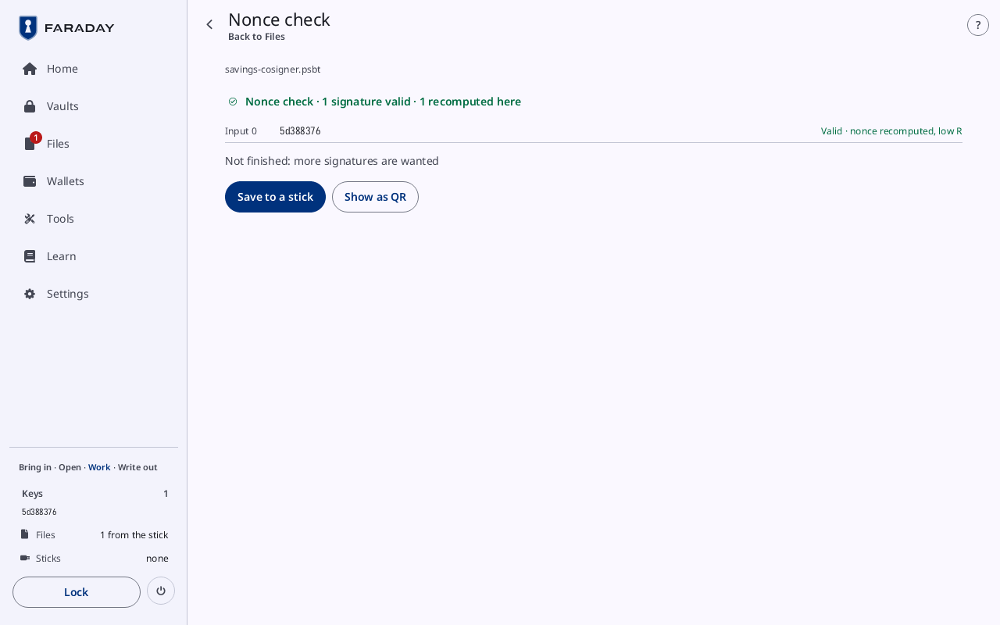

# Nonce check

**Kind:** Reference
**Status:** Checked against the app's pictures in docs/guide/pictures/ (drawn by just guide-pictures) and its code and strings (`faraday/faraday-core/src/screens/nonce_check.rs`, `faraday/faraday-core/src/decode.rs`, `faraday/faraday-core/src/catalog.rs`)
**Screen:** `NonceCheck`
**Group:** Tools

**Opened from:** a signed PSBT that no key loaded here is left to sign,
or a finished transaction: scanned by the
[camera](qr-and-scan.md#scan); **Nonce check** on its row in
[Files](files.md#a-file-from-the-stick); **Tools → Nonce check** while
no spend is finished here, which opens the first such file in Files, or
the camera while there is none. A finished spend's own check is on the
last card of [Sign a transaction](sign.md).

A transaction another signer made, checked and not signed: every
signature against its key and what is in the transaction, and each one
under a key loaded here signed again under both nonce rules. Nothing
on it signs or changes the transaction.

*Savings' spend as its cosigner signed it, brought in on a stick, with the cosigner's key added here: "Nonce check · 1 signature valid · 1 recomputed here", the row "Valid · nonce recomputed, low R", and "Not finished: more signatures are wanted".*

## On this screen

| Control | What it does |
|---|---|
| the way back | at the top left, named after where the page was opened from: **Files**, **Tools** or **Back** |
| the source | under the title: the file's name |
| the nonce check | its first line and a row per signature, as on [Send it](../walk/check-and-decode.md#4-nonce-check) |
| "Not finished: more signatures are wanted" | a PSBT that still needs signatures from another signer |
| "Not finished: a signature is wrong" | in the error tone: a signature does not hold, or two share a nonce; nothing below is offered |
| **Save to a stick** | puts it For the stick: the transaction finished, as `payment-final.txn`, or the PSBT as it came; **Remove** while it waits there |
| **Decode it** | a finished transaction taken apart on [Decode a transaction](decode.md), whose way back is **Nonce check** |
| **Show the raw hex**, **Hide the raw hex** | a finished transaction as hex, in a box under the buttons |
| **Show as QR** | the finished transaction, or the PSBT while it is not finished, as a [QR code](qr-and-scan.md#a-qr-code) |

The check is made when the page opens, with the keys and wallets loaded
then. Coming back from **Decode it** after loading a key makes it again.

## On a narrow window

The top bar holds the way back and the name, **Nonces**; each row's
verdict is under its input.

## Why

- [Nonces](../../learn/13-nonces.md)
- [Verifying](../../learn/06-verifying.md)
