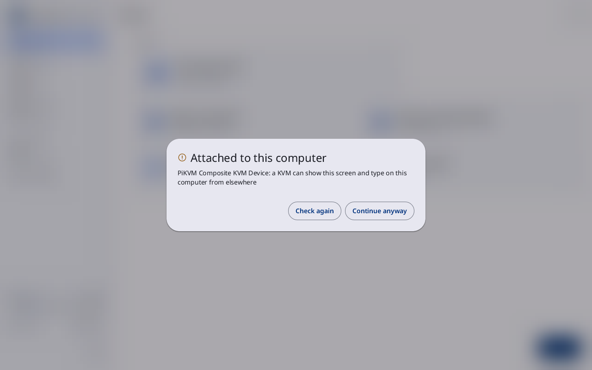
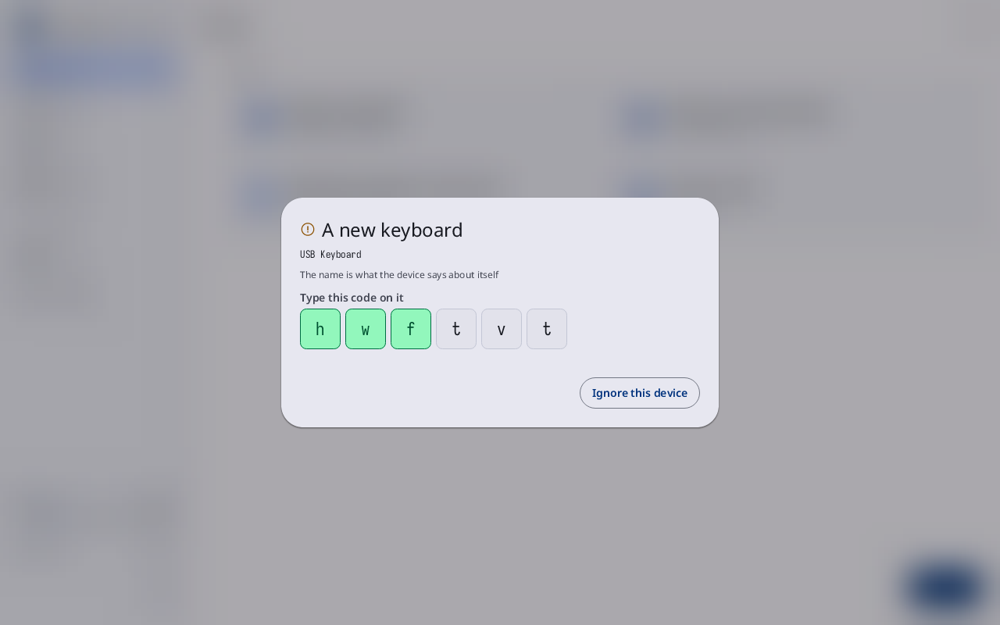
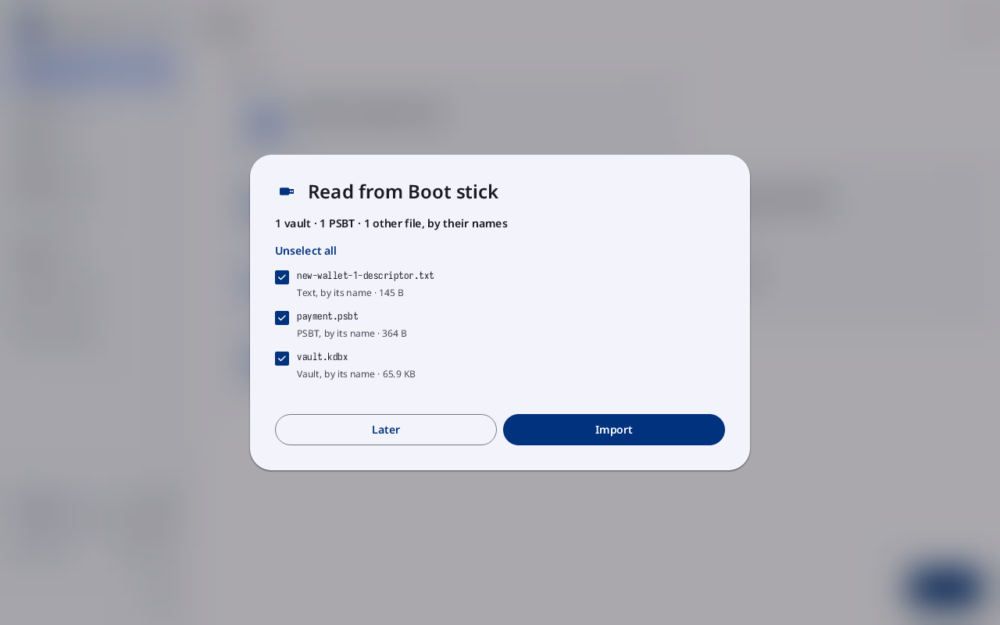
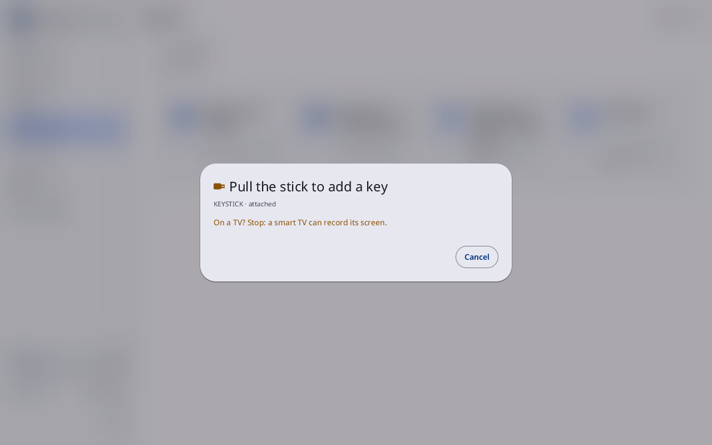
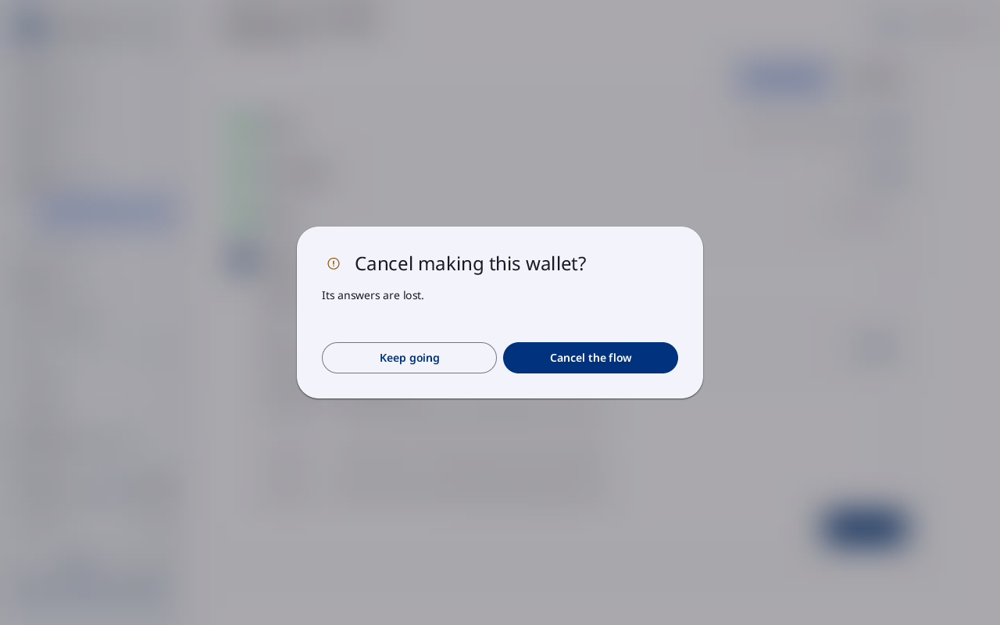

# Prompts

**Kind:** Reference
**Status:** Checked against the app's pictures in docs/guide/pictures/ (drawn by just guide-pictures) and its code and strings (`faraday/faraday-core/src/screens/sheets.rs`, `faraday/faraday-core/src/boot_import/screen.rs`, `faraday/faraday-core/src/boot_import/text_ask.rs`, `faraday/faraday-core/src/in_progress.rs`)
**Screen:** `Devices`, `NewInput`, `Import`, `TextSeed`, `Pull`, `CancelFlow`, `CancelKey`
**Group:** Home

The small sheets that open over any screen when something needs an
answer before Faraday goes on. Each section is one sheet, under the
title it shows.

## Attached to this computer

**Opened from:** the stick's check at start, and a device plugged in
later that can show the screen or type elsewhere; while one is
attached, anything that would show, load or have a secret typed opens
this sheet first. Not in Faraday Demo.

*A KVM attached: its name, what it can do, **Check again** and **Continue anyway**.*

| Control | What it does |
|---|---|
| each device's line | its name and what it can do: "a KVM can show this screen and type on this computer from elsewhere", "a TV can record what it shows", "a virtual machine's host sees and can change everything in it" |
| **Check again** | reads what is attached again: what was unplugged leaves the list, and the sheet closes once nothing is left. **Still attached** while something is |
| **Continue anyway** | asks once more: **Only for a screen or switch that is your own, in front of you. What is listed stays possible while it is attached.** with **Hold to continue** under it |
| **Hold to continue** | held until it fills: lets every device listed through for this session, and what was pressed goes ahead |
| **Cancel** | shown in place of **Continue anyway** while it asks: lets nothing through |
| **Power off** | shown for a virtual machine, with **Faraday must start on a real computer.**, in place of **Continue anyway**: there is no way on |

### Before a secret is shown

The same sheet, titled **Before a secret is shown**, when nothing is
held but a reminder is due, the first time a secret would be shown or
typed: "On a TV? Stop: a smart TV can record its screen." while the
screen did not say it is not a TV, and the wireless receiver's line
while one is attached.

| Control | What it does |
|---|---|
| **I understand** | what was pressed goes ahead. A reminder comes back only when it is new |
| **Cancel** | closes the sheet; what was pressed does not go ahead |

## A new keyboard

**Opened from:** a keyboard or pointer plugged in after Faraday
started. It asks when it is used, not when it is plugged in: a small
notice names it at plug-in, and its first key, motion or press brings
up this sheet (a touch or press that brings it up counts for nothing).
A device that is never used never asks. Its typing or pointing does
nothing until it is let in. The
title is **A new keyboard**, **A new pointer**, or **A new keyboard and
pointer**.

*A new keyboard: its name, **Type this code on it** with three of the six letters typed, and **Ignore this device**.*

| Control | What it does |
|---|---|
| the device's name | what the device says about itself (**The name is what the device says about itself**) |
| **Type this code on it** | six letters; each turns green as the new keyboard types it. Typed in full, the keyboard is let in ("… is in use"). A keyboard that types three codes' worth of letters without it is kept out until it is unplugged ("… typed the wrong code. Unplug it to try again.") |
| **Use this pointer** | lets the pointer in. Shown with input already trusted; with none trusted a pointer gets the targets below instead |
| **Ignore this device** | keeps it out until it is unplugged. A press beside the sheet does the same |

**This keyboard cannot be let in until Faraday restarts** shows in
place of the code while the system has given no randomness. After three
keyboards or touchscreens kept out, new ones are ignored until Faraday
starts again ("New keyboards and touchscreens are ignored until Faraday
starts again."). Every press beside a target counts for the session, from
any device, whether or not it is unplugged or ignored; nine close the door
the same way ("New keyboards, pointers and touchscreens are ignored until
Faraday starts again." when no input is trusted). A toast says what is in,
over this sheet too: "Keyboard in use: …", "Pointer in use: …", "Keyboard
and pointer in use: …" or "Touchscreen in use: …".

A USB touchscreen plugged in (an HDMI screen's touch on the Pi, for
one) fills the screen instead, titled **A new touchscreen**. So does a
USB pointer with no keys while nothing else is trusted, titled **A new
pointer**, with **Press the target**: its arrow moves by itself on the
screen and a press of its button is the press. Both press several
targets in a row:

| Control | What it does |
|---|---|
| the device's name | what the device says about itself |
| **Tap the target** | the round target below it, at a place drawn at random. Tapped, it brings the next; the last lets the device in ("Touchscreen in use: …") |
| "Target 1 of 3" | which target of how many. A press beside goes back to the first |
| "Tries left: 2" | shows once a press lands beside a target. The third keeps the device out until it is unplugged ("… tapped beside the target. Unplug it to try again.", "… pressed beside …" for a pointer) |
| **Ignore this device** | keeps it out until it is unplugged |

**This touchscreen cannot be let in until Faraday restarts** ("This
pointer …" for a pointer) shows in place of **Tap the target** while the
system has given no randomness, or on a screen too small for any number
of targets to be safe.

## Read from the boot stick

**Opened from:** the first look at the boot stick in a power-on, when
it holds files; Home's **Import from …** lead and the sidebar's
**import waiting** open it again. Its title is **Read from …** with
the stick's name ("Read from Boot stick"). Nothing on the stick is
read until **Import**.

*Three files on the boot stick, each ticked: a descriptor, a PSBT and a vault, with **Unselect all**, **Later** and **Import**.*

| Control | What it does |
|---|---|
| the count | what the files are by their names: "1 vault · 1 PSBT · 1 other file, by their names", or **No files Faraday reads** |
| **Select all**, **Unselect all** | ticks or unticks every file |
| a file's row | its name, what it is by its name, and its size; a press ticks or unticks it. A file Faraday does not read is greyed, and so is every file once **Import** is pressed |
| **Later** | closes the sheet, reads nothing and brings in nothing. A press beside the sheet does the same |
| **Import** | reads the ticked files, and only those, and brings in what they hold: files into Files, keys and wallets loaded, vaults into Files, locked |

| State | What the sheet shows |
|---|---|
| reading | "3 of 7 files read", and a bar that fills |
| the stick pulled before **Import** | **Put the stick back in to import** |
| a vault brought in | the vault's name, "Locked" and its size, the passphrase field, **Cancel** and **Unlock**, one vault at a time. **Pull the stick to continue** while the stick is in; the field takes typing once it is out |
| unlocking | "Unlocking" and the time it takes |
| the passphrase refused | why, in the error tone, under the field |

**Unlock** opens the vault and then its Load sheet; **Cancel** leaves the
vault locked in Files and goes on to the next.

## A picture that reads as a seed or as text

**Opened from:** a stick visit or **Import** from the boot stick, for
each picture whose QR code is 16 or 32 bytes that are both text and a
CompactSeedQR (`docs/SCANNING.md` §1). Its title names the file ("seed.png
reads as a seed or as text"). One sheet opens for each such picture, in
turn; nothing in it is loaded as a key until it is answered.

| Control | What it does |
|---|---|
| **Load as a key** | reads the code as a CompactSeedQR: its words are kept as a file beside the picture and loaded as a key, at once when no stick is in, or when the stick is pulled |
| **Leave as a file** | keeps the picture as a file and loads nothing; the visit's list says it was left as a file. Closing the sheet does the same |

A binary CompactSeedQR, and every other seed, loads as before, with no
sheet.

## Pull the stick

**Opened from:** a press that loads a key, unlocks a vault or opens the
camera while a stick is attached. Its title names the stick and what
waits: **Pull the stick to add a key**, **Pull the stick to make a
key**, **Pull the stick to unlock**, **Pull the stick to scan**,
**Pull the stick to load the wallet**, **Pull the stick to load the
samples**, **Pull the stick to create the vault, then your key**.

*The sheet **Pull the stick to add a key** with KEYSTICK attached, the reminder about a TV, and **Cancel**.*

| Control | What it does |
|---|---|
| the stick line | the stick attached ("Boot stick · attached"), or how many ("2 sticks attached") |
| a reminder | due before a secret, as on [Before a secret is shown](#before-a-secret-is-shown); pulling the stick answers it |
| **Cancel** | closes the sheet; what was pressed does not go ahead |

Pulling the stick closes the sheet and what was pressed goes ahead.

## Cancel a flow

**Opened from:** **Cancel** at the top of a flow, when ending it would
lose something. A flow with nothing past its first card ends at once,
without the sheet.

*The sheet **Cancel making this wallet?** over Make a new wallet: **Its answers are lost.**, **Keep going** and **Cancel the flow**.*

| Title | Shown for |
|---|---|
| **Cancel making this wallet?** | Make a new wallet |
| **Cancel restoring this wallet?** | Restore a wallet |
| **Cancel this backup?** | Back up a wallet, and a backup flow |
| **Cancel this spend?** | a spend |
| **Cancel signing this message?** | Sign a message |
| **Cancel making this vault?** | Create a vault |
| **Cancel making this key?** | a GPG key |
| **Cancel making these keys?** | Secure Boot keys |

Under the title, the one line of what is lost: **Its answers are
lost.**, **The plan and its places are lost.**, **Its answers and the
setup of its vaults are lost.** or **Its steps and any signatures made
are lost.** Keys loaded, wallets made, vaults and the files for the
stick are not lost.

| Control | What it does |
|---|---|
| **Keep going** | closes the sheet; the flow stays as it was |
| **Cancel the flow** | ends the flow and shows the screen it was opened from |

### Discard this key?

The same question over New key or Make codex32 shares opened from a
slot of Make a new wallet: **What is entered for this key so far is
discarded, and you return to Make a new wallet.**

| Control | What it does |
|---|---|
| **Keep going** | closes the sheet |
| **Discard** | discards the key so far and shows Make a new wallet |

## Why

- [Screens that record](../../learn/faraday/boot/screens-that-record.md)
- [The air gap](../../learn/07-air-gap.md)
- [Where keys are kept](../../learn/faraday/keys-kept.md)
- [Vaults](../../learn/faraday/vaults.md)
