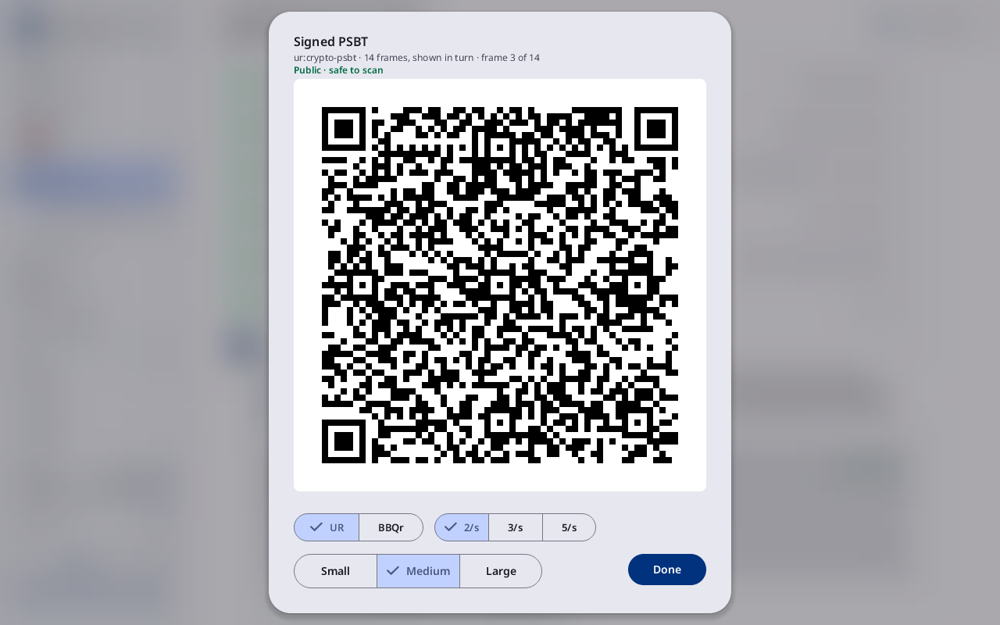
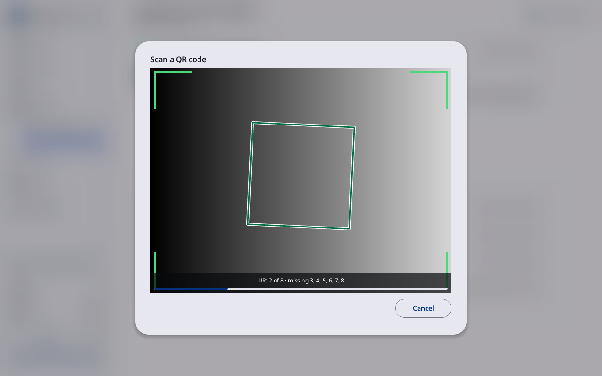
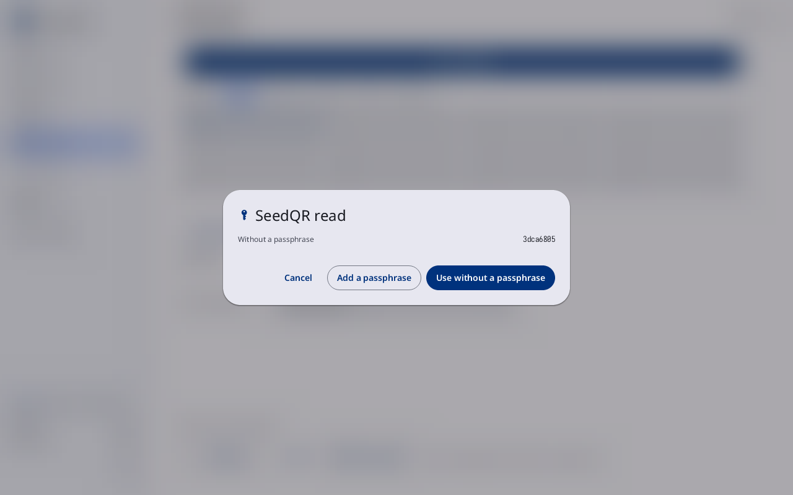
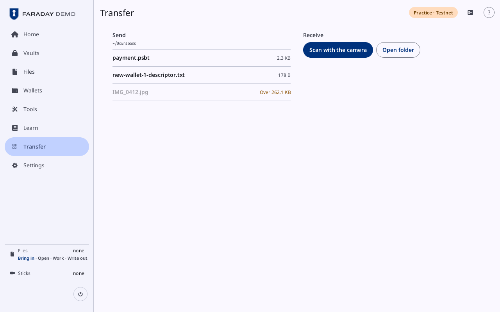

# QR codes and the camera

**Kind:** Reference
**Status:** Checked against the app's pictures in docs/guide/pictures/ (drawn by just guide-pictures) and its code and strings (`faraday/faraday-core/src/screens/sheets.rs`, `faraday/faraday-core/src/qr_view.rs`, `faraday/faraday-core/src/seeds/read.rs`, `faraday/faraday-core/src/transfer/screen.rs`, `faraday/faraday-core/src/transfer/mod.rs`, `faraday/faraday-starter/src/draw/home.rs`)
**Screen:** `Qr`, `Scan`, `SeedRead`, `Transfer`
**Group:** Files

The sheet that shows a QR code, the camera that reads one, the sheet a
SeedQR read opens, and Transfer, in Faraday Demo and Faraday Starter,
which carries files between this computer and the device by QR code.

## A QR code

**Opened from:** **Show as QR** wherever there is one: a wallet's card,
a file for the stick, a signed PSBT, a GPG key, a vault's wallet.

*"Signed PSBT", "ur:crypto-psbt · 14 frames, shown in turn · frame 3
of 14" and **Public · safe to scan** over the code; **UR**, 2/s and
**Medium** chosen; **Done**.*

| Control | What it does |
|---|---|
| the title | what the code holds, and under it what it is; for an animated code, how many frames and the one on show ("ur:crypto-psbt · 14 frames, shown in turn · frame 3 of 14") |
| **Public · safe to scan** | in the ok tone, under the title; **Secret · whoever scans this can use it** in the error tone for a secret |
| the code | one code, or an animated run of them, one frame after another |
| the text | a descriptor's whole text, under the code |
| **UR**, **BBQr**, **Parts** | how the code is written; the one in use ticked. **Parts** only for text: a descriptor or a key |
| 2/s, 3/s, 5/s | for an animated code: frames a second |
| **Small**, **Medium**, **Large** | for an animated code: how much each frame holds |
| **PNG for the stick** | for one code of public content only, in place of the part sizes: puts it in Files as a picture, with its label, for the stick. Never for a secret or an animated code |
| **Done** | closes the sheet |

## Scan

**Opened from:** Home's **Scan**, Files' **Scan a QR code**, and every
place that reads a code: a PSBT, a key for a wallet, a SeedQR, a copy
checked, a TOTP setup code, the Spend tab's intake. With a stick
attached, [Pull the stick to scan](prompts.md#pull-the-stick) comes
first.

*The camera, **Scan a QR code**, with an animated code in view: the code found
outlined, "UR: 2 of 8 · missing 3, 4, 5, 6, 7, 8" and its bar; **Paste**
dimmed, **Cancel**.*

| Control | What it does |
|---|---|
| the title | **Scan a QR code**; **Scan a SeedQR**, **Scan your copy**, **Scan what you have**, "Scan a key for New wallet 1", **Receive into Downloads**, by what it reads |
| **Never type a seed that holds real bitcoin here.** | beside the picture, where the camera reads a seed |
| the picture | the camera's picture with corner brackets, white while looking and green while a code it read is in view; the code found outlined |
| the line in the picture | **Starting the camera**, **Hold the QR in front of the camera**, what was read ("UR: 2 of 8 · missing 3, 4, 5, 6, 7, 8"), or why there is no picture: **The camera sends no picture**, **The camera was refused**, **The camera is in use by another app**, **No camera found**. A bar under it fills as the parts of an animated code are read |
| the cameras | a button each, where there is more than one |
| **Type the words instead** | for a key of a wallet, and the Spend tab's intake: the words typed in place of a SeedQR |
| **Paste** | reads the clipboard's text as a code; shown only where the shell has a clipboard. **Nothing to paste** when it is empty |
| **Cancel** | closes the camera; **Done** on the Spend tab's intake |

What a code holds goes where the scan was for: a file into **From the
stick** in [Files](files.md), a key into its slot, a PSBT into its
spend. A SeedQR opens [SeedQR read](#seedqr-read). Home's **Scan**
takes everything the other scanners take: a codex32 string or a SLIP-39
share opens Add a key on its form with the share in, and a TOTP setup
code opens a new entry in the open vault ("That is a TOTP setup code.
Unlock a vault to add it" when none is open).

A scanner opened for one thing shows anything else on the read card,
in place of the picture, with the camera off: **Read** and what it is
("A transaction to sign", "A TOTP setup code"), which one ("Key
73c5da0a", "1 input"), never a secret's value, and the way over to
where it is taken (**Sign it**, **Add this key**, **Add to {vault}**,
**Unlock {vault}**, **Make a vault**), with **Scan again**, which turns
the camera back on, and **Cancel**. With a stick in, **Add this key**
and **Add this share** are dimmed: "Remove the stick first".
**Scan a SeedQR** takes a codex32 string or a SLIP-39 share to its form
too, and a form's **Scan** takes the other share form's part onto that
form and a whole seed to [SeedQR read](#seedqr-read).

## SeedQR read

**Opened from:** a SeedQR read by the camera; on Restore and the Spend
tab, a seed taken in with no passphrase. A SeedQR holds no passphrase,
so the sheet asks.

*The sheet **SeedQR read**: **Without a passphrase** 3dca6805, then **Cancel**,
**Add a passphrase** and **Use without a passphrase**.*

| Control | What it does |
|---|---|
| **Without a passphrase** | the key the seed makes with none, by fingerprint |
| **Use without a passphrase** | loads the key with no passphrase |
| **Add a passphrase** | opens **Passphrase** and **Passphrase again**; **With this passphrase** then gives the key they make, or **The two passphrases differ** |
| **Use with this passphrase** | loads the key with the passphrase. Grey until both fields match |
| **Without a passphrase** | while adding one: loads the key with none |
| **Not this one** | on the Spend tab, for a seed that is none of the wallet's keys: back to the camera |
| **Cancel** | closes the sheet; the words are wiped |

## Transfer

**Opened from:** the sidebar's **Transfer** in Faraday Demo, and
**Open Transfer** on [Faraday Starter's Tools](starter-tools.md#tools).
It is in those two only, not on the stick or the Pi: it carries files
between this computer's Downloads folder and the device, by QR code.
What it receives goes into Downloads, never into Faraday Demo's Files.

*Transfer in Faraday Demo: **Send** lists ~/Downloads, payment.psbt,
new-wallet-1-descriptor.txt and IMG_0412.jpg (**Over 262.1 KB**);
**Receive** has **Scan with the camera** and **Open folder**.*

| Control | What it does |
|---|---|
| **Send** | the Downloads folder, its path under the heading, then its files newest first, each with its size; a press shows the file as [a QR code](#a-qr-code). "Over 262.1 KB" for a file too large; "Reading …" while one is read; **No files** while there is none |
| **Receive** | the camera and what it saved |
| **Scan with the camera** | under **Receive**: opens [Scan](#scan), titled **Receive into Downloads**: each whole file read is saved into Downloads ("Saved …"). A secret waits for [Save without encryption?](files.md#save-without-encryption) first |
| **Open folder** | beside it: opens Downloads in this computer's file manager |
| the lines under it | what was saved this session, newest first: "Saved …", "Saved …: this file holds a secret", "Not saved: …" |

A file over 262.1 KB is refused: "Larger than 262.1 KB: carry it on a
stick".

## On a narrow window

A QR code fills the width; an animated code's frame is in the title,
and its format, speed and part size are buttons that step through the
choices.

## Why

- [The air gap](../../learn/07-air-gap.md)
- [Coordinator files](../../learn/19-coordinators.md)
