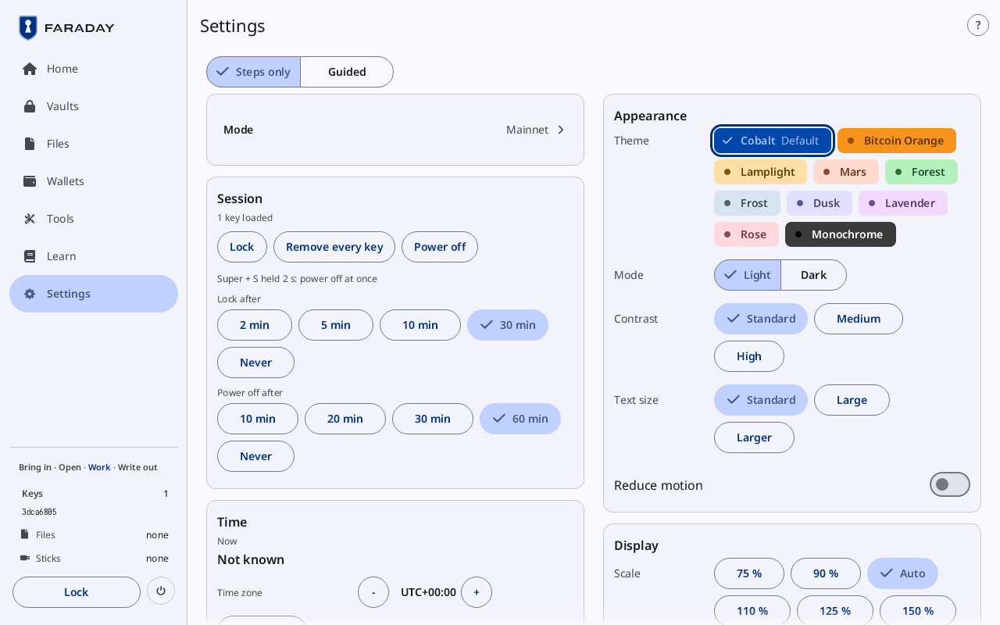
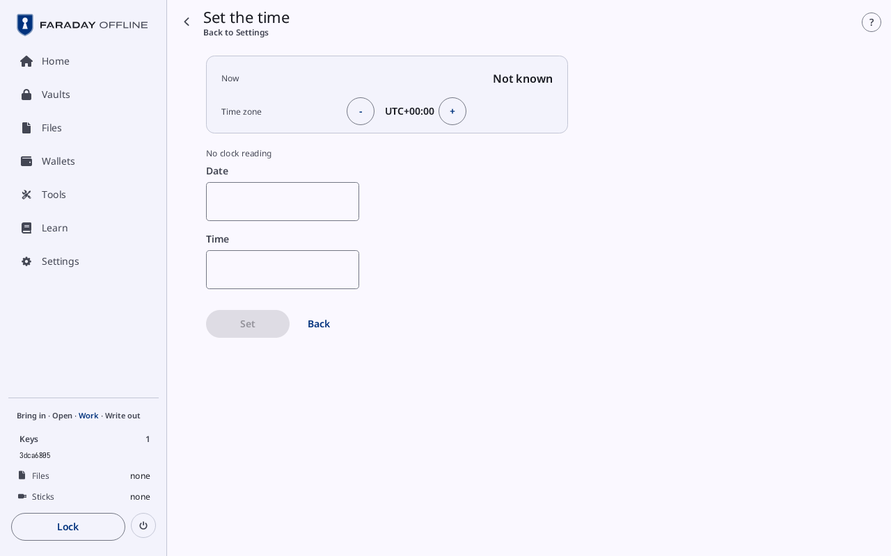

# Settings

**Kind:** Spec
**Status:** Checked against the app's pictures in docs/guide/pictures/ (drawn by just guide-pictures) and its code and strings (`faraday/faraday-core/src/screens/settings.rs`, `faraday/faraday-core/src/screens/set_time.rs`, `faraday/faraday-core/src/set_time.rs`, `faraday/faraday-core/src/screens/randomness.rs`, `faraday/faraday-core/src/fresh.rs`, `faraday/faraday-ui/src/appearance.rs`), but for Add randomness's picture
**Open:** Add randomness's picture, `settings-add-randomness.png`, is drawn as an empty page and is to be drawn again
**Screen:** `Settings`, `SetTime`, `Randomness`
**Group:** Settings

Settings, section by section, and the two pages it opens: Set the time
and Add randomness.

## Settings

**Opened from:** the sidebar's **Settings**; **Settings** in the **⋮**
menu on a tall narrow window.

*Settings with a key loaded: **Steps only** chosen over the columns;
**Mode** reading **Mainnet**, **Session** with **Lock**, **Remove every
key** and **Power off**, and **Time** on the left; **Appearance** with
**Cobalt** chosen, and **Display**, on the right.*

At 1280 × 800 the sections are cards in two columns: **Mode**,
**Session**, **Time** and **Randomness** on the left, **Appearance**,
**Display**, **Signed amounts** and **About** on the right.

| Control | What it does |
|---|---|
| **Steps only**, **Guided** | under the title, over both columns: with **Guided**, each section has a line under its name on what it does |

### Mode

| Control | What it does |
|---|---|
| **Mode** | a card of one row, with the mode in use and an arrow at its end (**Mainnet**, **Practice**, …): opens the [Mode](mode.md#mode) sheet. On Mainnet, where no pill shows, it is the only way to the sheet |

### Session

| Control | What it does |
|---|---|
| "1 key loaded" | the keys loaded |
| **Lock** | while a key is loaded or a vault is open: [Lock](lock-and-power.md#lock) |
| **Remove every key** | beside **Lock**: unloads every key and keeps the wallets; a spend under way ends |
| **Power off** | opens [Power](lock-and-power.md#power); **Quit** in Faraday Demo |
| **Super + S held 2 s: power off at once** | on the stick: the key that powers off without a sheet |
| **Lock after** | **2 min**, **5 min**, **10 min**, **30 min** (at first), **Never**: the idle lock |
| **Power off after** | **10 min**, **20 min**, **30 min**, **60 min** (at first), **Never**; not in Faraday Demo |
| "Ignored until unplugged: …" | in the warning tone: the devices [A new keyboard](prompts.md#a-new-keyboard) was told to ignore |

### Time

| Control | What it does |
|---|---|
| **Now** | the local date and time, with seconds, or **Not known** |
| **Time zone** | **-** and **+** step it by 15 minutes, from UTC-12:00 to UTC+14:00 |
| **Set the time** | opens [Set the time](#set-the-time) |

TOTP codes, GPG and Secure Boot signatures, and the dates a backup was
checked read this clock.

### Randomness

| Control | What it does |
|---|---|
| "System: operating system · your own: none" | where the system's randomness comes from, and what has been added this session ("3 dice rolls, 1 camera frame") |
| **Add randomness** | opens [Add randomness](#add-randomness) |

### Appearance

| Control | What it does |
|---|---|
| **Theme** | ten chips, each in its own colours: **Cobalt** (marked **Default**), **Bitcoin Orange**, **Lamplight**, **Mars**, **Forest**, **Frost**, **Dusk**, **Lavender**, **Rose**, **Monochrome**; the chosen one ringed and ticked |
| **Mode** | **Light**, **Dark** |
| **Contrast** | **Standard**, **Medium**, **High** |
| **Text size** | **Standard**, **Large**, **Larger** |
| **Reduce motion** | a switch: on, changes show at once, with no slide or fade |

A choice changes the whole window at once.

### Display

| Control | What it does |
|---|---|
| **Scale**: "75 %", "90 %", **Auto**, "110 %", "125 %", "150 %", "200 %" | the size of text and controls; **Auto** is the size for this screen |
| **Rotation**: **Landscape**, **Portrait** | on a 7-inch or 10-inch panel only: turns the screen, and its touch with it, at once; Faraday starts in landscape and the choice is kept on the stick |

**Landscape** suits the backup board and a list beside its detail.
**Portrait** suits typing words in: the keyboard leaves more of the
screen above it. On a laptop's screen, a monitor, the Pi's 2.8-inch
panel and in Faraday Demo there is no **Rotation** row.

### Signed amounts

| Control | What it does |
|---|---|
| "2 transactions remembered" | how many signed transactions' input amounts are remembered; the same transaction stated with other amounts is refused |
| **Sealed into an open vault** (at first), **Kept until power-off only** | where they are kept: sealed into an open vault, they last past power-off |

### About

| Control | What it does |
|---|---|
| "Faraday …" | the version, and what the app is: **Keys are typed, scanned as SeedQR or loaded from a vault, and kept for the session only**, "Vaults · files move by stick · QR by camera and from PNG files on a stick", and how sticks are read ("Sticks are read by an unprivileged disk process; the kernel mounts none"; in Faraday Demo, "Sticks are folders in ~/faraday-sticks") |
| **Self-test** | the self-test run at every start: "passed · … checks" in the ok tone, "failed · …" in red, or **not run** |
| **Run again** | runs the self-test again |
| "Visit nakamotoinstitute.org to learn about Bitcoin’s history, economics, and technology. Not affiliated." | in Faraday Demo the site's name is a link that opens it in the computer's browser |

## Set the time

**Opened from:** **Set the time** in Settings → Time, on
[TOTP codes](codes.md), on a vault entry's TOTP code while the clock is
not known, and on the [Sign with](vault.md#sign-with) sheet; and, before
something that keeps the time it reads (a GPG key or a Secure Boot
certificate made, a GPG signature), on its own while the clock has not
been checked since power-on. Back, **Set** and **Keep this time**
return to where it was opened from, with the sheet that was open there.

*The page **Set the time**, opened from **Settings**, with no clock reading:
**Now** reads **Not known**, the **Date** and **Time** fields are
empty, and **Set** is greyed beside **Back**.*

| Control | What it does |
|---|---|
| the way back | at the top left, the arrow beside the title, named under it after where the page was opened from (**Settings**) |
| **Now** | in a card at the top: the local date and time, with seconds, or **Not known** |
| **Time zone** | in the same card: **-** and **+**, as in Settings |
| **No clock reading**, **Counted from Set: no clock reading** | where the computer gives no clock reading: none at all, or a time set here counted on from **Set** |
| **Date** | the field, `YYYY-MM-DD`, filled with today's date where the clock is known; from 2020-01-01 to 2099-12-31 |
| **Time** | the field, `HH:MM`, 24-hour; typing goes here first. <kbd>Tab</kbd> moves between the two |
| **Set** | greyed until both are a real date and time; then the time typed, at :00 seconds, becomes the time ("Time set to 14:05"). <kbd>Enter</kbd> does the same. The computer's own clock is not changed |
| **Keep this time** | while the clock is known: marks it checked and sets nothing |
| **Back** | goes back and marks nothing; <kbd>Escape</kbd> does the same |

## Add randomness

**Opened from:** **Add randomness** in Settings → Randomness. New key's
**Generator** card offers the same sources on itself
([Add a key](new-key.md#the-entry-card)).

Randomness of your own, hashed with the system's into the session's
randomness. Nothing is chosen until a source is pressed.

*Picture to come: `settings-add-randomness.png`, Add randomness on Dice, ten rolls in the batch.*

| Control | What it does |
|---|---|
| the way back | at the top left, named after where the page was opened from (**Settings**) |
| the status line | as in Settings: "System: … · your own: …" |
| **Camera**, **Dice**, **Coins**, **Cards**, **Pointer and keys** | the source; **Camera** only where there is a camera, **Pointer and keys** only where there are a pointer and keys |

### The sources

| Source | Its pad |
|---|---|
| **Camera** | **Take a picture**, beside **Waiting for the camera**, **Camera on**, or "… luma values in the last picture"; each picture is added as it is taken. **Space takes a picture** |
| **Dice** | a button per face, 1 to 6; **Type 1 to 6 · Backspace takes one back · Enter adds** |
| **Coins** | **Heads**, **Tails**; **Type H or T · Backspace takes one back · Enter adds** |
| **Cards** | a button per rank, then per suit; "Deck 1 · 3 drawn from it"; **Type the rank (A 2–9 T J Q K), then the suit (S H D C)** |
| **Pointer and keys** | **Move the pointer here and type**: the pointer's moves over the area and the keys typed are taken, "120 pointer moves, 14 keys"; they are added once the pointer leaves the area |

For dice, coins and cards:

| Control | What it does |
|---|---|
| "In this batch: 10 dice rolls" | what is not added yet; **Enough for 256 bits on its own** in the ok tone from 99 rolls |
| **Undo**, **Clear** | takes the last one back, or every one in the batch |
| **Add** | adds the batch; the status line counts it |

A press that cannot be taken says why in red: **That card is already
out of this deck**, **No picture from the camera yet**, **Too little
variation in that picture**.

## On a narrow window

Settings is a list of its sections, each a row: **Mode** opens its
sheet, any other opens that section as its own page, whose way back is
the list. Set the time puts **Now** and the time zone in a card at the
top, as on a wide window; Add randomness sets the sources two to a row.

## Why

- [Where keys are kept](../../learn/faraday/keys-kept.md)
- [Time and TOTP codes](../../learn/faraday/time.md)
- [Randomness](../../learn/03-randomness.md)
- [Glossary](../../learn/15-glossary.md)
