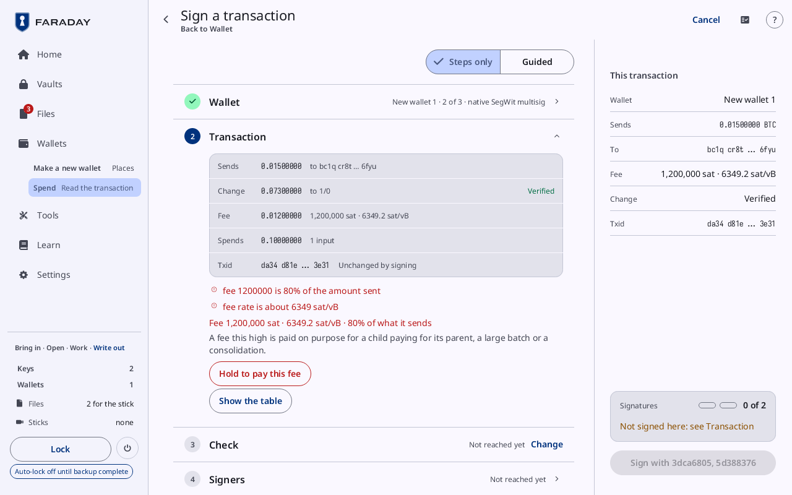
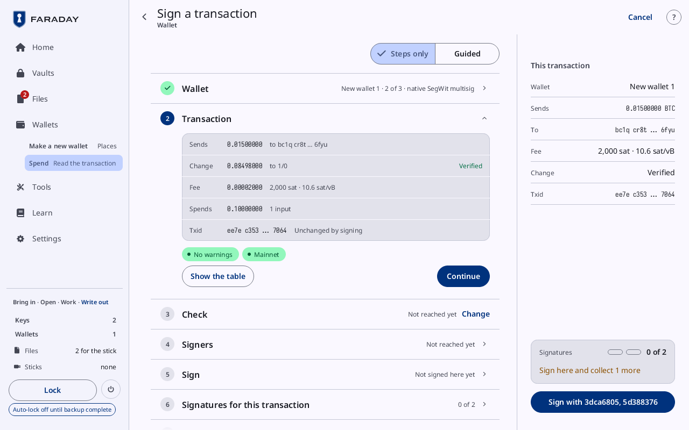

# Sign a transaction

**Kind:** Reference
**Status:** Checked against the app's pictures in docs/guide/pictures/ (drawn by just guide-pictures) and its code and strings (`faraday/faraday-core/src/screens/spend.rs`, `faraday/faraday-core/src/review.rs`, `faraday/faraday-core/src/wallet.rs`)
**Screen:** `Spend`
**Group:** Wallets

**Opened from:** **Sign** on a PSBT in [Files](files.md#a-file-from-the-stick);
**Tools → Sign a transaction** (the PSBT in Files, or the camera); a
PSBT read by the camera; Home's "Continue signing payment.psbt" lead
while a spend is under way; and the lead bar over Wallets' list
(**Signing**, **Continue**). Its way back, at the top left, is named
after the card before the one open, else the screen it was opened from.

Sign a transaction is a PSBT's review and signing, one card per step,
each closed to one line once it is done. The Spend tab's spend ([Spend
from a wallet](spend-tab.md#spend-from-a-wallet)) runs the same cards
under its own titles.

*Sign a transaction on a 2-of-3 wallet's PSBT whose fee is 80% of what it sends: **Transaction** open with the fee's warnings and **Hold to pay this fee**, and the panel **This transaction** at the right, its signatures "0 of 2" over "Not signed here: see Transaction", and **Sign with 3dca6805, 5d388376** off until the fee is held.*

## The cards

*A PSBT of the 2-of-3 New wallet 1 started from Files with **Sign**: **Wallet** done, **Transaction** open with "2,000 sat · 10.6 sat/vB", **No warnings** and **Mainnet**, **Show the table** and **Continue**; **Check**, **Signers**, **Sign** and **Signatures for this transaction** after it. The way back is named after the card before the one open, **Wallet**.*

**Steps only** and **Guided**, over the cards, turn the short text on
the open card off or on. Which cards a spend has depends on the wallet
it spends from:

| Card | Shown for |
|---|---|
| **Wallet** | every spend |
| **Path** | a miniscript or taproot-tree wallet |
| **Transaction** | every spend |
| **Check** | every spend |
| **Signers** | a wallet of more than one key |
| **Nonces** | a MuSig2 wallet |
| **Sign** | every spend |
| **Signatures for this transaction** | a wallet of more than one key |
| **Finish** | every spend |

Each card ends with **Continue**, which closes it and opens the next.

### Wallet

Closed, the wallet's name and shape ("New wallet 1 · 2 of 3 ·
native SegWit multisig"), or **No loaded wallet matches**.

| Control | What it does |
|---|---|
| the wallet | "New wallet 1 · from payment.psbt": the loaded wallet whose script the first input spends |
| "No loaded wallet matches this transaction. Change cannot be verified until its wallet is loaded." | where no loaded wallet matches |

### Path

For a wallet with more than one way to spend. Closed, "2 ways to spend".

| Control | What it does |
|---|---|
| "Path 1" | each way: its keys ("key 1 3dca6805"), each marked where it is here |
| **No wait**, "Waits 52560 blocks after the coins arrived (about 365 days)" | the wait the path needs |
| **This transaction's sequence allows this path** | in the ok tone; **This transaction's sequence does not allow this path** where it does not |

### Transaction

Closed, "Sends 0.01500000 BTC · fee 11.3 sat/vB" ("Sends … BTC · fee
not known" without the inputs' amounts).

| Row | What it shows |
|---|---|
| **Sends** | each payment, "to bc1q cr8t … 6fyu" |
| **Change** | what comes back, "to 1/0", with **Verified** once it is derived again from the wallet's keys |
| **Fee** | the fee in BTC, and "2,140 sat · 11.3 sat/vB"; **Not known** without the inputs' amounts |
| **Spends** | the amount spent and "1 input"; **Amount unchecked**, in the warning tone, where an input's amount is only stated |
| **Txid** | the transaction's id, **Unchanged by signing** (SegWit) or **Changes when signed**; **Not known until signed** where it cannot be worked out yet |
| the warnings | each in its own words, in red for danger |
| **No warnings** | a chip, where there are none; the network chip beside it |
| **Register this wallet** | under a warning that the wallet is not registered here, where the PSBT names every cosigner's key: opens [Register this wallet](wallets.md#register-this-wallet) |
| **Load this wallet's descriptor to sign** | the same, where the PSBT does not carry the keys |
| **Show the table**, **Hide the table** | each **Input** and **Output** whole |

Where a check stops the spend, the card says why under the rows, and
**Continue** is not shown:

| Line | Means |
|---|---|
| **Faraday does not sign this transaction. Make it again in the coordinator without what is marked above.** | a refusal, with no way past |
| **This transaction can never be valid. In the coordinator, set the input's sequence or the transaction's locktime to the path's wait, then make it again.** | the path's wait is not met |
| **Faraday signs this transaction once its wallet is registered.** | **Register this wallet** first |
| "Fee 1,200,000 sat · 6349.2 sat/vB · 80% of what it sends", then **A fee this high is paid on purpose for a child paying for its parent, a large batch or a consolidation.** | a fee too high to sign without a hold |
| **Hold to pay this fee** | held until it fills: the spend goes on with that fee |

An input whose key is in a script that no registered wallet gives is
named and left unsigned: "Input 1 is left unsigned: no registered wallet
covers this taproot tree. Register its wallet to sign it."

### Check

Closed, **Addresses · Compare**.

| Row | What it shows |
|---|---|
| **Receive 0/0**, **Receive 0/1**, **Change 1/0** | the wallet's first two receive addresses and its first change address, to compare with the online wallet's; **Back up before you receive**, in the warning tone, in their place while a key made here waits for its backup |
| **No wallet to show addresses from** | where no loaded wallet matches |

### Signers

Closed, "1 here · 2 needed".

| Control | What it does |
|---|---|
| a key's row | its number, its fingerprint, its name, and **Signs here** or **Not here** |
| **Load from vault** | on a key an open vault holds: loads it |
| **Load with a passphrase** | on a key an open vault keeps without its passphrase: opens [Seeds with no passphrase stored](vaults.md#seeds-with-no-passphrase-stored) |
| **Scan a key** | the camera, for a key not here |
| "Unlock vault.fvlt" | a locked vault in Files: opens its [Unlock](vaults.md#unlock) |
| **Collect a signature** | opens **Signatures for this transaction** |
| "Remove the stick first" | in the warning tone, while a stick is attached: the buttons that load a key are grey |
| "1 of 2 signatures here · 1 more needed" | or "2 of 2 signatures here" and **Can spend** |

### Nonces

MuSig2's first round. Closed, "1 of 3 nonces".

| Control | What it does |
|---|---|
| a key's row | **This device** on this device's key; **Nonce here** or **Waiting** |
| "Add from payment-part.psbt" | a copy in Files with others' nonces |
| **Show as QR** | this device's nonce, for the others |
| **Go first: share this device's nonce** | where no nonce is in yet |

### Sign

Closed, **Not signed here yet**, or "Signed with 3dca6805".

| Control | What it does |
|---|---|
| "Sign with 3dca6805, 5d388376" | beside "1 input": signs with every key here that has not signed. It cannot be taken back |
| **No key in this session signs this transaction** | where no key here is one of the transaction's |
| "Signed with 3dca6805" | in the ok tone, once signed |

### Signatures for this transaction

Closed, "1 of 2".

| Control | What it does |
|---|---|
| a key's row | its fingerprint, its name or "from payment-part.psbt", and **Signed here**, **Verified** (signed elsewhere and checked), **Waiting** or **Not needed** |
| **No cosigner's copy in Files** | where Files holds no other copy of this transaction |
| "Add from payment-2.psbt" | adds the signatures of a copy in Files; a copy of another transaction is not added |
| "payment-part.psbt" | the PSBT with this device's signatures, **For the stick**, with **Remove** |
| **Show as QR**, **Scan a copy** | this device's signatures as a [QR code](qr-and-scan.md#a-qr-code); the camera for a cosigner's signed copy |

### Finish

Closed, **Signed PSBT and finished transaction**, or **Not finished
yet**. Until enough keys have signed it reads "Needs 1 more signature",
in the warning tone.

| Control | What it does |
|---|---|
| **Signed PSBT** | **For the wallet that wrote it · not finalised**: "payment-signed.psbt", and **Show as QR** |
| **Finished transaction** | **Ready to broadcast**: its txid and size ("1757 … d6ee · 141 vB") |
| **Remove**, **Make again** | on each: takes the file off **For the stick**, or makes it again |
| "Nonce check · 2 signatures valid · 2 recomputed here" | each signature checked here; a row per signature ("Valid · nonce recomputed, low R"), and "Nonce check · a signature is wrong" in the error tone where one is |
| **Decode it** | opens Decode on the finished transaction |
| **Show the raw hex**, **Hide the raw hex** | the finished transaction's bytes |

## The panel

At 1280 × 800 a panel beside the cards, **This transaction**, keeps
the spend in view, a row each: **Wallet** (**Not loaded** where none
matches), **Sends**, **To**, **Fee**, **Change** (**Verified**, or
**None**) and **Txid**; a press on a row opens its card. At its foot,
**Signatures** ("0 of 2", a dot per signature) over what is missing
("Sign here and collect 1 more", **Complete**), and under it the next
press ("Sign with 3dca6805, 5d388376", **Finish**, **Open Files**,
"Insert a stick to write it").

## States

| State | What the page shows |
|---|---|
| no spend | **No transaction loaded**, and **Open Files** |
| signing | the cards, the one open where the spend is |
| signed | **Finish** open, with its files **For the stick** |

**Cancel**, at the top right while offered, asks first and leaves; nothing
is signed ([Cancel a flow](prompts.md#cancel-a-flow)).

## On a narrow window

The cards fill the window; the panel's foot becomes a bar at the foot
of the window: "1 of 2", what is missing, and the next press.

## Why

- [Verifying](../../learn/06-verifying.md)
- [Nonces](../../learn/13-nonces.md), for a MuSig2 wallet
- [Mistakes and scams](../../learn/08-scams.md)
