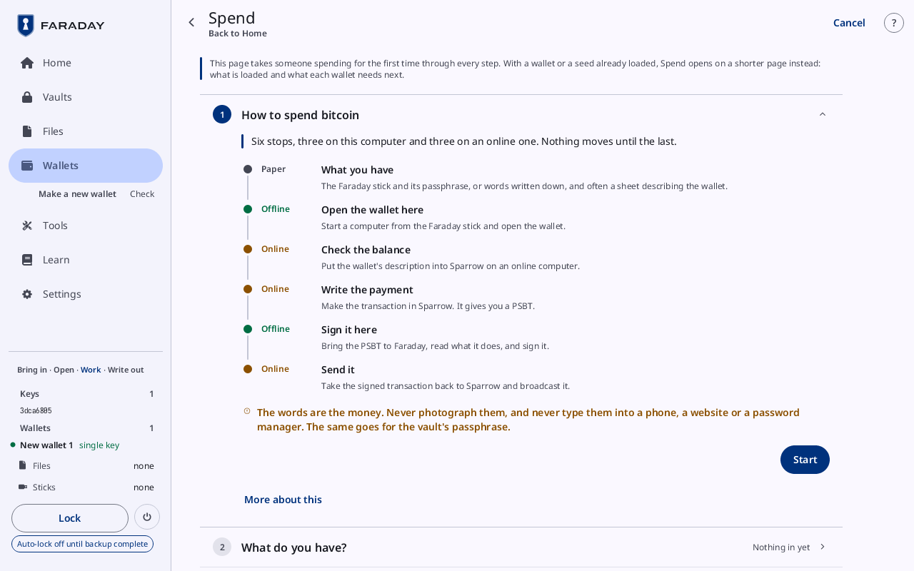
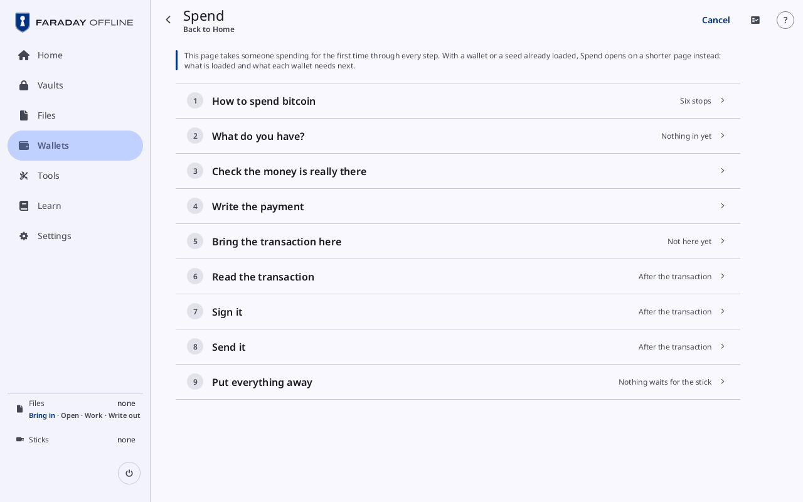
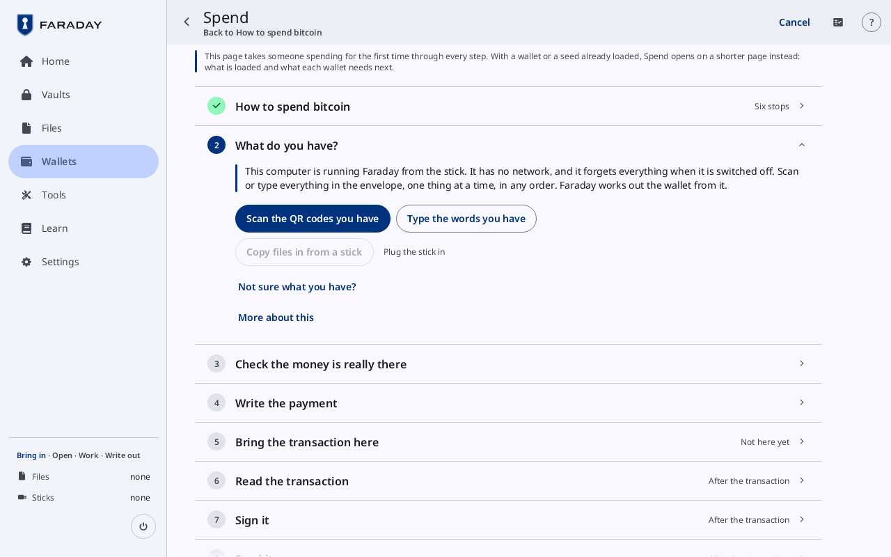

# Spend

**Kind:** Reference
**Status:** Checked against the app's pictures in docs/guide/pictures/ (drawn by just guide-pictures) and its code and strings (`faraday/faraday-core/src/family/screen.rs`, `faraday/faraday-core/src/family/mod.rs`, `faraday/faraday-core/src/family/text.rs`)
**Screen:** `Family`
**Group:** Wallets

**Opened from:** **Spend from a backup, step by step** on Home and on
Wallets' first page; **Spend from this wallet** on a wallet's card,
which opens it as [Spend from New wallet 1](#spend-from-a-wallet).

The Spend tab takes someone from what a backup left to a signed spend,
one card per stop, each with a line on what to do and **More about
this** (**Less about this**) for the rest. A spend started here is the
same spend as on Wallets.

## With something loaded

**Spend** first shows what is loaded, when a wallet or a seed is.

*Spend opened from Backups with New wallet 1 loaded: its row under **Wallets loaded** reads "Can spend · 1 of 1", with **Spend from it**.*

| Control | What it does |
|---|---|
| the way back | at the top left: the screen it was opened from |
| **Walk through from the start** | at the top right of the page: opens the column from its first card |
| "Signing payment.psbt · New wallet 1" | a spend under way, with **Continue signing** |
| **Wallets loaded** | each wallet: "Can spend · 1 of 1", "1 key here · 2 needed", or **No key here**; **Spend from it** where it can spend, else **Open it**, which opens its card. **An open vault holds a missing key · Open it to load it** where one does; **None loaded** while none is |
| **Keys with no wallet loaded** | each seed no loaded wallet uses: "Open new-wallet-1-descriptor.txt" for a description in Files, **Restore its wallet**, or **Spend as a single-key wallet** |

## The column

*The column opened from Home with nothing loaded: **How to spend bitcoin** reads **Six stops**, **What do you have?** **Nothing in yet**, and the spend's cards **After the transaction**.*

| Control | What it does |
|---|---|
| the note | at the top: "This page takes someone spending for the first time through every step. …" |
| the way back | at the top left: **Home** or **Wallets**, where it was opened from; once a card is closed, named after the card before the one open |
| a card | its title, how it stands, and **Change** |
| **More about this** | under a card's line: the rest of what the card is for |
| **Cancel** | at the top right: ends the spend, asking first where that loses something ([Cancel a flow](prompts.md#cancel-a-flow)) |

### How to spend bitcoin

Closed, **Six stops**. The six stops, from **What you have** to **Send
it**, each marked **Paper**, **Offline** or **Online**, and **Start**.

### What do you have?

Closed, **Nothing in yet**, **1 thing in** or "3 things in". It opens
with what starting from the stick means: "This computer is running
Faraday from the stick. It has no network, …".

*What do you have? with nothing in yet and no stick attached: "Copy files in from a stick" is grey beside "Plug the stick in".*

| Control | What it does |
|---|---|
| "Unlock vault.ofv" | a vault in Files: its row ("Copied in from a stick", its size, "Unlocks in …"), **Passphrase** and **Unlock**. While a stick is attached the field reads "Remove the stick, then type the passphrase" |
| **Or bring in what is on paper** | over the two ways in |
| **Scan the QR codes you have** | the camera, titled **Scan what you have**: one code after another until **Done** |
| **Type the words you have** | opens the [typing page](add-a-key.md), which comes back here |
| "Open new-wallet-1-descriptor.txt" | a description in Files |
| "Copy files in from a stick" | the [stick visit](stick-visit.md); grey with "Plug the stick in" while no stick is attached |
| **Not sure what you have?** | what each thing in an envelope looks like, and what it is |
| **What came in** | each thing read: "Seed · 3dca6805", "Wallet description · New wallet 1", "Part 1 · 2 of 3 keys in hand", "Key · xpub", **Transaction · kept for later**; **Rebuild the wallet** where shares add up |
| **Anything else in the envelope?** | once a seed is in: **Scan more**, **Type more words** or **That's everything** |
| **These seeds are one wallet with several keys.** | for several seeds with no description: **Scan the description**, or **I can't find one** |
| **Spend from** | the wallets opened, each "New wallet 1 · 1 of 1 keys here"; a press chooses one |
| **Start over** | forgets what came in |

A seed that is none of the described wallet's keys is named: "Seed
5d388376 is not one of New wallet 1's keys", with **Add its
passphrase**.

### Check the money is really there

Closed, **Money shows**.

| Control | What it does |
|---|---|
| **Show the wallet as a QR code** | the wallet's description for the online wallet; "Open this in the wallet on the online computer" |
| **Receive**, **Change** | the first addresses on each chain |
| **Show more addresses** | more on each chain |
| **Yes, my money shows** | the next card |

For a wallet made from seeds alone the card is **Check the money is
there, on the online computer**, and tries each kind in turn:

| Control | What it does |
|---|---|
| "Trying: …, no passphrase · 1 of 4" | the kind tried, and whether with a passphrase |
| **No money shows** | the next kind |
| **Is there a word or sentence kept apart from the list?** | asked once: **Yes, type it** or **No** |
| **None of these show money.** | after every kind: **Scan more** or **Type a passphrase** |

### Write the payment

Closed, **Done in Sparrow** or **Not here yet**. What to do on the
online computer, then **I have the PSBT**.

### Bring the transaction here

| Control | What it does |
|---|---|
| **Scan** | the camera, for the PSBT |
| "On a stick" | "Copy it in from a stick"; with a vault open, a stick goes in only after a lock (**Faraday asks to lock first when a stick goes in**) |
| **In Files** | each PSBT in Files, **Use this one** (**Signing this one** for the one under way) |
| "Spends from New wallet 1 · Single key · native SegWit" | the PSBT's wallet; "No wallet open here matches this transaction. …" in the warning tone where none does |
| **Read it** | opens the spend's cards |

### The spend's cards

Once the PSBT is in, its cards follow in the column, as on
[Spend](../walk/spend.md) and in [Sign a transaction](sign.md), each where the spend needs it: **Read the
transaction**, **The transaction id**, **Which way it spends**,
**Nonces**, **Who signs** (**Add the seeds that can sign** for a wallet
that came in as a description or was made here), **Sign it**, **The other signatures**, **Send
it**. Before the PSBT is in they are listed as **After the
transaction**.

On **Who signs**, each key reads **Signs here** or **Not here**, with
**Load from vault**, **Load with a passphrase**, "Unlock vault.ofv",
**Scan a key** or **Collect a signature** for a key not here; **Finish
the backup** while a key made here waits for its backup; then
**Continue**. **Send it** has **Show the finished transaction as QR**.

### Put everything away

Closed, "Nothing waits for the stick", "1 file for the stick" or "2
files for the stick". The files waiting, then **Lock**, **Power off**
and **Start over**.

## Spend from a wallet

**Opened from:** **Spend from this wallet** on a wallet's card. Its
title is "Spend from New wallet 1", the way back is **Wallets**, and the
first two cards are the wallet's own:

| Card | Controls |
|---|---|
| **Load the wallet in Sparrow** | **I have the PSBT from Sparrow ready: Scan it**, for a wallet already in Sparrow; **Show the wallet QR**; **Receive address 0**; **It is loaded**. Closed, **Loaded in Sparrow** |
| **Write the payment in Sparrow** | **Scan the PSBT**, "Copy it in from a stick", and this wallet's PSBTs **In Files**. For a wallet made to move another's money: "Every coin to New wallet 2" and **Amount: Max, in Sparrow's Send tab** |

Then the spend's cards and **Put everything away**. A PSBT for the
wallet already in Files opens the column at its review.

*A PSBT scanned on **Write the payment in Sparrow** ("Signing scanned-1.psbt"): **Read the transaction** open, the cards **Add the seeds that can sign**, **Sign it** and **The other signatures** after it.*

## On a narrow window

The cards fill the window; a card's buttons stand one under the other.

## Why

- [Inheritance](../../learn/12-inheritance.md)
- [Verifying](../../learn/06-verifying.md)
- [The air gap](../../learn/07-air-gap.md)
- [Mistakes and scams](../../learn/08-scams.md)
