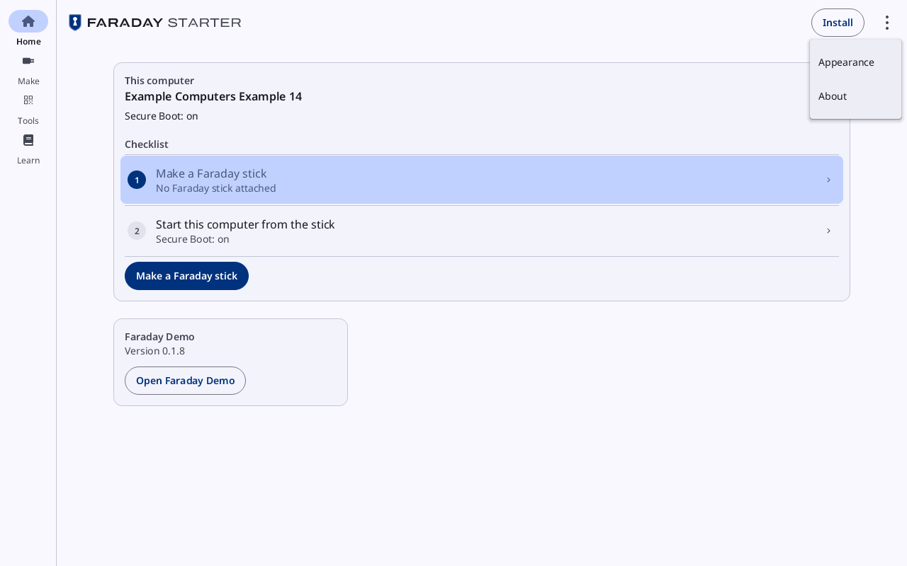
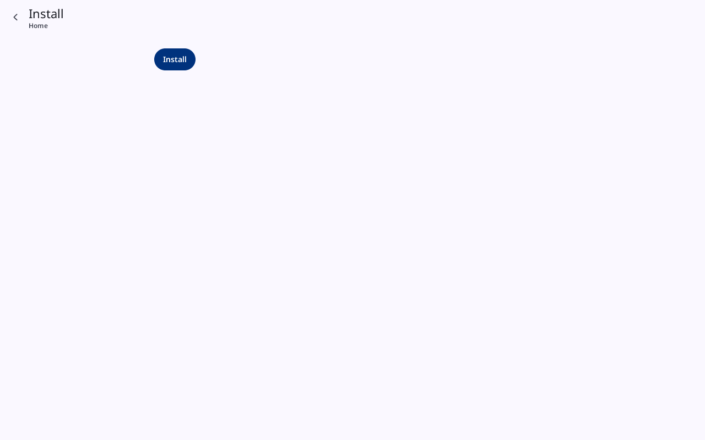
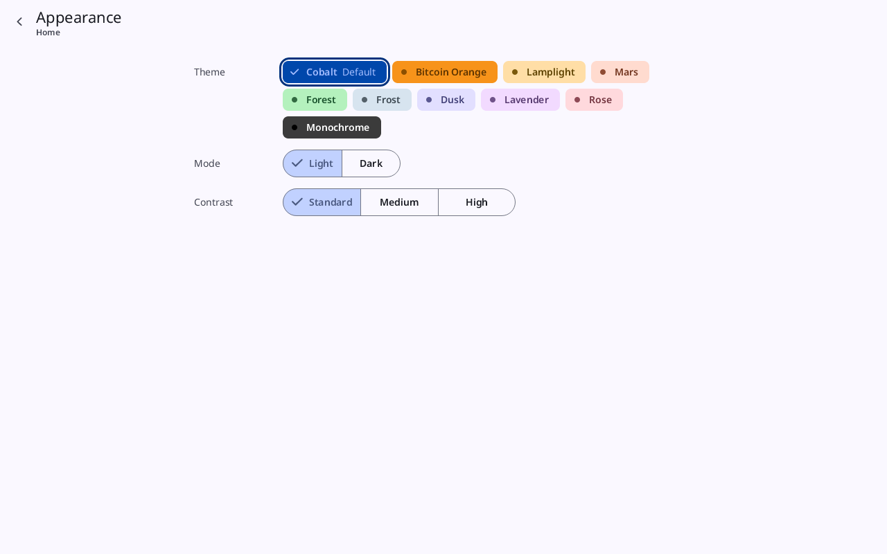
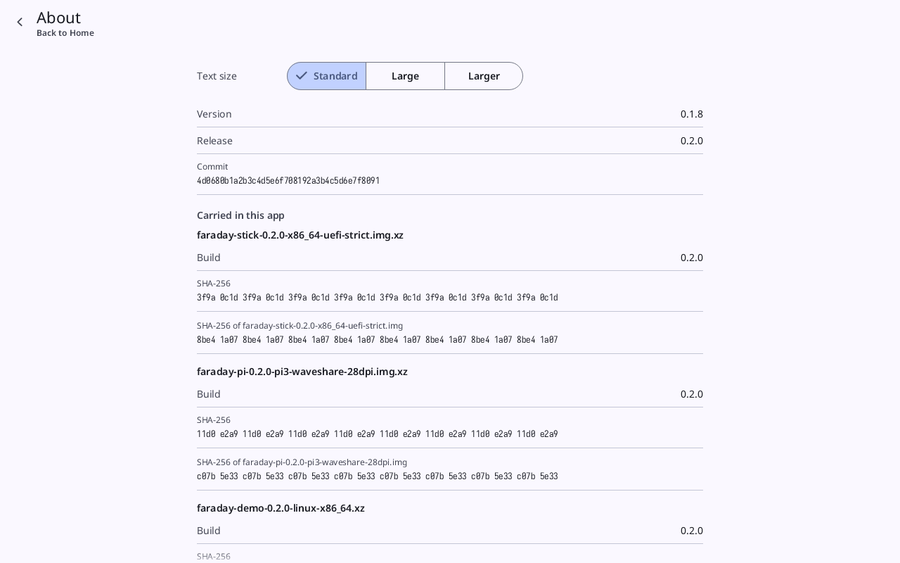

# Faraday Starter: Install, Appearance and About

**Kind:** Reference
**Status:** Checked against the app's pictures in docs/guide/pictures/ (drawn by just guide-pictures) and its code and strings (`faraday/faraday-starter/src/draw/nav.rs`, `faraday/faraday-starter/src/draw.rs`, `faraday/faraday-starter/src/draw/appearance.rs`, `faraday/faraday-starter/src/appearance.rs`, `faraday/faraday-ui/src/appearance.rs`)
**Starter page:** `Install`, `Installed`, `Appearance`, `About`
**Starter sheet:** `Uninstall`
**Group:** Starter

What is not a destination: the top app bar's **Install** or **Update**,
and the **⋮** menu. Each opens a page inside a task, with the way back
to the destination it was opened from.

## The ⋮ menu

**Opened from:** **⋮** at the right of the top app bar on Home, Make,
Tools and Learn. A press outside it closes it.

*The **⋮** menu open over Home with no copy installed: **Appearance** and **About**.*

| Row | Shown | Opens |
|---|---|---|
| **Appearance** | always | [Appearance](#appearance) |
| **About** | always | [About](#about) |
| **Uninstall** | while a copy is installed | [Installed](#installed) |
| **Remove the Faraday boot entry** | on Linux, while the Faraday stick's entry is in the firmware's boot list and no Faraday stick is attached | removes the entry, as Home's [Boot entry](starter-home.md#the-other-cards) card does: the system asks for the password first |

## Install and Update

**Opened from:** **Install** at the top right while no copy is
installed; **Update**, in its place, and **Update** on Home's Update
the installed Faraday card, while this copy is newer than the one
installed. Titled **Install**, or **Update the installed Faraday**,
with the way back to where it was opened.

*Install with no copy installed, before it is pressed: the page holds only the button **Install**.*

Before it is pressed, Install holds the button alone; Update holds the
two versions over it.

| Control | What it does |
|---|---|
| **Installed version**, **This version** | on Update: the installed copy's version and this one's |
| **Install** | the primary button: installs this copy of the Starter, with its menu entry. Faraday Demo is inside the Starter and is not installed apart |
| **Installing** | in its place, grey, while it runs |
| "Installed in …" | in the ok tone, when done: where it went, in place of the button; **Done** under it goes to Home, wherever Install was opened from |
| the reason | in the error tone, when it failed |

## Installed

**Opened from:** the ⋮ menu's **Uninstall**. Titled **Installed**.

| Control | What it does |
|---|---|
| **Installed version** | the installed copy's version |
| **Faraday Starter**, **Menu entry**, **Icon**, **Installed apps entry** | each file the install wrote, and where it is, as the system has them: on Linux **Faraday Starter**, **Icon** and **Menu entry**; on Windows **Faraday Starter**, **Menu entry** (the Start menu's shortcut) and **Installed apps entry**; on macOS **Faraday Starter** alone (the app) |
| **Settings** | last, the file the installed Starter keeps its text size in, once it holds one |
| **Not installed** | when no copy is installed |
| "The BIOS's Faraday stick entry remains: …" | in the warning tone, after an uninstall that could not remove the firmware's Faraday stick entry, and why |
| **Uninstall** | opens [Uninstall Faraday Starter?](#uninstall-faraday-starter) |
| the reason | in the error tone, when the uninstall failed |

### Uninstall Faraday Starter?

| Control | What it does |
|---|---|
| **Removes the files listed. Received files and Faraday Demo's sticks stay.** | what it does |
| **Cancel** | closes the sheet |
| **Uninstall** | removes the files listed, the settings file among them; on Linux, the firmware's Faraday stick entry too, when there is one, and the system asks for the password for it |

## Appearance

**Opened from:** the ⋮ menu's **Appearance**.

*Appearance as the Starter opens on a computer set to Light: **Theme** on **Cobalt** (**Default**), **Mode** on **Light**, **Contrast** on **Standard**.*

The same rows as Faraday's own Settings → Appearance. A choice is drawn
at once, in the Starter's pages and in Transfer, Learn and Faraday Demo
inside it; a theme chosen in Faraday Demo is the Starter's too. The
theme is not kept: the Starter opens in **Cobalt** at **Standard**
contrast, in **Light** or **Dark** as this computer's own setting says,
and a choice lasts until it is closed. Text size is on
[About](#about).

| Control | What it does |
|---|---|
| **Theme** | the ten themes as chips, each drawn in its own colours: **Cobalt** (marked **Default**), **Bitcoin Orange**, **Lamplight**, **Mars**, **Forest**, **Frost**, **Dusk**, **Lavender**, **Rose**, **Monochrome**. The one chosen is ticked and ringed |
| **Mode** | **Light**, **Dark** |
| **Contrast** | **Standard**, **Medium**, **High** |

On a narrow window each row's label is over its control.

## About

**Opened from:** the ⋮ menu's **About**.

*About: **Text size** on **Standard**, **Version** 0.1.8, **Release** and **Commit**, then **Carried in this app** with the stick, Pi and Faraday Demo files, each with **Build** and its sums. The release, commit and sums are made up for the picture.*

| Control | What it does |
|---|---|
| **Text size** | **Standard**, **Large**, **Larger**, as Faraday's own: the Starter's pages, and Transfer, Learn and Faraday Demo inside it, drawn at once at the size chosen; a size chosen in Faraday Demo is the Starter's too. An installed Starter keeps it and opens at it; one run without installing keeps it until it is closed |
| **Version** | this Starter's version |
| **Release**, **Commit** | the release the carried images are from, and its commit |
| **Carried in this app** | each image the Starter carries, by its file name, with **Build** (its build ID), **SHA-256** (the compressed file's) and "SHA-256 of …" (the image inside it) |
| **Faraday Starter carries no images** | in place of the above, when it carries none |
| **Not Faraday Starter's own image** | in the warning band, when the Starter was started with a developer's image: then **Image file** and **SHA-256 of this image** |
| **Release key** | the release key's fingerprint, as the README prints it |
| **Checking this file** | **Check this file against SHA256SUMS and its signature, SHA256SUMS.asc, from the release, with the release key above.**, then the three commands that do it |
| **On Windows: Get-FileHash -Algorithm SHA256 for the sum, Gpg4win for the signature.** | on Windows |
| **Not code-signed** | on Windows: why the `.exe` carries no code signature, and how to open it past Windows' warning |

The walkthrough that checks the Starter file is [Get Faraday on a
stick](../walk/get-faraday.md#11-download-the-starter).
