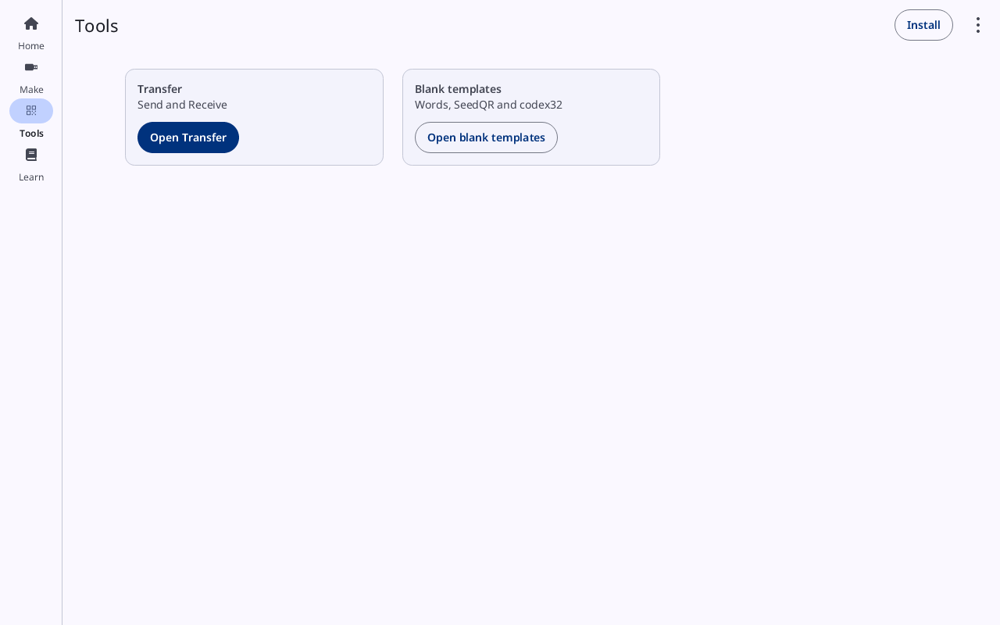
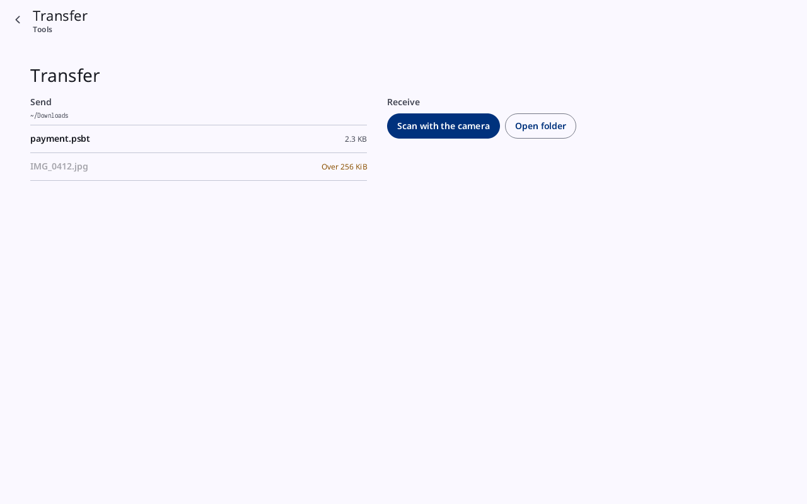
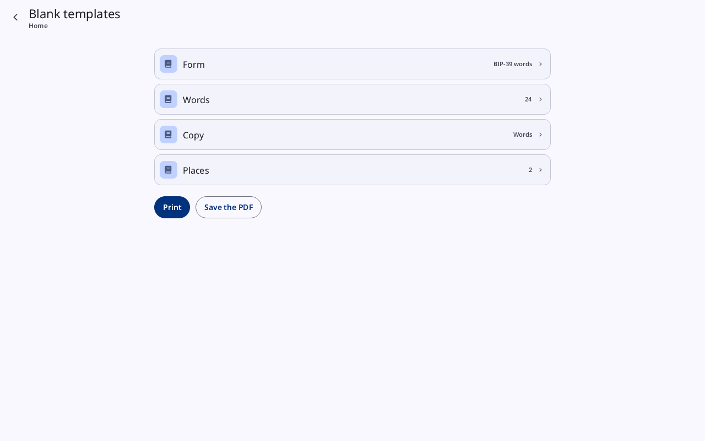
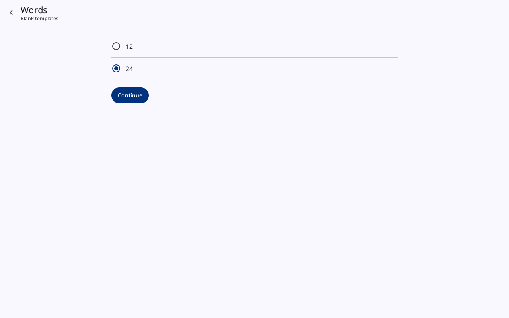

# Faraday Starter: Tools

**Kind:** Reference
**Status:** Checked against the app's pictures in docs/guide/pictures/ (drawn by just guide-pictures) and its code and strings (`faraday/faraday-starter/src/draw/home.rs`, `faraday/faraday-starter/src/draw.rs`, `faraday/faraday-starter/src/template.rs`, `faraday/faraday-starter/src/lib.rs`)
**Starter page:** `Tools`, `Templates`, `TemplateForm`, `TemplateWords`, `TemplateLength`, `TemplateCopy`, `TemplateWorksheets`, `TemplatePlaces`
**Group:** Starter

**Opened from:** **Tools** on the rail or the bar.

## Tools

*Tools: **Transfer** (**Send and Receive**) with **Open Transfer**, and **Blank templates** (**Words, SeedQR and codex32**) with **Open blank templates**.*

| Card | Line | Button |
|---|---|---|
| **Transfer** | **Send and Receive** | **Open Transfer**, the primary button: opens Faraday's own [Transfer](qr-and-scan.md#transfer) under the Starter's top app bar, which reads **Transfer** with the way back to **Tools** |
| **Blank templates** | **Words, SeedQR and codex32** | **Open blank templates**: opens [Blank templates](#blank-templates) |

*Transfer opened from Tools, under the top app bar that reads **Transfer** over **Tools**: **Send** lists Downloads (`payment.psbt`, and a photo dimmed as **Over 262.1 KB**), **Receive** holds **Scan with the camera** and **Open folder**. After a file is received, "Saved …" and its path are under the buttons ([Transfer](qr-and-scan.md#transfer)).*

On Windows, when camera access is off in Windows' privacy settings,
**Scan with the camera** opens the camera and it reads **The camera was
refused**.

## Blank templates

*Blank templates as it opens: **Form** **BIP-39 words**, **Words** **24**, **Copy** **Words**, **Places** 2, then **Print** and **Save the PDF**. Its way back reads **Tools**.*

Printable sheets to copy a seed onto by hand. A blank template holds
nothing of any wallet: no wallet, key or seed is asked for or shown.
Its way back is the destination it was opened from, **Tools**.

A row for each choice, its value at the right; a press opens the
choice's page. The rows depend on **Form**:

| Row | With **BIP-39 words** | With **codex32** |
|---|---|---|
| **Form** | **BIP-39 words** | **codex32** |
| **Words** | **24** at first, or **12** | — |
| **Length** | — | "48 characters" at first, "74 characters" or "127 characters" |
| **Copy** | **Words** at first, **SeedQR** or **Both** | **String** at first, **Codex32QR**, **Both** or **Four Codex32QR grids** |
| **Worksheets** | — | **None** at first, or **Dice, checksum and translation** |
| **Places** | 2 at first | 2 at first |

| Control | What it does |
|---|---|
| **Print** | the primary button: makes the sheet as a PDF and opens it in this computer's PDF viewer, to print from there. Nothing is sent to a printer unasked. The sheet is A4, and each page's foot reads **Print at 100% (actual size).**: printed so, not fitted to the page, the SeedQR grid's squares keep their size |
| **Save the PDF** | saves the same PDF into Downloads, never over a file: when the name is taken, " (2)" is added before `.pdf`, then " (3)", and so on |
| "Saved …" | in the ok tone, after a save: where the file went |
| **Open it** | under it: opens the saved PDF in the viewer |
| the reason | in the error tone, when the PDF could not be saved or the viewer could not be opened |

A choice changed clears the "Saved …" line.

### A choice's page

*The **Words** page, its way back to **Blank templates**: **12**, **24** ticked, and **Continue**.*

Each choice is a page of its own, named as its row (**Form**,
**Words**, **Length**, **Copy**, **Worksheets**, **Places**), with its
way back to **Blank templates**. A ring is filled on the option chosen;
a press chooses it. **Continue** goes back to Blank templates.

| Page | Options |
|---|---|
| **Form** | **BIP-39 words**, **codex32** |
| **Words** | **12**, **24** |
| **Length** | "48 characters", "74 characters", "127 characters". A length that no longer allows the copy or the worksheets chosen puts them back to **String** and **None** |
| **Copy** | with BIP-39 words: **Words** (the word lines), **SeedQR** (the SeedQR grid), **Both** (both on one sheet). With codex32: **String**; at 48 characters only, also **Codex32QR**, **Both** and **Four Codex32QR grids** |
| **Worksheets** | **None**; **Dice, checksum and translation**, not at 127 characters |
| **Places** | the count of places to fill in by hand, at the top as a row (**Places** and the number); **Fewer** and **More** change it, from one to 13, **More** off at 13. The PDF ends with a page titled **Places** holding a line for each, "Place ____ holds ____" |

Faraday's backup checklist asks for these templates: a 12-word one in
[Back it up](../walk/back-up.md), a codex32 one in [codex32
shares](../walk/codex32.md).
