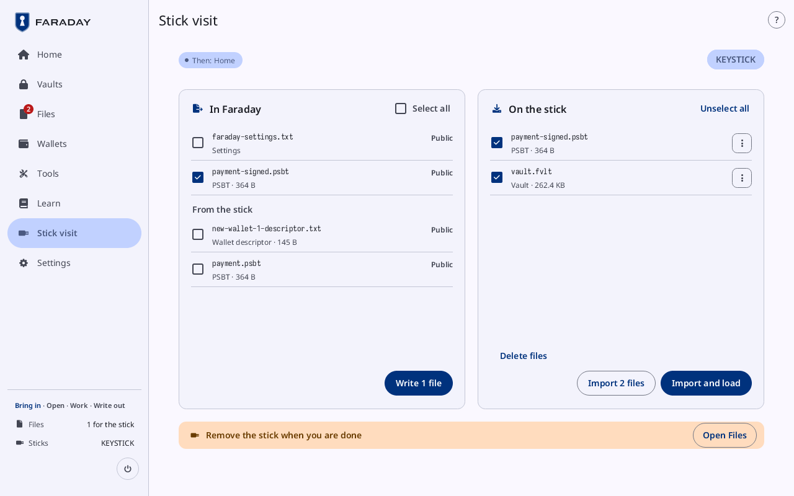
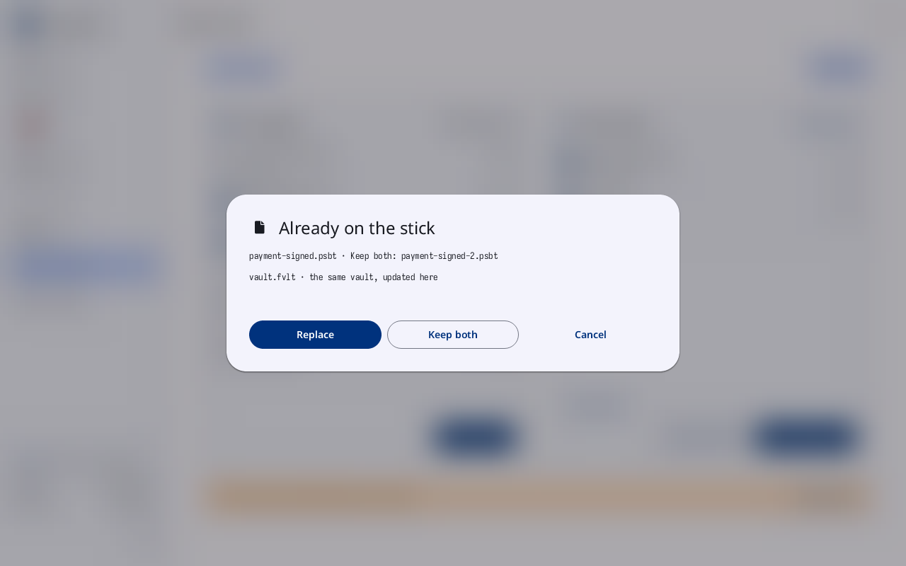
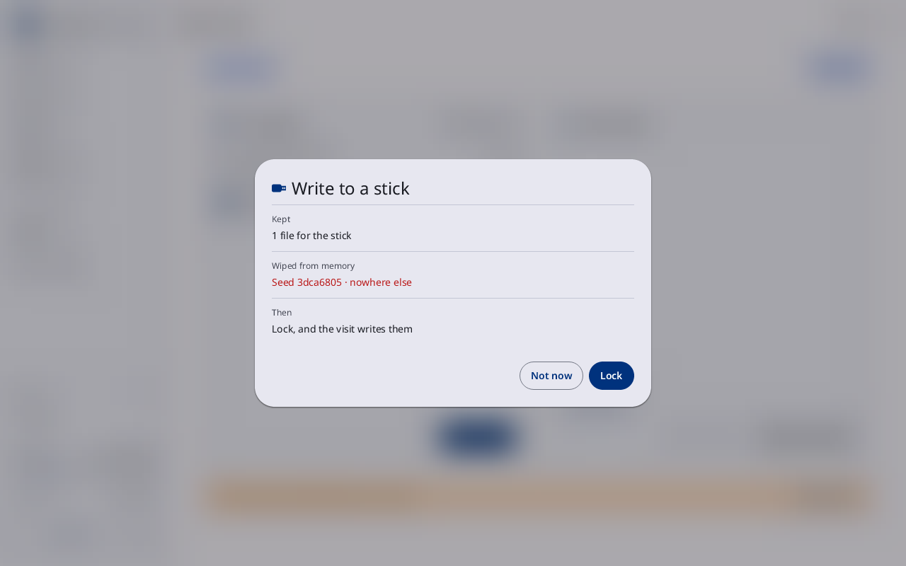
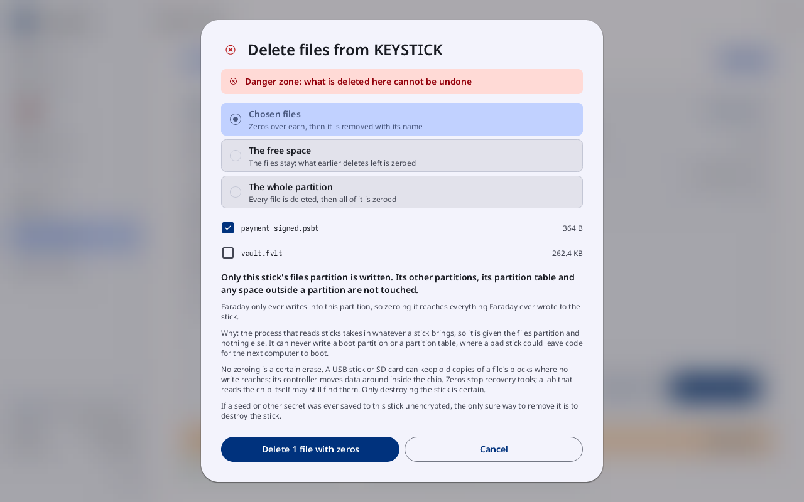
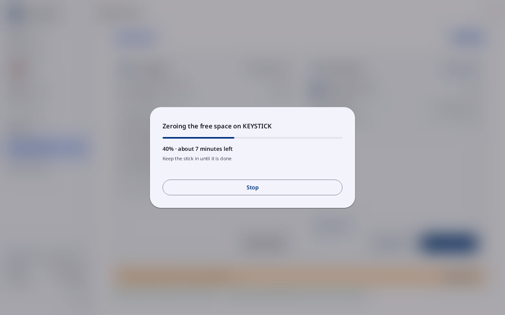

# Stick visit

**Kind:** Reference
**Status:** Checked against the app's pictures in docs/guide/pictures/ (drawn by just guide-pictures) and its code and strings (`faraday/faraday-core/src/screens/visit.rs`, `faraday/faraday-core/src/visit_taken.rs`, `faraday/faraday-core/src/stick/wipe.rs`, `faraday/faraday-core/src/screens/sheets.rs`, `faraday/faraday-core/src/lib.rs`)
**Screen:** `Visit`, `Taken`, `WriteOut`, `Delete`, `Zeroing`
**Group:** Files

**Opened from:** a stick plugged in while Faraday holds no secret; the
sidebar's **Stick visit** and Home's **Stick visit** tile while a stick
is attached and no key is loaded; Files' "Visit KEYSTICK" chip, named
after the stick; **Lock
and use stick** on [A stick is attached](lock-and-power.md#a-stick-is-attached);
and **Copy files in from a stick** in Restore and the Spend tab. The
boot stick alone, at its first look in a power-on, leaves Home on
screen instead, with
[Read from the boot stick](prompts.md#read-from-the-boot-stick) over
it when it holds files; any other stick opens the visit.

A visit writes what waits for the stick and copies in what is needed
from it. Each file written is read back and compared before it counts.
Keys load only once the stick is out.

*Stick visit on KEYSTICK, **Then: Home**: **In Faraday** lists
**Settings**, a signed PSBT ticked and, under **From the stick**, two
files, with "Write 1 file"; **On the stick** lists a PSBT and a vault,
both ticked, with **Delete files**, "Import 2 files" and **Import and
load**; the band reads **Remove the stick when you are done**, beside
**Open Files**.*

## On this screen

| Control | What it does |
|---|---|
| **Stick visit** | the title |
| **Then: Home** | the chip under the title, at the left: where pulling the stick goes, **Then: Home**, **Then: Unlock**, or "Then: …" naming the flow that opened it |
| a stick's chip | one per stick attached, by its name, at the right of the same row, the one shown selected: a press shows that stick |
| "Write what waits for the stick …" | in Guided mode |
| **In Faraday** | the left card: what can be written to the stick, each row ticked or not |
| **On the stick** | the right card: the stick's files, each row ticked to copy in or not |
| the warning band | under the cards: "Remove the stick when you are done", "Remove the stick to unlock vault.fvlt", "1 key copied in · remove the stick to load it" |
| **Open Files** | at the band's right end: opens [Files](files.md) |
| the last two lines | what the visit did, in the ok or error tone. After a write, a line per file: "Wrote payment-signed.psbt, read back and matched", or "Wrote payment-signed.psbt as payment-signed-2.psbt, read back and matched" where **Keep both** gave it another name; otherwise "… not written: …", "… renamed …", "… deleted, zeros over it first" |

### In Faraday

| Control | What it does |
|---|---|
| **Select all** | ticks every row, or none; an unprotected secret is ticked one at a time |
| **Settings** | Faraday's settings file (faraday-settings.txt), tagged **Public**; a press ticks it |
| a file for the stick | its name and what it is, tagged **Public**, **Sealed** or **Unprotected secret**; **In the backup** for a file a backup flow writes, which cannot be unticked here |
| **From the stick** | under the files for the stick: the files copied in, which can be written to this stick too. Tagged **Public**, **Sealed**, **May be a secret** or **Secret**; **On this stick** for one it holds already. Ticking a secret opens [This is a secret](files.md#this-is-a-secret) first |
| "Nothing waits for the stick" | while nothing does |
| "Write 2 files" | writes what is ticked. Before it, [Already on the stick](#already-on-the-stick) where a name is taken, or [Write to a stick](#write-to-a-stick) while a secret has been held |

### On the stick

| Control | What it does |
|---|---|
| **Unselect all** | unticks every file; everything is ticked at first |
| a file's row | its name and what it is, or "Being read · 2 MB", **Larger than 18 MB: not read**; **In Faraday** for one Files holds already; a press ticks it |
| **⋮** | **Rename**, "Delete from the stick", **Details** ([the ⋮ menu](files.md#the--menu)); not on the settings file |
| "No files on this stick" | while it holds none |
| **Delete files** | opens [Delete files](#delete-files) |
| "Import 3 files" | copies the ticked files into Files |
| **Import and load** | copies them in, opens Files, and loads them once the stick is out |

With more rows than fit, a scrollbar runs beside each list and "3 more ·
scroll to see them" under it.

| State | What the visit shows |
|---|---|
| no stick | "No stick attached" |

## Already on the stick

**Opened from:** "Write 2 files" when a file's name is on the stick
already, ignoring case. Its title is **Already on the stick**.

*The sheet **Already on the stick**: "payment-signed.psbt · Keep both:
payment-signed-2.psbt" and "vault.fvlt · the same vault, updated here".
**Replace** is outlined.*

| Control | What it does |
|---|---|
| each row | "wallet.txt · Keep both: wallet-2.txt"; "vault.fvlt · the same vault, updated here", which always goes over its own file; "vault.fvlt · another vault · kept, this one as vault-2.fvlt", which never does |
| **Replace** | writes over the files of the same name |
| **Keep both** | writes each under the name its row gives |
| **Cancel** | closes the sheet; nothing is written |

## Write to a stick

**Opened from:** "Write 2 files" on a visit, or a wallet's chart's
stick, while Faraday has held a secret since it started: a stick is
written only from a fresh start. Its title is "Write to a stick".

*"Write to a stick": **Kept** 1 file for the stick, **Wiped from
memory** Seed 3dca6805 · nowhere else, **Then** **Lock, and the visit
writes them**, over **Not now** and **Lock**.*

| Control | What it does |
|---|---|
| **Kept**, **Wiped from memory**, **Then** | as on [Lock](lock-and-power.md); **Then** reads **Lock, and the visit writes them**, or "Lock, plug in a stick, and the visit writes them" |
| **Dropped from Files** | the files from the stick the lock drops: each that may be a secret |
| **Not now** | closes the sheet |
| **Lock** | locks; the visit after it writes the files |

## Delete files

**Opened from:** **Delete files** on a stick visit, and "Delete from the
stick" in a file's **⋮**. Its title is "Delete files from Boot stick".

*"Delete files from KEYSTICK" on **Chosen files**: payment-signed.psbt
ticked, vault.fvlt not, and "Delete 1 file with zeros" beside
**Cancel**.*

| Control | What it does |
|---|---|
| **Danger zone: what is deleted here cannot be undone** | the band at the top |
| **Chosen files** | **Zeros over each, then it is removed with its name**: the stick's files, under the three choices, each ticked or not, with its size |
| **The free space** | **The files stay; what earlier deletes left is zeroed**: with the amount to write and the time ("1.8 GB to write · about 6 minutes on a typical stick") |
| **The whole partition** | **Every file is deleted, then all of it is zeroed**: with **One pass** and **Two passes** |
| the lines under them | that only the stick's files partition is written, why, and what zeros do not reach |
| "Delete 2 files with zeros", **Zero the free space**, **Zero the whole partition** | does it |
| "Hold to delete 1 file with zeros", **Hold to zero the free space**, **Hold to zero the whole partition** | in place of the button when a vault is chosen, and for the free space and the partition: held until it fills |
| **Cancel** | closes the sheet |

**Reading the stick's space** shows until the stick has said how large
it is. Each file deleted is listed on the visit: "… deleted, zeros over
it first", or "… not deleted: …".

## Zeroing

**Opened from:** the free space or the partition, started on Delete
files. Its title is "Zeroing the free space on Boot stick" or "Zeroing
the whole partition on Boot stick". No press beside the sheet closes
it.

*"Zeroing the free space on KEYSTICK": "40% · about 7 minutes left",
"Keep the stick in until it is done", and **Stop**.*

| Control | What it does |
|---|---|
| the bar | how far: "40% · about 7 minutes left", and "Pass 1 of 2" for two passes |
| "Keep the stick in until it is done" | a line |
| **Stop** | stops after the step under way (**Stopping**); the visit says "Stopped at 40%" |

When it ends, the visit says "Free space on Boot stick zeroed" or "Boot
stick's partition zeroed".

## On a narrow window

One column: the sticks, the warning band and **Open Files**, then what
to write and what to copy in, each a list with its buttons under it.

## Why

- [The air gap](../../learn/07-air-gap.md)
- [Coordinator files](../../learn/19-coordinators.md)
