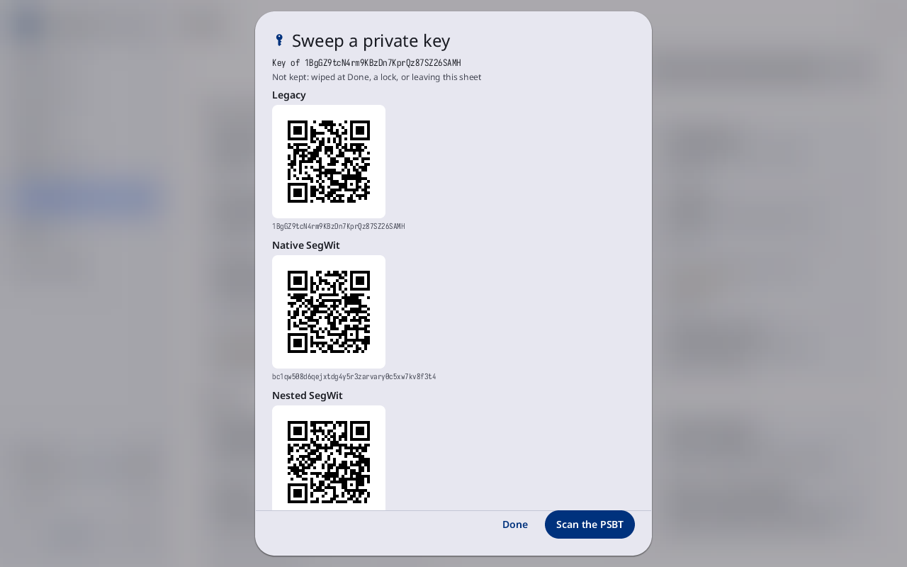

# Sweep a private key

**Kind:** Reference
**Status:** Checked against the app's pictures in docs/guide/pictures/ (drawn by just guide-pictures) and its code and strings (`faraday/faraday-core/src/seeds/sweep.rs`, `faraday/faraday-core/src/seeds/read.rs`, `faraday/faraday-core/src/catalog.rs`)
**Screen:** `Sweep`
**Group:** Tools

**Opened from:** **Tools → Sweep a private key**; a private key (WIF)
read on Home's **Scan**. Every other scanner refuses a private key
with "That is a private key. Sweep a private key, in Tools, takes it",
and files nothing.

A paper wallet's key, or any single private key written as WIF, moved
to a wallet of your own. The key is read for this sheet only: it is not
loaded as a key, not kept in Files and not saved anywhere. An online
wallet watches the key's addresses and makes the PSBT that spends them;
this sheet reads that PSBT, shows where it pays, and signs the key's
inputs.

*A compressed key read: "Key of 1BgGZ9tcN4rm9KBzDn7KprQz87SZ26SAMH",
**Not kept: wiped at Done, a lock, or leaving this sheet**, then
**Legacy**, **Native SegWit** and **Nested SegWit**, each with its QR
code and its address; **Done** and **Scan the PSBT** at the foot.*

## The key

| Control | What it does |
|---|---|
| **Private key (WIF)** | the field: a dot for each character typed, never the key |
| **Never type a seed that holds real bitcoin here.** | under the field, in Faraday Demo |
| **Scan** | the camera, for the key's QR code |
| **Use this key** | reads the key typed; filled once something is typed |
| **Done** | closes the sheet; the key is wiped |

A key that is not taken says why in red: **This is not a private key**,
"This is a mainnet key, and this session is on Testnet", **This key is
for the test networks, and this session is on Mainnet**, or, with a
stick attached, "Keys load only with no stick attached". In Practice
the tile reads **Practice sweeps no private key** and takes no press.

## Its addresses

Once read, the key is named by its legacy address ("Key of 1…"), and
each address it pays is shown with its QR code, for the online wallet
to watch: **Legacy**, then **Native SegWit** and **Nested SegWit** for a
compressed key. An uncompressed key reads **Uncompressed key: legacy
addresses only**.

| Control | What it does |
|---|---|
| **Scan the PSBT** | the camera, for the PSBT the online wallet made to spend these addresses; **Not a PSBT** for anything else |
| **Done** | closes the sheet; the key is wiped |

## The PSBT

The PSBT read is shown as it pays:

| Line | What it says |
|---|---|
| "From this key: 2 inputs, …" | the inputs this key spends, each with its address and amount |
| "Other inputs, not signed: 1" | in the warning tone: inputs of another key, left as they are |
| **To** | each output: its address, its amount, and the loaded wallet whose address it is ("Savings, receive address 4"), or **Not a loaded wallet's address** in red |
| "Fee: …" | the fee |
| a warning | each in its own words, in red for danger, as on [Sign a transaction](sign.md) |
| **Hold to sign** | held until it fills: signs this key's inputs |

Where it cannot be signed the hold is not shown, and why is in red:
**No input of this PSBT spends this key**, **A legacy input with
OP_CODESEPARATOR is not signed**, or the review's own reason. An output
is matched against the loaded wallets' first hundred addresses on each
chain; load the wallet the sweep pays before scanning the PSBT.

Once signed: "Signed 2 inputs. The transaction is in the Outbox" where
every input is signed, else "Signed 2 inputs. The PSBT is in the
Outbox". **Show as QR** shows it as a code, titled **Swept
transaction** or **Swept PSBT**, for the online wallet to broadcast or
finish.

The key is wiped at **Done**, at a lock, and when the sheet is left.

## Why

- [Tools](../../learn/16-tools.md)
