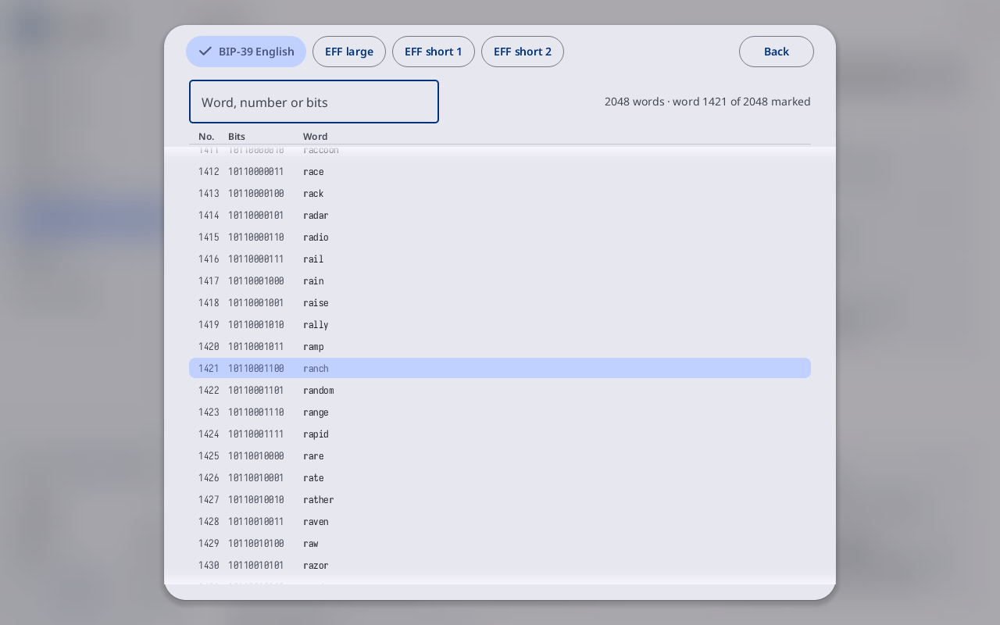

# Tools

**Kind:** Reference
**Status:** Checked against the app's pictures in docs/guide/pictures/ (drawn by just guide-pictures) and its code and strings (`faraday/faraday-core/src/screens/catalog.rs`, `faraday/faraday-core/src/catalog.rs`, `faraday/faraday-core/src/wordlist/screen.rs`, `faraday/faraday-core/src/wordlist/mod.rs`)
**Screen:** `Catalog`, `WordList`
**Group:** Tools

**Opened from:** the sidebar's **Tools**.

Every flow Faraday has, as a tile, by group. A tile names what it does
and the standards it follows, as small tags.

*Tools with a key loaded: **Find a tool: a name, a BIP number** at the
top right, then **Keys and seeds** and **Wallets**, each tile with its
name, its line and its standards; the groups below scroll into view.*

## On this screen

| Control | What it does |
|---|---|
| **Find a tool: a name, a BIP number** | the search field; whatever is typed on the page goes into it. It keeps the tiles whose name, line, group or standard holds every word typed ("85" finds BIP-85). **No tool matches** when none does |
| a tile | its name, its line, its standards; a press opens its flow |
| a tile's line in the warning tone | what the tile needs first; the tile is greyed and takes no press. A vault tile still opens, into making or unlocking a vault, and a tile reading **Continue** opens where its making was left |

### What a tile needs first

| Line | Tiles |
|---|---|
| **Load a key first** | **Explore a key**, **Child seeds and passwords**, **Vanity address**, **Silent payments** |
| **Load a wallet first** | **Back up a wallet**, **Check an address** |
| **At the end of signing** | **Nonce check**, until a spend is signed |
| **Needs a single-key wallet with its key here** | **Sign a message** |
| **Copy a signed message in first** | **Check a signed message** |
| **Make a vault first**, **Unlock a vault first** | **TOTP codes**, **KeePass export**, while no vault is open |
| **Continue** | **GPG key**, **Secure Boot keys**: a key's making left part way; the tile opens it there |

## The tiles

| Group | Tile | Opens |
|---|---|---|
| **Keys and seeds** | **Add a key** | [Add a key](new-key.md) on its Start card |
| | **Scan a SeedQR** | the [typing page](add-a-key.md), with the camera open for a SeedQR |
| | **SLIP-39 shares** | Add a key, making SLIP-39 shares |
| | **Restore from SLIP-39**, "codex32", **Seed XOR** | Add a key, on that form typed |
| | **Explore a key**, **Child seeds and passwords**, **Vanity address**, **Silent payments**, **Lightning node key** | each tool's page |
| **Wallets** | **Single-key wallet**, **Multisig**, **Taproot multisig**, "MuSig2" | [Make a new wallet](make-a-wallet.md), that kind chosen |
| | **Miniscript and inheritance**, **Restore an existing wallet** | [Restore an existing wallet](restore.md) |
| | **Back up a wallet** | the backup of the wallet chosen on Wallets |
| **Transactions** | **Sign a transaction** | the spend of the PSBT in Files, or the camera |
| | **Nonce check** | the signed spend's last card |
| | **Decode a transaction** | Decode, on a transaction in Files, or the camera |
| | **Check an address** | the camera |
| **Messages** | **Sign a message**, **Check a signed message** | each tool's page |
| **Vaults and other keys** | **Vaults** | [Vaults](vaults.md) |
| | **TOTP codes** | [TOTP codes](codes.md) |
| | **Diceware passphrase** | [Create a vault](create-vault.md) |
| | **GPG key**, **Secure Boot keys** | the key's making, or that kind in the open vault |
| | **KeePass export** | that kind in the open vault |
| **Calculators** | **Hashes**, **Encodings**, **Descriptor checksum**, **Convert an xpub**, **Units**, **Miniscript compiler** | the calculators, on that one |
| **Word lists** | **BIP-39 words**, **EFF large list**, **EFF short list 1**, **EFF short list 2** | [the word list](#the-word-list) on that list |
| **QR** | **Scan a QR code** | the [camera](qr-and-scan.md#scan); what it reads goes into Files |

## The word list

**Opened from:** a tile under **Word lists** on Tools; a word pressed
under **Words so far** on Add a key's rolls, which opens the BIP-39 list
with that word marked; a word pressed while rolling a Diceware
passphrase in Create a vault, which opens its EFF list with that word
marked.

*The word list on **BIP-39 English**: "2048 words · word 1421 of 2048
marked", the columns **No.**, **Bits** and **Word**, and ranch, word
1421, lit.*

| Control | What it does |
|---|---|
| **BIP-39 English**, **EFF large**, **EFF short 1**, **EFF short 2** | a tab for each list; the one on show filled |
| **Back** | at the top right: closes the sheet; a press beside it does the same |
| the search field | **Word, number or bits** for BIP-39, **Word, number or dice** for an EFF list |
| the count | at the right of the search field: "2048 words", "2048 words · word 1421 of 2048 marked", or "3 found" while something is typed |
| **No.**, **Bits** or **Dice**, **Word** | the columns: a word's number, its bits or its dice, and the word; the marked word lit |

## On a narrow window

Tools is one tile to a row, the search across the page. The word list
fills the window, its tabs wrapped; with no keyboard, it has no search
field.

## Why

- [Tools](../../learn/16-tools.md)
- [Glossary](../../learn/15-glossary.md)
