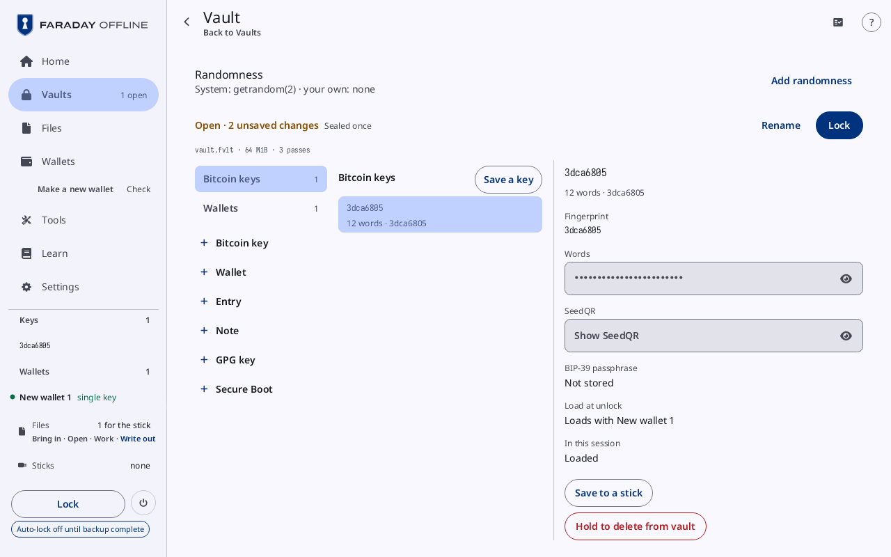
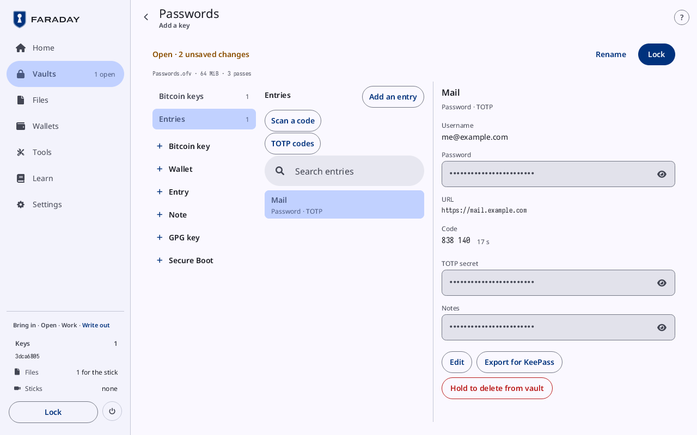
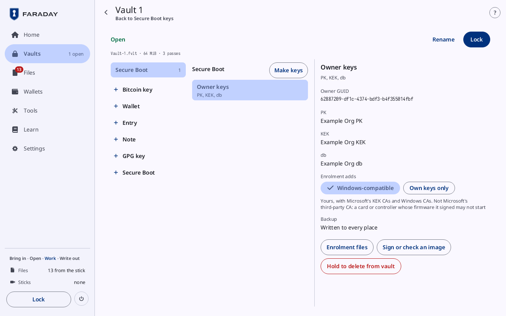
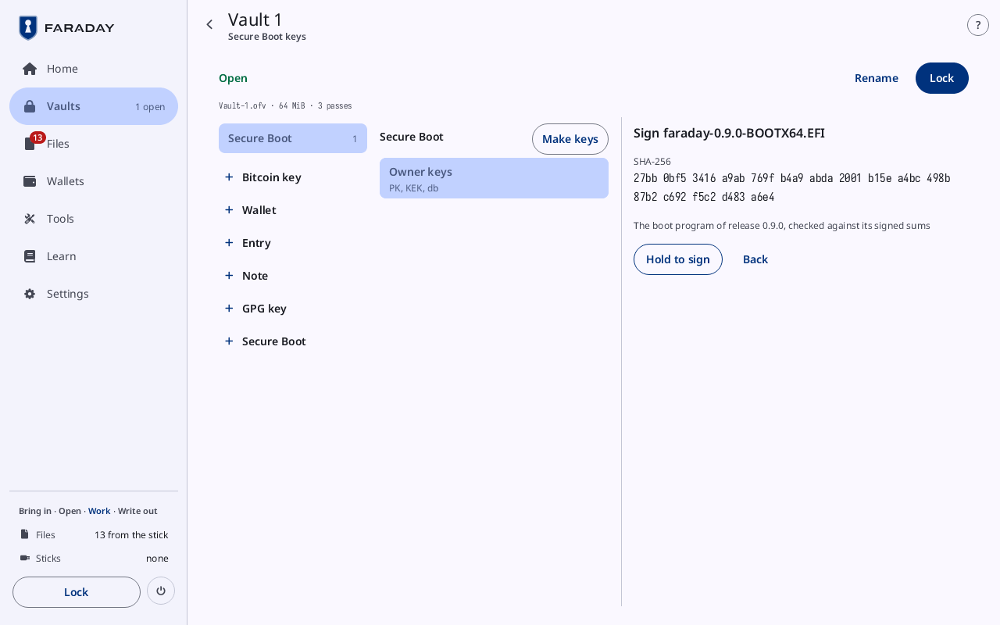
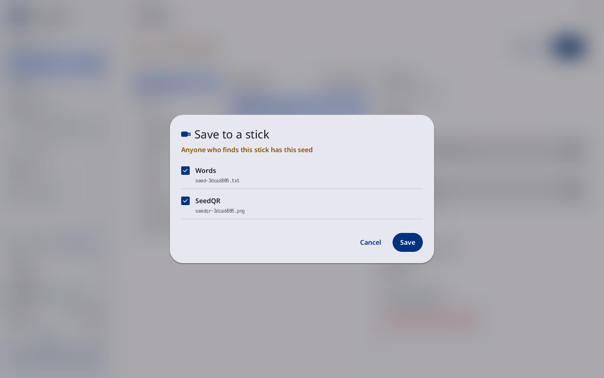
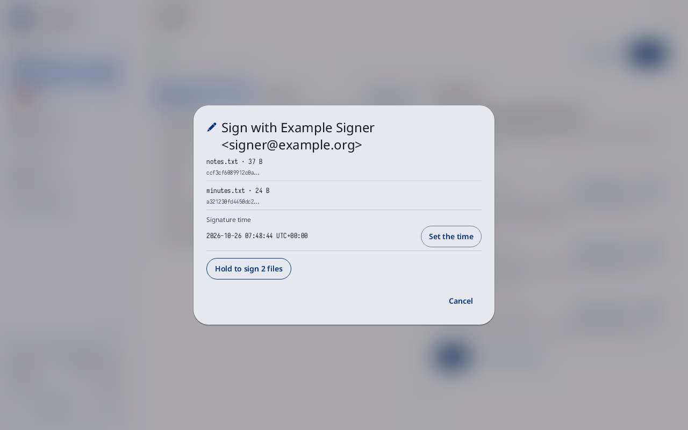

# Vault contents

**Kind:** Reference
**Status:** Checked against the app's pictures in docs/guide/pictures/ (drawn by just guide-pictures) and its code and strings (`faraday/faraday-core/src/vault/screen.rs`, `faraday/faraday-core/src/vault/screen/save.rs`, `faraday/faraday-core/src/vault/area.rs`, `faraday/faraday-core/src/vault/mod.rs`)
**Screen:** `VaultContents`, `VaultSave`, `GpgSign`
**Group:** Vaults

**Opened from:** **View contents** on an open vault (Vaults, Files'
**Contents**), a row of [TOTP codes](codes.md), and an unlock that
opened a vault just made. Its way back at the top goes to **Vaults**.

What one passphrase opened: its keys, wallets, entries, notes, GPG keys
and Secure Boot keys. A change stays in this session until the next
lock, which seals it into the vault in Files; the next stick visit
writes the vault back over its own file.

*A vault with no name, "Open · 2 unsaved changes", on **Bitcoin keys**: the key 3dca6805 chosen, its **Words** and **SeedQR** hidden, **Load at unlock** "Loads with New wallet 1", **Save to a stick** and **Hold to delete from vault**.*

## On this screen

| Control | What it does |
|---|---|
| the title | the vault's name ("Vault 1"), or "Vault" for a vault with no name |
| the state | under the title: **Open**, or "Open · 2 unsaved changes" in the warning tone |
| **Rename** | opens **Rename the vault** in the detail: **Name**, **Save**, **Cancel** |
| **Lock** | locks, sealing every open vault; [Lock](lock-and-power.md#lock) asks first when the lock would end something |
| the line under the state | the file and its unlock cost ("vault.ofv · 64 MiB · 3 passes"); with more than one vault open, a button per vault, the one shown filled |
| "A secret value shows after a press on its eye …" | in Guided mode |

The page has three columns: the kinds, the items of the kind chosen,
and the item chosen.

| Column | What it holds |
|---|---|
| the kinds | **Bitcoin keys**, **Wallets**, **Entries**, **Notes**, **GPG keys**, **Secure Boot**, those the vault holds, each with its count; under them a row per kind to add: **Bitcoin key**, **Wallet**, **Entry**, **Note**, **GPG key**, **Secure Boot** |
| the items | the kind's name and its add button (**Save a key**, **Save a wallet**, **Add an entry**, **Add a note**, **Make a key**, **Make keys**); on Wallets, Entries and GPG keys a search bar (**Search wallets**, **Search entries**, **Search GPG keys**; **No titles match** when none does); then a row per item |
| the item | its title, its line, its fields and its buttons, below |

On **Entries** the items column also has **Scan a code** (a TOTP setup
code read by the camera, into a new entry), "Import from Files (2)"
while Files holds entry files, and **TOTP codes** ([TOTP codes](codes.md)).

**Make a key** on GPG keys and **Make keys** on Secure Boot start the
backup flow, which makes the key and decides where it is kept before
anything else.

### An empty vault

**Nothing in it yet**, and a button for each way in: **Save a bitcoin
key**, **Save a wallet**, **Add an entry**, **Add a note**, **Make a
GPG key**, **Make Secure Boot keys**, and "Write it to a stick", which
opens Files.

### Save a key, Save a wallet

**Save a key** lists each key loaded in the session and not in the
vault, by fingerprint and name, with **Save**; a key loaded with a
BIP-39 passphrase also has **Save with its passphrase**. **Save a
wallet** lists each wallet loaded and not in the vault, with **Save**.
With none left: **Every key in this session is in the vault**, **Every
wallet in this session is in the vault**.

## A key

The title is its fingerprint; its line "12 words", its label, and
**not loaded at unlock** when that is off.

| Field or control | What it is |
|---|---|
| **Fingerprint** | the key's fingerprint |
| **Words** | the seed words, hidden; the eye shows them until the next press on it or until the page is left |
| **SeedQR** | the words as a SeedQR, hidden behind its eye (English words only) |
| **BIP-39 passphrase** | **Stored** or **Not stored** |
| **Load at unlock** | **Yes** or **No**; "Loads with New wallet 1" for a seed of a wallet in the vault, which loads with it |
| **In this session** | **Loaded** or **Not loaded** |
| **Load into session** | loads the key. Shown while it is not loaded |
| **Load with a passphrase** | opens **Load with a BIP-39 passphrase** in the detail: **Passphrase**, **Load**, **Cancel**. Shown for a key with no passphrase stored |
| **Load at unlock**, **Don't load at unlock** | turns the setting on or off. Not shown for a seed that loads with its wallet |
| **Save to a stick** | opens [Save to a stick](#save-to-a-stick) |
| **Hold to delete from vault** | held until it fills: deletes the item ("Deleted from the vault") |

## A wallet

The title is its name; its line its shape ("2 of 3 · …").

| Field or control | What it is |
|---|---|
| the chart | where each seed of the wallet is kept, its keys, and the wallet |
| **Descriptor** | the wallet's descriptor |
| **Load at unlock** | **Yes** or **No** |
| **Open in Wallets** | loads the wallet and opens its card |
| **Load at unlock**, **Don't load at unlock** | turns the setting on or off |
| **Show as QR** | opens the descriptor as a [QR code](qr-and-scan.md#a-qr-code) |
| **Save to a stick** | opens [Save to a stick](#save-to-a-stick) |
| **Hold to delete from vault** | deletes the item |

## An entry

The title is its title; its line **Password**, **TOTP**, both
("Password · TOTP"), or **Entry**.

*The Passwords vault on **Entries**, with **Add an entry**, **Scan a code**, **TOTP codes** and **Search entries**; the entry Mail chosen, its code 838 140 with 17 s left.*

| Field or control | What it is |
|---|---|
| **Username**, **URL** | shown as typed |
| **Password**, **TOTP secret**, **Notes** | hidden behind their eyes |
| **Code** | the TOTP code now and the seconds it has left; **Set the time** while the clock is not set this power-on; **HOTP** or **Unreadable** for a secret Faraday does not count codes for |
| **Edit** | opens **Edit the entry** in the detail |
| **Export for KeePass** | opens **Export for KeePass** in the detail: **Passphrase**, **Seal and export**, **Cancel**. While it works, **Sealing** |
| **Hold to delete from vault** | deletes the item |

**Add an entry** and **Edit the entry** have **Title**, **Username**,
**Password**, **URL**, **Notes** and **TOTP secret**, then **Save** and
**Cancel**.

## A note

The title is its first line; its line "Note · 120 characters".
**Text** is hidden behind its eye; **Edit** opens **Edit the note**
(**Text**, **Save**, **Cancel**). A recovery sheet kept in the vault
shows its **Descriptor** and **Note**.

## A GPG key

The title is its user ID; its line **Ed25519 · does not expire** or
"Ed25519 · expires 2029-10-25".

*Vault 1 (Vault-1.ofv) on **GPG keys**: Example Signer's key, valid 2026-10-26 to 2029-10-25, its revocation certificate kept, its backup **Written to every place**, **Renew for** with **Renew** grey, and **Export public key**, **Show as QR** and **PNG**.*

| Field or control | What it is |
|---|---|
| **Fingerprint**, **Signing subkey**, **User ID** | the key's facts |
| **Valid** | "From 2026-10-27 · does not expire", or its start and end ("2026-10-26 to 2029-10-25") |
| **Status** | "Revoked on …", once marked revoked |
| **Revocation certificate** | "Kept with the key · made …", or **None kept yet** |
| **Paperkey** | the secret key as paperkey text, hidden behind its eye |
| "Term now: expires …" | the term as it stands; **Term now: does not expire** |
| **Renew for** | **1 year**, **2 years**, **3 years**, **5 years**, **Never**; **Renew** sets the new term from now, grey until one is chosen |
| **Backup** | for a key made by the backup flow: "1 of 2 written", and **Continue the backup** until every place is; then **Written to every place** |
| **Export public key** | puts the public key in Files, for the stick |
| **Show as QR**, **PNG** | the public key as a QR code, or as a picture in Files |
| **Export the kept revocation** | the revocation certificate, through [This is a secret](files.md#this-is-a-secret) |
| **Make a revocation** | opens **Make a revocation** in the detail: **Description (optional)**, **Reason** (**No reason specified**, **Key has been compromised**, **Key is superseded**, **Key is no longer used**), **Make the revocation**, **Cancel** |
| **Sign a file** | opens [the signing page](#sign-a-file) |
| **Back up first** | in place of **Sign a file** and **Renew** until every place of the key's backup is written: opens the backup |
| **Hold to delete from vault** | deletes the item |
| **Hold to mark the key revoked** | held until it fills: marks the key revoked |

### Sign a file

The detail turns to **Sign a file**: the key's user ID, its signing
subkey, and "Signing subkey ID … · main key ID … · created …".

| Control | What it does |
|---|---|
| **Select all** | ticks or unticks every file |
| a file's row | a file in Files, its size, its SHA-256 and, for a short text file, its text; a press ticks it. **Signed** once its signature is in Files |
| **Show as QR**, **PNG** | that file's signature, as a QR code or a picture |
| **Sign** | opens [Sign with](#sign-with). Grey while nothing is ticked |
| **Back to the key** | back to the key's page |

"No file from the stick" shows while Files holds none.

## Secure Boot keys

The title is **Owner keys**; its line **PK, KEK, db**.

*Vault 1's **Owner keys**: the owner GUID, the Example Org PK, KEK and db, **Windows-compatible** chosen, the backup **Written to every place**. **Sign or check an image** is outlined.*

| Field or control | What it is |
|---|---|
| **Owner GUID**, PK, KEK, db | the owner's GUID and each key's name |
| **Enrolment adds** | **Windows-compatible** (yours with Microsoft's KEK CAs and Windows CAs) or **Own keys only** (yours alone: Windows will not start); the line under them says which |
| **Backup** | as for a GPG key |
| **Enrolment files** | puts the enrolment files in Files, for the stick. **Back up first** until the backup is written |
| **Sign or check an image** | opens the images in the detail |
| **Hold to delete from vault** | deletes the item |

### Sign or check an image

Each EFI image in Files with **Check** and **Sign**; "No EFI image from
the stick" while there is none. **Check** says under the list what it
found: **Signed by this vault's db key**, **Signed by another key**,
**Changed since it was signed**, **Not signed**, or **Its signature
could not be read**. **Sign** opens "Sign faraday-0.9.0-BOOTX64.EFI": its **SHA-256**,
the line "The boot program of release 0.9.0, checked against its signed
sums" or why it is refused, in the error tone, **Hold to sign** and
**Back**. **Back to the keys** closes the images.

*Signing the boot program of a test release, 0.9.0, checked against its signed sums; for a real release the steps are the same. **Hold to sign** is outlined.*

## Save to a stick

**Opened from:** **Save to a stick** on a key or a wallet in the vault.

*Save to a stick for the key 3dca6805: **Anyone who finds this stick has this seed**, **Words** (seed-3dca6805.txt) and **SeedQR** (seedqr-3dca6805.png) ticked, **Cancel** and **Save**.*

| Control | What it does |
|---|---|
| **Anyone who finds this stick has this seed** | in the warning tone, first, for a key |
| each form | ticked or not, with the names of its files: for a key **Words** and **SeedQR**; for a wallet **Descriptor** (ticked), **QR picture**, and "Sparrow file", "Nunchuk file" and the like |
| **Save** | puts the ticked files in Files, for the stick. A key's words or SeedQR go only past [Save without encryption?](files.md#save-without-encryption). Grey while nothing is ticked |
| **Cancel** | closes the sheet |

## Sign with

**Opened from:** **Sign** on the signing page. Its title is **Sign
with …** and the key's user ID.

*Sign with Example Signer's key: notes.txt and minutes.txt, the **Signature time** in UTC, **Set the time**, "Hold to sign 2 files" and **Cancel**.*

| Control | What it does |
|---|---|
| each file | its name, its size and the start of its SHA-256 |
| **Signature time** | the time the signatures will carry, and its zone; **Not known** in the warning tone while the clock is not set |
| **Set the time** | opens Set the time |
| **Hold to sign 1 file**, "Hold to sign 2 files" | held until it fills: signs the files, each signature into Files. Grey while the time is not known |
| **Cancel** | closes the sheet |

## On a narrow window

The vault, its kinds and the kind's items are one list; an item, a
form or a panel is a page of its own, which the bar goes back from.

## Why

- [Vaults](../../learn/faraday/vaults.md)
- [Passphrases](../../learn/05-passphrases.md)
- [GPG keys](../../learn/faraday/gpg.md)
