# Back it up

**Kind:** Spec
**Status:** Text moved from `docs/GUIDE.md` (§4.1 to §4.10 and the opening of §4), written and checked against the app's screens and strings; the pictures are in `docs/guide/` and keep their names
**Open:** the walkthrough's form (result line, what is needed, time, "With your own key"); the pictures, drawn once after the theming has landed

What you will do: make a single-key wallet from key `3dca6805`, plan
its backup on the backup board, and carry the plan out with its
checklist: the words and the SeedQR copied by hand and checked, a vault
made, and the sticks written. Faraday backs up a wallet, not a key on
its own, so the wallet comes first (step 4.1).

What you need:

- Faraday with key `3dca6805` loaded (section 3) and no stick attached.
- A blank template for 12 words, printed from the Starter (**Tools →
  Blank templates**), and a pen.
- Two USB sticks formatted FAT32, other than the Faraday stick: one for
  the vault, one for the public files.
- An envelope.

A single key has one place, **Place 1**: everything in this section is
kept there. A copy kept anywhere else is made outside the plan, and the
plan does not track it.

### 4.1 Make the wallet

Press **Wallets** in the sidebar, then **Make a new wallet**. The page
is **Make a new wallet**, one card per step. It opens on **Kind**,
with **Single key, backup in shares (codex32)** ticked; a choice moves
on to the next card by itself.

| Kind | Use vaults |
|---|---|
| 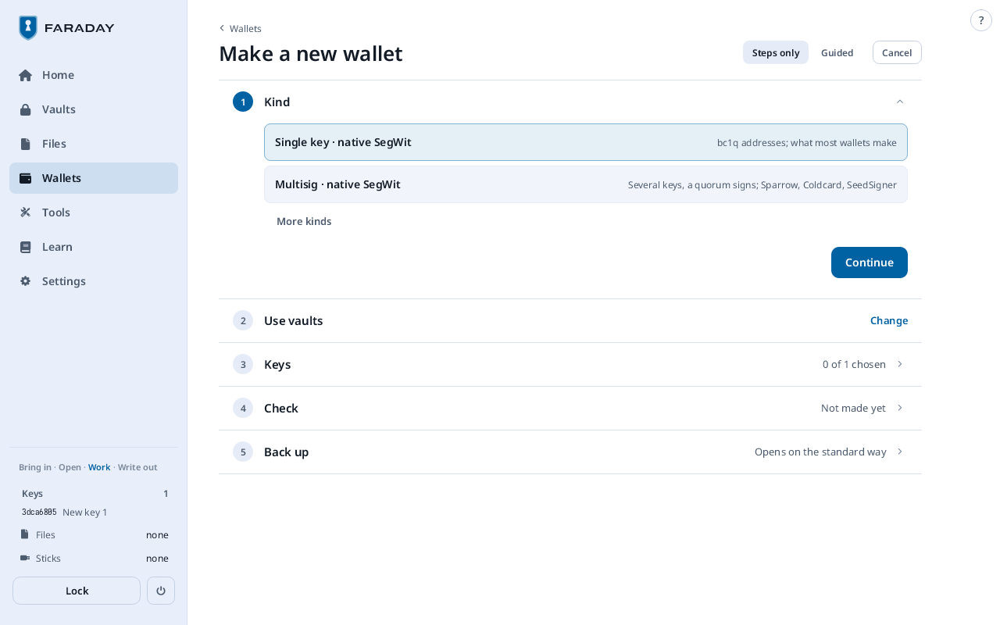 | 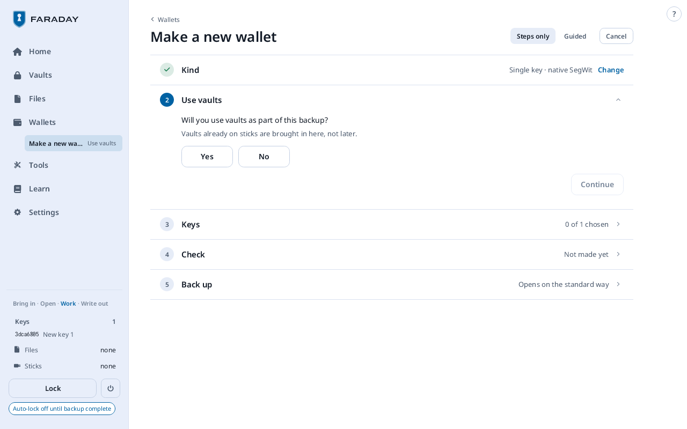 |
| **Single key, backup in shares (codex32)** (One key, its backup in 3 shares, any 2 rebuild it) makes its one key as codex32 shares instead of words (step 4.11); the ⓘ after its name says what codex32 is. **Multisig · native SegWit** is section 5; **More kinds** lists the rest. This section keeps the key's words: press **Single key · native SegWit** (One key, its words on paper). | Kind closes on **Single key · native SegWit**. **Will you use vaults as part of this backup?** Press **No**: the card closes on **No** and **Keys** opens. The vault in this section is a new one, made in the checklist; **Yes** is for a vault already on a stick, which is brought in here. |

| Keys | Check |
|---|---|
| 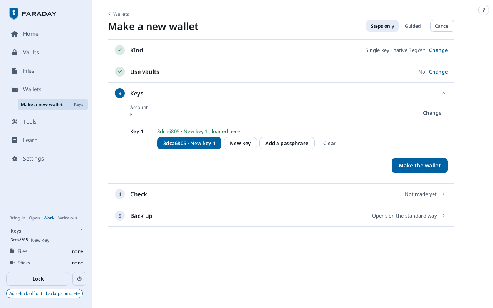 | 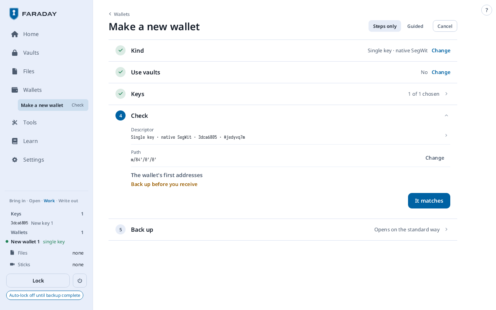 |
| Under **Key 1**, press **3dca6805 · New key 1**; the row reads **3dca6805 · New key 1 · loaded here**. Press **Make the wallet**. | **Descriptor** reads **Single key · native SegWit · 3dca6805** and a checksum; **Path** reads **m/84'/0'/0'**. Under **The wallet's first addresses** it reads **Back up before you receive**: a key made on this device shows no address until its backup is done. Press **It matches**. |

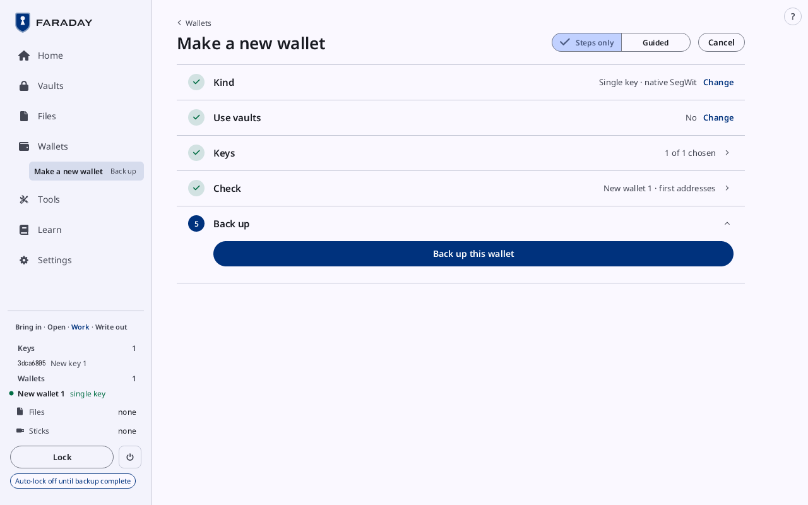

The wallet is **New wallet 1** in the sidebar. Press **Back up this
wallet**.

### 4.2 The board, the standard way

Back up opens on the board with the standard way placed: the seed's
words and the wallet description on paper at Place 1. Nothing can be
moved yet.

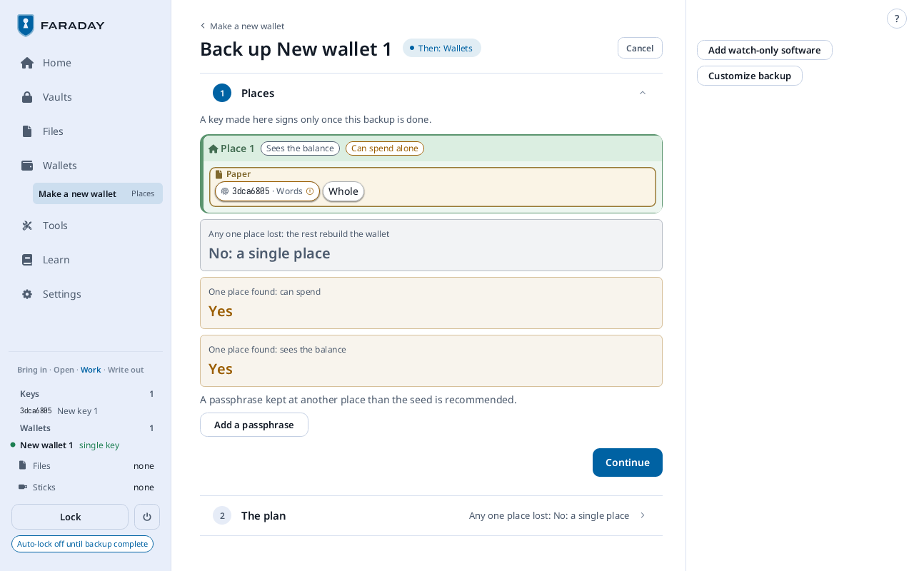

| On screen | Meaning |
|---|---|
| **Place 1** | the place's card; the tags beside the name say what someone who finds this place alone gets: **Sees the balance**, **Can spend alone** |
| **Paper** | what the place keeps on paper: **3dca6805 · Words**, the seed's 12 words, and **Whole**, the whole wallet description, as the printed wallet sheet |

Under the board, three lines check the plan:

| Line | Here | Meaning |
|---|---|---|
| **Any one place lost: the rest rebuild the wallet** | **No: a single place** | losing Place 1 loses the wallet |
| **One place found: can spend** | **Yes** | whoever finds Place 1 can spend |
| **One place found: sees the balance** | **Yes** | whoever finds Place 1 sees every address and the balance |

**Add a passphrase** adds a BIP-39 passphrase to the key; this guide
uses none. In the right-hand column, **Add watch-only software** adds a
place for a watch-only wallet (step 5.4), and **Customize backup** makes
the board editable.

To keep the standard way, press **Continue**, then go to step 4.6.

### 4.3 Customize backup

Press **Customize backup**.

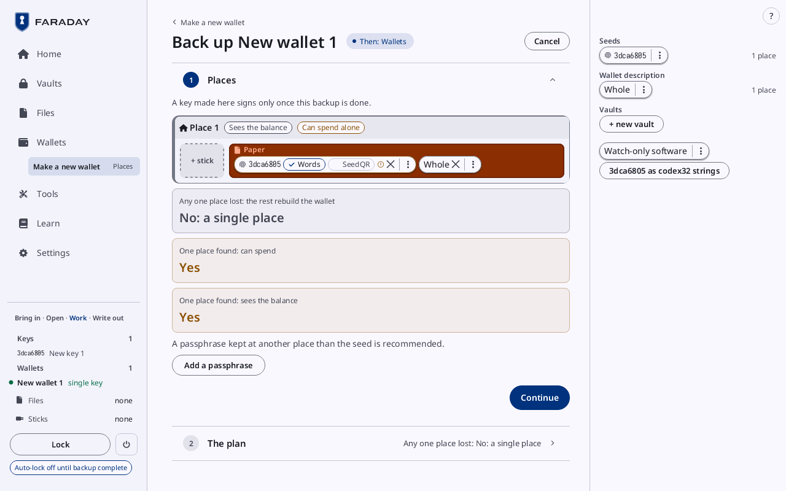

| On screen | Meaning |
|---|---|
| the list on the right | everything the backup can keep: **Seeds**, **Wallet description** (**Whole**), **Vaults** with **+ new vault**, **Watch-only software**; "1 place" beside each says how many places keep it |
| **3dca6805 · codex32 w0za · 2 of 3** | a key made as codex32 shares or loaded from strings keeps those strings instead of its words, each placed on its own; a key of words is not offered codex32 strings. Making a key as codex32 shares is step 4.11 |
| on a placed chip, **Words** and **SeedQR** | the forms it is kept in; a press turns one on or off, and the last one on stays on |
| **×** | takes the chip off that place |
| **⋮** | its menu (step 4.5) |
| **+ stick** | adds an empty stick to the place |
| the mark after a chip | a check under the board names it |

A chip from the list is never used up: placing it places a copy.

### 4.4 A vault on a stick

A vault is a file sealed with a passphrase, kept on a stick. Press
**+ new vault**: **Vault 1** joins the list. Drag it onto Place 1's
card. The place under it is edged while it takes the vault:

| Dragging | Dropped |
|---|---|
| 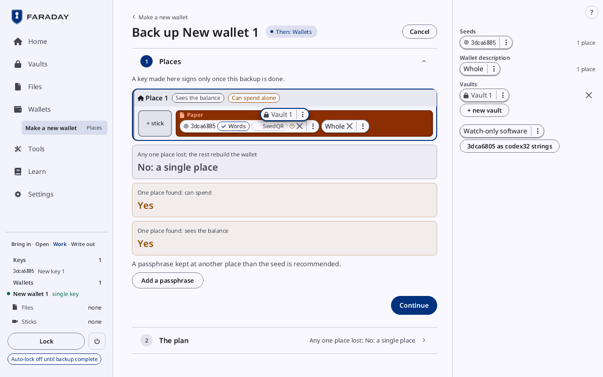 | 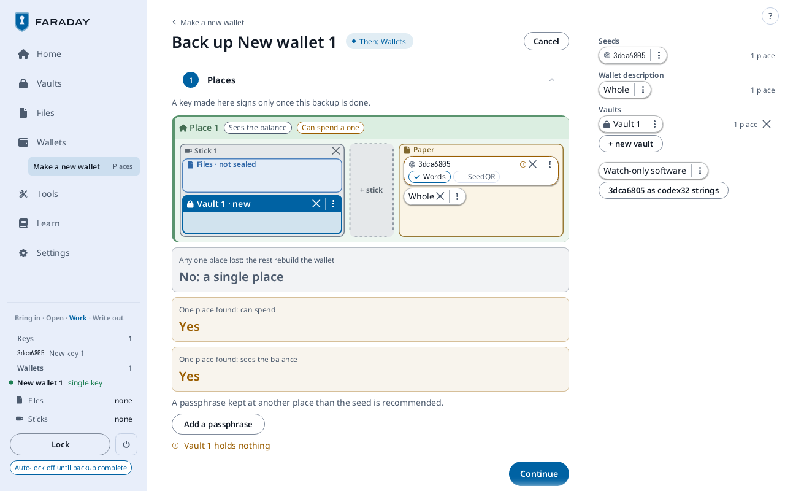 |

Place 1 now has **Stick 1**, with two boxes: **Vault 1 · new** (made in
the checklist) and **Files · not sealed** (files kept on the same stick
outside the vault). The line **Vault 1 holds nothing** shows until
something is put in it.

Without dragging: press a chip, then press the box it goes in. A press
anywhere else lets it go.

| Box | Keeps | Tag on the map |
|---|---|---|
| **Paper** | the words, the SeedQR, the printed wallet sheet | secret; the sheet public |
| **Vault 1** | the seed and the description, sealed in the vault file | sealed |
| **Files** | the seed as a `.txt` or `.png` file, the description as a file | secret: a seed file is not sealed |

### 4.5 The ⋮ menu, and the SeedQR

Press **⋮** on the seed chip in the list. **Add to…** lists every box
that takes the seed, under its place:

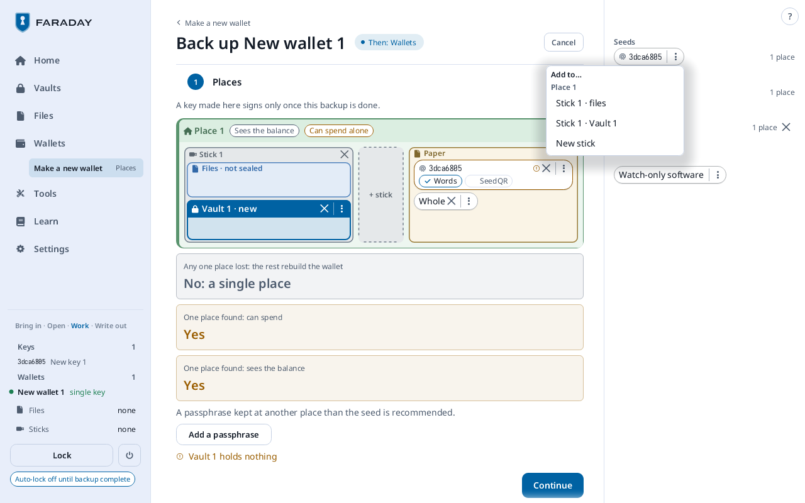

Press **Stick 1 · Vault 1**. Put **Whole** into Vault 1 the same way.
On a chip already placed, ⋮ offers **Move to…**, **Copy to…** and
**Take off**.

On the seed chip in **Paper**, press **SeedQR**: the paper copy is now
the words and the SeedQR.

A drop never refuses: a plan that keeps something unwise shows a
warning line and a mark on the chip it names. On a wallet of several
keys a drop can also open a sheet (step 5.5). Only **Seed … is kept
nowhere** holds the plan back.

Press **Continue**, then **Make the checklist** on **The plan**.

### 4.6 The checklist

The checklist has an item for each thing the plan needs, in the order
they are done. An item opens once the one before it is done ("After:
…"). The **Map** on the right shows each place and the vault, and what
each keeps; a dot turns green when that copy is made. **Change the
plan** returns to the board.

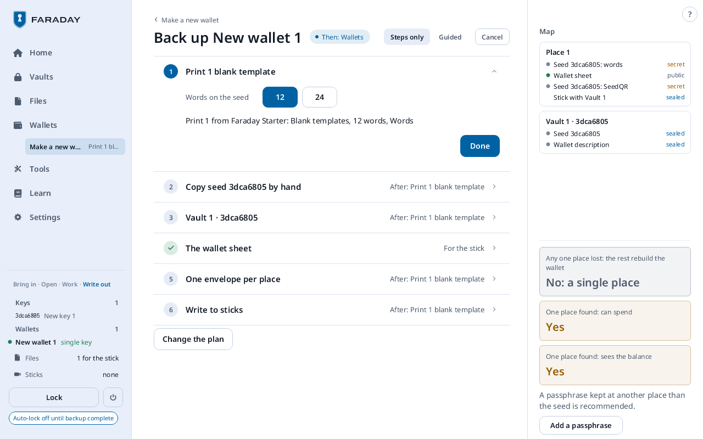

**Print 1 blank template**: **Words on the seed** is **12**. Faraday
prints nothing: the template comes from the Starter (**Blank
templates**, 12 words), on another computer. Press **Done**.

**The wallet sheet** is ticked already: it is a PDF, **For the stick**,
written in step 4.10 and printed from the stick on another computer.

### 4.7 Copy the seed by hand, and Check my copy

| Copy seed 3dca6805 by hand | Show the seed |
|---|---|
| 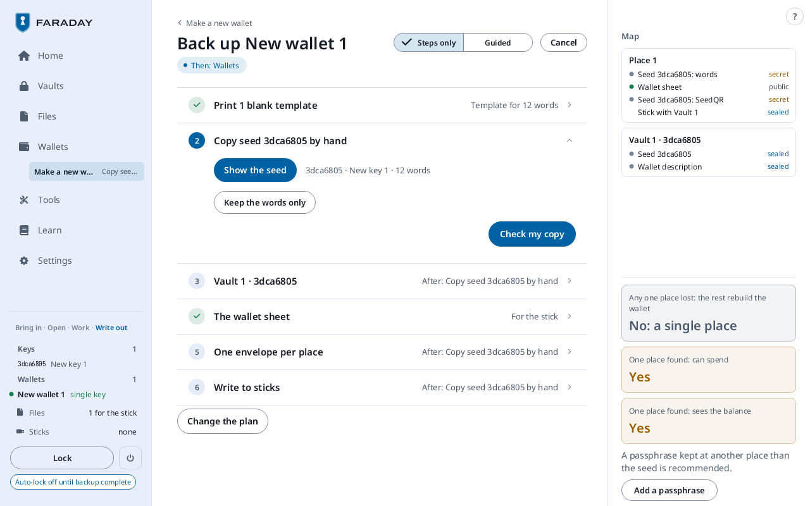 | 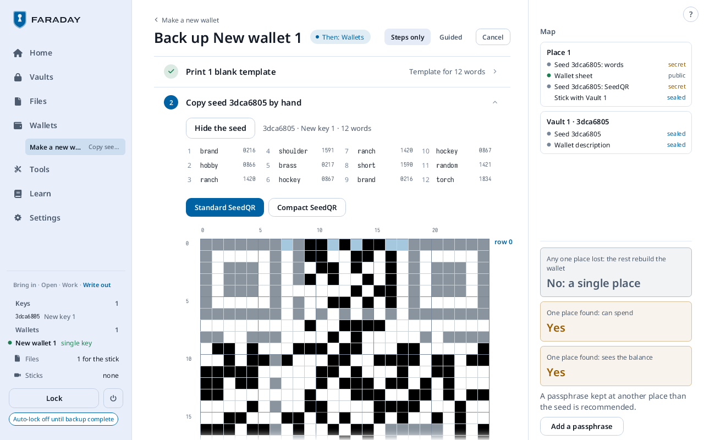 |
| Press **Show the seed**. | The 12 words, each with its number in the word list, and the SeedQR's grid. On the template, write the words in order, then fill the SeedQR square by square; the grey squares are printed already. **Blocks** lights the 5 × 5 block under the pointer and shows it large beside the grid, counted in fives from the top left as the template's heavy lines are; **Previous**, **Next** and the arrow keys move a block at a time, and **Rows** lights a row instead. **Compact SeedQR** shows the smaller grid. Press **Hide the seed**. |

**Keep the words only** takes the SeedQR off the plan; the item then
asks for the words alone.

Press **Check my copy** and type your copy's words back, from the
paper:

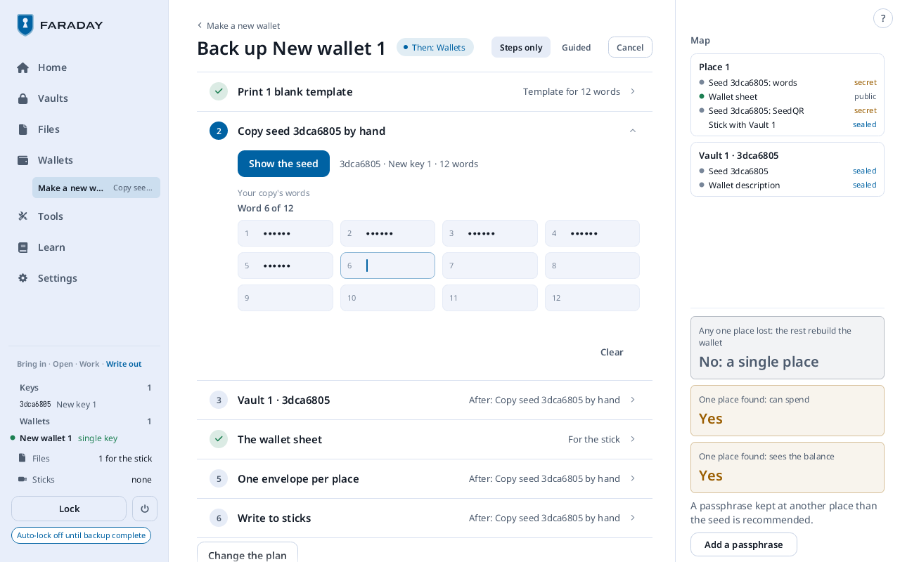

Each word shows as dots once typed. Then hold the SeedQR you drew up to
the camera (**Scan your copy**). Once the copy matches, the item reads
**Checked** and the checklist moves on to the vault by itself; opened
again, the item shows what matched:

| Result | Meaning | Do |
|---|---|---|
| 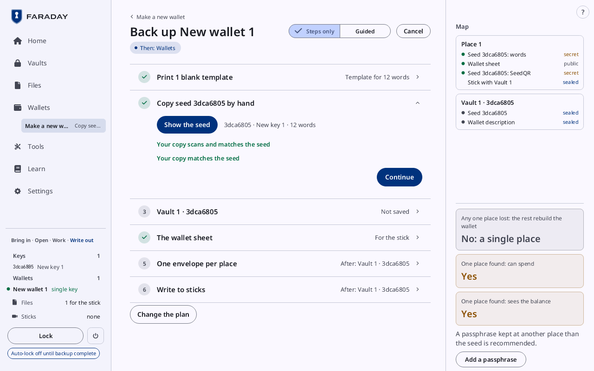 **Your copy scans and matches the seed** and **Your copy matches the seed** | the words typed and the SeedQR scanned are this seed's | nothing: the vault's item is open |
| **Word … differs from the seed** | that word on the paper is wrong | correct the paper from **Show the seed**, **Clear**, type it again |
| **Your copy scans but word … differs** | that word's squares are wrong | correct those squares and scan again |

A match proves the paper holds this seed. It does not prove the paper
will stay readable: keep it dry, and check it again from time to time.

### 4.8 The vault

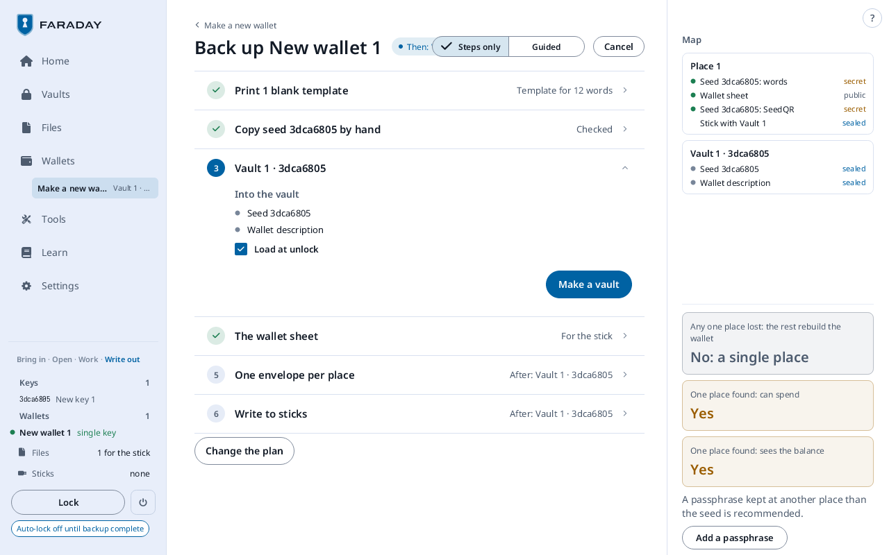

**Into the vault** lists **Seed 3dca6805** and **Wallet description**.
**Load at unlock** (ticked) loads them whenever the vault is unlocked.
Press **Make a vault**.

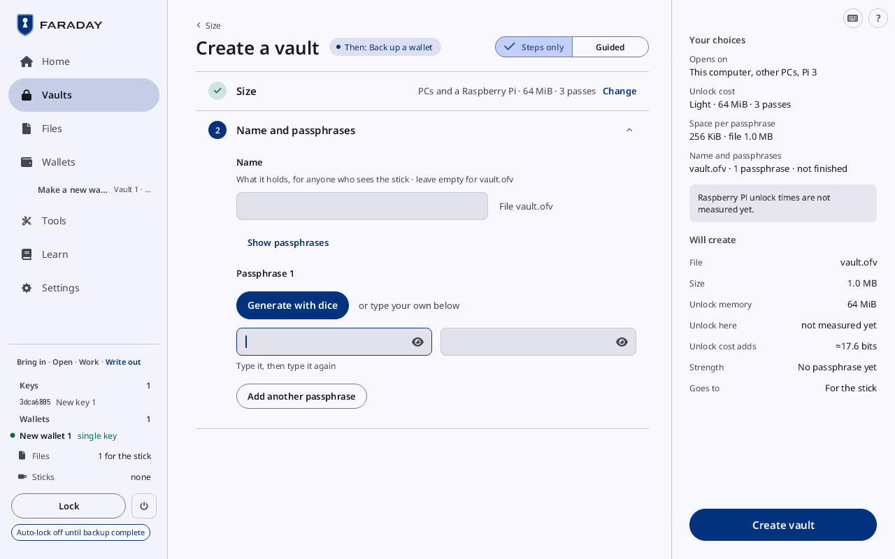

**Create a vault** opens with **Size** chosen (**PCs and a Raspberry Pi
· 64 MiB · 3 passes**). Under **Name and passphrases**:

1. **Name**: leave it empty for `vault.ofv`, or type what the vault
   holds; the name is visible to anyone who sees the stick.
2. **Passphrase 1**: type it in the first field, then again in the
   second, or press **Generate with dice**. The eye button at the end
   of a field shows what is typed in it. Write it down: the vault
   cannot be opened without it.
3. Press **Create vault**.

Faraday makes the vault, then asks its passphrase once to unlock it.
Back on the checklist:

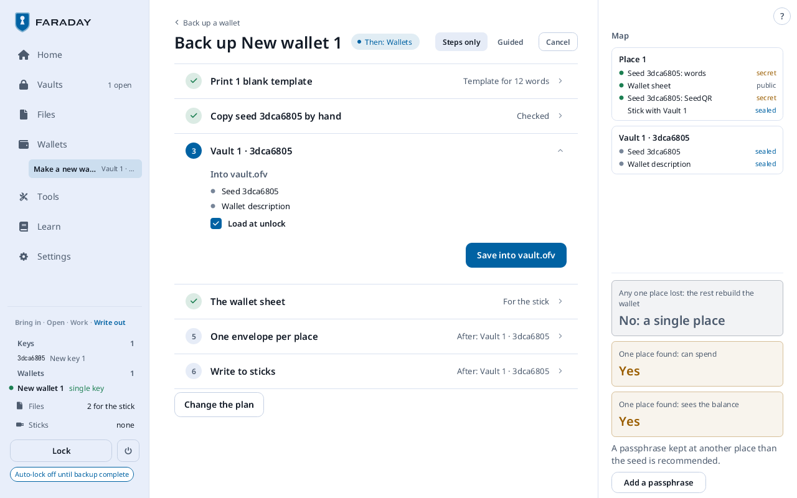

Press **Save into vault.ofv**. The item reads **In vault.ofv**, and the
checklist moves on to **The wallet sheet**, ticked already: press
**Continue**. The vault is in memory until step 4.10 writes it.

### 4.9 One envelope per place

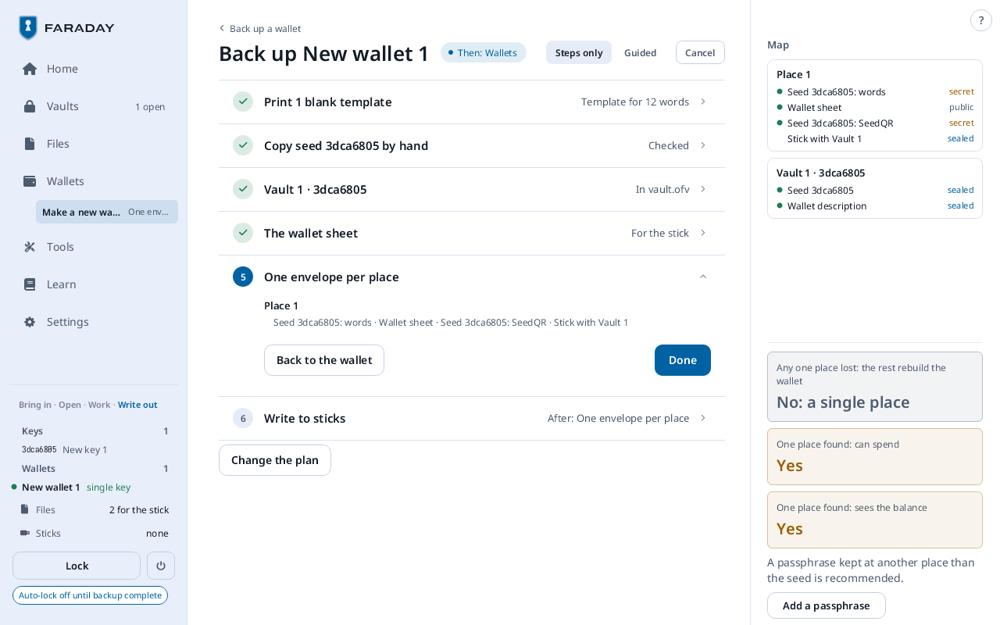

The item lists what goes into Place 1's envelope: the seed's words, the
wallet sheet, the seed's SeedQR, and the stick with Vault 1. Press
**Done**.

### 4.10 Write to sticks

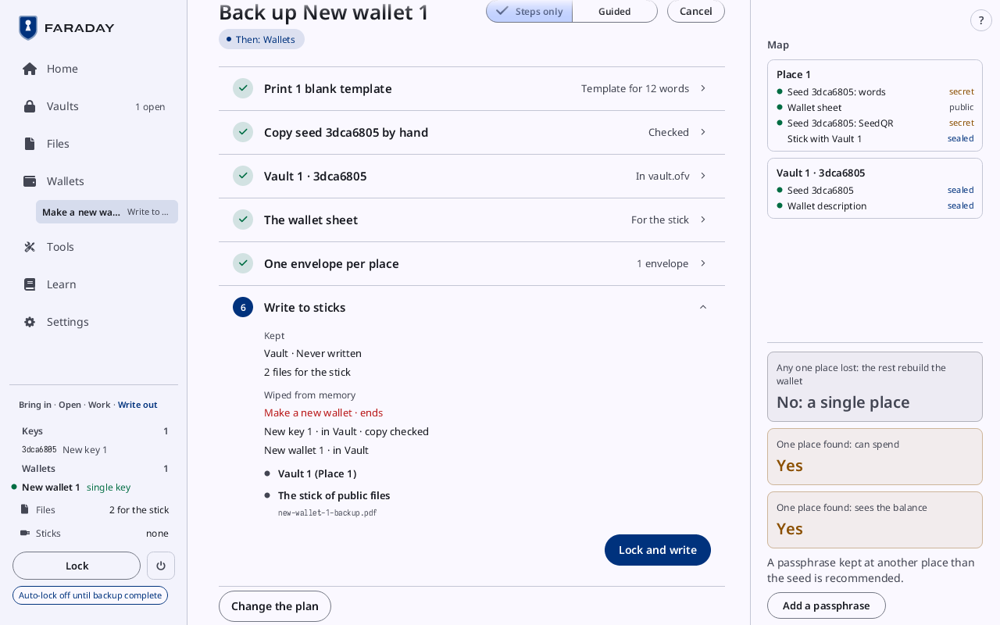

The item lists what the lock keeps (**Kept**: the vault and the files
for the stick) and what it wipes (**Wiped from memory**: the key and
the wallet, which are in the vault; **Make a new wallet · ends**), then
the sticks to write. Press **Lock and write**.

The session locks. The page becomes the backup's own steps, open on
**Write the sticks**:

| Insert | Stick read | Written |
|---|---|---|
| 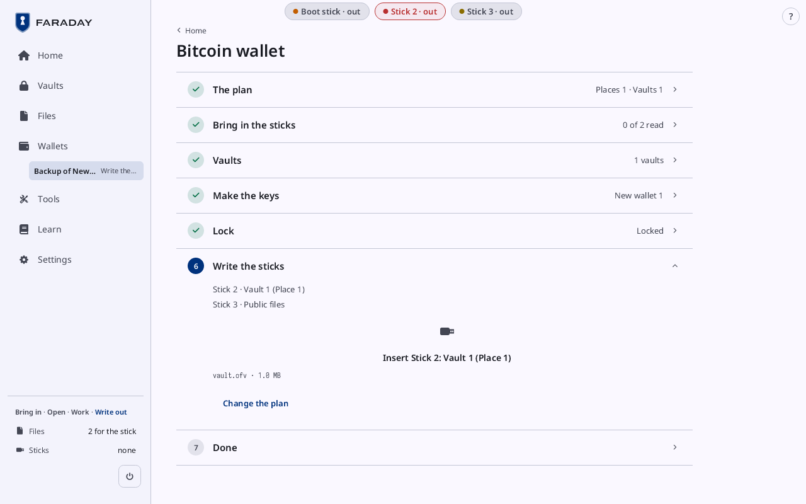 | 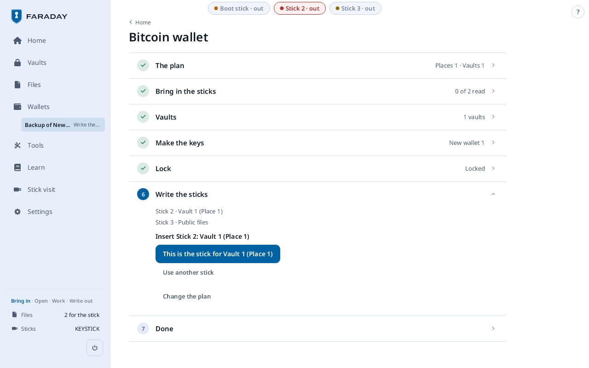 | 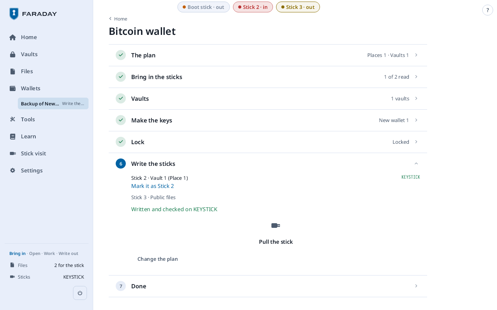 |
| **Insert Stick 2: Vault 1 (Place 1)**. The pills at the top name every stick: the Faraday stick is **Boot stick**, the board's Stick 1 is **Stick 2** here, and the public files go on **Stick 3**. Plug in a stick. | Press **This is the stick for Vault 1 (Place 1)**, or **Use another stick**. | **Written and checked on** and the stick's name. Write "Stick 2" on the stick (**Mark it as Stick 2**), then pull it (**Pull the stick**). |

Then **Insert Stick 3: Public files** the same way.

| Line | Meaning | Do |
|---|---|---|
| **Not a FAT32 stick. Format it as FAT32, or use another stick** | the stick cannot take the files | format it on another computer, or use another |
| **Not enough room: … needed, … free** | the stick is full | another stick |
| **Not the stick read for …** | a different stick from the one read for this slot | the stick read before |
| **Pulled before the copy was checked. Nothing counted** | the stick came out too soon | plug it in again |
| **… did not read back from …; try another stick** | the stick did not keep what was written | another stick |

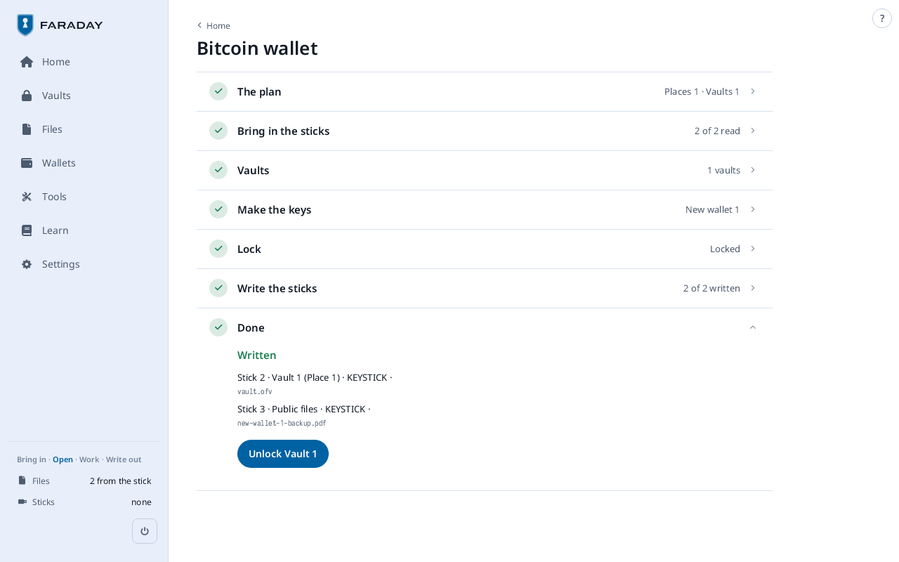

**Done** lists each stick written and what it holds. **Unlock Vault 1**
opens the vault with its passphrase and loads the wallet and the key
again.

What "Written and checked" proves: the stick read back what was
written. It does not prove the stick will last: keep the paper copy as
well.

> **With your own key**
>
> - The places are real. Choose them first, and know who can reach
>   each one.
> - Use new sticks you trust. USB sticks are not very reliable for
>   long-term storage: name-brand sticks are generally better, and
>   cheap off-brand sticks should not be relied on to keep a backup for
>   years. Always keep a paper or metal backup as well.
> - Seal and label each envelope as the checklist's
>   **One envelope per place** says.
> - Keep the record of what is at each place. Never write the words on
>   it.
> - Before you rely on the key, restore it once from the backup alone,
>   on a fresh start, and check the fingerprint:
>   [Before you rely on a key](before-you-rely.md).
>
> Why: [Backups](../../learn/04-backups.md),
> [A backup plan's check](../../learn/faraday/backup-plan-check.md),
> [Extra copies](../../learn/faraday/extra-copies.md).
