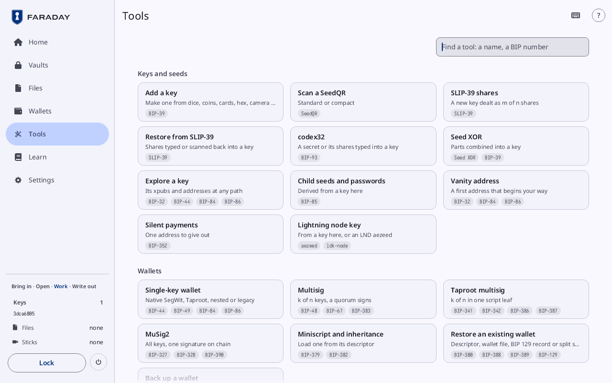
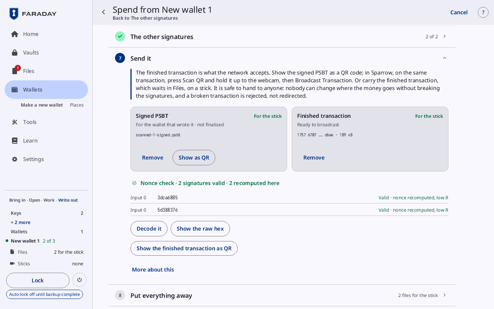
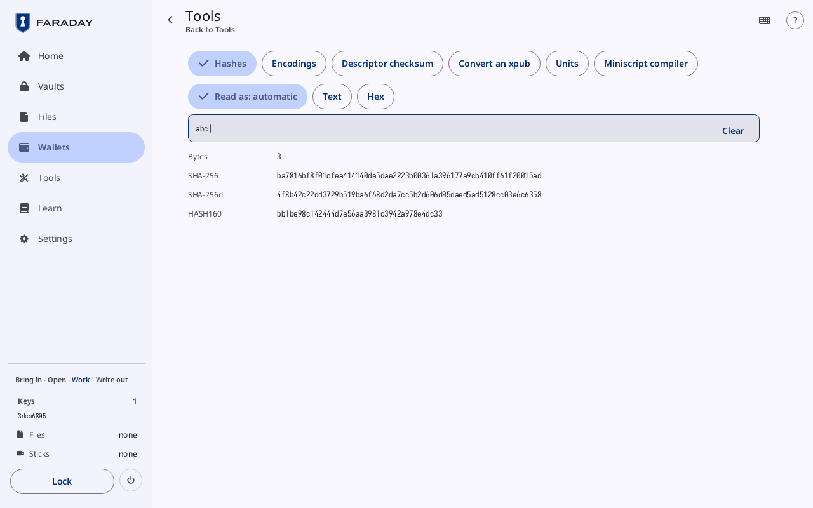

# Check and decode

**Kind:** Reference
**Status:** Written, checked against the app's screens and strings, and pictured from `just guide-pictures` (`docs/guide/pictures/`)

**You end with:** the transaction of [Spend](spend.md) taken apart
field by field, its signatures' nonces checked, an address checked
against the loaded wallets, a file's SHA-256 compared with another
computer's, and each of the six calculators used once.

**Before you start:** [Spend](spend.md) (a transaction signed and
finished), [Receive](receive.md) (checking an address) and
[Files, sticks and QR codes](files-and-sticks.md) (a stick visit).

**You'll need:**

- Faraday with keys `3dca6805` and `5d388376` loaded and New wallet 1,
  the 2-of-3 of [Make a wallet](make-a-wallet.md), loaded.
- The PSBT of [Spend](spend.md), `payment.psbt`, signed there to the
  end, or a finished transaction (`.txn`) on a stick.
- A watch-only wallet showing a receive address, as in
  [Receive](receive.md).
- For the file check, a computer that prints a file's SHA-256
  (`sha256sum` on Linux and macOS, `Get-FileHash` on Windows).

**Time:** about 25 minutes.

None of these checks signs anything or changes a file. The
calculators keep nothing of what is typed in them.

## 1. Tools



Press **Tools** in the sidebar. **Tools** lists every flow by what it
works on, each tile with its name, one line and the standards it
follows. What is typed goes into **Find a tool: a name, a BIP number**
at the top: "85" finds BIP-85, and **No tool matches** shows when
nothing does.

This walkthrough uses two groups:

| Group | Tiles |
|---|---|
| **Transactions** | **Sign a transaction**, **Nonce check**, **Decode a transaction**, **Check an address** |
| **Calculators** | **Hashes**, **Encodings**, **Descriptor checksum**, **Convert an xpub**, **Units**, **Miniscript compiler** |

A tile that needs something first is grey, and its line says what, in
the warning tone: **Load a wallet first**, **At the end of signing**.

## 2. Read a PSBT before signing

A PSBT is read on **Sign a transaction** (**A PSBT from Files or a QR
code**): what leaves, what comes back, the fee and the txid, row by
row, as [Spend](spend.md#64-read-the-transaction) shows. Nothing is
signed until a **Sign with** button is pressed; leave the screen
before that, and the PSBT stays as it came.

## 3. Decode a finished transaction


*The 2-of-3's payment.psbt, signed with a second key and finished, opened with **Decode it**: "Finished from payment.psbt", **Fee** "1850 sat · 9.8 sat/vB", "Inputs · 1", and "Outputs · 2", the payment (**Pays out of the loaded wallets**) and the change ("Change · back to new-wallet-1-descriptor · 1/0"). The way back reads **Back to Spend**.*

[Decode a transaction](../screens/decode.md) takes apart a transaction that is signed and
finished, the one a wallet broadcasts. Open it one of three ways:

| From | Press |
|---|---|
| [Spend](spend.md#67-send-it)'s **Send it** card, under the nonce check | **Decode it** |
| **Files**, a **Finished transaction** such as `payment-final.txn` | **Decode** |
| **Tools** | **Decode a transaction**: the first finished transaction in Files, or the camera when there is none; a transaction scanned lands as `scanned-1.txn` |

Under the title, where it came from: the file's name, or "Finished
from payment.psbt". Then:

| Row | What it is |
|---|---|
| **Transaction id** | the txid, the one a wallet or an explorer reports once it is broadcast |
| **Witness id** | the id with the signatures counted |
| **Version** | the transaction's version |
| **Locktime** | **0 · none**, or a block height or a time |
| **Size** | bytes, virtual bytes and weight units |
| **Fee** | in sat and sat/vB; **Not stated: the amounts going in are not here** when no PSBT of it is |
| **Amounts in** | the PSBT the amounts going in were read from ("From payment.psbt"); **Not here**; or **PSBTs of it state different amounts**, and none is used |

**Inputs** lists each input from 0: the output it spends, its amount
where known, its sequence and what it means (**final**, **locktime on,
no replace-by-fee**, …), and its witness. **Outputs** lists each
output: its amount, its address, its kind (P2WPKH, P2WSH, P2TR, …),
and whose it is:

| Line | Tone | Meaning |
|---|---|---|
| "Change · back to New wallet 1 · 1/0" | ok | change, to a loaded wallet's change address |
| "Back to New wallet 1 · receive 0/…" | ok | to a loaded wallet's receive address |
| **Pays out of the loaded wallets** | warning | to an address no loaded wallet makes in its first 100 |

Compare the outputs that pay out with the payee's address and amount.
**Show the hex** shows the whole transaction as hex (**Hide the hex**
hides it); **Show as QR** shows it as a code, for a wallet or an
explorer that broadcasts it.

## 4. Nonce check



The nonce check is on [Spend](spend.md#67-send-it)'s **Send it** card, under
the files, once the transaction is finished. **Tools → Nonce check**
opens that card; until a transaction is finished, the tile reads **At
the end of signing**.

Its first line sums it up:

| First line | Tone |
|---|---|
| "Nonce check · 2 signatures valid · 2 recomputed here" | ok |
| "Nonce check · 1 of 2 signatures not checked" | warning |
| **Nonce check · a signature is wrong** | danger |

Then a row per signature, **Input 0**, **Input 1** and on, with the key
and what was found; an input signed by two keys has two rows, as input
0 of the 2-of-3 has in the picture. Under them, **Decode it**, **Show
the raw hex** and **Show the finished transaction as QR**.

| Row | Meaning |
|---|---|
| "Valid · nonce recomputed, low R" | signed with a key here, and the same signature made again here |
| **Valid · signed elsewhere, its nonce needs that device's key** | valid; its nonce can be checked only on the device that holds the key |
| **Valid · not the nonce this key makes: do not broadcast** | valid, but not made the way this key signs |
| **Invalid: not this key's over this transaction** | the signature does not hold |
| "Not checked ·" and why | it could not be checked here |

Two signatures that share a nonce are named in red, with the inputs
("one nonce on inputs … · this gives the key away"). Past twelve rows,
one line counts the rest ("4 more · none wrong").

## 5. Check an address

Press **Tools**, then **Check an address** (**Scan it; the loaded
wallets are searched**), and hold the watch-only wallet's receive code
up to the camera. The line under the picture says whose address it is,
as [Receive](receive.md#61-receive-check-the-address) lists: "That
address is New wallet 1's receive address 0". Nothing is put in Files.
With no wallet loaded, the tile reads **Load a wallet first**. In
Faraday Demo's Practice, the camera offers **Load sample address**.

## 6. A file's SHA-256

Every file has its SHA-256, to compare with the one another computer
prints for the same file: a file changed on the way has another.

On **Files**, press a file's **⋮**, then **Details**: **SHA-256** shows
the hash in groups of eight ([Details](../screens/files.md#details)).
On the other computer:

```
sha256sum payment.psbt
```

The two must match in every character.

## 7. The calculators



*Tools on **Hashes**, opened from **Tools**, with `abc` typed and **Read as: automatic**.*

Press **Tools**, then any tile under **Calculators**. The calculator
page, [Tools](../screens/calculators.md), has a button per calculator at the top, **Hashes**,
**Encodings**, **Descriptor checksum**, **Convert an xpub**, **Units** and
**Miniscript compiler**, then a mode row where the calculator has one, then the
field. What is typed goes into the field; **Clear** empties it, and
<kbd>Escape</kbd> leaves the page and keeps nothing. None of them
touches a key.

| Calculator | Type | It shows |
|---|---|---|
| **Hashes** | **Text or hex**; the mode row reads it as **Read as: automatic**, **Text** or **Hex** | **Bytes**, then SHA-256, SHA-256d and HASH160; **Not hex** when Hex is chosen and it is not |
| **Encodings** | **Base58, bech32 or hex**: an address, an xpub, any such string | **Encoding**, **Prefix**, **Version**, **Checksum** (**holds** or **does not hold**) and **Bytes**; **Not Base58, bech32, bech32m or hex** |
| **Descriptor checksum** | **A descriptor**, with its checksum after `#` or without | **Checksum**; **Given**, the one typed, and whether it **holds**; **With it**, the descriptor with its checksum; **Wallet**: **one this device loads** or **not one this device loads**. **Not a descriptor** |
| **Convert an xpub** | **An xpub, ypub, zpub, tpub…** | the key in BIP-32's spelling and as **Legacy**, **Nested SegWit**, **Native SegWit** and **Taproot**; **Depth**, **Fingerprint** and **Child**. An extended private key is refused: **That is an extended private key: this tool takes public keys only** |
| **Units** | **An amount**, down to one satoshi (0.5 in BTC; a whole number in sat), in the unit the mode row chooses: **In sat**, **In BTC**, **In mBTC**, **In bits** | the amount in sat, BTC, mBTC and bits |
| **Miniscript compiler** | a policy (step 8) | its descriptor (step 8) |

Try **Hashes** with `abc`, read as text: **Bytes** 3, and SHA-256
`ba7816bf8f01cfea414140de5dae2223b00361a396177a9cb410ff61f20015ad`,
the value the SHA-256 standard publishes for it. **Units** with 1, **In
BTC**: 1.00000000 BTC, 1000.00000 mBTC, 1000000.00 bits.

## 8. The Miniscript compiler

**Tools → Miniscript compiler** (**A policy compiled into a
descriptor**) opens **Miniscript compiler** ([the calculators](../screens/calculators.md#the-calculators)). The field takes a policy:
**A policy, e.g. or(pk(9a6a2580),and(pk(…),older(1000)))**. The mode
row chooses the script: wsh (SegWit) or tr (Taproot). A loaded key can
be named by its fingerprint; with `3dca6805` and `5d388376` loaded,
type:

```
or(pk(3dca6805),and(pk(5d388376),older(1000)))
```

`3dca6805` spends at any time; `5d388376` spends once the coins are
1000 blocks old. The page shows:

| Row | What it is |
|---|---|
| **Descriptor** | the policy compiled, with each fingerprint as the loaded key's xpub with its origin, and the checksum |
| **Spend paths** | how many ways it can be spent |
| **Wallet** | **one this device loads**; or **keys need origins and both chains to load**, when a key is typed some other way |

A policy the compiler cannot compile shows its message in red. To use
the descriptor as a wallet, load it through **Restore an existing
wallet** (**Miniscript and inheritance** on Tools leads there).

> **With your own key**
>
> - Read every output of a transaction on Faraday's screen before it
>   is broadcast; an output that **Pays out of the loaded wallets** is
>   the payment and nothing else.
> - Give out a transaction whose **Nonce check** reads anything but
>   valid only after finding out why; "do not broadcast" means so.
> - Take receive addresses from Faraday or the watch-only wallet, and
>   check them with **Check an address**, never from a page or a
>   message.
> - Compare a file's SHA-256 with the one another computer prints for
>   it before you load or sign what is in it.
>
> Why: [Verifying](../../learn/06-verifying.md),
> [Nonces](../../learn/13-nonces.md),
> [Tools](../../learn/16-tools.md),
> [Inheritance](../../learn/12-inheritance.md).

Next: [The Starter's other tools](starter-tools.md).
