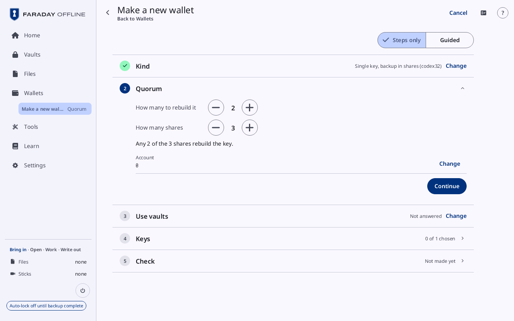
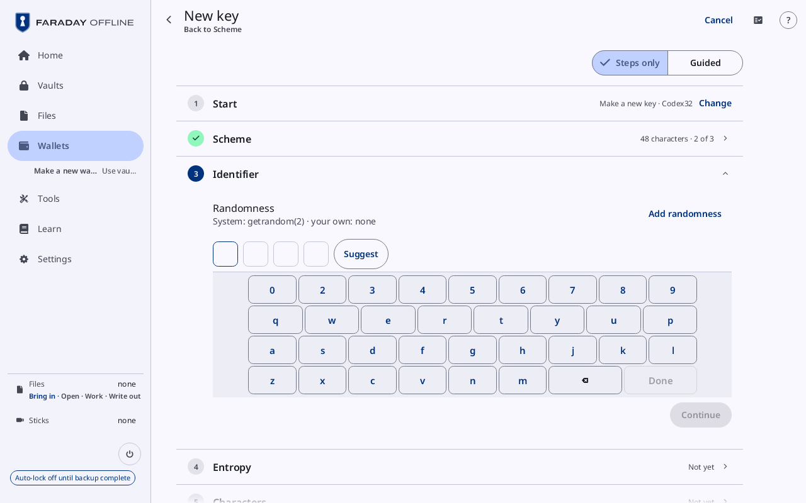
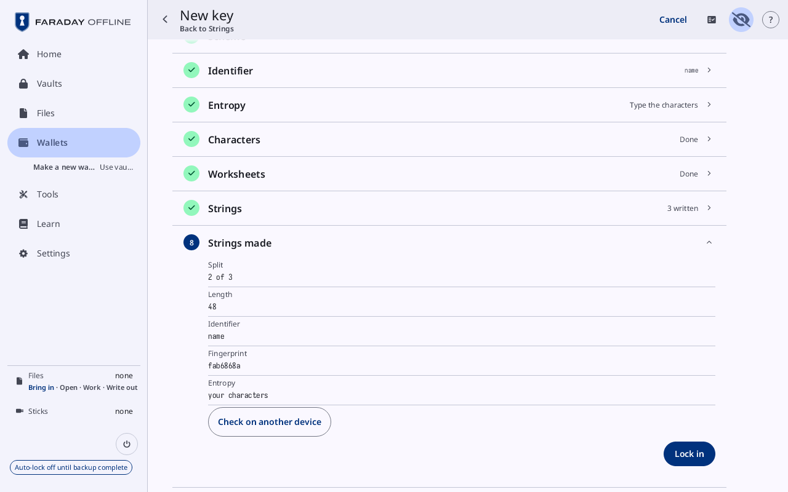
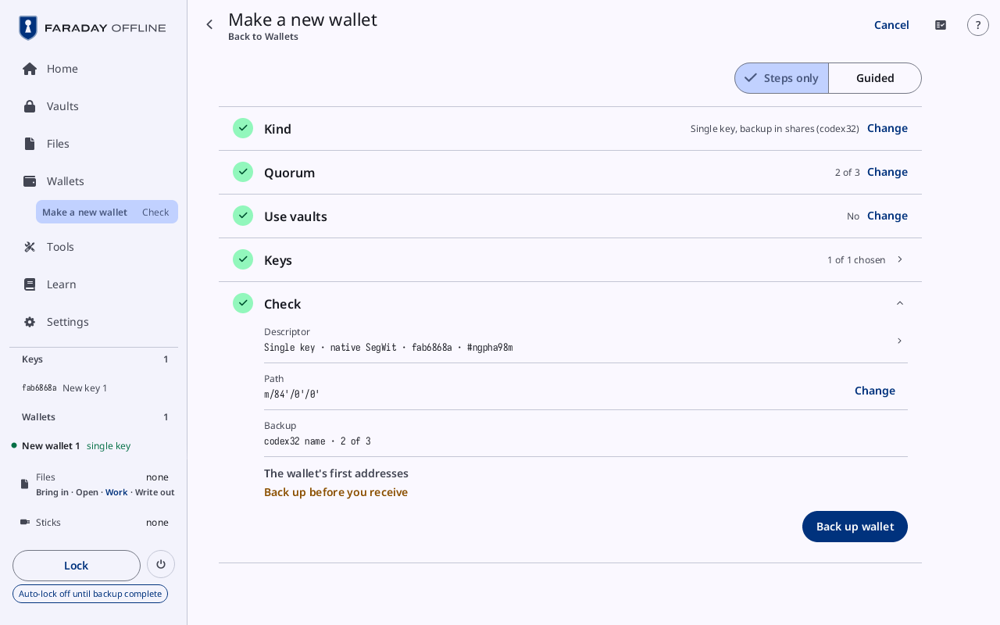
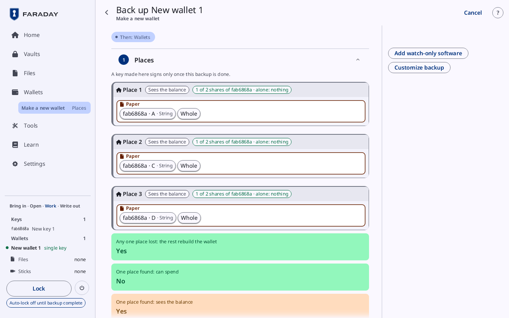
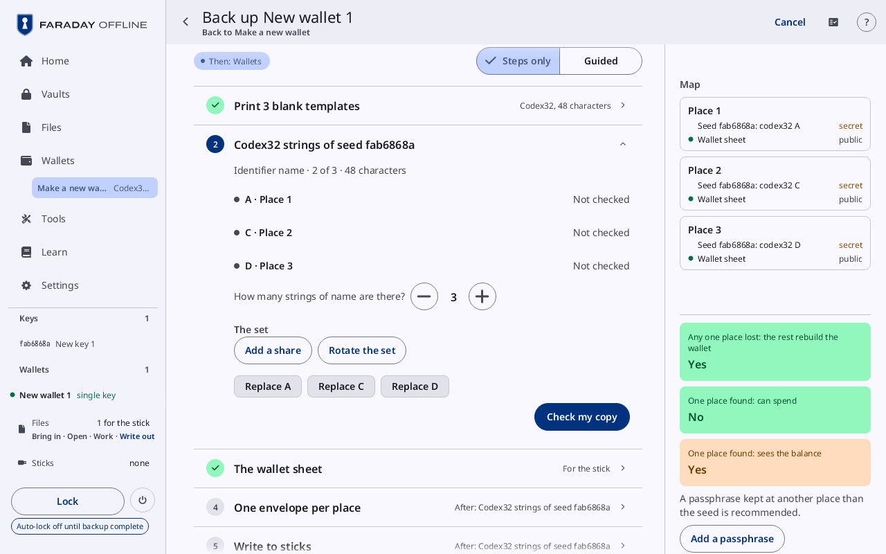
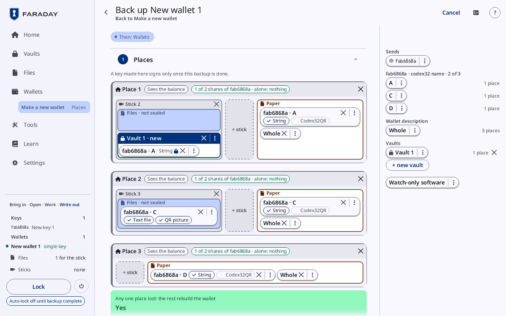
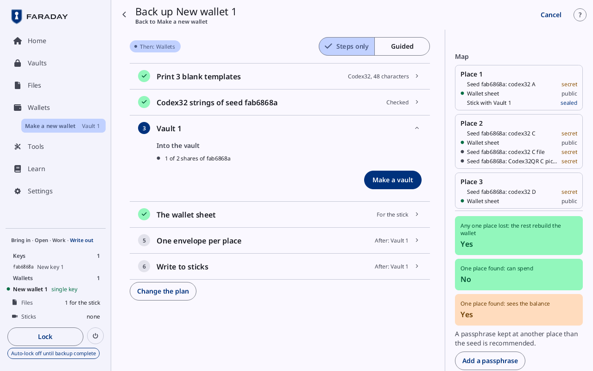
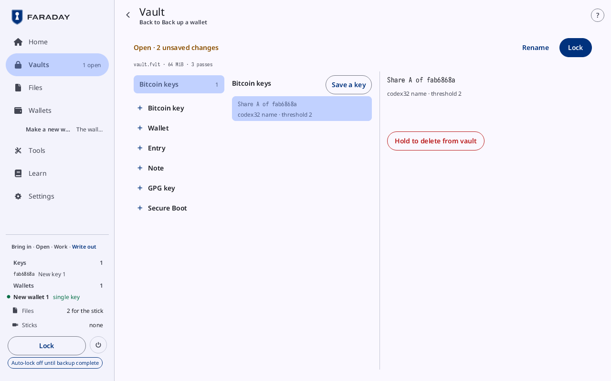
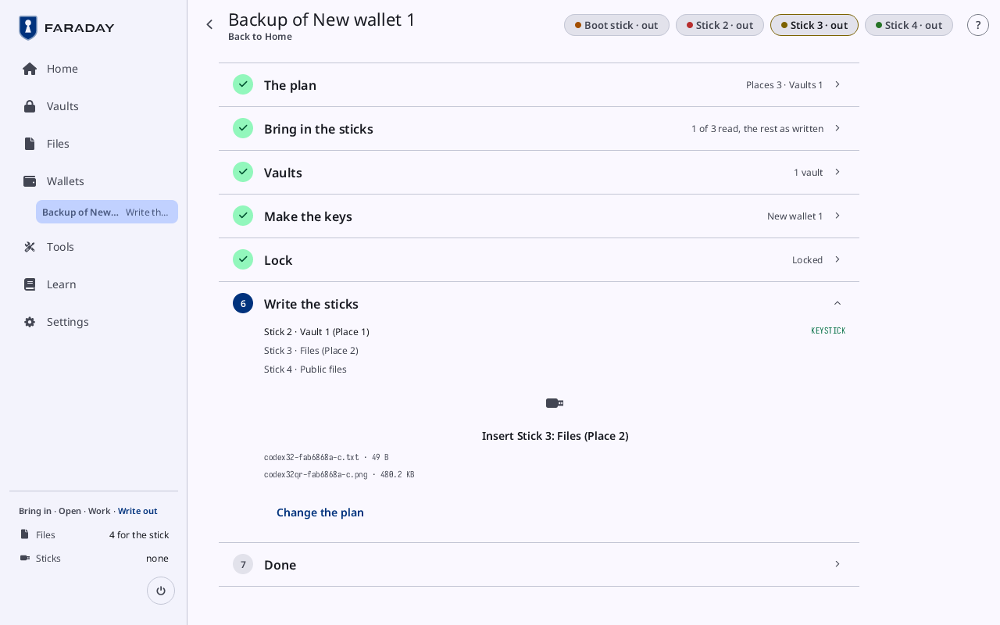

# codex32 shares

**Kind:** Reference
**Status:** Written, checked against the app's screens and strings, and pictured from `just guide-pictures` (`docs/guide/pictures/`)

**You end with:** a single-key wallet whose one key was made as three
codex32 strings, any 2 of which rebuild it, each kept at a place of its
own, and the strings typed back and checked.

**Before you start:** [Back it up](back-up.md): this walkthrough
follows its steps and names only what differs.

**You'll need:**

- Faraday with no key loaded and no stick attached.
- Three blank templates for codex32, 48 characters, printed from the
  Starter (**Tools → Blank templates**), and a pen.
- For the strings kept on sticks, as many USB sticks formatted FAT32 as
  the plan names.

**Time:** about 90 minutes, most of it the worksheets by hand.

Instead of [Back it up](back-up.md)'s steps 4.1 to 4.10, a single-key wallet can have its one key
made as codex32 shares: strings worked from your own dice, any 2 of 3
of which rebuild the key, and 1 alone shows nothing of it. Each string
goes to a place of its own, so no one place holds the key. Section 5
does not need this step.

The test data: BIP 93's published vector 2, identifier `name`. Its
characters make key `fab6868a`. Never keep funds on it.

**Wallets → Make a new wallet**. Kind opens with **Single key, backup
in shares (codex32)** chosen; press it:

**How many to rebuild it** reads 2 and **How many shares** 3; the line
under them reads **Any 2 of the 3 shares rebuild the key.** Press
**Continue**, then **No** on **Use vaults**. With no key loaded, Keys
is not shown: the key is made at once.

The page is [**New key**](../screens/new-key.md#make-codex32-shares), open on **Identifier**: **Start** reads **Make
a new key · Codex32** and **Scheme** **48 characters · 2 of 3**, from
Quorum. Type four characters that name the set (**Suggest** fills four),
then **Continue**. **Entropy** offers **Roll dice**, **Type the
characters** (made on paper) and **Type shares made by hand**; dice
can have 4, 6 (the default), 8, 10, 12 or 20 faces, five of one size,
each die's first and second roll giving one bit, as on the booklet's
de-biasing worksheet. Each roll or character drops into its box and the worksheets fill as on
paper; **Worksheets** then shows each sheet whole, and **Strings** each
string to write down and type back. Learn's page **Backups in other
forms** walks through these cards.

**Strings made** lists **Split**, **Length**, **Identifier**,
**Fingerprint** (`fab6868a` for the test data) and **Entropy**.
**Check on another device** lists sets of strings to load on another
implementation; every set must give the same fingerprint. Press **Lock
in**: the key fills Key 1, the wallet is made, and Make a new wallet
opens on **Check**.

| Check | The board, the standard way |
|---|---|
|  |  |
| **Descriptor** reads **Single key · native SegWit · fab6868a** and a checksum, and **Backup** **codex32 name · 2 of 3**. **The wallet's first addresses** reads **Back up before you receive**, and the card offers only **Back up wallet**: press it. | One string per place, on paper, each beside **Whole**, the wallet description: **fab6868a · A** at Place 1, **C** at Place 2, **D** at Place 3. Each place reads **1 of 2 shares of fab6868a · alone: nothing**. **Any one place lost: the rest rebuild the wallet** reads **Yes**; **One place found: can spend**, **No**. |

**Customize backup** changes the board as in steps 4.3 to 4.5: a string
can go into a vault or a stick's files as well. Press **Continue**, then
**Make the checklist**.

**Print 3 blank templates** asks for **Codex32, 48 characters** from the
Starter. [**Codex32 strings of seed fab6868a**](../screens/back-up-wallet.md#the-checklist) lists each string and its
place under **Identifier name · 2 of 3 · 48 characters**, **Not
checked** until it is typed back. **How many strings of
name are there?** counts the strings that exist, if more were made.
Under **The set**, **Add a share** makes one more string of the same
set, **Rotate the set** makes a new set in place of this one, and
**Replace A**, **Replace C** and **Replace D** each replace a lost
string. Press **Check my copy** and type
each string back from its paper; a box copied wrong is named. The rest
of the checklist goes as in steps 4.9 and 4.10.

A string can be kept on more than paper. Here, after **Change the
plan** and **Customize backup**, string A also goes into Vault 1 on a
stick at Place 1, and string C onto a new stick at Place 2, its forms
**Text file** and **QR picture** both on. Each place still reads **1 of
2 shares of fab6868a · alone: nothing**.

On the checklist, the vault's item, **Vault 1**, names the set under
**Into the vault**: **1 of 2 shares of fab6868a**, its dot turning
green once the open vault holds that string.

**Save into vault.fvlt** (step 4.8) saves each string the plan puts in
the vault as a share record. The vault lists it under **Bitcoin keys**:
**Share A of fab6868a**, **codex32 name · threshold 2**. At unlock,
strings of one set from the vaults open together load the key once
there are enough of them; a string typed in counts with them.

At **Lock and write** (step 4.10), a string kept in a stick's files is
written as `codex32-fab6868a-c.txt`, and its Codex32QR picture as
`codex32qr-fab6868a-c.png`, both listed under **Insert Stick 3: Files
(Place 2)**; the picture is read back against the string
before the stick counts. One such file shows nothing of the key, but
enough of them together are the key: the stick's files are **not
sealed**.

> **With your own key**
>
> - Roll your own fair dice, or work your own characters, as each lands;
>   never the published vector's characters.
> - Your fingerprint will not match the guide's: write yours down.
> - Write each string on paper or metal, never on a computer, phone or
>   photo, and check it against the screen.
> - The places are real: choose them first, and keep each string at a
>   place of its own.
> - Before you rely on the key, restore it once from the strings alone,
>   on a fresh start, and check the fingerprint:
>   [Before you rely on a key](before-you-rely.md).
>
> Why: [Backups](../../learn/04-backups.md).
