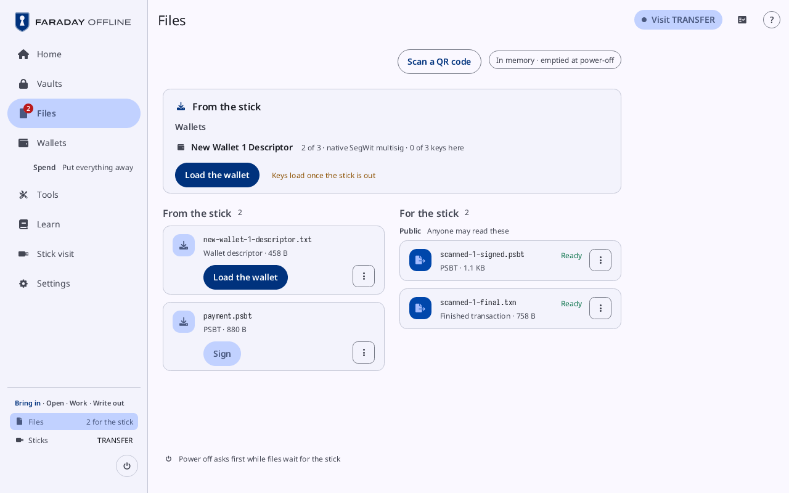
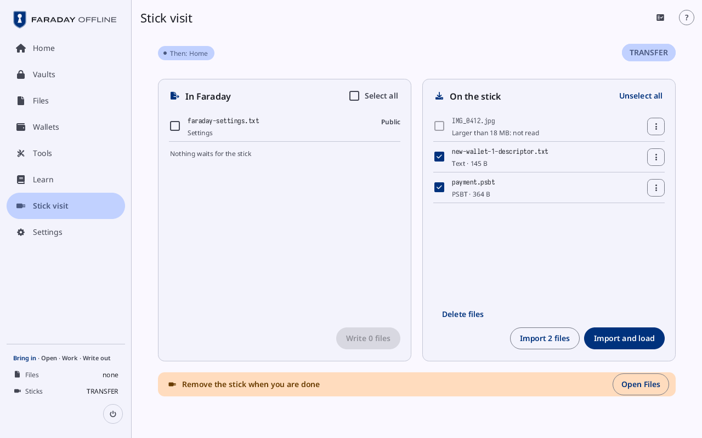
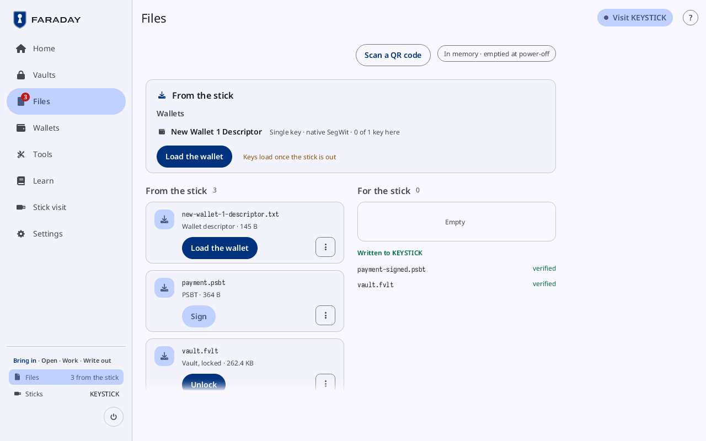
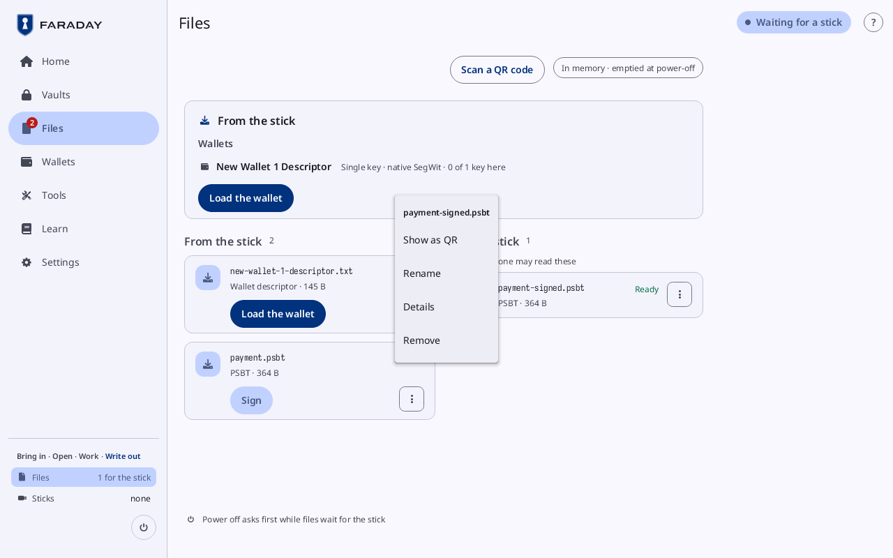
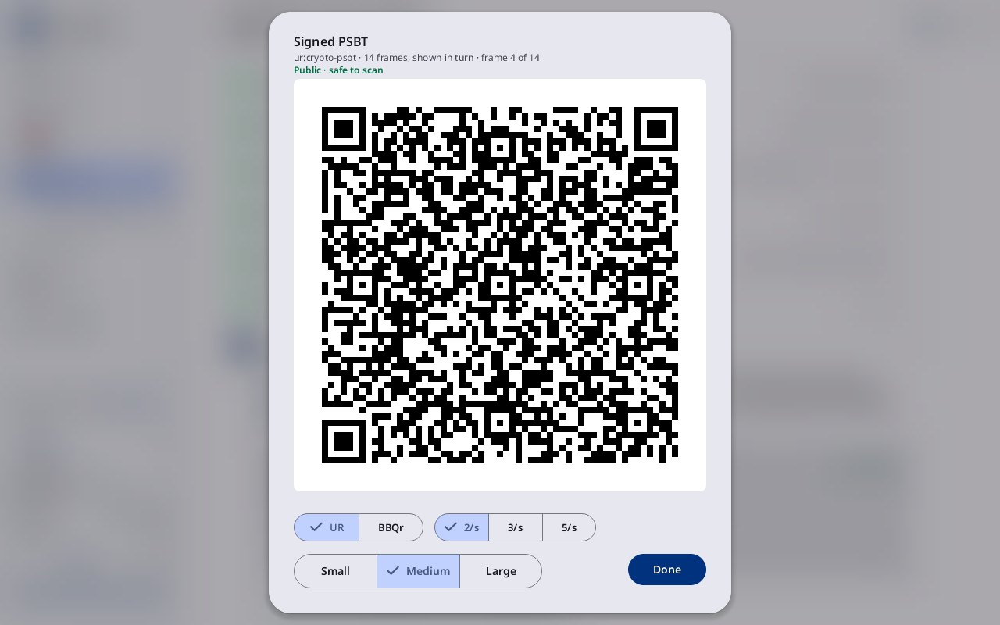

# Files, sticks and QR codes

**Kind:** Reference
**Status:** Written, checked against the app's screens and strings, and pictured from `just guide-pictures` (`docs/guide/pictures/`)

**You end with:** files brought in from a stick and by QR code, files
written to a stick and checked, a file renamed and its SHA-256 read,
and a file deleted from a stick with zeros.

**Before you start:** [First start, Home and the session](first-start.md).
[Spend](spend.md) uses the same ways in and out for a PSBT (steps 6.3
and 6.7).

**You'll need:**

- Faraday with no key loaded.
- A USB stick other than the Faraday stick, formatted FAT32, holding a
  file or two from another computer (a PSBT, a wallet file).
- For the QR codes, a camera on the PC that runs Faraday, and Faraday
  Starter, or a wallet that shows and scans QR codes, on another
  computer.

**Time:** about 20 minutes.

Faraday runs from memory. What it reads is in **Files** until
power-off; what it writes waits there for the next
stick. A stick comes in only while nothing secret is in memory: with a
key loaded, a lock comes first.

## 1. Files

Press **Files** at the foot of the sidebar.

| Part | What it shows |
|---|---|
| the title's chip | **Waiting for a stick**; with a stick in, "Visit" and its name ("Visit TRANSFER"), which opens the stick visit; with a key loaded, **Stick attached · lock to use it** |
| **Scan a QR code** | the camera, into Files (step 6) |
| **In memory · emptied at power-off** | both lists are in memory only |
| **From the stick** | what was copied in, from a stick or a QR code: each file with what it is, its size and the one action it is for |
| **For the stick** | what waits to be written, under **Public** (**Anyone may read these**), **Written sealed** and **Unprotected secrets**; each row **Ready**, **Written after Lock** (an open vault) or **Unprotected**; **Empty** when nothing waits |

A file's action is its button:

| File | Button |
|---|---|
| a PSBT | **Sign** |
| a wallet file | **Load the wallet** |
| a key's words | **Load this key** |
| a text file | **Add to vault**, with a vault open |
| a vault | **Unlock**, or **Contents** when it is open |
| an entries file | **Import into the vault** |
| a transaction | **Decode** |
| a signed message | **Check the signature** |
| a cosigner's signed PSBT | **Add to signatures** |

Over the two lists, a card **From the stick** groups what the files
make: **Wallets** (a wallet's name, its kind and how many of its keys
are here, with **Load the wallet**, and **Keys load once the stick is
out** while a stick is in), **Keys with no wallet** (**Make it a
wallet**) and **Xpubs with no wallet** (**Make it a watch-only
wallet**). A file nothing reads is listed as a file, for **Sign a
file** or to be shown as a QR code.

Nothing goes **For the stick** by a button: a flow puts there what it
makes (a signed PSBT, a backup's public files, a sealed vault at a lock,
a KeePass export). With files there, the foot of the page reads
**Power off asks first while files wait for the stick**.

## 2. A stick visit: bring files in

Plug the stick in. With nothing loaded, **Stick visit** opens; Home has
a **Stick visit** tile while the stick is in.

With a key loaded, the sheet **A stick is attached** comes first
([A stick is attached](../screens/lock-and-power.md#a-stick-is-attached)):
**Lock and use stick** locks and opens the visit; **Not now** keeps
working, nothing read, with **Remove the stick to keep working** until
it is pulled. The Faraday stick's first look in a power-on is
[Read from the boot stick](../screens/prompts.md#read-from-the-boot-stick)
instead.

| Part | What it shows |
|---|---|
| the chip under the title | where pulling the stick goes: **Then: Home**, **Then: Unlock** when a vault was sealed for it, or the flow it came in during; the stick's name is at the right |
| **In Faraday**, on the left | Faraday's settings file, `faraday-settings.txt` (**Settings**, **Public**), then the files **For the stick**, each tagged **Public**, **Sealed** or **Unprotected secret**, then those **From the stick**, each tagged **Public**, **Sealed**, **Secret** or **May be a secret**, or **On this stick** where the stick holds it already |
| **On the stick**, on the right | every file on the stick, with what it is and its size, and a **⋮** |
| under each list | **Write** and the count under In Faraday; **Delete files**, "Import" and the count, and **Import and load** under On the stick |
| the line at the foot | what is left to do, such as **Remove the stick when you are done**, and **Open Files** |

On the stick, every file Faraday reads is ticked, except a seed's file
(words, a SeedQR, a child seed), a file over 18 MB (**Larger than 18 MB:
not read**) and a file in Faraday already (**In Faraday**).
Over each list, **Select all** while none is ticked, **Unselect all**
while any is.

| Press | Does |
|---|---|
| "Import" and the count (**Import 2 files**) | copies the ticked files into Files, **From the stick** |
| **Import and load** | the same, then opens Files; a key's words load once the stick is pulled |

A PNG is read for its QR codes ("PNG ·" and what it holds, or **PNG, no
QR code read**), and the picture comes in too. A file of a name Files
holds already comes in under another name, and the visit's line says
so. A vault comes in locked: unlock it from Files or Vaults with the
stick out ([Vaults, passwords and codes](vaults-and-passwords.md#10-unlock-it-again-and-load-from-it)).

Pull the stick. Faraday goes where the chip said.

## 3. Write files to a stick

Files waiting **For the stick** are ticked under **In Faraday**, except
an unprotected secret, which is ticked by hand. A file **From the
stick** can be ticked too, to copy it to another stick. Press **Write**
and the count (**Write 1 file**). With nothing for the stick, the list
reads **Nothing waits for the stick** and **Write 0 files** is grey.

Each file is written, read back and compared: "Wrote payment.psbt, read
back and matched". A file that does not match stays **For the stick**,
and the line says why.

Where the stick holds a file of the same name, **Already on the stick**
asks first, a row per file:

| Press | Does |
|---|---|
| **Replace** | writes over the old file: the new one is written under a hidden name, read back, then put in the old one's place |
| **Keep both** | writes the new one beside it as `name-2` and its extension ("Keep both:" and the new name) |
| **Cancel** | writes nothing; the visit stays |

A vault's own older copy is always replaced ("the same vault, updated
here"); another vault of that name is kept, and this one written
beside it ("another vault · kept, this one as …").

What is written leaves **For the stick**. Files shows it under
"Written to" and the stick's name ("Written to KEYSTICK"), with "at"
and the time once the clock is set, each file **verified** or why not,
until the next write. A vault written stays in Files as the
stick holds it.

**Write** while a key is loaded writes nothing: **Write to a stick**
says **Lock, and the visit writes them**, lists what the lock keeps and
wipes and, under **Dropped from Files**, the files From the stick a lock
drops. **Lock** locks and the visit writes; **Not now** closes it.

A secret goes out unprotected only past a hold: **Save without
encryption?**, then **Hold to save without encryption**, or **Put it
in a vault** with a vault open.

## 4. A file's ⋮ menu

Each file row has its button and a **⋮**. The menu opens under the
file's name. In Files it holds, where
the file has them: **Add to vault**, **Show as QR**, **Make PDF**,
**Rename** (For the stick only), **Details** and **Remove**. On the
stick visit, a file on the stick has **Rename**, **Delete from the
stick** and **Details**.

**Rename** opens "Rename" and the file's name: a field for the name,
its extension fixed after it, **Rename** and **Cancel**. The name is
refused, with Rename greyed, where it is empty (**Type a name**),
starts with a dot (**A name cannot start with a dot**), holds a
character a stick cannot (**A name cannot hold / \ : * ? " < > | or a
control character**), is over 255 characters, or is another file's
for the stick. A file For the stick is written under its new name at
the next visit; a file on the stick is renamed there at once (the
visit's line, "renamed" and the new name).

**Details** shows the file's **Name**, **Kind**, **Size** in bytes and
its **SHA-256** in groups of eight, then **Close**. For a file on the
stick the hash reads **Reading…** until the stick has given it.

**Remove** takes a file out of Files. A file a flow made is made again
by that flow's button.

## 5. Delete with zeros

On the stick visit, press **Delete files** (or a file's **⋮ → Delete
from the stick**). The sheet is "Delete files from" and the stick's
name, under **Danger zone: what is deleted here cannot be undone**:

| Choice | Does |
|---|---|
| **Chosen files** | **Zeros over each, then it is removed with its name**; the files ticked on its list |
| **The free space** | **The files stay; what earlier deletes left is zeroed** |
| **The whole partition** | **Every file is deleted, then all of it is zeroed**, with **One pass** or **Two passes** |

**Chosen files** lists the stick's files, each with its size, to tick.
**The free space** and **The whole partition**, once chosen, say how much
they write and about how long it takes on a typical stick. The button names the action: "Delete 1 file with zeros", or a
hold where a vault is among the files (**Hold to delete 1 file with
zeros**), and always for the space: **Hold to zero the free space**,
**Hold to zero the whole partition**. **Cancel** closes the sheet.

A deleted file's line on the visit reads "deleted, zeros over it
first". Zeroing the space shows its share done and the time left, with
**Stop**; keep the stick in until it is done. The sheet says, under the choices, what zeros
do not reach: a stick's controller can keep old copies of blocks, and a
secret ever saved to a stick unencrypted is surely gone only with the
stick destroyed. Only the stick's files partition is written.

## 6. QR codes

**Scan a QR code** in Files, or **Scan** on Home, opens the camera:
**Hold the QR in front of the camera**. A code in parts counts them as
they come. What it holds lands in Files, **From the stick**, and a bar
names the file ("… is in Files"). A seed's SeedQR is not taken here: it
goes in through **Add a key**.

**Show as QR** (a file's **⋮**, or a flow's button) shows a file as a
code, or as an animated run of codes, its line saying which
("ur:crypto-psbt · 14 frames, shown in turn · frame 4 of 14"):

| Control | Does |
|---|---|
| **Public · safe to scan** or **Secret · whoever scans this can use it** | what anyone who scans it gets |
| **UR**, **BBQr**, **Parts** | the format, the one chosen ticked; a PSBT offers UR and BBQr |
| **2/s**, 3/s, **5/s** | how fast a run of codes goes |
| **Small**, **Medium**, **Large** | the size of each part of a run |
| **PNG for the stick** | in their place, for one code of a public file: the code as a picture, for the stick |
| **Done** | closes it |

## 7. Transfer, the computer's end

On the online computer, Faraday Starter's **Tools → Open Transfer** is
the other end ([The Starter's other tools](starter-tools.md#2-send-a-file-to-faraday)); Faraday Demo opens the
same Transfer from **Transfer** in its sidebar:

| Part | Does |
|---|---|
| **Send** | the Downloads folder, newest first; a file pressed is shown as codes for Faraday's camera. **Over 262.1 KB**: carried on a stick instead |
| **Receive** | **Scan with the camera** reads Faraday's codes into Downloads ("Saved" and the path); **Open folder** opens it |

A file that holds a secret is saved only past **Save without
encryption?**'s hold. Nothing Transfer receives goes into the app's
Files.

In Practice ([Faraday Demo](starter-tour.md)) each stick is a folder in
`faraday-sticks` in the home folder: a file put there is on that stick.

> **With your own key**
>
> - Keep the sticks Faraday uses for Faraday.
> - Never let a seed's words out unprotected: keep them in a vault, or
>   on paper or metal.
> - A stick that ever held a seed unencrypted is wiped for certain only
>   by destroying it.
> - Check a file's SHA-256 under **Details** against what the sending
>   computer shows before you trust a copy.
>
> Why: [The air gap](../../learn/07-air-gap.md),
> [Where keys are kept](../../learn/faraday/keys-kept.md),
> [Verifying](../../learn/06-verifying.md).

Next: [A GPG key](gpg.md).
