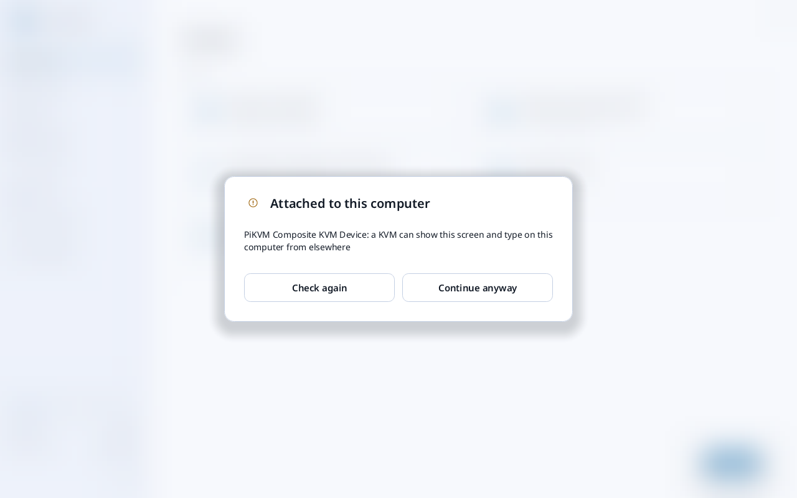
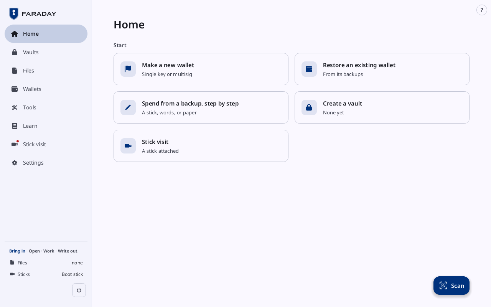
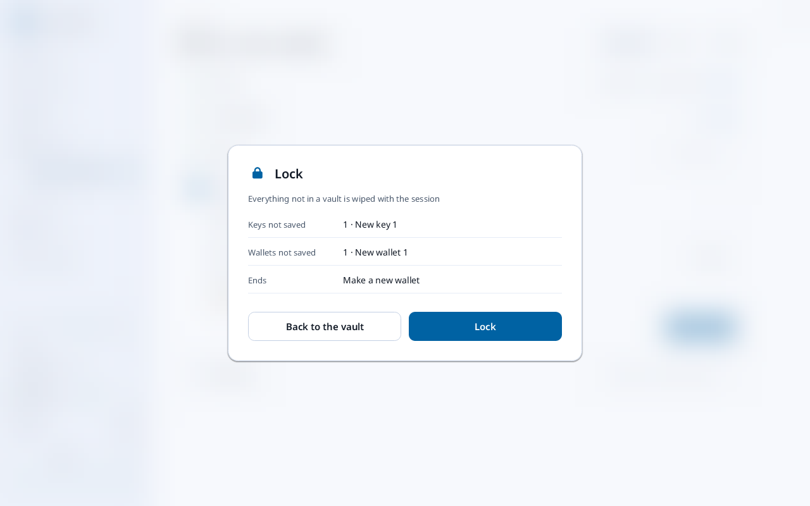
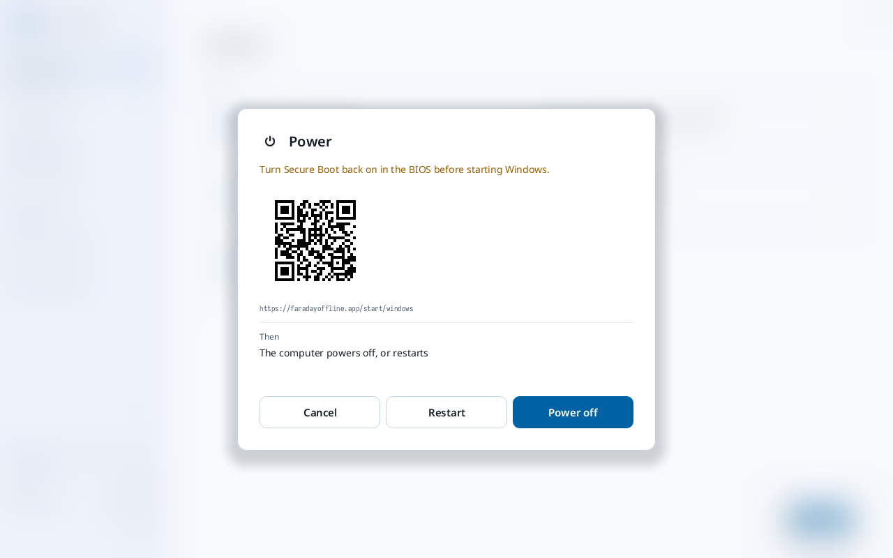

# First start, Home and the session

**Kind:** Spec
**Status:** Text moved from `docs/GUIDE.md` (§2.1 to §2.4), written and checked against the app's screens and strings; the pictures are in `docs/guide/` and keep their names
**Open:** the walkthrough's form (result line, what is needed, time, "With your own key"); the pictures, drawn once after the theming has landed

### 2.1 Home

The stick starts Faraday into memory. Before Home it checks itself and
what is attached to the PC:

| Screen | Meaning | Press |
|---|---|---|
| **Self-test failed**, with the **Check** that failed, over the whole window | Faraday's own cryptography did not reproduce a published test vector | **Exit**. Do not use this stick: write a new one (section 1) and report the check's name. |
|  **Attached to this computer**, naming a KVM ("a KVM can show this screen and type on this computer from elsewhere") or a TV ("a TV can record what it shows") | that device can record the screen or type | unplug it and press **Check again**. **Continue anyway** asks once more, naming the case (**Only for a screen or switch that is your own, in front of you. What is listed stays possible while it is attached.**), with **Hold to continue**. |
| the same sheet naming a virtual machine ("a virtual machine's host sees and can change everything in it") | Faraday is not running on the PC itself | **Power off**: Faraday must start on a real computer |

A keyboard or mouse plugged in after Faraday starts does nothing until
it types the code Faraday shows, or clicks the target it draws.

A new stick holds no files, so nothing is offered to import.

Under **Start** the tiles are in a grid, two to a row in a window this
size:

| Tile | Opens |
|---|---|
| **Make a new wallet** | a wallet from new keys, single key or multisig (section 5) |
| **Restore an existing wallet** | a wallet from its backups (section 7) |
| **Spend from a backup, step by step** | spending from a stick, words or paper (section 6) |
| **Create a vault** | an encrypted file for keys and secrets, kept on a stick (section 4) |
| **Stick visit** | the files on the stick, while a stick is attached and no key is loaded |

**Scan**, the button at the bottom right, opens the camera for a QR
code.

### 2.2 The sidebar

The rows are **Home**, **Vaults**, **Files**, **Wallets**, **Tools**,
**Learn**, **Stick visit** (while a stick is attached) and **Settings**;
the page on show is on a pill. A flow under way, such as **Make a new
wallet**, is a row under its page with the card open beside it: pressing
it goes back to the flow. A number on **Files** counts the files
waiting in its Inbox; a dot on **Stick visit** means the stick attached
has not been visited yet.

In a narrower window the same pages are a rail of icons at the left,
with **Learn** and **Settings** under a line and **Lock** and the power
button at its foot; Home then opens with a strip of what is under way,
the keys, the wallets, Files and the sticks. A tall narrow window has a
bar at the foot instead (**Home**, **Wallets**, **Files**, **Vaults**,
**Tools**), and **Settings** and **Power off** in the **⋮** menu at the
top right.

At the sidebar's foot:

| On screen | Meaning |
|---|---|
| **Bring in · Open · Work · Write out** | the stage of the session; the current one is in blue. **Bring in** while nothing is attached, loaded or waiting (on a new stick, with the boot stick still in); **Open** only while Files holds files. Pressing it opens Files. |
| **Files** | files brought in, or **none** |
| **Sticks** | **Boot stick** while the stick Faraday started from is in; **none** once it is pulled |
| **Keys** | the keys loaded, each by its fingerprint (once a key is loaded) |
| **Lock** | wipes the session from memory (once a key is loaded) |
| the power button | the power sheet |

The **?** at the top right opens Learn's page for the screen on show.

### 2.3 Lock and Power off

Faraday keeps everything in memory. What is not in a vault on a stick,
or on paper, is gone after a lock or a power-off.

| | Lock | Power off |
|---|---|---|
| Where | **Lock** at the foot of the sidebar, once a key is loaded; **Settings → Session** | the power button at the foot of the sidebar; **Power off** in **Settings → Session**; Super + S held 2 seconds |
| What it does | wipes the session (every key and wallet loaded), seals open vaults, and starts again on Home | turns the PC off |
| What stays | the stick's files, and the Inbox and Outbox | the stick's files only |

**Lock** asks first only while a lock would end something under way
(a wallet being made, a vault with changes). The sheet reads like the
power sheet:

| Section | Lists |
|---|---|
| **Kept** | the files for the stick (**0 files for the stick** here) |
| **Wiped from memory** | the flow that ends (**Make a new wallet · ends**), and each key and wallet kept nowhere else (**New key 1 · nowhere else**) |
| **Then** | **Faraday restarts on Unlock** |

With a vault open, each key or wallet in no vault has a **Save** beside
it, which saves it into the open vault. **Lock** wipes them; **Back to
the vault** closes the sheet. With
nothing under way, Lock wipes at once, without a sheet: a key made in
section 3 and not yet backed up is lost.

A stick plugged in while a key is loaded opens **A stick is attached**:
**Lock and use stick** locks and opens the stick's files; **Not now**
keeps working, and a banner says to remove the stick.

**Settings → Session** also sets **Lock after** (30 min at first) and
**Power off after** (60 min at first). From **Make a new wallet** until
its backup is done there is no idle lock, and the sidebar reads
**Auto-lock off until backup complete**.

Power off: press the power button at the foot of the sidebar.

On a PC started with Secure Boot off, the sheet leads with **Turn Secure
Boot back on in the BIOS before starting Windows.** and the QR code of
the steps. With keys loaded it also lists what is kept and what is
wiped from memory. Press **Power off**, **Restart**, or **Cancel**.

While files wait for the stick, or a vault has changes not saved, the
buttons read **Hold to power off** and **Hold to restart**: hold one
until it fills. A short press does nothing.

On Faraday Demo the same button opens the sheet with **Quit** (**Hold
to quit**) in place of Power off.

### 2.4 Settings → Appearance

The colours of every screen are chosen on **Settings → Appearance**
(the Starter has the same three rows on **Appearance** in its **⋮**
menu). A first start is in Cobalt, Light, Standard.

| Row | Choices |
|---|---|
| **Theme** | ten chips, each with a swatch of its colours: **Cobalt** (marked **Default**), **Bitcoin Orange**, **Lamplight**, **Mars**, **Forest**, **Frost**, **Dusk**, **Lavender**, **Rose**, **Monochrome**. The chosen one is selected |
| **Mode** | **Light** or **Dark** |
| **Contrast** | **Standard**, **Medium** or **High**. Medium and High make text and edges stronger on every theme |
| **Reduce motion** | a switch; on, nothing slides or fades and every change is there at once |

Pressing a chip, a mode or a contrast changes the colours of the whole
window at once; with **Reduce motion** off, the old colours fade into the
new over a third of a second. Any theme can be Light or Dark at any
contrast. The choice is kept across a lock, and on a stick until power-off.

Picture to be drawn: Settings → Appearance with Theme, Mode and Contrast.
