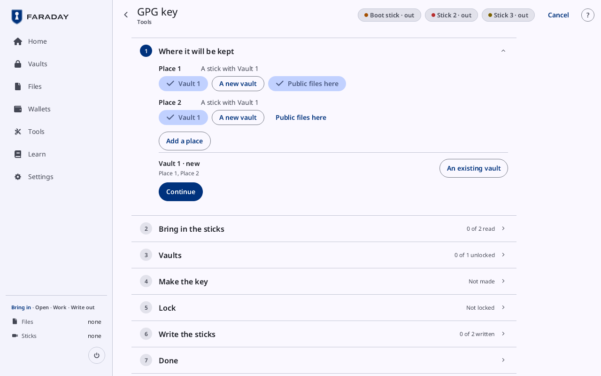
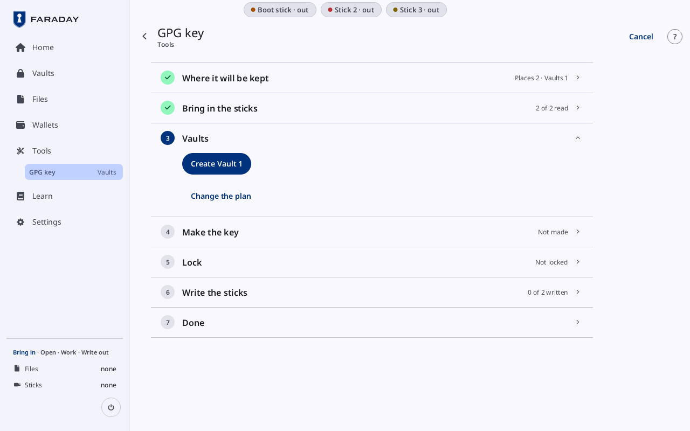
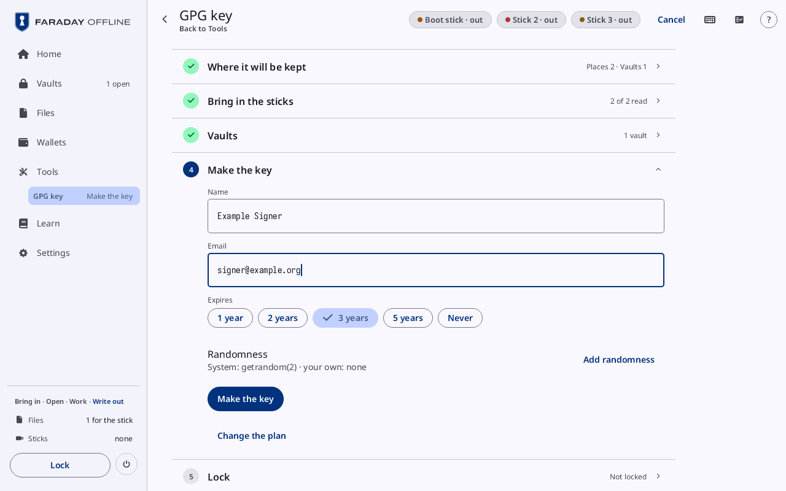
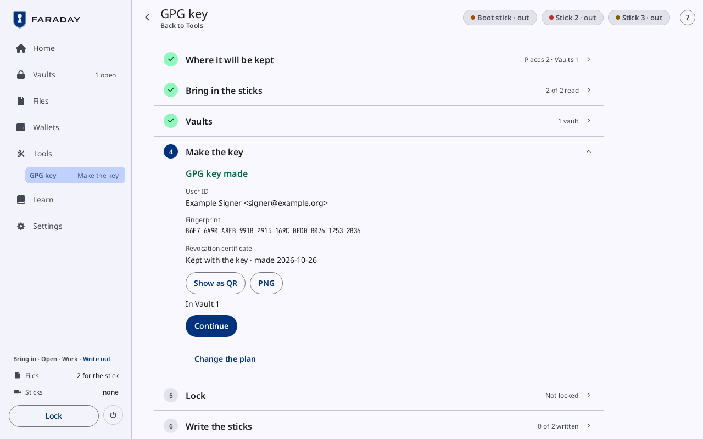
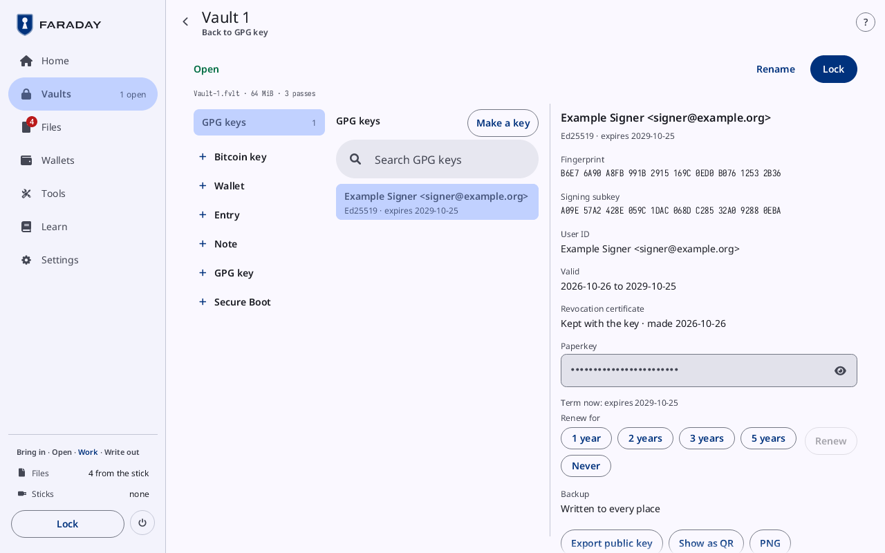
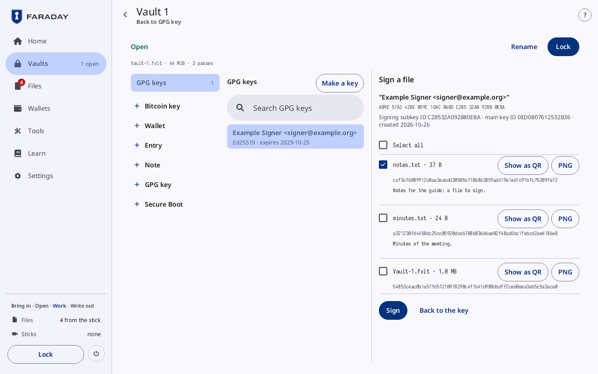
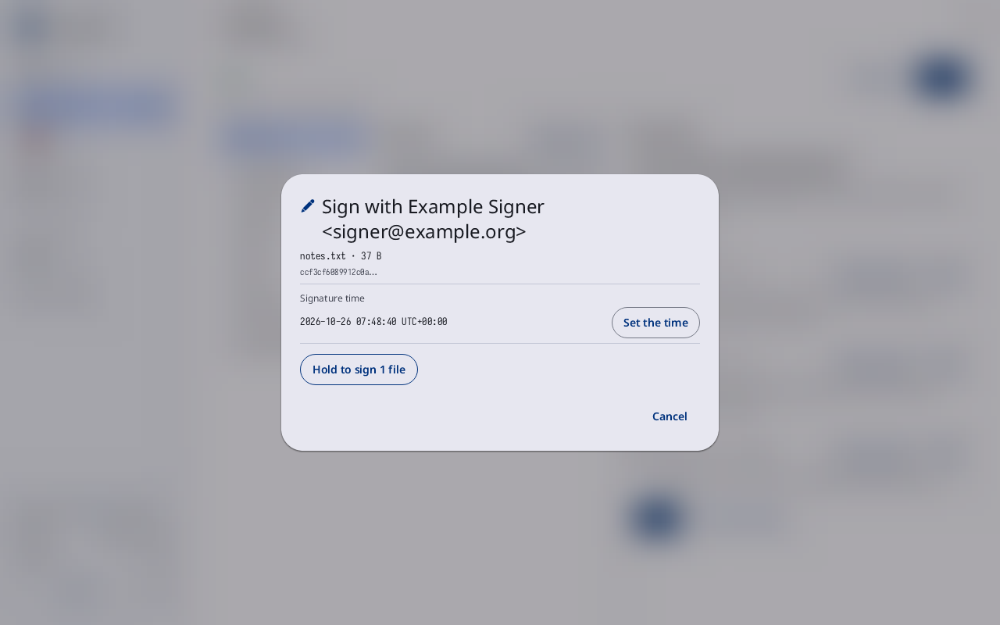

# A GPG key

**Kind:** Reference
**Status:** Written, checked against the app's screens and strings, and pictured from `just guide-pictures` (`docs/guide/pictures/`)

**You end with:** a GPG key, `Example Signer <signer@example.org>`,
made in a vault kept on two sticks at two places; its public key on a
computer; a file signed with it and the signature checked there; and
the key's revocation and paperkey where they can be used.

**Before you start:** [Vaults, passwords and codes](vaults-and-passwords.md)
(creating and unlocking a vault) and
[Files, sticks and QR codes](files-and-sticks.md) (a stick visit).

**You'll need:**

- Faraday started from the stick, with no stick attached but the
  Faraday stick.
- Two USB sticks other than the Faraday stick, formatted FAT32, one for
  each place the key is kept at.
- A phone or watch showing the time to the minute: a GPG key carries
  the time it was made, and a signature the time it was made.
- A text file to sign, `notes.txt` in this walkthrough, on a stick.
- A computer with GnuPG (Gpg4win on Windows), to check the signature.

**Time:** about 40 minutes.

The name, email, file names and passphrases on this page are examples
only: use your own. A GPG key cannot be made again from seed words, so
Faraday makes it inside the backup: the key is planned at two places
or more, written to each, and signs nothing until every place is
written. In Faraday Demo, Practice makes no GPG key: **Make the key**
does nothing there ([Faraday Demo](starter-tour.md)).

## 1. Start

Press **Tools**, then **GPG key** (**Make, sign, revoke, paperkey**).
With no vault open, the backup flow opens at once. With a vault open,
**Vault contents** opens on **GPG keys** instead: press **Make a key**
there ([Vault contents](../screens/vault.md)). An empty vault offers
**Make a GPG key** too.

The flow is a column of cards, each closed to one line once it is
done: **Where it will be kept**, **Bring in the sticks**, **Vaults**,
**Make the key**, **Lock**, **Write the sticks** and **Done**. **Change
the plan** is under each card after the first.

## 2. Where it will be kept



[Where it will be kept](../screens/backup-flow.md#where-it-will-be-kept) starts with one new vault, Vault 1, on a stick at **Place 1**
and another at **Place 2**: two copies of the same vault. Each place's
row reads "A stick with Vault 1", with buttons under it; the one chosen
is ticked:

| Button | Does |
|---|---|
| **Vault 1** (filled) | the vault this place's stick holds |
| **A new vault** | gives the place a vault of its own, Vault 2 |
| **Public files here** | the place whose stick also carries the public key; ticked on Place 1 at first |
| **Remove** | removes the place; shown only with more than two |

**Add a place** adds Place 3. Under the places, a row per vault:
**Vault 1 · new** and its places (Place 1, Place 2), with **An existing vault** to use a
vault already on a stick instead (its button then reads **A new
vault**).

A GPG key needs two places or more: with fewer, **At least 2 places**
shows and **Continue** is grey. Keep the plan as it is and press
**Continue**.

## 3. Bring in the sticks

With a key loaded or a vault open, the card shows only **Lock and
bring in the sticks**: it locks, then the flow goes on.

Each stick is read ([Bring in the sticks](../screens/backup-flow.md#bring-in-the-sticks)) before the key exists, so that the vault on it is
known and nothing secret is open while a stick is in.

On the Faraday stick, the flow names each of its sticks by a pill at
the top of the screen: **Boot stick**, then **Stick 2** for Place 1's
and **Stick 3** for Place 2's, each "out" or "in". The cards ask for a
stick by that name ("Insert Stick 2: Vault 1 (Place 1)"); Faraday Demo
asks for "the stick for Vault 1 (Place 1)".

1. Insert Stick 2, for Vault 1 (Place 1). Plug in the first stick.
   It is read ("Reading" and its name); an empty stick is taken for the
   new vault. Press **This is the stick for Vault 1 (Place 1)**. "Mark
   it as Stick 2" shows under its row: write that on the stick. Then
   pull it (**Pull the stick**).
2. Insert Stick 3, for Vault 1 (Place 2). Plug in the second stick. If
   it reads as the first one did (same label and size), "This reads as
   Stick 2" shows and the button is a hold: **Hold: this is the stick
   for Vault 1 (Place 2)**. Mark it as Stick 3 and pull it.

**Use another stick** under each refuses this stick and asks again.
A stick that cannot hold the vault says why: **Not a FAT32 stick.
Format it as FAT32, or use another stick**, **This is a boot partition.
Use another stick**, **Cannot be written. Use another stick**, or "Not
enough room". A stick that holds vaults already asks **Which vault is
Vault 1?**, with **A new vault beside them**.

## 4. The vault



The **Vaults** card offers **Create Vault 1**. It opens
[Create a vault](../screens/create-vault.md) with **Name** set to
`Vault 1`. Choose its passphrase as
[Vaults, passwords and codes](vaults-and-passwords.md#1-create-a-vault)
does, then press **Create vault**. The flow comes back with **Vault 1 ·
Unlocked**; the Vaults card closes to "1 vault". The vault's file is
`Vault-1.fvlt`.

An existing vault reads **Open Vault 1** instead: type its passphrase
and press **Unlock Vault 1**. **I do not have its passphrase** offers
**A new vault beside it** or **Use another stick**.

## 5. Make the key



| Field | Example |
|---|---|
| **Name** | `Example Signer` |
| **Email** | `signer@example.org` |
| **Expires** | **1 year**, **2 years**, **3 years** (chosen at first), **5 years** or **Never** |

The name and the email make the key's user ID,
`Example Signer <signer@example.org>`. Everyone who gets the public key
reads it, and it cannot be changed later. A key needs one or the other:
with both empty, **A key needs a name or an email**.

Press **Make the key**. The first time after power-on, **Set the time**
opens first: type the next minute and press **Set** when the phone's
minute changes to it
([Vaults, passwords and codes](vaults-and-passwords.md#6-the-codes-and-the-time)).
Then press **Make the key** again.



The card reads **GPG key made**, in the ok tone, with:

| Row | What it is |
|---|---|
| **User ID** | `Example Signer <signer@example.org>` |
| **Fingerprint** | the key's fingerprint, forty characters in groups of four |
| **Revocation certificate** | "Kept with the key · made" and the date |
| **Show as QR**, PNG | the public key as a [QR code](../screens/qr-and-scan.md#a-qr-code), or as a picture in Files |
| **In Vault 1** | the vault the key is in |

A toast says the certificate waits for the stick and the revocation
certificate is kept with the key. The public key, `example-signer-`
and the fingerprint's last eight characters, `.asc` (here
`example-signer-DBACCC57.asc`), waits in Files for the stick of the place marked **Public files here**. Press
**Continue**.

## 6. Lock, and write the sticks

The **Lock** card lists what the lock keeps (**Kept**) and what it
wipes (**Wiped from memory**). Press **Lock and write**: Vault 1 is
sealed with the key in it, and every key is wiped.


[**Write the sticks**](../screens/backup-flow.md#write-the-sticks) lists the sticks, "Stick 2 · Vault 1
(Place 1)" and "Stick 3 · Vault 1 (Place 2)", each with its label once
written, and asks for each in turn, with the file it writes
(`Vault-1.fvlt` and its size) under it:

1. "Insert Stick 2: Vault 1 (Place 1)". Plug it in. The vault and the
   public key are written, read back and compared ("Writing" and the
   file's name); then **Written and checked on** the stick's name. Pull
   it.
2. "Insert Stick 3: Vault 1 (Place 2)". The first stick put back is
   refused (**This stick has the first copy**). Plug in the second:
   **Hold: this is a second stick**, held until it fills, writes it.
   Pull it.

A stick pulled before its copy is checked counts nothing (**Pulled
before the copy was checked. Nothing counted**): plug it in again.

## 7. Done, and the key's page



**Done** reads **Written**, with a line per stick: its pill, its
place, its label and the time ("Stick 2 · Vault 1 (Place 1) · KEYSTICK
·" and the time), and under it the files written to it. Press **Unlock
Vault 1**, type the passphrase and press **Unlock**: the vault opens,
titled **Vault 1** with `Vault-1.fvlt` and its cost under **Open**, on
**GPG keys**, and the key's page shows beside the list
([A GPG key](../screens/vault.md#a-gpg-key)).

| Row | What it is |
|---|---|
| the title | `Example Signer <signer@example.org>`, then "Ed25519 · expires" and the date |
| **Fingerprint**, **Signing subkey**, **User ID** | the key's facts |
| **Valid** | the day it was made "to" the day it expires, or "From" the day "· does not expire" |
| **Revocation certificate** | "Kept with the key · made" and the date |
| **Paperkey** | the secret key as text, behind its eye (step 11) |
| "Term now: expires" and the date | the term as it stands; **Renew for** under it (step 10) |
| **Backup** | **Written to every place** |

Until every place is written, **Backup** reads how many are
("Written to 1 of 2 places", in the warning tone) with **Continue the
backup**, and **Back up first** stands in place of **Sign a file** and
**Renew**. A key in a vault unlocked from its stick signs at once.

## 8. The public key out

On the key's page:

| Press | Gives |
|---|---|
| **Export public key** | `example-signer-….asc` in Files, for the stick; "File exists:" and its name when it is there already |
| **Show as QR** | the public key as a QR code |
| PNG | the same code as a picture in Files, for the stick |

The public key checks signatures and signs nothing. Write it to a
stick on the next stick visit
([Files, sticks and QR codes](files-and-sticks.md#3-write-files-to-a-stick)).
On the computer, import it and compare its fingerprint with the one
on Faraday's screen:

```
gpg --import example-signer-XXXXXXXX.asc
gpg --fingerprint signer@example.org
```

## 9. Sign a file

Bring `notes.txt` in on a stick visit
([Files, sticks and QR codes](files-and-sticks.md#2-a-stick-visit-bring-files-in));
with a vault open, the visit locks first. Then unlock Vault 1 again
(**Vaults**, **Unlock**) and open the key under **GPG keys**. Press
**Sign a file**.



The detail turns to **Sign a file**: the user ID, the signing subkey,
and "Signing subkey ID … · main key ID … · created …". Under them a row
per file from the stick: its name, its size, its SHA-256 and, for a
short text file, its text, with **Show as QR** and PNG. Press
`notes.txt` to tick it. **Select all** ticks every file; "No file from
the stick" shows while Files holds none. **Back to the key** returns to
the key's page.

Compare the SHA-256 with the one the other computer prints for the same
file (`sha256sum notes.txt`) before signing: a signature cannot be
taken back. Press **Sign**.



**Sign with** and the user ID opens ([Sign with](../screens/vault.md#sign-with)):

| Row | What it is |
|---|---|
| each file | its name, its size and the start of its SHA-256 |
| **Signature time** | the time the signature will carry, with its zone; **Not known**, in the warning tone, while the clock is not set |
| **Set the time** | opens Set the time |
| **Hold to sign 1 file** | held until it fills: signs. Grey while the time is not known |
| **Cancel** | closes the sheet |

Hold **Hold to sign 1 file**. The signature, `notes.txt.asc`, goes into
Files for the stick ("1 signature waits for the stick"), and the file's
row reads **Signed**, with **Show as QR** and PNG for the signature.
Faraday signs nothing with a key that has expired or was revoked, and
says so in GnuPG's words ("Unusable secret key: it expired on …").

Write the signature to a stick and check it on the computer:

```
gpg --verify notes.txt.asc notes.txt
```

## 10. Renew

Under "Term now: expires" and the date, **Renew for** offers **1
year**, **2 years**, **3 years**, **5 years** and **Never**. Choose one,
then press **Renew**, grey until one is chosen. The new term counts
from today. The renewed public key goes into Files for the stick
("Renewed ·" and its name). Others see the new term only once they
import it again. A clock earlier than the key's last signature is
refused: **Time conflict: the clock is before the key's last
signature**.

## 11. The revocation and the paperkey

The revocation certificate was made with the key and is kept
in the vault with it. Whoever has it can revoke the key for everyone
who imports it.

| Press | Does |
|---|---|
| **Export the kept revocation** | opens [This is a secret](../screens/files.md#this-is-a-secret) for `example-signer-` and the full fingerprint, `.rev` |
| **Make a revocation** | opens **Make a revocation**: **Description (optional)**, **Reason** (**No reason specified**, **Key has been compromised**, **Key is superseded**, **Key is no longer used**), **Make the revocation** and **Cancel**. The new certificate goes out through This is a secret too; the kept one stays as it was |
| **Hold to mark the key revoked** | held until it fills: **Status** reads "Revoked on" and the date, and the key signs and renews nothing ("The key is marked revoked") |

On This is a secret, the revocation goes into an open vault ("Save
into Vault 1"), or out as a plain file only past **Save without
encryption?** and **Hold to save without encryption**. To use it on a
computer, see [GPG keys](../../learn/faraday/gpg.md): the colon before
its first line of dashes is removed, then `gpg --import`.

Press the eye beside **Paperkey**: the key's secret
part shows as text, made only while it shows, and hides at the next
press or when the page is left. With the public key, it rebuilds the
secret key in GnuPG's `paperkey`. Faraday does not read a paperkey back
in.

## 12. Delete

**Hold to delete from vault** removes the key from the vault open
("Deleted from the vault"). The copies on the sticks keep it until each
vault is written again.

> **With your own key**
>
> - Make the key on the Faraday stick, not in Faraday Demo, which runs
>   on a computer with a network.
> - Keep the plan's two places or more, and write every place before
>   you rely on the key; then unlock it once from each stick on a fresh
>   start ([Before you rely on a key](before-you-rely.md)).
> - Keep the revocation certificate as the app does: in a vault, or on
>   a stick kept as a secret. Never publish it.
> - Write the paperkey on paper only if you will keep the paper as you
>   keep your words: anyone who reads it has the key.
> - Before you sign, compare each file's SHA-256 with the one another
>   computer prints for it.
> - Give out the public key, and compare its fingerprint with Faraday's
>   screen on the computer that imports it.
>
> Why: [GPG keys](../../learn/faraday/gpg.md),
> [Vaults](../../learn/faraday/vaults.md),
> [Where keys are kept](../../learn/faraday/keys-kept.md),
> [Time and TOTP codes](../../learn/faraday/time.md),
> [The air gap](../../learn/07-air-gap.md).

Next: [Your own Secure Boot keys](secure-boot-keys.md).
