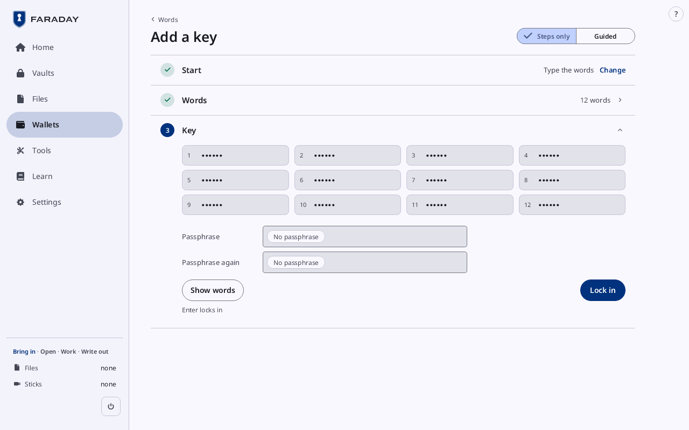

# Make a wallet, single key or multisig

**Kind:** Spec
**Status:** Text moved from `docs/GUIDE.md` (§5.1 to §5.3, §5.5 and the opening of §5), written and checked against the app's screens and strings; the pictures are in `docs/guide/` and keep their names
**Open:** the walkthrough's form (result line, what is needed, time, "With your own key"); the pictures, drawn once after the theming has landed

What you will do: load three keys, make a 2-of-3 multisig wallet from
them, read its wallet card, show it to a watch-only wallet and compare
an address, plan its backup, and add a missing key by scanning its
SeedQR.

What you need:

- Faraday with no key loaded (press **Lock** if one is) and no stick
  attached.
- The paper copy of key `3dca6805` from section 4.
- Two more public test keys: twenty-four times **zebra**
  (fingerprint `5d388376`) and twenty-four times **summer**
  (`cf2e083d`).
- Sparrow, or another watch-only wallet, on an online computer
  (step 5.4).

The places of this section are Place 1, Place 2 and Place 3.

### 5.1 Load the keys

Press **Wallets**, then **Add a key**. The page of section 3 opens;
press **Change** on **Start**, then **Type the words**.

| On screen | Meaning |
|---|---|
| **Start** **Type the words** | the choice made; **Change** opens Start again |
| **Words** **12 · 15 · 18 · 21 · 24** | how many words; typing past the boxes adds more |
| **Other languages** | word lists other than English |
| **Continue** | checks the words and opens **Key** |

Start's other choices load a key the same way: **Scan a SeedQR** reads
one with the camera, **Type codex32 strings** opens the codex32 form,
and **Other forms** lists SLIP-39 shares and Seed XOR parts. A key
scanned from [Home](../screens/home.md)'s **Scan**, or typed for Restore (section 7), opens
**Add a key** with the forms as tabs: **BIP-39 words**, **SLIP-39
shares**, **codex32** and **Seed XOR parts**. On **codex32** each
string typed or scanned is checked at once. This section needs none of
it; for codex32 strings in full, see Learn's page **Backups in other
forms**.

| A string in | Check a string |
|---|---|
|  |  |
| **1 in** and **Share A · id name · 2 needed**. Once 2 strings of the set are in, the key loads. **Make the rest** makes the set's other strings from the ones typed; **Add a share** makes one more string at an unused index. Where an open vault keeps strings of the same set, the line **1 more of this set in open vaults** says so, and they count. | **Check a string**, then **Check it**: **Checksum holds** or **Checksum fails**, with the checksum worksheet's **Final** row beside what it **Must read**, and where it first differs (**Final row differs at box 36**). Nothing is loaded or kept. **Back to adding strings** returns. |

| The worksheet | Make the rest |
|---|---|
|  |  |
| **Show the worksheet** shows every row of the string's checksum worksheet as the booklet draws it, each box of the string numbered in its corner, to compare row by row with the paper; drag it, or use the wheel or the arrow keys, to see the rest. **Final row only** goes back. | **Make the rest**, then the second string: New key opens on **Scheme**, **From A, C**, with **Strings** to choose. **Worksheets**, **Strings** and **Strings made** follow, as in step 4.11. **Add a share** opens the same way on **Index**, offering the next unused one. |

With **Suggest corrections** ticked, a string whose checksum fails
gets a correction to compare with the paper; Learn's page covers it.
A key loaded from corrected strings keeps a line beside its
fingerprint, **Share entry corrected** (**I mistyped**) or **Share
repairs unchecked**:

| New key's Key card | Wallets |
|---|---|
|  |  |
| From **Type codex32 strings**, **Key** lists the strings in (**Share A · id name · 2 needed**). **Lock in** loads the key and opens Wallets. | Under **Keys without a wallet**, and on the key's card: **fab6868a · Share entry corrected**. |

Type key `3dca6805`'s 12 words from the paper, then press **Continue**.

**Key** shows the 12 words hidden (**Show words** shows them), with
**Passphrase** and **Passphrase again** (**No passphrase** unless one
is typed in both). Press **Lock in**.

Faraday returns to Wallets, and the sidebar lists `3dca6805` under
**Keys**. The fingerprint proves the words typed are the test words.
Press **Add a key** again, **Change** on Start and **Type the words**,
press **24**, type **zebra** twenty-four times, **Continue** and **Lock
in**; then the same with **summer**. The sidebar lists three keys:
`3dca6805`, `5d388376`, `cf2e083d`.

### 5.2 Make a new wallet

Press [**Home**](../screens/home.md), then **Make a new wallet**.

| Kind | Quorum |
|---|---|
|  |  |
| Kind opens with **Single key, backup in shares (codex32)** ticked. Press **Multisig · native SegWit** (3 keys, any 2 sign): **Quorum** opens; **Change** on Kind shows it ticked. | **Signatures needed** 2 and **Keys** 3 (**-** and **+** change them). The line under them says what the quorum means: **Any 2 of the 3 keys can spend. Losing 1 key still leaves the money spendable; 2 keys together can take it.** **Account** 0. Press **Continue**. |

On **Use vaults**, press **No**: **Keys** opens.

| Keys | Check |
|---|---|
|  |  |
| Each **Key** row offers the keys loaded. Press `3dca6805` for Key 1, `5d388376` for Key 2, `cf2e083d` for Key 3. **Show xpub QR**, **Xpub PNG for the stick** and **Xpub file for the stick** give a key's public part to another wallet; **New key** makes one here. Press **Make the wallet**. | **Descriptor** reads **2 of 3 · native SegWit multisig · 3dca6805, 5d388376, cf2e083d** and a checksum; **Path** **m/48'/0'/0'/2'**. **The wallet's first addresses**: **Receive 0/0**, **Receive 0/1** and **Change 1/0**. With these test keys, Receive 0/0 begins `bc1q rfhg t7dv` and ends `ecxs 0246 6p`. Press **It matches**. |

Then **Back up** (step 5.5).

### 5.3 The wallet card

Press **Wallets**, then the wallet in the left column.

| On screen | Meaning |
|---|---|
| **New wallet 1**, **2 of 3 · native SegWit multisig** | the name and the kind; **Rename** changes the name |
| **Not backed up** | no backup plan yet (step 5.5) |
| **2 of 2 signatures possible here**, **Can spend** | the quorum is 2, and 2 of the keys that sign are loaded |
| **At a glance** | the wallet, each key (**Can sign here** while loaded), and the backup |
| **First receive address · 0/0** | the address to compare (step 5.4) |
| **Spend from this wallet** | section 6 |
| **Show wallet QR** | the wallet description as a QR code (step 5.4) |
| **Remove from session** | takes the wallet out of memory |

### 5.5 Back it up

Press **Back up** on the card. The board opens with the standard way
for a 2-of-3: one place per key, each keeping one seed's words and the
whole description.

Each place reads **Sees the balance** and **Spends with 1 more place**.
The three lines read **Yes**, **No** and **Yes**: any one place lost,
the other two rebuild the wallet; no place alone can spend; any place
alone sees the balance.

After **Customize backup**, a drop that changes what a place alone can
do asks first:

| Seeing the balance | Spending |
|---|---|
|  |  |
| **Place 3 can see the wallet's balance**: what was dropped there completes the description at that place. | **Anyone with access to Place 1 can spend**: Place 1 now keeps as many seeds as a spend needs. |
| **Keep it** keeps the drop; **Take it off** undoes it. | the same |

The rest is section 4: the checklist, a copy checked per seed, any
vaults, and the sticks, each place in its turn.

> **With your own key**
>
> - Check the first address on Faraday against the watch-only wallet
>   before using either
>   ([Receive, step 5.4](receive.md#54-show-the-wallet-to-a-watch-only-wallet)).
> - Take receive addresses from Faraday or from the watch-only wallet,
>   never from a web page or a message.
> - For a multisig wallet, check each cosigner's fingerprint with that
>   person directly, not through the coordinator.
>
> Why: [Verifying](../../learn/06-verifying.md),
> [Multisig](../../learn/09-multisig.md),
> [Coordinator files](../../learn/19-coordinators.md).
