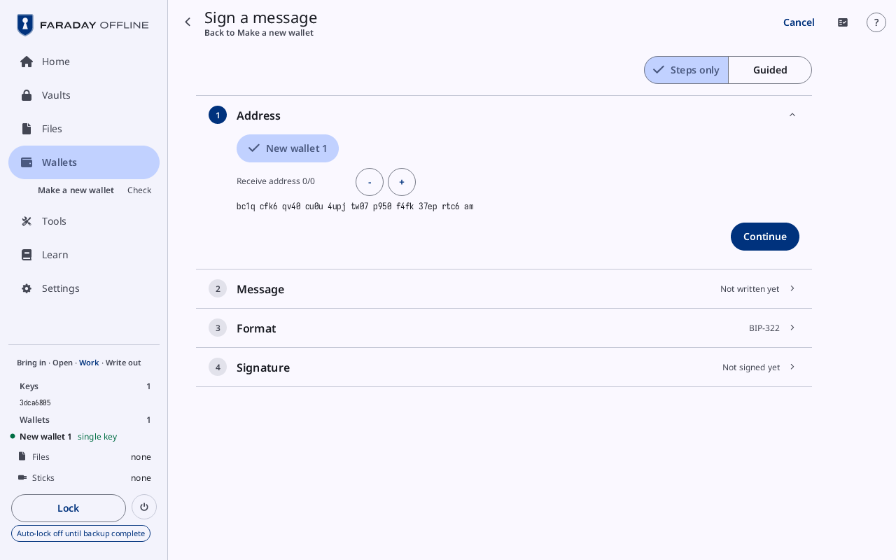
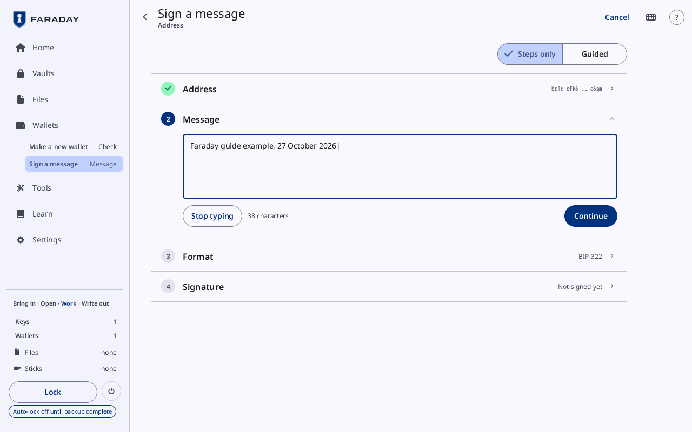
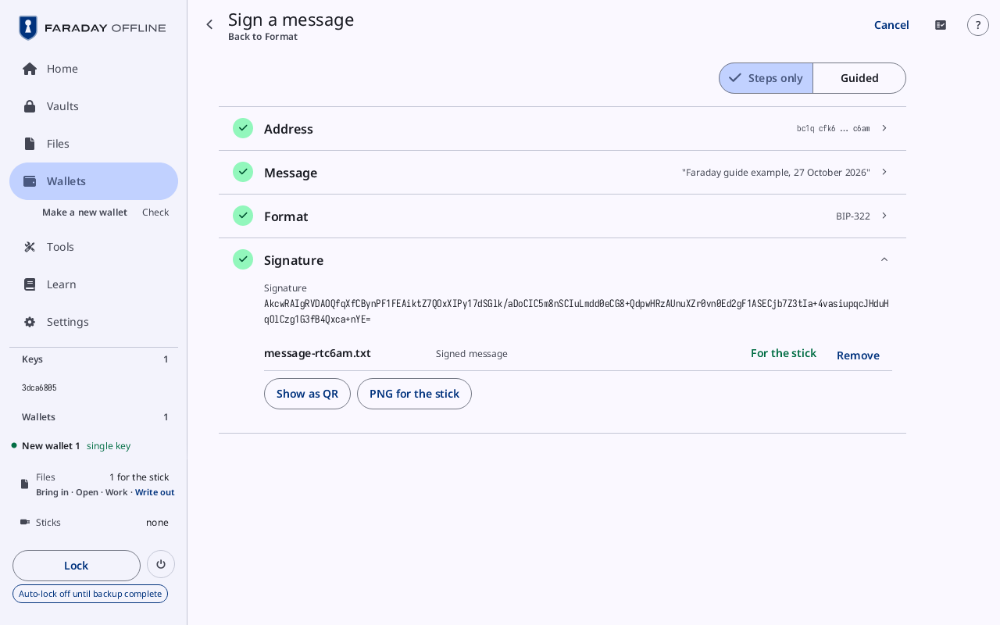
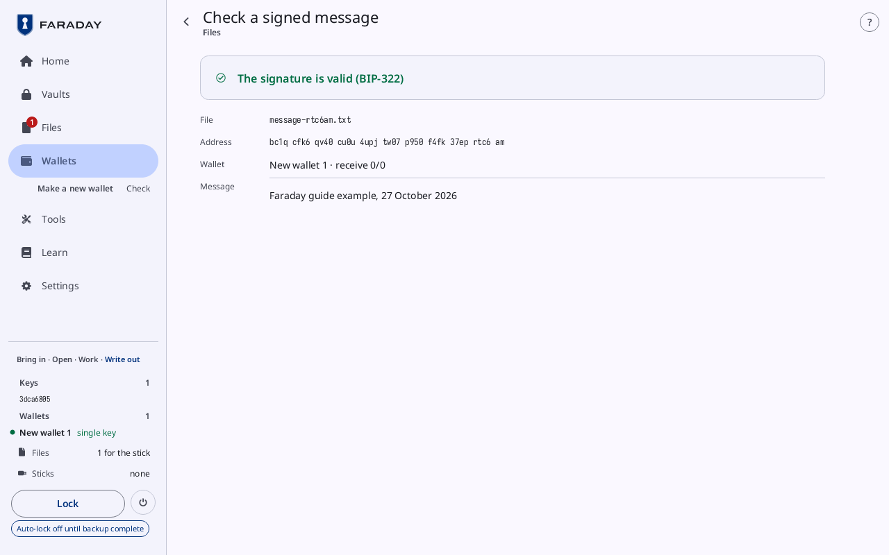

# Sign and check a message

**Kind:** Reference
**Status:** Written, checked against the app's screens and strings, and pictured from `just guide-pictures` (`docs/guide/pictures/`)

**You end with:** a message signed with key `3dca6805` at receive
address 0/0 of a single-key wallet, as a file for the stick and as a
QR code; and a signed message checked on Faraday, with the wallet whose
address it is named.

**Before you start:** [Make a key](new-key.md) and
[Make a wallet](make-a-wallet.md) (making a wallet from a loaded key);
[Files, sticks and QR codes](files-and-sticks.md) (a stick visit).

**You'll need:**

- Faraday with key `3dca6805` loaded, no wallet in the session and no
  stick attached. If a wallet is loaded, press **Lock**, then load the
  key again as [Make a wallet](make-a-wallet.md#51-load-the-keys) does.
- A USB stick other than the Faraday stick, formatted FAT32, to carry
  the signed message.
- The text to sign, exactly as the person who asked for it wrote it.

**Time:** about 15 minutes.

A signed message proves that whoever holds the key behind one address
signed one text. It moves nothing and spends nothing. Faraday signs
with a single-key wallet's key, at one of its receive addresses; a
multisig wallet signs no message. The message on this page is an
example only.

## 1. A single-key wallet

Press **Tools**, then **Single-key wallet** (**Native SegWit, Taproot,
nested or legacy**). **Make a new wallet** opens with **Single key ·
native SegWit** chosen. Make it as
[Make a wallet](make-a-wallet.md#52-make-a-new-wallet) makes the 2-of-3,
with one key: `3dca6805`. The wallet is **New wallet 1**.

The format a message can be signed in follows the wallet's addresses:

| Wallet | Formats |
|---|---|
| **Single key · native SegWit** (`bc1q…`) | BIP-322 and BIP-137 |
| **Single key · Taproot** (`bc1p…`) | BIP-322 |
| nested SegWit (`3…`) and legacy (`1…`) | BIP-137 |

## 2. Start



On the wallet card, press **Sign a message**; or press **Tools**, then
**Sign a message** (**With a single-key wallet's key here**). With no
such wallet, the tile reads **Needs a single-key wallet with its key
here** and does not open: a wallet whose key is not loaded signs
nothing.

[Sign a message](../screens/messages.md#sign-a-message) is a column of four cards, each closed to one line
once it is done: **Address**, **Message**, **Format** and **Signature**.

## 3. Address

The card has a button per single-key wallet whose key is loaded:
**New wallet 1** is chosen. Under it, **Receive address 0/0**, with
**-** and **+** to choose another receive address, and the address
itself.

Choose the address the person asking named. Press **Continue**.

## 4. Message



Press **Type**, then type the text. <kbd>Enter</kbd> starts a new line,
<kbd>Backspace</kbd> takes back a character, and **Stop typing** or
<kbd>Escape</kbd> ends the typing. The count beside it counts every
character, spaces and line breaks included: **38 characters** for the
text below.

Type the text exactly as it was given. One character changed, a space
or a line break, makes another message, and its signature does not
check. For this walkthrough, type:

```
Faraday guide example, 27 October 2026
```

Press **Continue**.

## 5. Format

Two buttons, BIP-322 and BIP-137; a format the address cannot carry is
grey. Press the one the person asking named: the card closes on it and
**Signature** opens. With none named, BIP-322 is the one chosen at
first; BIP-137 is the one older tools read.

## 6. Sign



Press **Sign the message**. The card shows:

| Row | What it is |
|---|---|
| **Signature** | the signature, in base64 |
| `message-` and the address's last six characters, `.txt` | **Signed message**: the file, made as the message is signed. It reads **For the stick**, with **Remove** |
| **Show as QR** | the signed message as a [QR code](../screens/qr-and-scan.md#a-qr-code) |
| **PNG for the stick** | the same code as a picture, for the stick |

A bar names the file ("… waits for the stick"). The file and the code
hold three lines: the address, the signature, and the message from the
third line to the end. Whoever checks it needs nothing typed.

Changing the address, the message or the format after signing drops
the signature: the card reads **Not signed yet**, and **Sign the
message** signs again. A message that cannot be signed says why in red
under the card.

## 7. Hand it over

Plug in the stick: the stick visit writes the file
([Files, sticks and QR codes](files-and-sticks.md#3-write-files-to-a-stick)).
Or press **Show as QR** and let the other side scan it.

The other side checks it with its own tool against the address, for
example Sparrow's *Tools → Sign/Verify Message* with the three lines
pasted in their places. A tool that reads BIP-137 only refuses a BIP-322
signature: sign again in BIP-137 where the address can carry it.

## 8. Check a signed message



A signed message to check comes in as a file: from a stick visit
([Files, sticks and QR codes](files-and-sticks.md#2-a-stick-visit-bring-files-in)),
or from **Scan** with the three-line QR code in front of the camera
(it lands as `scanned-1.txt`). To check the one made above, bring
`message-….txt` back in from the stick.

Files lists it as a **Signed message**, with **Check the signature**.
Press it; or press **Tools**, then **Check a signed message** (**Against
its address**), which opens the first signed message in Files. With
none, the tile reads **Copy a signed message in first**.

**Check a signed message** opens ([Check a signed message](../screens/messages.md#check-a-signed-message)).
Opened with no signed message chosen, it reads **No signed message
chosen**. With one chosen, as in the picture (`message-rtc6am.txt`,
the message signed above), it shows:

| Row | What it is |
|---|---|
| the verdict | "The signature is valid (BIP-322)", in the ok tone; or why it does not ("The signature does not verify for this address and this message"), in red |
| **File** | the file's name |
| **Address** | the address it was signed for |
| **Wallet** | the loaded wallet whose address it is, with its chain and number: "New wallet 1 · receive 0/0"; or **Not an address of a loaded wallet** |
| **Message** | the text that was signed |

A valid signature proves the key behind the address signed this text,
and nothing more: not who is showing it, nor when it was signed. A file
whose address is for another network reads "Not a signed message for a
mainnet address" on Mainnet. In Faraday Demo's Practice, the tile with
no signed message in Files checks a sample, `sample-message.txt`.

> **With your own key**
>
> - Sign only text you have read in full, on Faraday's screen, before
>   pressing **Sign the message**.
> - Sign at the address the person asking named, and compare it on
>   Faraday's screen with theirs.
> - To be proved something, choose the text yourself, with the date in
>   it, and ask for a signature over it. A signed message made before
>   you asked proves nothing about who is showing it.
> - On **Check a signed message**, read the **Address** and the
>   **Message** as well as the verdict: a valid signature over other
>   words, or for another address, proves something else.
>
> Why: [Signing a message](../../learn/14-message.md),
> [Mistakes and scams](../../learn/08-scams.md).

Next: [More from a key](more-from-a-key.md).
