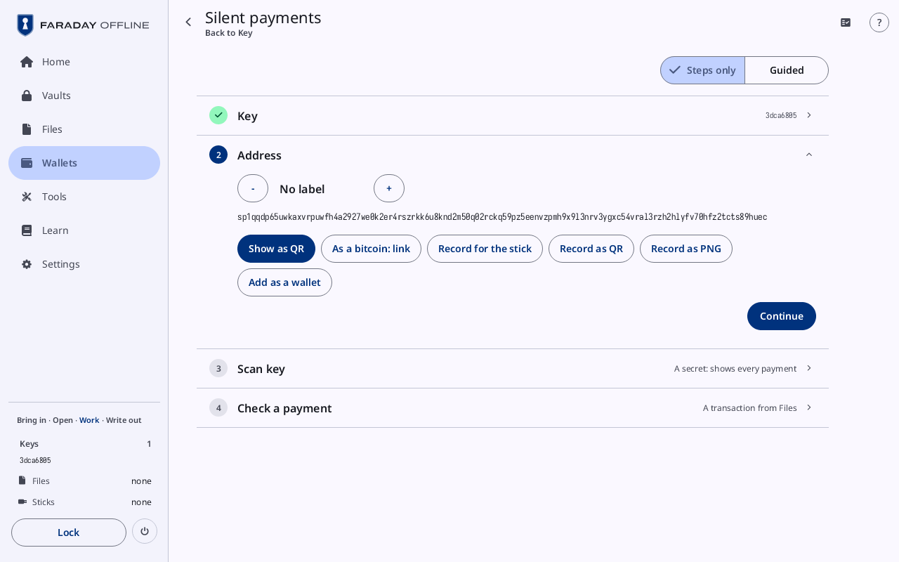
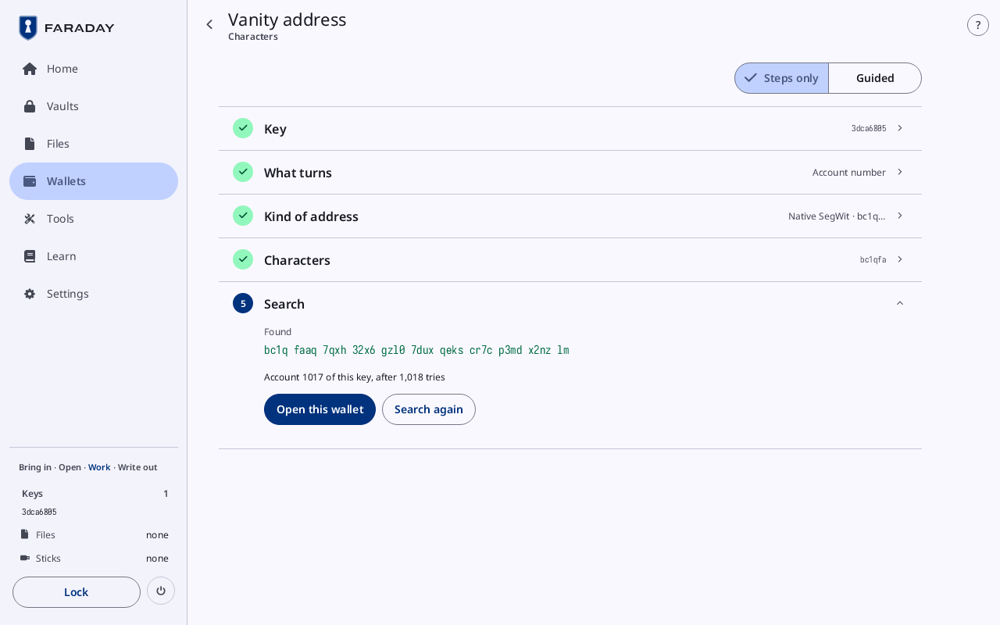
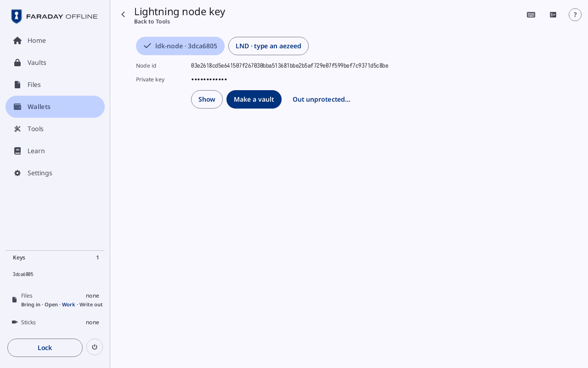
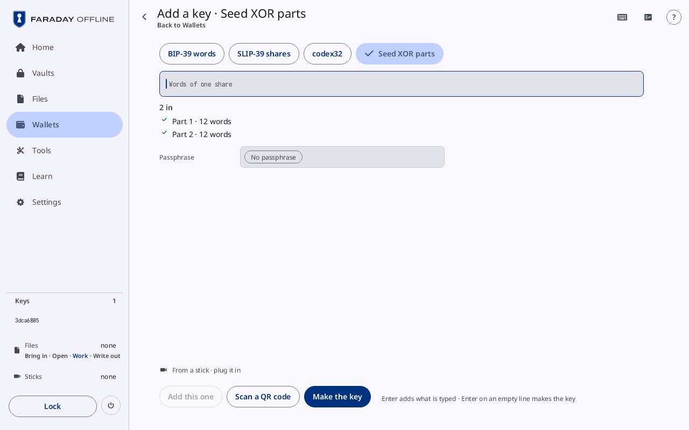
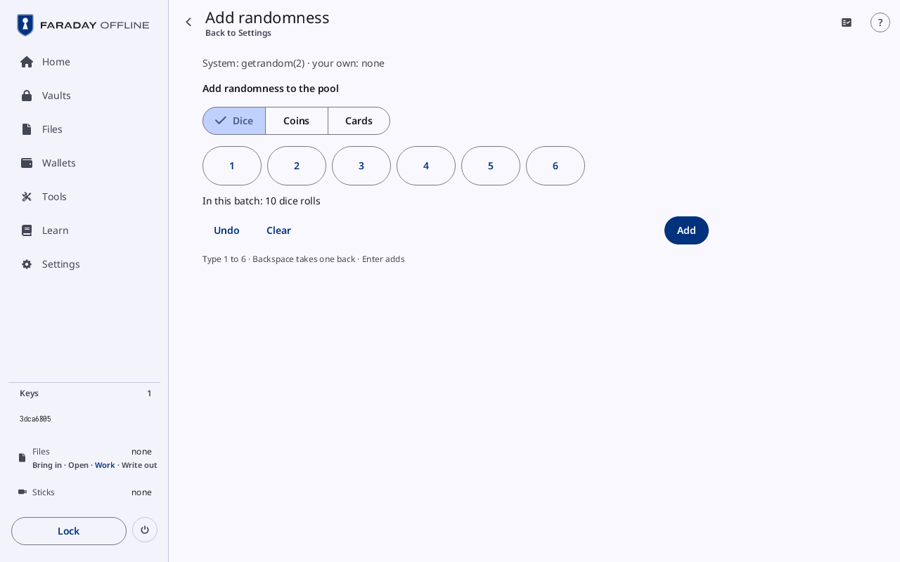

# More from a key

**Kind:** Reference
**Status:** Written, checked against the app's screens and strings, and pictured from `just guide-pictures` (`docs/guide/pictures/`)

**You end with:** key `3dca6805`'s addresses read at any path; a child
seed and a password made from it with BIP-85 and kept in a vault; its
silent payments address, record and wallet; an address that begins
with characters you chose; a Lightning node key; Seed XOR parts put
back together into the key; and randomness of your own added to the
session.

**Before you start:** [Make a key](new-key.md),
[Vaults, passwords and codes](vaults-and-passwords.md) (a vault made
and unlocked) and [Files, sticks and QR codes](files-and-sticks.md)
(a stick visit).

**You'll need:**

- Faraday with key `3dca6805` loaded, as
  [Make a wallet](make-a-wallet.md#51-load-the-keys) loads it: its row
  reads `3dca6805 · New key 1`. A key typed back in is named by its
  fingerprint and reads `3dca6805` alone, as in the pictures. With more
  keys loaded, each tool asks which first.
- Vault 1 of [Vaults, passwords and codes](vaults-and-passwords.md),
  unlocked, to keep what is made.
- For step 8, the paper with key `3dca6805`'s words, or Faraday Demo's
  sample.

**Time:** about 40 minutes.

Each tool here reads a loaded key and changes nothing about it. What it
makes comes back the same from the same key, on any device that follows
the same standard. In Faraday Demo's Practice the secrets these tools
would make are dimmed: BIP-85's values, the vanity passphrase, the
Lightning node's private key and the silent payments scan key. The
public values all work ([Faraday Demo](faraday-demo.md)).

## 1. The tools


Press **Tools** in the sidebar ([Tools](../screens/tools.md)). The
group **Keys and seeds** holds, beside the tiles for adding a key, the
tools of this walkthrough:

| Tile | Its line | Step |
|---|---|---|
| **Explore a key** | **Its xpubs and addresses at any path** | 2 |
| **Child seeds and passwords** | **Derived from a key here** | 3, 4 |
| **Silent payments** | **One address to give out** | 5 |
| **Vanity address** | **A first address that begins your way** | 6 |
| **Lightning node key** | **From a key here, or an LND aezeed** | 7 |
| **Seed XOR** | **Parts combined into a key** | 8 |

With no key loaded the first four read **Load a key first** and do not
open. **Lightning node key** opens without one: it also reads a node's
own seed typed in. Each tool opens on the one key loaded; with more, it
opens on its **Key** card. The way back at the top left, or
<kbd>Escape</kbd>, leaves the tool for where it was opened from.

## 2. Explore a key


Press **Explore a key**, or a key's fingerprint under **Keys** in the
sidebar. **Explore** opens on that key at the path of a native SegWit
wallet's first receive address:

| Row | What it is |
|---|---|
| the keys | a button per loaded key, its fingerprint and name, the one in use ticked |
| **Secret** | the key's words, behind its eye |
| **Path** | the path, typed after `m/`; digits, `/`, `h` and `'`. <kbd>↑</kbd> and <kbd>↓</kbd> step its last number |
| the presets | BIP-84, BIP-86, BIP-49, BIP-44 and BIP-48: each sets the path of that kind of wallet; **Index -1** and **Index +1** step its last number |
| **Script** | **Legacy**, **Nested SegWit**, **Native SegWit**, **Taproot**: the kind of address, for a path whose first number names none |
| **Address** | the address at the path |
| **Private key (WIF)** | that address's private key, behind its eye |
| **Public key** | the public key at the path |
| **Extended key** | the extended public key at the path |
| **Extended private keys** | behind their eye: **Root**, and the account the path is in |

A path that is not one says why in red under the field.

For key `3dca6805` on a stick (Mainnet), the path reads
`m/84h/0h/0h/0/0` and **Address** reads

```
bc1q cfk6 qv40 cu0u 4upj tw07 p950 f4fk 37ep rtc6 am
```

the same address as New wallet 1's receive address 0/0 in
[Sign and check a message](messages.md#1-a-single-key-wallet). Press
**Index +1**: the path ends `0/1` and the address begins `bc1q rpav`.
In Faraday Demo, on testnet, the path is `m/84h/1h/0h/0/0` and the
address `tb1q vj0p 3tmc qu4a dq3k yrn2 yk8a cspg 6vyr eqaq zk`. Compare
an address with what a watch-only wallet shows for the same path.

Each eye is pressed once to show and once to hide. Everything is hidden
when Explore opens, and a secret is dropped once the path or the page
it belongs to changes. **Secret** shows the words in a numbered grid,
as they are written on paper, and the passphrase where the key has one;
a key with no words shows its seed and its codex32 strings instead.

### Addresses and Find an address


On a path inside an account, two buttons follow:

| Button | Page |
|---|---|
| **Addresses** | under **Account**, the account's path and kind, then its addresses ten at a time: **Receive** or **Change**, **From index**, **Previous 10** and **Next 10**. Each row is named ("Receive 0") with its address, and an eye on its private key |
| **Find an address** | **Address**, typed or put in with **Paste**; **Look through** the **First 100**, **First 1,000** or **First 10,000** of each chain; **Search** (**Stop** while it looks). It reads "Searched … of … on each chain" as it goes, then "1 found" with the address's chain and index, or "Not in the first 100 receive and change addresses" |

**Explore**, at the top left of either page, returns to the path.

## 3. A child seed (BIP-85)


Press **Child seeds and passwords**. **Derive with BIP-85** is a column
of four cards: **Key**, **Application**, **Index** and **Value**. With
one key loaded, **Key** is closed on it and **Application** is open.

1. **Application**: press **Words** (the first one). It is at **24
   words**; **-** takes three off at a time, down to **12 words**, and
   "12 to 24" beside it is the range. Keep 24 and press **Continue**.
2. **Index**: **0**. Type another number, or press **-** and **+**
   ("Type the digits · Enter continues"). Each index gives another
   child; a number past the range reads **An index is 0 to
   2147483647**. Press **Continue**.
3. **Value**: **Path** reads `m/83696968'/39'/0'/24'/0'`, and under
   **Words** the value is hidden. **Show** shows the 24 words,
   **Hide** hides them again; leaving the card hides them too.

What to do with it:

| Button | Does |
|---|---|
| "Save into Vault 1" | keeps it in the open vault, as a key named "BIP-85 Words · 3dca6805 · index 0" ("… is in the vault"). With no vault open, **Make a vault**, "Unlock" and a vault's name, or **Unlock a vault** in its place, each coming back here |
| **Load as a key** | loads the child as a key of this session ("Key … added"), for a wallet of its own |
| **Out unprotected…** | opens [This is a secret](../screens/files.md#this-is-a-secret): the file `bip85-3dca6805-words-0.txt`, the path and the words, for the stick |

The picture has no vault open, so **Make a vault** stands in its
place. With Vault 1 unlocked, press "Save into Vault 1". The child is in the vault as a
[key](../screens/vault.md#a-key), with its own fingerprint.

## 4. A password (BIP-85)

Open **Application** again and press **Password (base64)**: **21
characters**, "20 to 86". Set the length the site or program allows,
then **Continue**, choose the index, **Continue** again.

| Application | Length | Kept in the vault as |
|---|---|---|
| **Words** | 12 to 24 words, at first 24 | a key |
| **WIF** | none | a note |
| **Extended private key** | none | a note |
| **Hex** | 16 to 64 bytes, at first 32 | a note |
| **Password (base64)** | 20 to 86 characters, at first 21 | an entry |
| **Password (base85)** | 10 to 80 characters, at first 12 | an entry |

An application with no length moves on to **Index** as it is pressed.

"Save into Vault 1" keeps the password as an
[entry](../screens/vault.md#an-entry) titled "BIP-85 Password (base64)
· 3dca6805 · index 0", with the path in its notes. For the next
password, raise the index: the index, with what it is for, is all that
makes the same password again from the same key.

## 5. Silent payments



Press **Silent payments**. Its cards are **Key**, **Address**, **Scan
key** and **Check a payment**; **Address** is open.

**Address** shows the key's silent payments address, which begins
`sp1q` (`tsp1q` on testnet). **-** and **+** step **No label**, "Label
1", "Label 2": each label is another address of the same wallet, to
tell payers apart.

| Button | Does |
|---|---|
| **Show as QR** | the address as a [QR code](../screens/qr-and-scan.md#a-qr-code) |
| **As a bitcoin: link** | the same, written as a `bitcoin:` link |
| "Record for the stick" | the wallet's public record, `silent-3dca6805.txt`, for the stick: what a watching wallet needs, with the labels handed out |
| **Record as QR**, **Record as PNG** | the record as a code, or as a picture for the stick |
| **Add as a wallet** | adds "Silent payments 3dca6805" to Wallets ("Added to your wallets"), with [its card](../screens/wallets.md#a-silent-payments-wallet) |

Give the address to whoever pays. Press **Continue**.

**Scan key**, closed, reads **A secret: shows every payment**; open,
it carries the tag **Secret · shows every payment, cannot spend**. A wallet that watches for payments needs it. "Save into Vault
1" keeps it as a note, "Silent payments scan key · 3dca6805";
**Out unprotected…** opens [This is a secret](../screens/files.md#this-is-a-secret)
with the file `spscan-3dca6805.txt`.

**Check a payment** tells whether a signed transaction pays this
wallet. Copy the transaction into Files, with the transactions it
spends from ([a stick visit](files-and-sticks.md#2-a-stick-visit-bring-files-in)).
The card has a button per transaction in Files, "Check" and the file's
name; with none, **No transaction in Files**.

| Result | Meaning |
|---|---|
| "Pays this wallet: 1 output", then "Output 0 · … · to the address" | paid, each output with its amount and its label ("to label 1", "to change") |
| **Pays nothing to this wallet** | no output is this wallet's |
| **Spends nothing a silent payment is made from** | the transaction cannot carry a silent payment |
| **Not signed: an input's key is not in it yet** | it is not signed yet |
| "Needs the transaction it spends from, …: copy it into Files and check again" | a transaction it spends from is missing |

## 6. A vanity address



Press **Vanity address**. The search finds an account of the key, or a
passphrase for it, whose first receive address begins with the
characters you choose. Its cards are **Key**, **What turns**, **Kind of
address**, **Characters** and **Search**.

1. **What turns**: **Account number** (fast: the same words and
   passphrase, another account) or **Passphrase** (slow: characters
   added to the key's BIP-39 passphrase, which make another wallet).
   **Passphrase** is offered only for a key loaded from BIP-39 words,
   and is dimmed in Practice. Press **Account number**.
2. **Kind of address**: **Legacy**, **Nested SegWit**, **Native
   SegWit** or **Taproot**, each with the characters every such address
   begins with (`bc1q…` for native SegWit). Press **Native SegWit**.
3. **Characters**: type them after `bc1q`. For this walkthrough, type
   `fa`: "About 1,024 tries". Each character more takes 32 times as
   long in a bech32 address, 58 times in a legacy one. A character no
   such address can hold is refused there ("… cannot stand there in
   this kind of address"). Press **Continue**.
4. **Search**: press "Search for bc1qfa". "Searching for bc1qfa" shows
   the count tried, the rate and the time expected, and **Stop**
   stops. Leave the screen open: the search runs only while it is.

For key `3dca6805` on Mainnet it finds

```
bc1q faaq 7qxh 32x6 gzl0 7dux qeks cr7c p3md x2nz lm
```

and reads "Account 1017 of this key, after 1,018 tries". **Open this
wallet** adds the single-key wallet at that account, "New key 1 ·
bc1qfaaq7q", and opens it in Wallets; **Search again** looks for the
next. In Faraday Demo, on testnet, the addresses begin `tb1q` and the
find is another.

A find on **Passphrase** names the characters added under **Added to
the passphrase:**, hidden until **Show**: they are part of the
passphrase from then on, and the words with any other passphrase open
another wallet.

## 7. A Lightning node key



Press **Lightning node key**. Choose where the node's key comes from:

| Button | Node key |
|---|---|
| "ldk-node · 3dca6805 · New key 1" ("ldk-node · 3dca6805" for a key named by its fingerprint) | made from the loaded key, the way ldk-node makes it from a BIP-39 seed. A key with no words reads **This key has no BIP-39 seed** |
| **LND · type an aezeed** | read from an LND cipher seed: type **The 24 words** ("0 of 24" counts them), its **Passphrase** if it has one (empty, it is **aezeed (LND's default)**), then **Read it** or <kbd>Enter</kbd>. **Made** shows the date the seed was made |

Press the first. **Node id** is the node's public key, safe to share;
compare it with the one the node shows. **Private key** is hidden:
**Show** shows it. "Save into Vault 1" (**Make a vault** with none
open, as in the picture) keeps it as a note ("The node key
is in the vault"); **Out unprotected…** opens
[This is a secret](../screens/files.md#this-is-a-secret) with a file
`lightning-` and the node id's first 16 characters, `.txt`. In
Practice an aezeed other than the sample is refused.

## 8. Seed XOR parts back into a key



Seed XOR splits a key's words into two or three sets of words, the
parts. Every part is needed to make the key again. Each part is itself
a valid set of BIP-39 words, a wallet of its own: keep it with the same
care as the key's words.

To make them, open the key's backup and its copy by hand
([Back it up](back-up.md#47-copy-the-seed-by-hand-and-check-my-copy)):
under **Other paper forms**, press **Seed XOR, 2 parts** or **Seed XOR,
3 parts**. The parts show, "2 parts · every one is needed", each part's
words numbered; copy each onto its own paper, then press **Put them
away**. They are new randomness each time, and dimmed in Practice.

To put them back into the key, press **Tools**, then **Seed XOR**.
[Add a key](../screens/new-key.md) opens with **Type Seed XOR parts**
chosen and its typing card open
([the other forms](../screens/add-a-key.md#the-other-forms)):

1. Type the first part's words and press **Add this one**: "Part 1 · 12
   words", under a count of the parts in ("2 in" once there are two).
   **Scan a QR code** reads a part instead.
2. Do the same for every other part.
3. Under **Passphrase**, type the key's BIP-39 passphrase, if it has
   one.
4. Press **Make the key**. One part alone reads **Seed XOR needs two
   parts or more**.

The key loads with its own fingerprint: `3dca6805` for parts made from
it. In Practice, **Load samples** offers "Seed XOR, 2 parts", and
Faraday Demo's strip's **Use a sample** puts a part in as if typed. SLIP-39 shares
come back the same way, from **Restore from SLIP-39**; codex32 strings
are [codex32 shares](codex32.md).

## 9. Add randomness



What Faraday makes from randomness (a new key from this device, Seed
XOR parts, codex32 shares) takes the system's randomness. Randomness of your own can be mixed in, never in
its place.

Press **Settings**. **Randomness** reads "System: … · your own: none".
Press **Add randomness**.

1. Choose a source: **Camera** (with a camera attached), **Dice**,
   **Coins**, **Cards** or **Pointer and keys**.
2. Enter some: for **Dice**, type each roll ("Type 1 to 6 · Backspace
   takes one back · Enter adds"). "In this batch: 10 dice rolls" counts
   them; at 99 rolls it reads **Enough for 256 bits on its own**.
   **Undo** takes the last back, **Clear** the batch.
3. Press **Add**. The line at the top reads "… · your own: 10 dice
   rolls", and a check mark under the pad reads "Added to the pool
   once: 10 dice rolls"; each batch after that counts up there.

**Pointer and keys** takes the pointer's moves over its box and the
keys typed while it is chosen. What is added is kept for this session
only: **Lock** wipes it. New key's **Generator** card offers the same
sources ([Make a key](new-key.md#36-rolls)).

> **With your own key**
>
> - A child seed, password or key from BIP-85 is as secret as the key
>   it comes from: whoever has the key's words can make every one of
>   them again. Back up the key as the backup of all of them.
> - Write down each child's application, length and index with what it
>   is for. A child seed used as a wallet on another device needs a
>   backup of its own there, or that note kept with the key's backup.
> - Keep a scan key, a node's private key or a child in a vault. Use
>   **Out unprotected…** only for the device that needs it, on a stick
>   kept for that.
> - Open an eye in Explore only with no one watching and no camera
>   seeing the screen.
> - Write down the account a vanity search found, and the characters
>   it added to a passphrase: without them the address is not found
>   again.
> - Keep Seed XOR parts at different places: every part is needed, and
>   one lost loses the key.
>
> Why: [Words](../../learn/02-words.md),
> [Xpubs and privacy](../../learn/11-xpubs.md),
> [Silent payments](../../learn/20-silent-payments.md),
> [Passphrases](../../learn/05-passphrases.md),
> [Backups in other forms](../../learn/18-other-backups.md),
> [Tools](../../learn/16-tools.md),
> [Randomness](../../learn/03-randomness.md).

Next: [Check and decode](check-and-decode.md).
