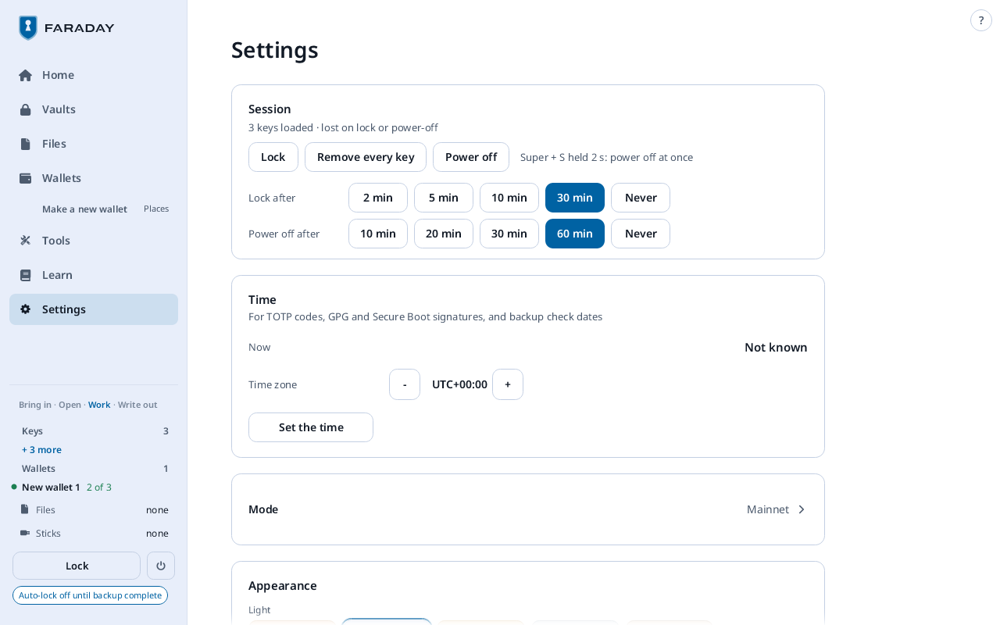
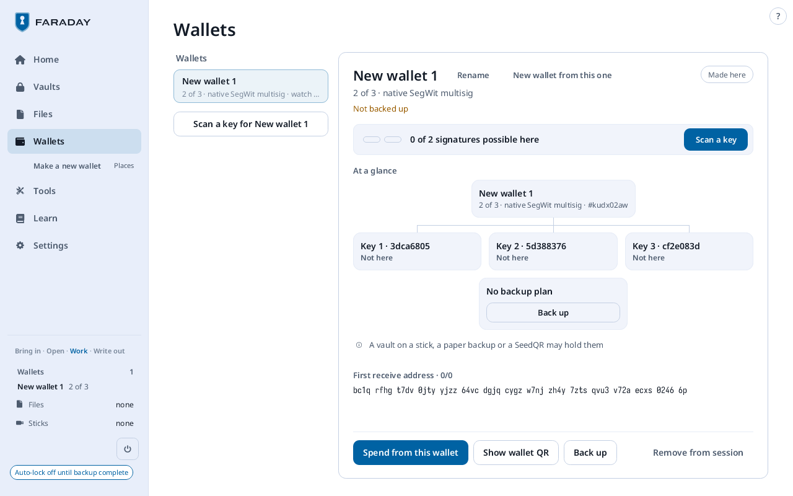
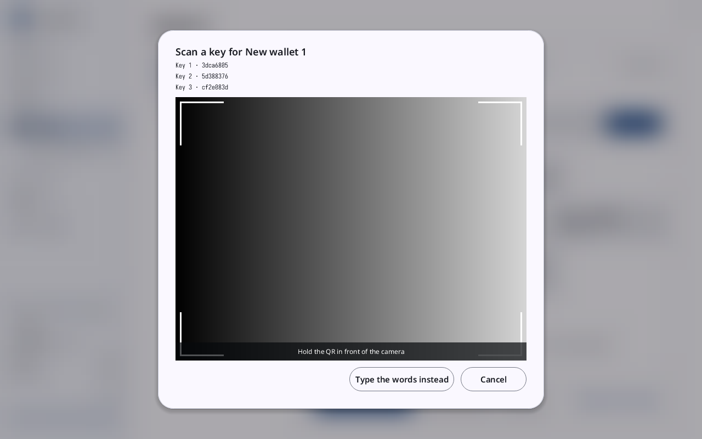
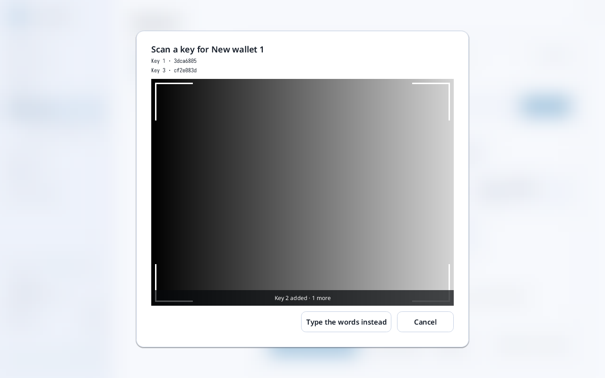
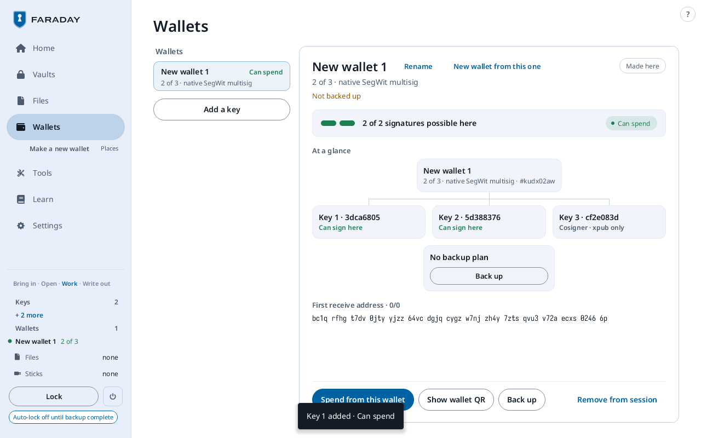

# Multisig with other people and devices

**Kind:** Spec
**Status:** Text moved from `docs/GUIDE.md` (§5.6), written and checked against the app's screens and strings; the pictures are in `docs/guide/` and keep their names
**Open:** the walkthrough's form (result line, what is needed, time, "With your own key"); the pictures, drawn once after the theming has landed

A key does not have to stay loaded: its SeedQR is scanned when it is
needed, as on a SeedSigner. **Settings → Session → Remove every key**
takes every key out of memory and leaves the wallet.

The card reads **0 of 2 signatures possible here**, each key **Not
here**, and **A vault on a stick, a paper backup or a SeedQR may hold
them**. Press **Scan a key** (or **Scan a key for New wallet 1** in the
left column).

The sheet lists the keys still missing. Hold a SeedQR up to the camera.
Faraday works out which key it is; no choice is made first.

| After | Screen | Meaning |
|---|---|---|
| Key 2's SeedQR |  **Key 2 added · 1 more** | the camera stays on for the next key |
| Key 1's SeedQR, from Place 1's paper |  **Key 1 added · Can spend**, in a bar at the foot of the page that goes by itself | enough keys to sign; the camera closes. Key 3 reads **Cosigner · xpub only**. |
| a key loaded already | **Key … · already here** | scan another |
| a seed of no key of this wallet | "… is not one of New wallet 1's keys", on the passphrase sheet | a passphrase that gives one of the missing keys loads it; otherwise **Cancel** |
| anything else | **Not a SeedQR or a CompactSeedQR** | scan the seed's SeedQR |

No SeedQR carries a passphrase: a key with a passphrase is typed with
**Type the words instead**, which also takes keys with no SeedQR, such
as the test keys' twenty-four words.
