# Make a key

**Kind:** Reference
**Status:** Written, checked against the app's screens and strings, and pictured from `just guide-pictures` (`docs/guide/pictures/`)

**You end with:** a key of 12 words, fingerprint `3dca6805`, loaded in
Faraday, written down on paper and checked by the quiz.

**Before you start:** [First start, Home and the session](first-start.md),
or [Faraday Demo](faraday-demo.md) to practise.

**You'll need:**

- Faraday started, with the Faraday stick still in (step 3.2 asks for
  it to be pulled).
- Paper and a pen.
- The guide's 70 rolls below, or a die for a real key.

**Time:** about 30 minutes.

A key is a list of words (a BIP-39 seed). This walkthrough makes one on
the device, writes it down and checks the copy. It loads the key; a
wallet from it is [Make a wallet](make-a-wallet.md), and backing it up
is [Back it up](back-up.md).

The test data: EntropyLab's published BitBox dice transcript for twelve
words (`tools/reference/dice/README.md` names the source). Its first 70
rolls are:

```
1234112341223412334123441234152341263412314123421234132341243412354321
```

They make these words, with fingerprint `3dca6805`:

```
brand hobby ranch shoulder brass hockey ranch short brand hockey random torch
```

Rolls of a real die make other words and another fingerprint.

### 3.1 Wallets → Add a key

Press [**Wallets**](../screens/wallets.md) in the sidebar, then **Add a key** (Keys first,
wallets later). **Tools → Add a key** opens the same page: one tile for
making a key and for typing one.

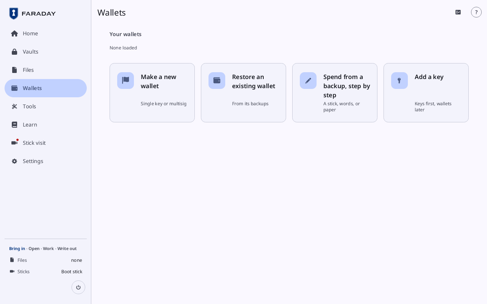

### 3.2 Pull the stick

A key loads only with no stick attached. The sheet
[**Pull the stick to add a key**](../screens/prompts.md#pull-the-stick)
opens while the boot stick is in.

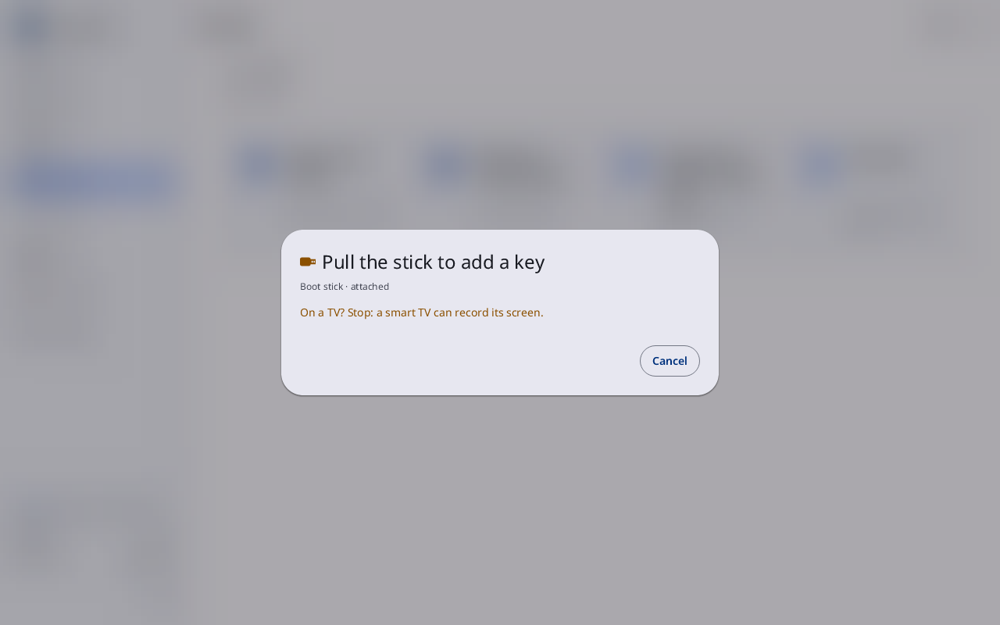

The sheet reads **Boot stick · attached**; **Cancel** goes back. Pull
the stick out. Faraday keeps running from memory, and Add a key opens. A reminder line can show on this sheet, such as **On a TV? Stop:
a smart TV can record its screen.**; act on it before going on.

Faraday Demo shows this sheet only while one of its sticks is
plugged in.

### 3.3 Start

The page is [**Add a key**](../screens/new-key.md), one card per step. A finished card shows its
choice and **Change**. It opens on **Start**, open with no choice ticked:

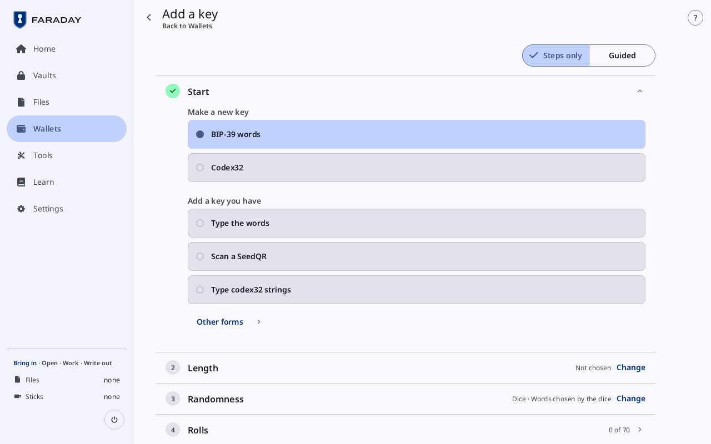

| Group | Choices |
|---|---|
| **Make a new key** | **BIP-39 words** (this guide); **Codex32**, a key made by hand as codex32 shares |
| **Add a key you have** | **Type the words**, **Scan a SeedQR**, **Type codex32 strings** |
| **Other forms** (a link that opens the group) | SLIP-39 shares, made here or typed; Seed XOR parts, typed |

A choice moves on to the next card by itself, and **Change** on Start
opens it again with the choice ticked; **BIP-39 words**, pressed again,
goes back to Length. For this guide press **BIP-39 words**.

**Codex32** makes the key by hand as codex32 shares: a scheme, an
identifier, your own dice or characters, the worksheets filled in as on
paper, then each string to write down and type back. Step 4.11 makes a
wallet that way; Learn's page **Backups in other forms** walks through
every card. **Type codex32 strings** opens the codex32 form of step 5.1.

**Steps only** and **Guided**, a pair of buttons at the top right,
switch a short walk-through on each card off and on; the one on is
ticked.

The link at the top left is named after the card before the one open
(**Start**, with Length open): it opens that card again, with its choice
kept. On Start it goes back to **Wallets**. <kbd>Escape</kbd> does the same.
Once the key is locked in (step 3.7) the link no longer opens a card
before **Key**.

### 3.4 Length

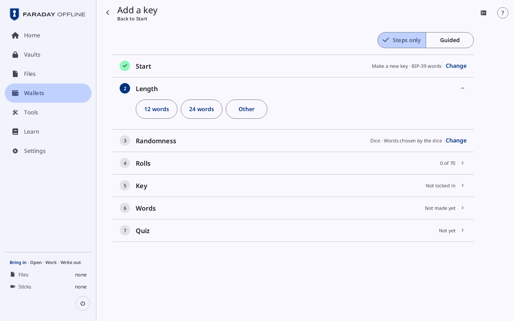

No length is chosen yet. Press **12
words**: the card closes and **Randomness** opens. (24 words takes more
rolls; the steps are the same. [**Other**](../screens/new-key.md#other) opens a menu of 15, 18 and 21
words.)

### 3.5 Randomness

Choose where the randomness comes from. A choice moves on to its entry
card by itself; **Change** on Randomness opens it again with the choice
kept.

| Dice (this guide) | This device |
|---|---|
| 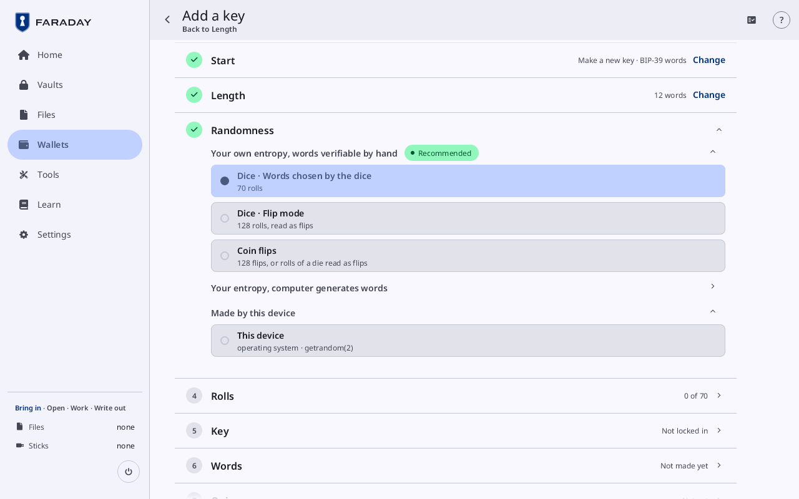 | 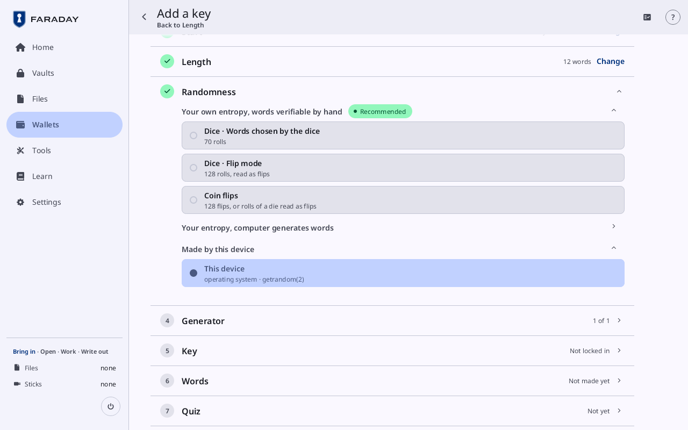 |
| **Dice · Words chosen by the dice** (70 rolls) is chosen, under **Your own entropy, words verifiable by hand** (marked **Recommended**). Each word can be worked out from the rolls by hand. | Under **Made by this device**, press **This device**. The words come from the operating system's generator and cannot be checked. |
| Press **Dice · Words chosen by the dice**: **Rolls** opens. Go to step 3.6. | **Generator** opens. Go to step 3.6, right-hand column. |

The other options (**Dice · Flip mode**, **Coin flips**, and under
**Your entropy, computer generates words** hashed dice as Coldcard and
SeedSigner do it, hex, cards, camera, a mix) follow the same steps with
their own entry card. A mix ticks its sources under its row and keeps
**Continue**.

### 3.6 Rolls

| Dice | This device |
|---|---|
| 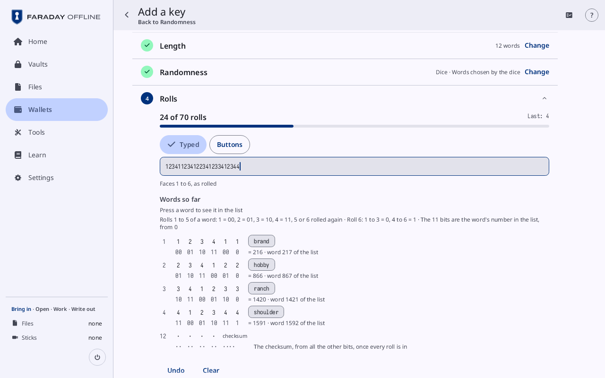 | 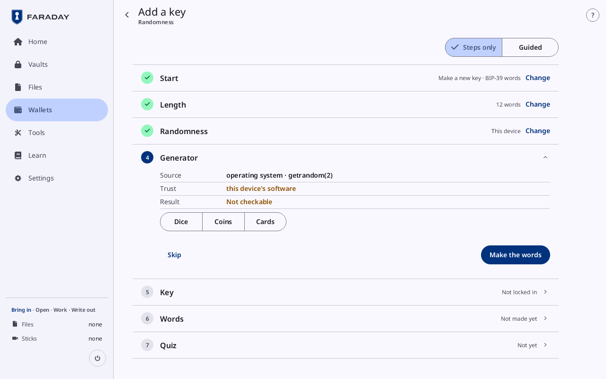 |
| **Typed** is chosen: type the rolls into the box. **Buttons** shows a button for each face instead. Under **Words so far**, each word appears as its six rolls come in, with the bits each roll gives and the word's number in the list; pressing a word shows it in the list. | The **Generator** card shows **Source**, **Trust** (this device's software) and **Result** (Not checkable). Press **Make the words**, then go to step 3.7. Until the operating system's randomness is in, the button reads **Waiting for randomness**. |

The Generator card also takes randomness of yours, mixed into the
operating system's, never in its place. Nothing is chosen at first:
press **Camera** (with a camera attached), **Dice**, **Coins**,
**Cards** or **Pointer and keys** (with a pointer and keyboard), enter
some, then **Add** (**Undo**
takes the last one back, **Clear** the batch). **Pointer and keys**
takes the pointer's moves over its box and the keys typed while it is
chosen, with no **Add**: they are added in batches: every 64 moves and keys, when the
pointer leaves the box, when a key it does not take is pressed, when another
source is chosen, and when **Make the words** is pressed (which then
waits once more for the operating system's randomness). Once some is
added, the card reads **Randomness
added to the pool**, and **Source** ends **· with your own**. To go on
without adding any, press **Skip**. Settings' **Randomness** row opens
the same choices on a page of their own ([Add randomness](../screens/settings.md#add-randomness)).

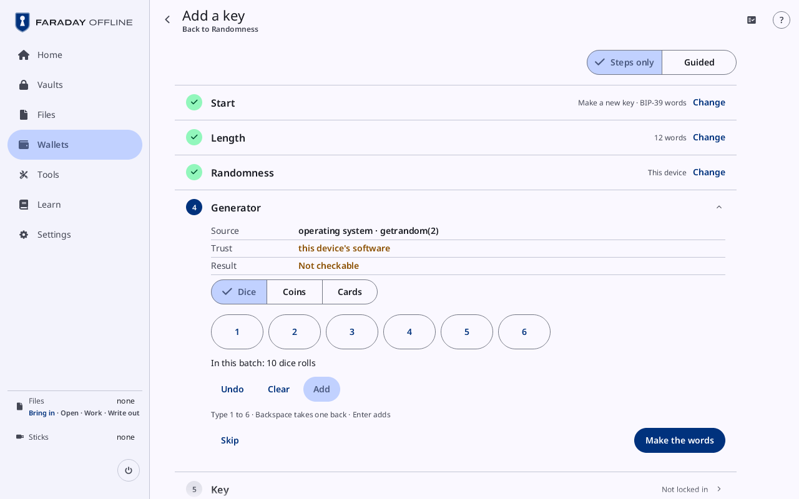

For this guide, type the 70 rolls above. The 70th roll ends the entry;
the word list shows **torch** as word 12 (its checksum filled in).

In a word's first five rolls only 1 to 4 count. A 5 or a 6 there is not
taken, and the card says so, **A 5 or a 6 is rolled again in a word's
first five rolls**:

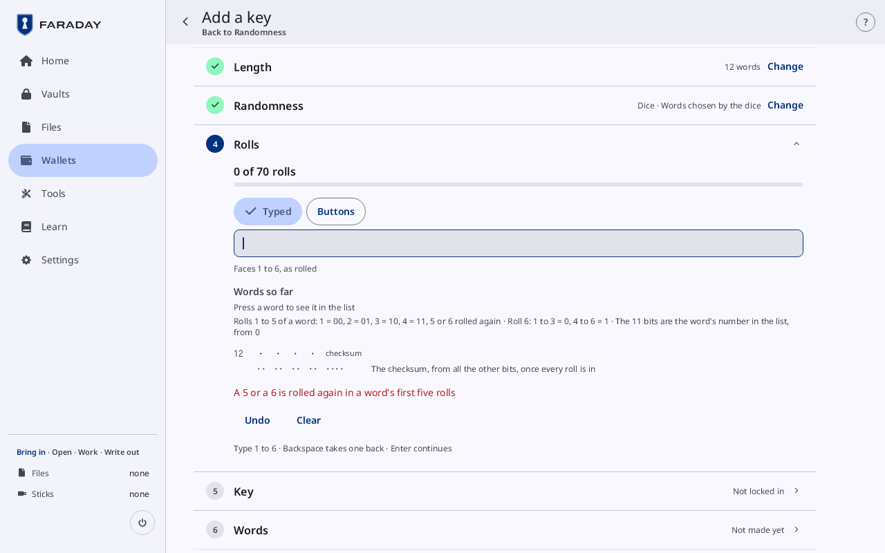

Roll again and type the new roll.

On Faraday Demo a die beside the box, **Rolled by this computer**,
rolls in place of a real die: **Roll**, with **Rolls per click** (1, 5,
10 or To the end). Each face it rolls is marked as this computer's, and
the closed Rolls card reads **Entropy · simulated dice** (or **Entropy ·
simulated dice and your dice**) in place of **Complete**. Use it only to
try the steps out.

With the last roll in, the card ends with **Randomness check**: the
number of **Rolls**, how often each face came up (**Faces**), the
**Longest run**, and a verdict.

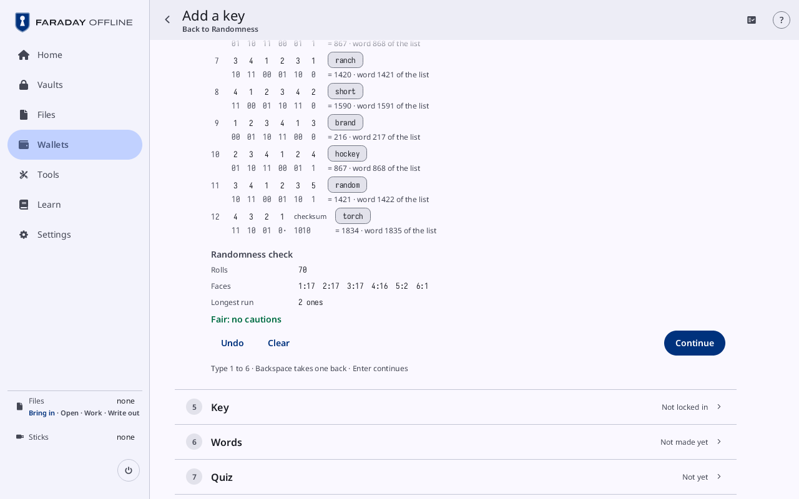

| Verdict | Meaning | Press |
|---|---|---|
| **Fair: no cautions** | the counts and runs look like a fair die | **Continue** |
| **A long run of one result**, with **Roll again** | the same face many times in a row | if you rolled them, **Continue**; if not sure, **Roll again** |
| **Far from even: one result came up much more than the others** | one face is far more common: a worn die, or a typing habit | the same |
| **A long run counting up or down** | rolls such as 1 2 3 4 5 6, counted out rather than rolled | the same |

A caution does not stop the key. The check catches mistakes hands
make; it cannot prove the rolls were random.

**Undo** takes the last roll back; **Clear** removes every roll.

### 3.7 Key: lock it in

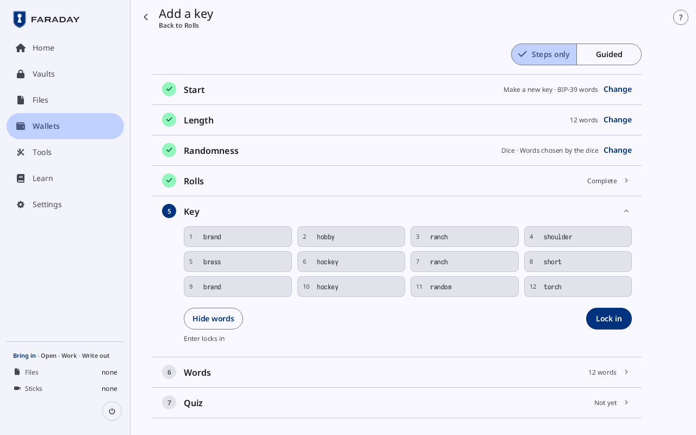

The 12 words are shown (**Hide words** hides them). Check them against
the words above. Press **Lock in**.


The Key card closes on `3dca6805 · locked in` and **Words** opens, with
**Fingerprint** `3dca6805`, **Source** and the key's account key
(**Key**); the words are hidden. The key is now loaded: the sidebar
lists it under **Keys** as `3dca6805 New key 1`, and **Lock** appears
at its foot.

A fingerprint of `3dca6805` proves that the words on screen are the
test words and the key loaded is the one they make. It does not prove
that the paper copy is right: the quiz (step 3.9) checks that.

In Faraday Demo's Practice the guide's rolls make the words of a
sample, **Guide key · 3dca6805**: the strip at the window's foot reads
**These words are sample Guide key · 3dca6805**, and Lock in keeps
them, so the fingerprint is `3dca6805` there too. Words from other
rolls are replaced at Lock in by a public sample, which the card
names.

### 3.8 Words: write them down

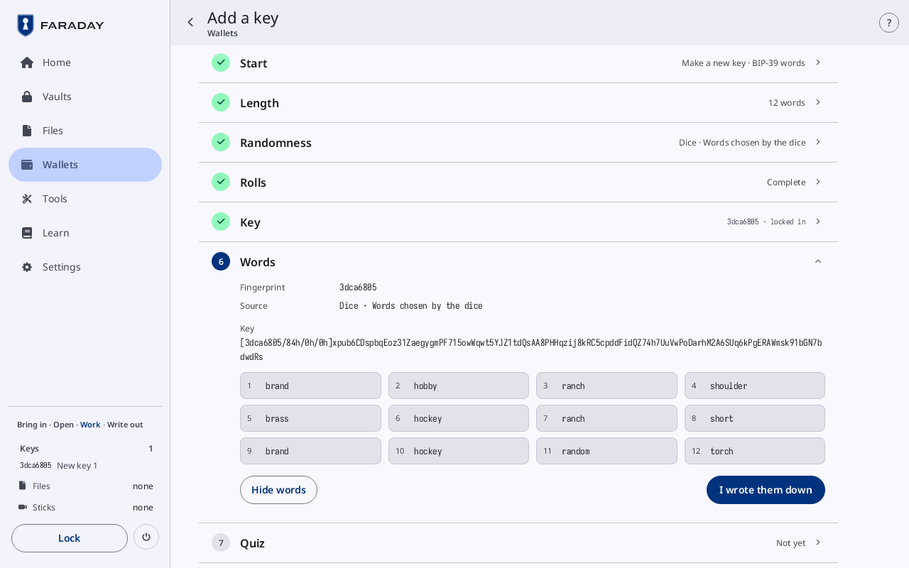

Press **Show words**. Write the 12 words on paper, numbered, in order.
Check the copy word by word, then press **Hide words** and **I wrote
them down**.

### 3.9 Quiz

The quiz asks for words by number, four choices each, until all 12
are right.

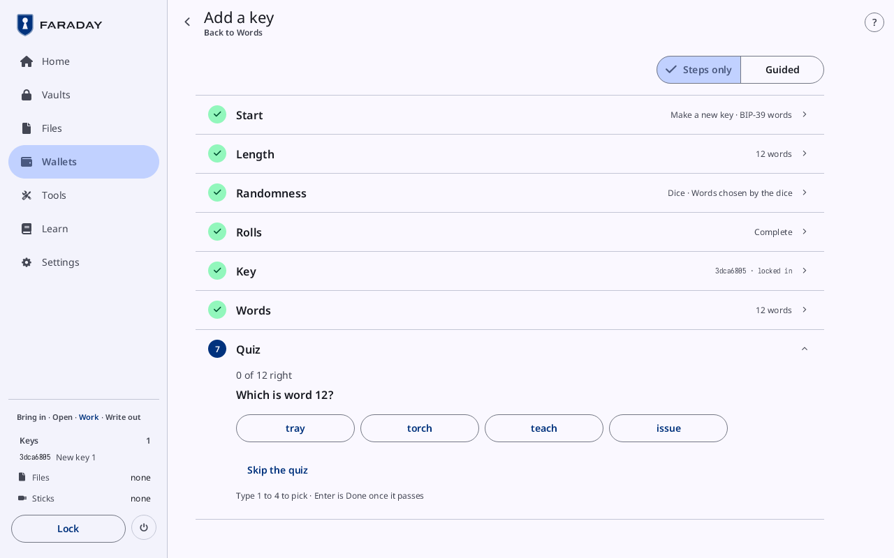

Answer from the paper copy, not from memory.

| Answer | Screen | Press |
|---|---|---|
| right | the next question; **0 of 12 right** counts up | the next answer |
| wrong | 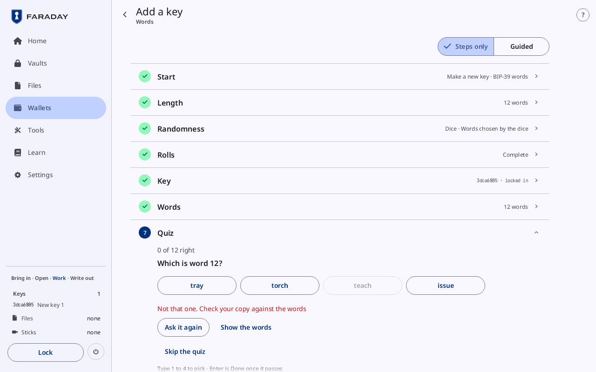 **Not that one. Check your copy against the words**; the wrong choice is greyed out | **Show the words** to correct the copy, then **Ask it again** |
| all right | 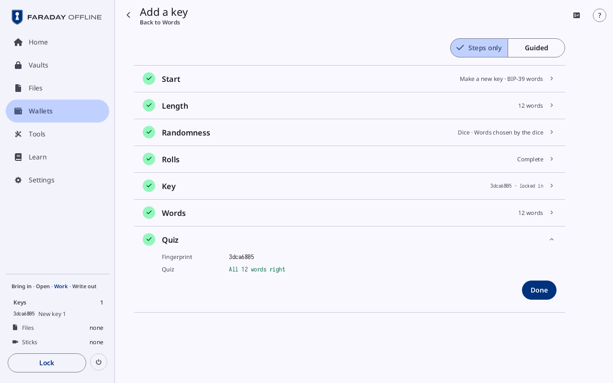 **All 12 words right**, under the **Fingerprint** | **Done** |

**Skip the quiz** asks once more ("Without the quiz, a word copied
wrongly is found only when the backup is needed"); skipped, the card
reads **Skipped: the copy is not checked**. Do not skip it for a real
key.

### 3.10 After Done

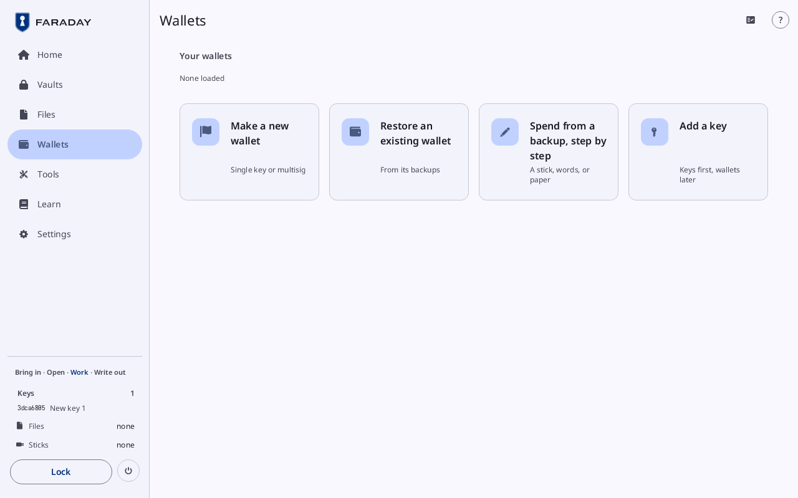

Faraday returns to [Wallets](../screens/wallets.md#wallets-the-list-and-the-card). The key is loaded and shows in the sidebar
under **Keys**. It is in memory only: Lock or Power off wipes it, and
the paper copy is then the only one.

Next: [Back it up](back-up.md) makes a wallet from the key and backs it
up.

> **With your own key**
>
> - Roll your own fair dice, and enter every roll as it lands. Never
>   use the guide's published rolls.
> - Your fingerprint will not match `3dca6805`. Write yours down.
> - Write the words on paper or metal, never on a computer, a phone or
>   in a photo, and check each word against the screen.
> - Make the key with no one watching and no camera able to see the
>   screen.
>
> Why: [Randomness](../../learn/03-randomness.md),
> [Seed words](../../learn/02-words.md),
> [Screens and devices that can record](../../learn/faraday/boot/screens-that-record.md).
