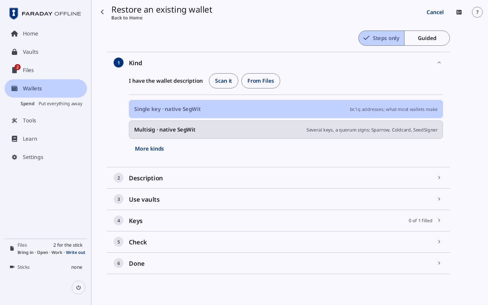
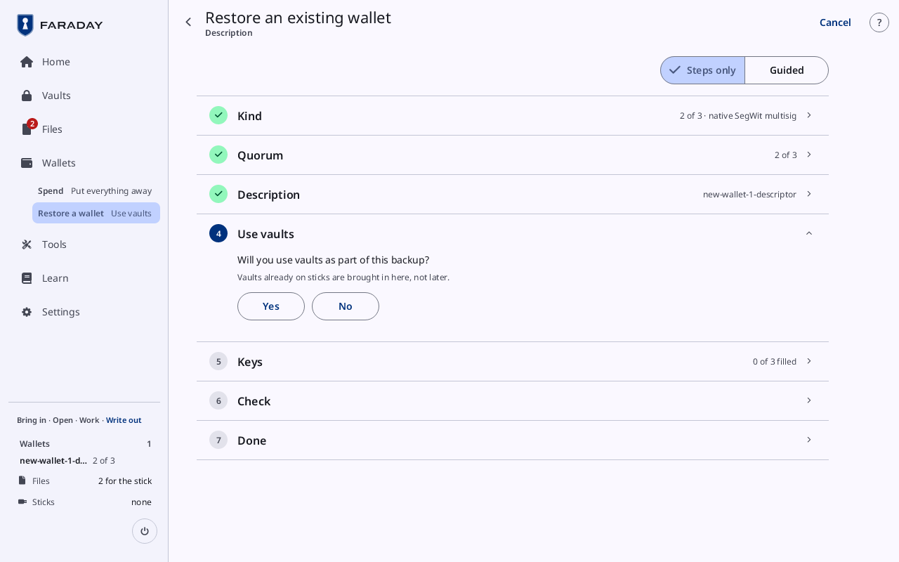
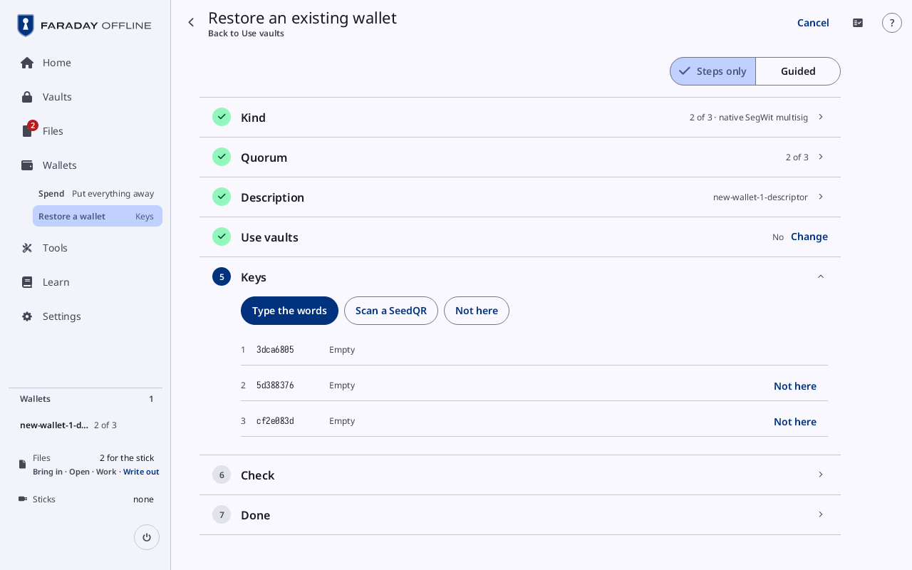
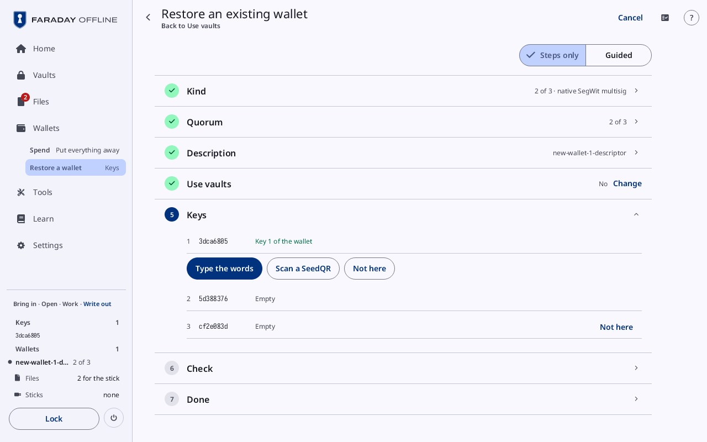
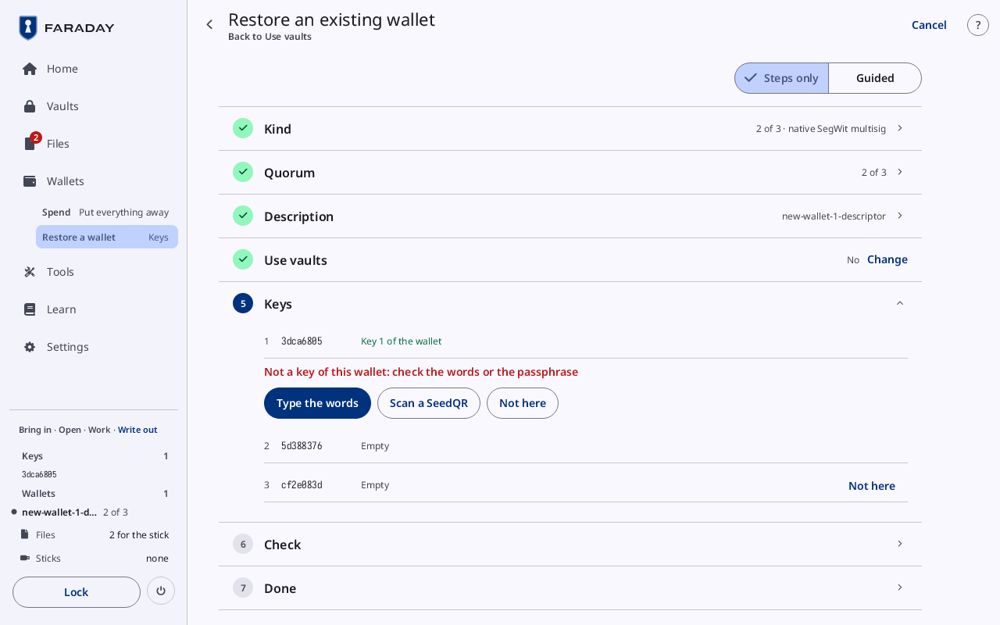
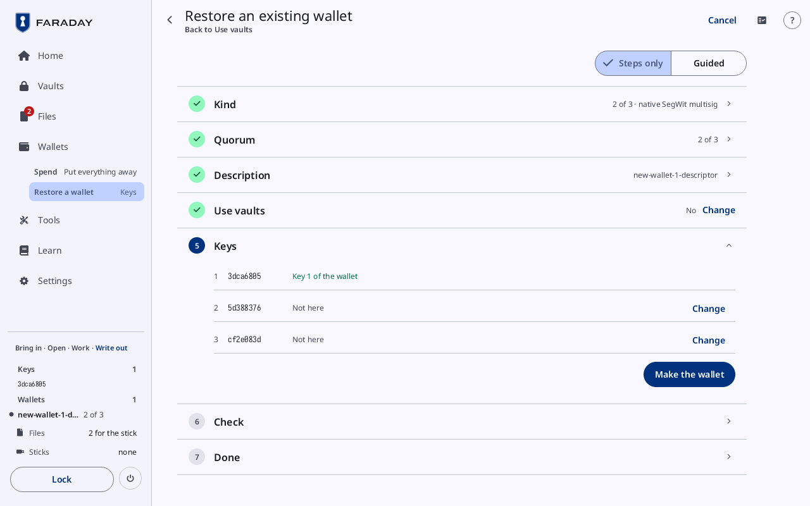
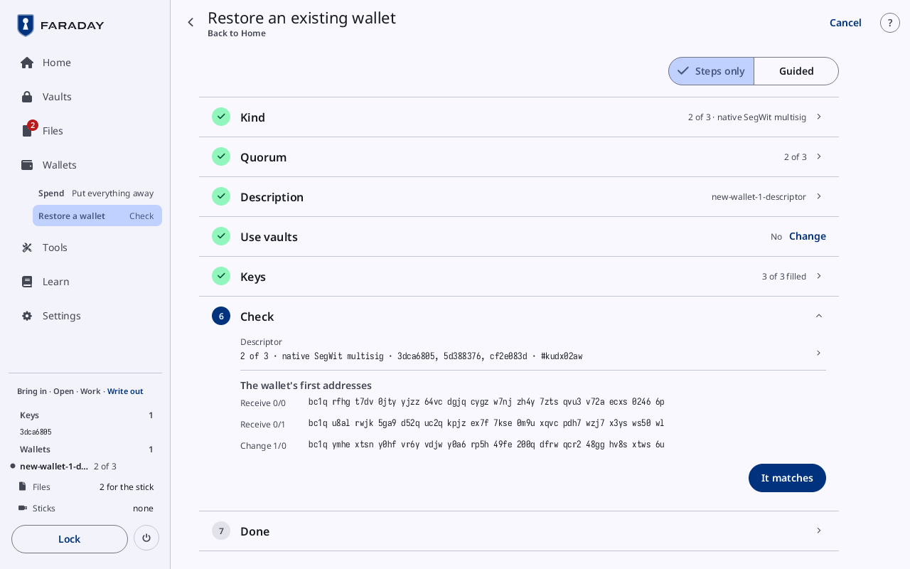
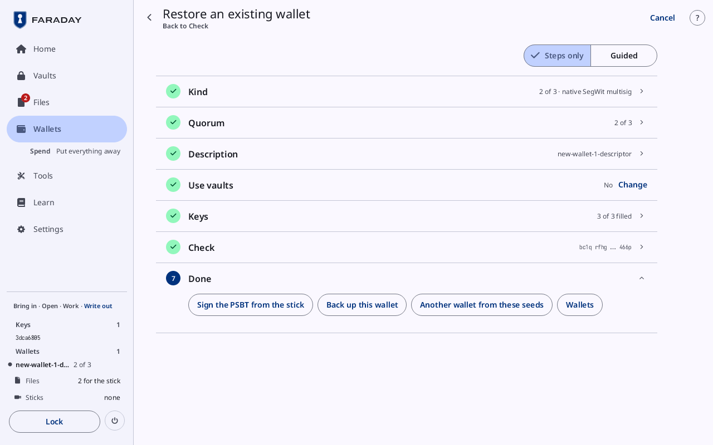

# Restore a wallet

**Kind:** Reference
**Status:** Written, checked against the app's screens and strings, and pictured from `just guide-pictures` (`docs/guide/pictures/`)

**You end with:** the 2-of-3 of [Make a wallet](make-a-wallet.md)
rebuilt from its backups, first from its wallet description and one
key, then from a vault, and checked before it is trusted.

**Before you start:** [Make a wallet](make-a-wallet.md) and
[Back it up](back-up.md).

**You'll need:**

- Faraday with no key loaded.
- The wallet description: here `new-wallet-1-descriptor.txt`, brought
  into Files from a stick
  ([Files, sticks and QR codes, step 2](files-and-sticks.md#2-a-stick-visit-bring-files-in)); a printed wallet sheet's QR code
  or the description's QR picture works the same way with **Scan it**.
- The paper copy of key `3dca6805`. Keys `5d388376` and `cf2e083d` stay
  away: two of three keys are enough to sign, and one is enough to
  restore the wallet with its description.

**Time:** about 15 minutes.

### 7.1 Restore an existing wallet

Press **Home**, then [**Restore an existing wallet**](../screens/restore.md). The page is
**Restore an existing wallet**, one card per step.

With the description at hand, Kind is not chosen by hand: press **From
Files** beside **I have the wallet description** (or **Scan it** for its
QR code). The kinds below it (**Single key · native SegWit**,
**Multisig · native SegWit**, **More kinds**) are for a wallet without
its description. With more than one description in Files, the **Description**
card lists them; press one.

The description fills **Kind** (**2 of 3 · native SegWit multisig**),
**Quorum** (**2 of 3**) and **Description** (the file's name), and the
wallet loads under that name, here **new-wallet-1-descriptor** (**Rename**
on its card changes it). Without a description, pressing a kind closes
**Kind** and opens the next card.

**Will you use vaults as part of this backup?** (**Vaults already on
sticks are brought in here, not later.**) Press **No**: the card
closes on **No** and **Keys** opens.

### 7.2 The keys

One row per key of the description, by fingerprint, each **Empty**.
**Use vaults** reads **No**, with **Change**; the link at the top left,
**Use vaults**, opens that card again with **No** kept. The buttons
stand over the row they fill; each other row has its own **Not here**:

| Button | Does |
|---|---|
| **Type the words** | opens [Add a key](../screens/add-a-key.md); the words typed, **Add key** |
| **Scan a SeedQR** | the camera; a passphrase is asked after the scan |
| **Not here** | the key stays away; the wallet signs with the others |

Press **Type the words**, type key `3dca6805`'s 12 words from the paper,
and press **Add key**.

| Result | Screen | Meaning | Do |
|---|---|---|---|
| a key of the wallet |  **Key 1 of the wallet**, in green | the words make the key the description names in that row | the next row |
| any other seed |  **Not a key of this wallet: check the words or the passphrase**, in red | the words, or the passphrase, make a key the description does not name; nothing is loaded | check the copy, type it again |

The second picture is of a seed of no key of this wallet (BIP 39's
"abandon … about"). A word copied wrongly makes another key and is
refused the same way.

Press **Not here** for rows 2 and 3.

Each row reads **Not here**, with **Change**. Press **Make the wallet**:
**Keys** closes on **3 of 3 filled**, a key not here counting as filled.

### 7.3 Check, then Done

**Descriptor** reads **2 of 3 · native SegWit multisig · 3dca6805,
5d388376, cf2e083d · #kudx02aw**; under **The wallet's first addresses**,
**Receive 0/0** reads `bc1q rfhg t7dv … 0246 6p`, the same as in step
5.2.

Compare before pressing **It matches**:

| Compare | With | A match proves |
|---|---|---|
| the descriptor's checksum (`#kudx02aw`) | the one on the wallet sheet or the card from before | the description is the one backed up, character for character |
| **Receive 0/0** | the first receive address in Sparrow, or on the printed wallet sheet | the wallet makes the same addresses as before: the money is in it |
| the fingerprints | the ones on the wallet sheet | each key is the one the backup names |

If Receive 0/0 differs, do not receive to or spend from this wallet:
the description is another wallet's, or was changed. Press **It
matches**.

**Done** offers **Sign the PSBT from the stick** (with a PSBT for this
wallet in Files; otherwise **Spend from this wallet**), **Back up this
wallet**, **Another wallet from these seeds** and **Wallets**. A
restored key is not held for a backup: it signs at once. The card reads
**1 of 2 signatures possible here**, with **Scan a key** for the second
([Multisig with other people and devices](multisig-with-others.md#7-keys-kept-off-the-device),
step 7).

A match proves the description and the keys typed are the wallet's. It
does not prove the balance: check that in Sparrow, which sees the
blockchain.

### 7.4 From a vault

A wallet backed up into a vault (section 4) comes back from the vault's
stick:

1. Start Faraday from the Faraday stick that holds the vault. Faraday
   lists the stick's files by name (**Read from …**); press
   **Import**: it reads the ticked files, lists **Locked · vault.fvlt**,
   and asks **Pull the stick to continue**. Pull the stick, type the
   vault's passphrase and press **Unlock**.

   Or, with Faraday started and no key loaded, plug the vault's stick
   in: [**Stick visit**](../screens/stick-visit.md) opens, with `vault.fvlt` ticked under **On the
   stick**. Press **Import 1 file** and pull the stick
   ([Files, sticks and QR codes, step 2](files-and-sticks.md#2-a-stick-visit-bring-files-in)).
   In **Files**, press **Unlock** on `vault.fvlt`'s row, type the
   vault's passphrase and press **Unlock**.
2. [**Load from Vault**](../screens/vaults.md#load-from) lists what the vault holds, each seed and
   wallet saved with **Load at unlock** (step 4.8) ticked. Press **Load
   ticked**: the wallet and its keys load, and Wallets opens
   ([Vaults, passwords and codes, step 10](vaults-and-passwords.md#10-unlock-it-again-and-load-from-it)).

Then check it as in step 7.3: the checksum, Receive 0/0 against Sparrow
or the wallet sheet, the fingerprints. **Unlock Vault 1** on the backup's
**Done** (step 4.10) is the same unlock.

A vault holds what was saved into it: a seed not saved there is
restored from its paper copy as in step 7.2.
