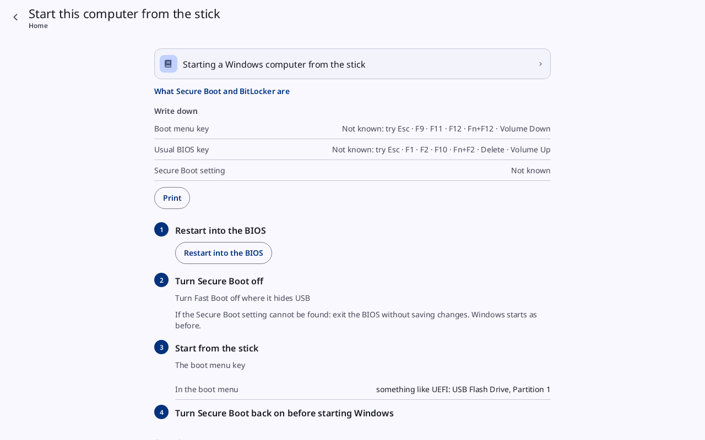
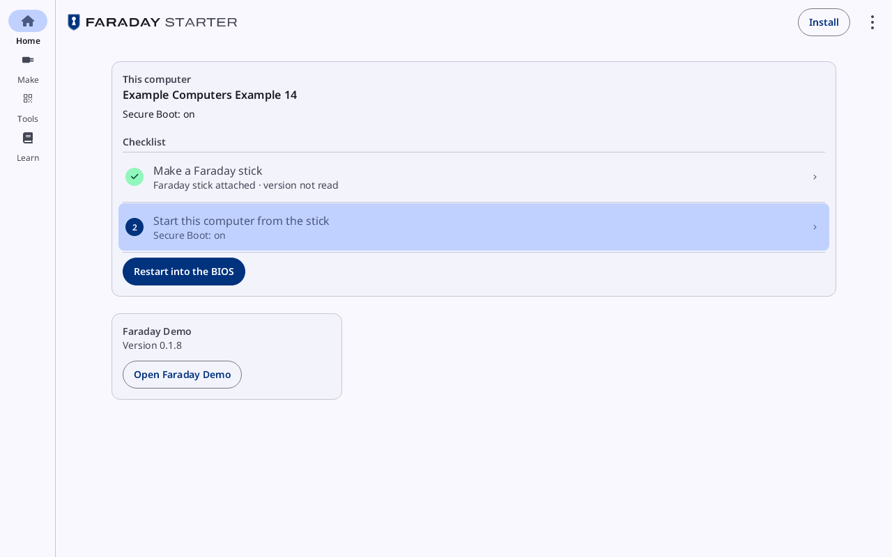
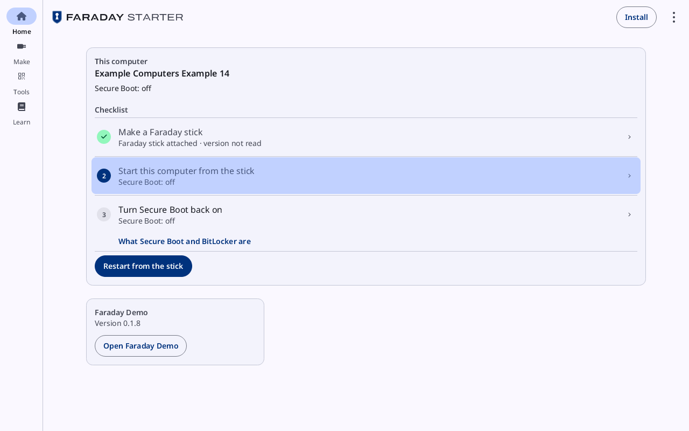
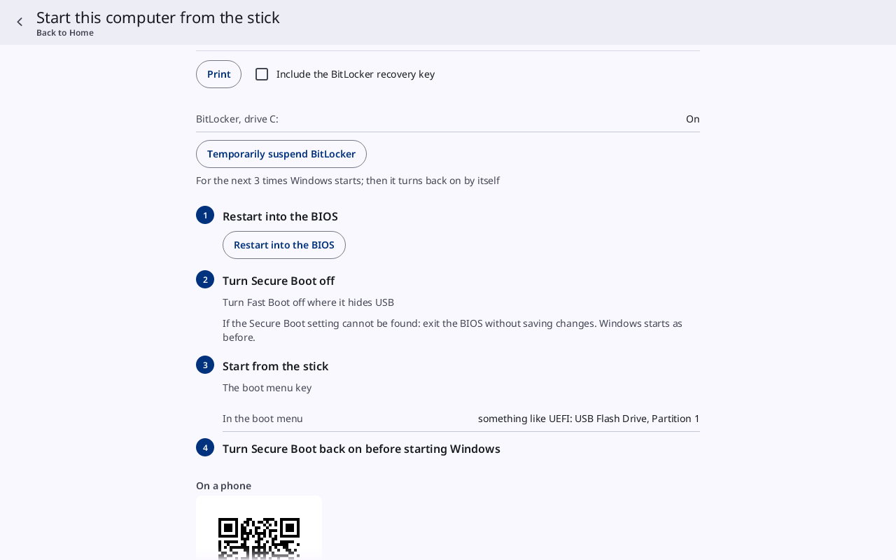
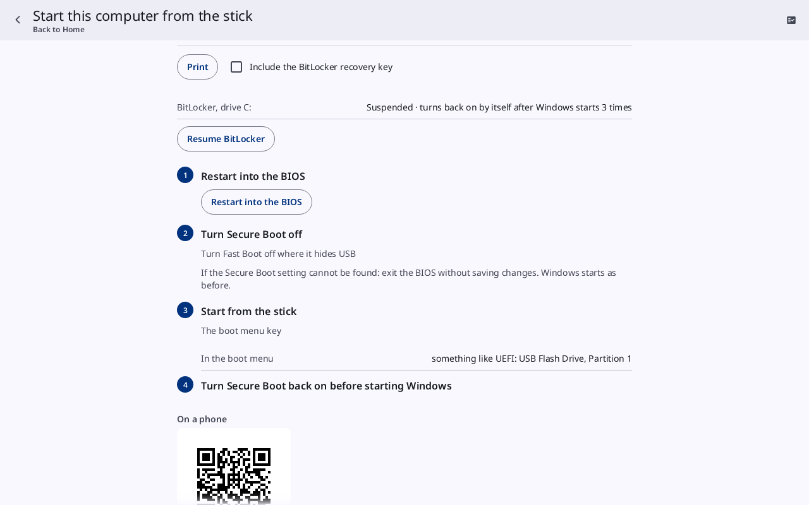
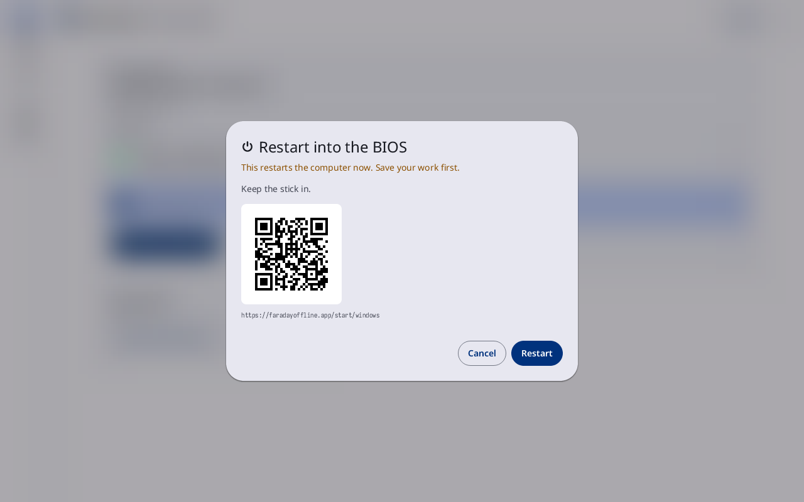
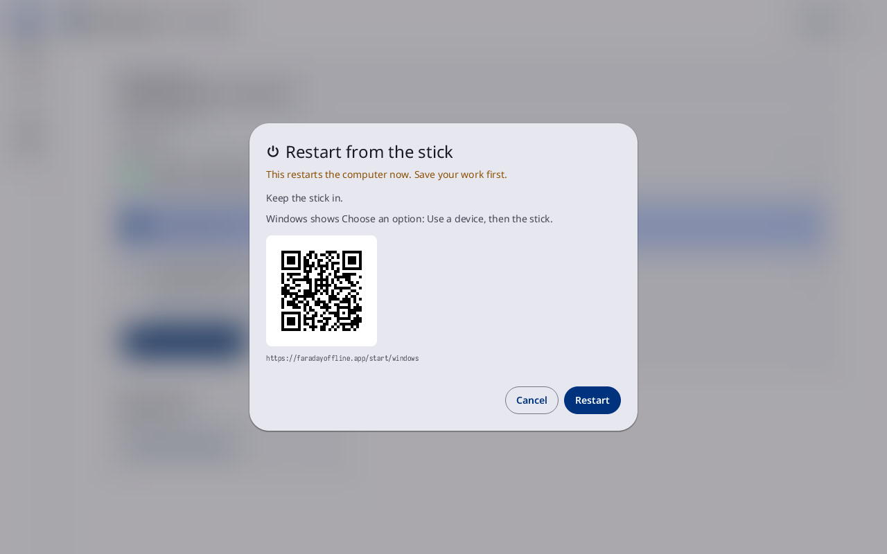

# Start a PC from the stick

**Kind:** Reference
**Status:** Written, checked against the app's screens and strings, and pictured from `just guide-pictures` (`docs/guide/pictures/`)

**You end with:** the PC started from the Faraday stick, showing
Faraday's first screen, and Secure Boot back on before Windows starts
again.

**Before you start:** [Get Faraday on a stick](get-faraday.md).

**You'll need:**

- The Faraday stick, still in the PC, and Faraday Starter open on Home.
- Paper and a pen, or a printer, for the keys and setting to write down.
- On Windows with BitLocker, where its recovery key is kept.

**Time:** about 20 minutes, more for a PC whose BIOS is new to you.

### 1.7 Start this computer from the stick

Leave the stick in. **Start this computer from the stick** on the
Written page, or item 2 of Home's checklist, opens this page
([Start this computer from the stick](../screens/starter-learn-and-boot.md#start-this-computer-from-the-stick)):

At the top, **Starting a Windows computer from the stick** opens that
Learn page, and **What Secure Boot and BitLocker are** the page on
both. Under **Write down**, copy **Boot menu key**, **Usual BIOS key** and **Secure
Boot setting**, or press **Print** for a sheet with them and the steps.
The PC restarts later and the Starter is then off the screen. For a PC
the Starter does not know, the key rows read **Not known: try** and
the keys most makers use; the printed sheet lists them too. Under
**Print** come the steps, numbered: **Restart into the BIOS**, **Turn
Secure Boot off**, **Start from the stick** (with **In the boot menu**)
and **Turn Secure Boot back on before starting Windows**. **On a phone**,
at the foot, is a QR code of the same steps.

The stick cannot start while Secure Boot is on. Back on Home (the back
arrow at the top left), the card's button shows which case this PC is in:

| Secure Boot on | Secure Boot off |
|---|---|
|  |  |
| Button: **Restart into the BIOS**. Go to step 1.8. | Button: **Restart from the stick**. The checklist adds a third line, **Turn Secure Boot back on**. Go to step 1.9. |

On Windows the first checklist line reads **Faraday stick attached ·
version not read**: the Starter reads a stick's version on Windows only
with administrator permission. Nothing here needs it.

BitLocker (Windows). With BitLocker on, the Start page shows a row
**BitLocker, drive C:** under **Print**, reading **On**. Nothing here is required:
with Secure Boot back on before Windows starts (step 1.10), Windows
usually starts as before. A PC whose BIOS changes its Secure Boot keys
when the setting is turned off and on makes Windows ask for the
48-digit BitLocker recovery key.

| BitLocker on | Suspended |
|---|---|
|  |  |
| **Temporarily suspend BitLocker** (For the next 3 times Windows starts; then it turns back on by itself): Windows then does not ask for the recovery key. Windows asks for administrator permission once. | The row reads **Suspended · turns back on by itself after Windows starts 3 times**. **Resume BitLocker** turns it back on now. |

**Include the BitLocker recovery key**, a tick box beside **Print**, puts the
recovery key of drive C: on the printed sheet. Windows asks once for
administrator permission; the key is never shown on the page. Keep
that sheet as you keep the key.

| Red line | Meaning |
|---|---|
| "BitLocker was not suspended (…). This computer's BitLocker is managed: its administrator has to suspend it." | an employer or school manages this PC; ask its administrator, or go on without suspending |
| "An administrator of this computer has to do this step." | your Windows account is not an administrator's |
| "The drive has no BitLocker recovery key." | there is nothing to print |

If Windows asks for the recovery key: Control Panel → BitLocker Drive
Encryption → Back up your recovery key shows where it is kept; on a PC
signed in with a Microsoft account, also aka.ms/myrecoverykey. If it
asks while Secure Boot is still off, turn the PC off, turn Secure Boot
back on (step 1.10), and Windows starts without it.

On Linux, a disk that the TPM unlocks shows **A disk here is unlocked
by the TPM: have its passphrase ready** at the top of the Start page.

### 1.8 Restart into the BIOS (Secure Boot on)

1. Press **Restart into the BIOS**, on Home's card or as step 1 of the
   Start page. A [sheet](../screens/starter-learn-and-boot.md#restart-into-the-bios-and-restart-from-the-stick)
   asks first:

   

   It reads **This restarts the computer now. Save your work first.**
   The QR code opens the same steps on a phone. **Keep the stick in.**
   Press **Restart**.
2. In the BIOS, turn Secure Boot off, at the **Secure Boot setting**
   written down. Turn Fast Boot off too if it hides USB devices. If the
   setting cannot be found, exit the BIOS without saving changes:
   Windows starts as before.
3. Save and exit. As the PC restarts, press the **Boot menu key** and
   choose the stick (the **In the boot menu** name from step 1.6). It
   is not *Windows Boot Manager*, a Linux name such as *ubuntu*, or the
   PC's own disk. Listed twice, it is the entry that begins with UEFI.
   A stick not listed: the table at the end of step 1.9.

### 1.9 Restart from the stick (Secure Boot already off)

Press **Restart from the stick**. The same
[sheet](../screens/starter-learn-and-boot.md#restart-into-the-bios-and-restart-from-the-stick)
asks first.

Keep the stick in and press **Restart**. On Linux the system asks for
your password, then the PC starts from the stick by itself. On Windows
the sheet says what follows: "Windows shows Choose an option: Use a
device, then the stick."

On Windows, while Secure Boot is off, the Start page's step 3 offers
the same restart as **Restart to choose a device**.

On Linux, when the restart cannot be set up, Home's card reads
**Restart from the stick did not happen:** and the reason, and its
button becomes **Restart into the BIOS**: go to step 1.8.

Faraday shows its logo a few seconds after the stick starts, then its
first screen (section 2). If it does not (the Starter's Learn page
**When the stick does not start** has the same table):

| What happens | Do |
|---|---|
| the stick is not in the boot menu | set the BIOS's Fast Boot to Disabled, or to Thorough; turn on a setting such as Enable USB Boot Support where there is one |
| the stick is in a USB-C or Thunderbolt port | use a USB-A port, or turn on the BIOS's USB-C or Thunderbolt boot support |
| the PC is set to legacy BIOS or CSM | set the BIOS's boot mode to UEFI; turning CSM on does not help |
| choosing the stick returns to the menu, or shows a Secure Boot message | Secure Boot is still on: step 1.8 |
| the screen stays black, with no logo | the BIOS did not start the stick: check that Secure Boot is off, try another USB port |
| the logo, then a black screen for more than a minute | Faraday did not start its screen on this PC: hold the power button until the PC turns off |
| the BIOS asks for a password you do not have | only whoever set it can open it; this PC cannot start the stick |

### 1.10 Before starting Windows again

When done with Faraday, turn Secure Boot back on in the BIOS before
starting Windows (the Start page's step 4, **Turn Secure Boot back on
before starting Windows**). Faraday's [power sheet](../screens/lock-and-power.md#power) says the same (step
2.3).

1. Power off from Faraday (step 2.3) and pull the stick out.
2. Turn the PC on and press the **Usual BIOS key** written down.
3. Set Secure Boot to Enabled. Save and exit.

If Secure Boot cannot be enabled, or Windows does not start with it on,
load the PC's own Secure Boot keys in the BIOS (Restore Factory Keys,
or the setting that loads the keys built into the PC). Back in Windows,
the Starter's Home lists **Turn Secure Boot back on** until it is on.
