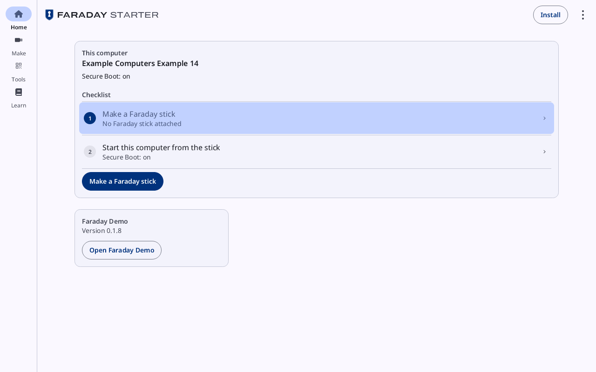
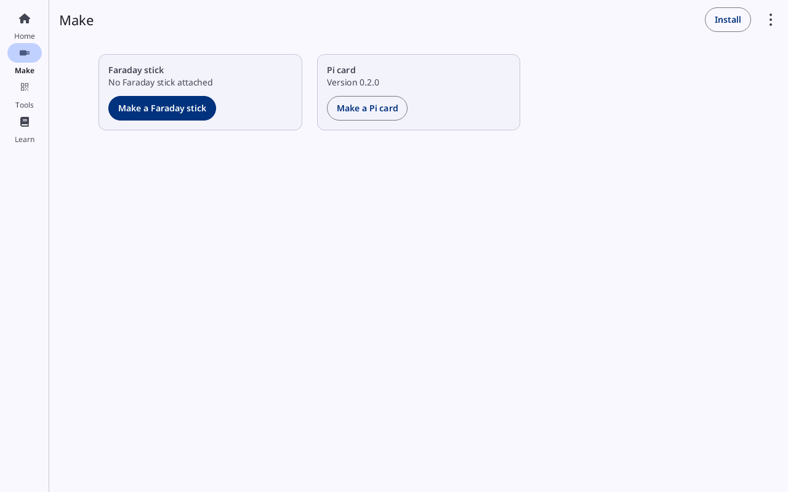

# Faraday Starter

**Kind:** Reference
**Status:** Written, checked against the app's screens and strings, and pictured from `just guide-pictures` (`docs/guide/pictures/`)

**You end with:** knowing where everything is in Faraday Starter.

**You'll need:**

- A computer running Windows or Linux.
- Faraday Starter, downloaded and checked as
  [Get Faraday on a stick](get-faraday.md#11-download-the-starter),
  step 1.1, says.

**Time:** about 10 minutes.

Faraday Starter is an app for Windows and Linux. It writes the Faraday
stick, helps start a computer from it, prints blank backup templates,
moves files to and from the device by QR code, and holds Faraday Demo.
It runs without being installed.

## 1. Open the Starter

- Windows: open the `.exe`. The first time, Windows shows "Windows
  protected your PC": press *More info*, then *Run anyway*.
- Linux: extract the `.tar.gz` and open the file inside.

The Starter opens on **Home**. It opens in the **Cobalt** theme at
**Standard** contrast, in **Light** or **Dark** as the computer's own
setting asks.

The [rail](../screens/starter-home.md#the-rail-the-bar-and-the-top-app-bar)
at the left holds the four destinations: **Home**, **Make**,
**Tools** and **Learn**. In a narrow window they are a bar across the
foot of the window. The bar at the top holds **Install** (or
**Update**) and the **⋮** menu.

A step inside a task, such as **Which stick?**, opens as a page of its
own: the rail is gone, and the top bar holds a back arrow and the
page's name. The back arrow returns to the destination the task was
opened from, at the place it was left.

## 2. Home

Home is about this computer ([Home](../screens/starter-home.md)).

| On screen | Meaning |
|---|---|
| **This computer** | the computer's maker and model, and **Secure Boot: on** or **off** (the pictures show a made-up computer, Example Computers Example 14) |
| **Checklist** | **Make a Faraday stick**, then **Start this computer from the stick**, numbered, each with its state under it (**No Faraday stick attached**, **Secure Boot: on**); the step to do now is highlighted. **Turn Secure Boot back on** is listed while Secure Boot is off |
| the button on the card | the next step for this computer: **Make a Faraday stick**, **Restart into the BIOS** or **Restart from the stick** |
| **Faraday Demo** | the Demo's version and **Open Faraday Demo** ([Faraday Demo](faraday-demo.md)) |
| **Update the installed Faraday** | shown only while this copy is newer than the one installed: **Installed … · this copy …** and **Update** |
| **Boot entry** | on Linux, shown only while the Faraday stick's boot entry is in this computer's boot list: **Remove the Faraday boot entry** |

The checklist is read again each time Home is drawn: plugging a
Faraday stick in ticks **Make a Faraday stick**. A restart button asks
once before the computer restarts: "This restarts the computer now.
Save your work first.", with **Restart** and **Cancel**.

The stick and the restart are the next two walkthroughs:
[Get Faraday on a stick](get-faraday.md) and
[Start a PC from the stick](start-from-the-stick.md).

## 3. Make

Every control of Make and its steps: [Make](../screens/starter-make.md).

| Card | Shows | Button |
|---|---|---|
| **Faraday stick** | **No Faraday stick attached**, or the attached stick's Faraday version | **Make a Faraday stick**: writes a USB stick, step by step (**Which stick?**, **What to write?**, **Confirm**, **Writing**, **Written**) |
| **Pi card** | **Version …** of the Pi image, or **Not in this Starter** | **Make a Pi card**: writes an SD card for a Raspberry Pi the same way; grey when this Starter carries no Pi image |

A disk is never chosen for you: the one USB disk attached is as often a
backup drive as a stick.

## 4. Tools

Every control of Tools and Blank templates: [Tools](../screens/starter-tools.md).

| Card | Shows | Button |
|---|---|---|
| **Transfer** | **Send and Receive** | **Open Transfer**: sends a file from this computer's Downloads folder as animated QR codes for the device's camera, and receives the device's codes through this computer's camera into Downloads |
| **Blank templates** | **Words, SeedQR and codex32** | **Open blank templates**: printable sheets to copy a seed onto by hand. They hold nothing of any wallet. Choose the rows, then **Print** (opens the PDF in this computer's viewer) or **Save the PDF** (into Downloads) |

The backup walkthrough prints its 12-word template from here
([Back it up](back-up.md)).

## 5. Learn

**Learn** ([Learn](../screens/starter-learn-and-boot.md#learn)) holds the Starter's Learn pages: starting a Windows or a
Linux computer from the stick, one page for each computer maker, what
Secure Boot and BitLocker are, what to do when the stick does not
start, and what else runs on a computer below Faraday. A page opened
from a link elsewhere in the Starter opens as a task page, with the
back arrow.

## 6. Install, Update, Appearance and the ⋮ menu

**Install**, at the top right while nothing is installed, opens a page
with one button, **Install**. Press it: the page reads **Installed in
…** with **Done**. The Starter is then in this computer's menu as
Faraday Starter. Faraday Demo is not installed separately: it is inside
the Starter ([Faraday Demo](faraday-demo.md)).

**Update** takes the place of **Install** while this copy is newer than
the one installed. It shows **Installed version** and **This version**,
then the same **Install** button.

The **⋮** menu holds what is not a destination, only the rows that
apply (**Appearance** and **About** while nothing is installed)
([the ⋮ menu](../screens/starter-menu.md#the--menu)):

| Row | Opens |
|---|---|
| **Appearance** | **Theme**, **Mode** (**Light**, **Dark**) and **Contrast** (**Standard**, **Medium**, **High**), the same rows as Faraday's own Settings → Appearance. A choice lasts until the Starter closes: the theme is not kept |
| **About** | **Text size** (Standard, Large, Larger; an installed Starter keeps it), the version, each image the Starter carries with its build ID and SHA-256, the release key's fingerprint, and **Checking this file**: how to check the Starter file against `SHA256SUMS` and its signature |
| **Uninstall** | shown while a copy is installed: what is installed and where, and **Uninstall**, which asks **Uninstall Faraday Starter?** first. "Removes the files listed. Received files and Faraday Demo's sticks stay." |
| **Remove the Faraday boot entry** | shown while the entry is in the boot list, as on Home |

Next: [Get Faraday on a stick](get-faraday.md), or, to try Faraday in
a window first, [Faraday Demo](faraday-demo.md).
