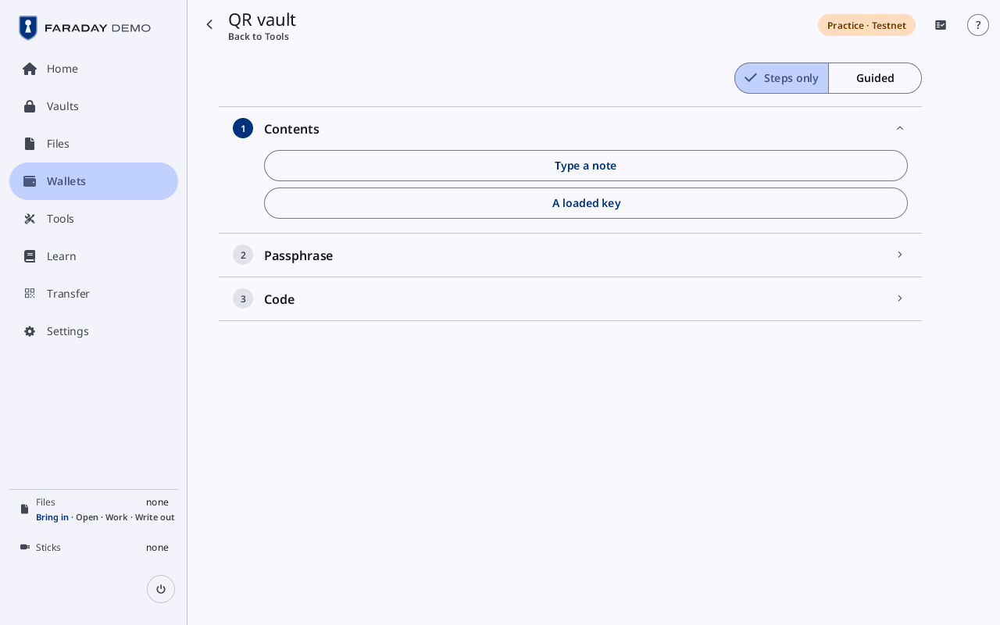
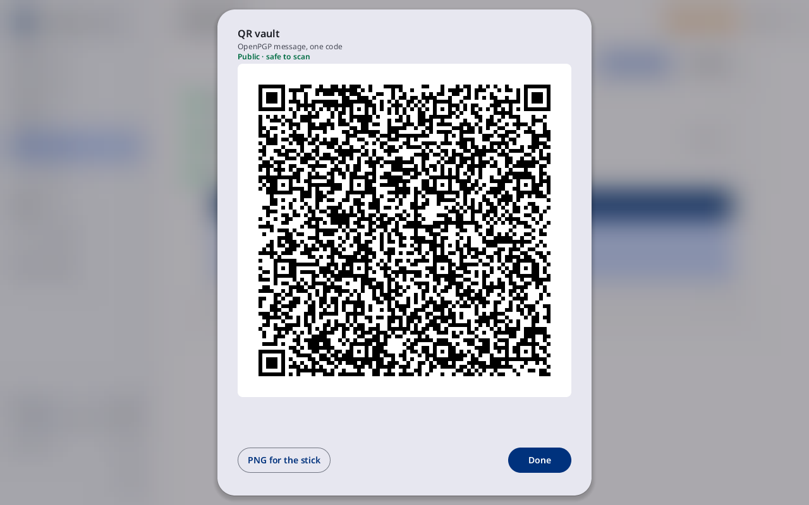
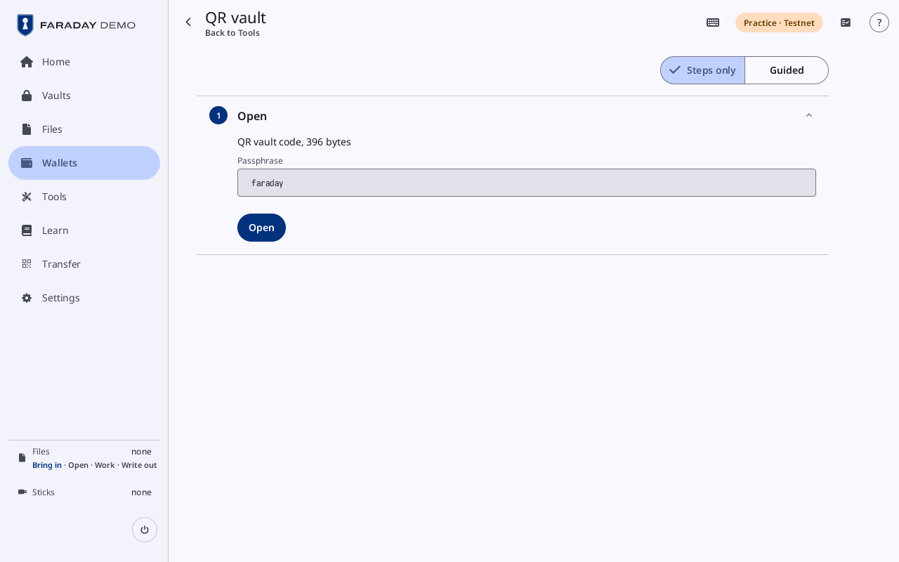
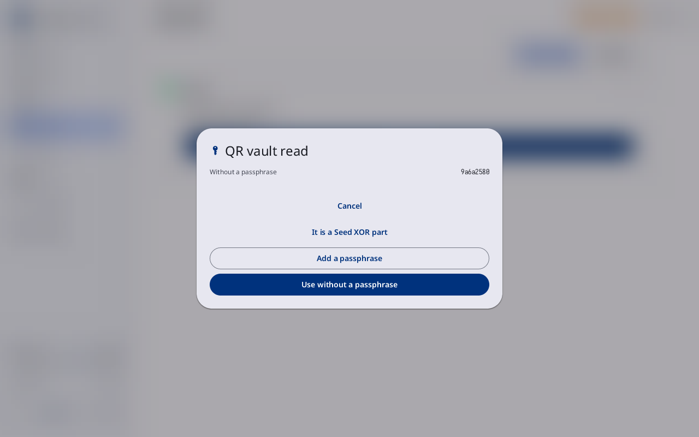

# QR vault

**Kind:** History
**Status:** Checked against the app's pictures in docs/guide/pictures/ (drawn by just guide-pictures) and its code and strings (`faraday/faraday-core/src/qr_tool/screen.rs`, `faraday/faraday-core/src/qr_tool/mod.rs`, `faraday/faraday-core/src/qr_tool/offers.rs`, `faraday/faraday-core/src/qr_tool/open.rs`)
**Screen:** `QrTool`, `QrNoFit`
**Group:** Tools

**Opened from:** **Tools → QR vault** ("A note or a key sealed in one QR
code"), which makes a code; a QR vault code read by Home's Scan, by Add a
key's scanners (also with a stick plugged in) or from Files (**Open in QR
vault**), which opens on the Open card; **Save as a QR vault** on the page
of a seed, a codex32 share, a BIP-39 passphrase or a note in an open file
vault, which opens on Passphrase.

One QR code that holds a note or a key's words under a passphrase, as an
OpenPGP message, and the way to open one again. A column of cards, with
the title of each and what was chosen on it.

*Contents open: **Type a note** and **A loaded key**; **Passphrase** and **Code** wait below. The way back is named **Tools**.*

## On this screen

| Control | What it does |
|---|---|
| the way back | at the top left, named after where the page was opened from (**Tools**) |
| **Steps only**, **Guided** | at the top right: the short text on each open card, off or on |
| a card | its title and what was chosen; a press opens it again |

## Make

Three cards: **Contents**, **Passphrase** and **Code**.

### Contents

| Control | What it does |
|---|---|
| **Type a note** | opens the note field, with "{n} characters left" under it; **Continue** moves on once something is typed |
| **A loaded key** | a row for each key loaded, its name and fingerprint; a key that is not 12 or 24 English words reads **Not 12 or 24 English words** and takes no press. **No key is loaded.** where there is none |

### Passphrase

| Control | What it does |
|---|---|
| **Passphrase**, **Passphrase again** | the two fields, each with its eye; **The two passphrases differ** in red while they do. In Practice a **Use faraday** chip fills them |
| **The code is only as strong as its passphrase** | in the warning tone |
| **Memory** | the memory the passphrase costs to open, in MiB, one step chosen; a step this computer has no room for says "This computer has no room for {n} MiB. Choose a smaller step" |
| Randomness | the row that adds randomness of your own, as elsewhere |
| **Name** | the name the code's file takes |
| **Make the code** | seals the code under **Sealing the code**; grey until the two passphrases match. **The code could not be made** where it fails |

### Code

| Control | What it does |
|---|---|
| **Show as QR** | the code as a QR code, "OpenPGP message, one code" |
| **PNG to the Outbox** | the code's picture in the Outbox; "{name} is in the Outbox" |
| **To the Outbox** | the code's `.pgp` file in the Outbox, the same message |
| **Make another** | back to **Contents**, with nothing kept |

*The note sealed under "faraday" and **Show as QR** pressed: the sheet says the code is public and safe to scan.*

## Open

A code from a scan or Files opens on one card, **Open**, which says "QR
vault code, {n} bytes".

| Control | What it does |
|---|---|
| **Passphrase** | the field, with its eye; in Practice **Use faraday** fills it |
| **Open** | opens the code under **Opening the code**, grey until a passphrase is typed |
| **The passphrase is wrong** | in red; the passphrase is typed again |
| **The code is damaged**, **An OpenPGP message Faraday does not open**, **Not an OpenPGP message**, **The code states a cost Faraday does not accept**, **The code could not be opened** | in red, what the code is instead |
| "Needs {memory}. This computer has {memory} free." | in red, at once with no progress, where the code needs more memory than this computer has free; a computer that does not say what it has free takes a code up to the Light cost |

In Practice the first card also has **Use a sample**, which brings a
sample QR vault code (the public bacon seed under faraday) to the Open card.

*A sample code with "faraday" typed.*

Opened, the card says what the code holds. **Back**, **Cancel**, a lock or
the idle warning drop the answer, and leaving the tool forgets it.

| It holds | The card says | And offers |
|---|---|---|
| a seed | "A seed of {n} words" | **Load as a key**, and the seed sheet opens at once: **Use without a passphrase** or **Add a passphrase**, read in the word list they spell, in a sheet titled **QR vault read** |
| a codex32 share | **A codex32 share**, "Key {fingerprint}" | **Add the share**, which types it into Add a key's codex32 form |
| a passphrase | **A passphrase**, "Key {fingerprint}", the passphrase behind its eye | **Add to key {fingerprint}** where a loaded key's words make the key the code names; "Key {fingerprint} · already here" only where a loaded key's words make that key; "No loaded key makes key {fingerprint} with this passphrase" where the code names a loaded key that none makes; "Key {fingerprint} is not loaded" and **Load its words without a passphrase first.** where it is not |
| a note | **A note**, behind its eye | **Save as a note**, which saves it in the open vault ("Note saved in {vault}"); grey with **Open a vault first** where none is open, and a vault with no room says why |
| nothing | **This QR vault is empty.** | |

With a stick plugged in none of the offers that load a key loads
anything: the card says "Keys load only with no stick attached".

*The sample's seed opened: its sheet, **QR vault read**, the key's fingerprint 9a6a2580.*

## Save as a QR vault

**Save as a QR vault** is on the page of a seed, a codex32 share, a
BIP-39 passphrase or a note in an open file vault (see
[Vault contents](vault.md#a-key)). It opens this tool on **Passphrase**
with the item as the contents. The **Contents** card names it: "A seed in
{vault}", "A codex32 share in {vault}", "A BIP-39 passphrase in {vault}" or
"A note in {vault}"; for a seed that keeps a passphrase it adds **Its
passphrase is not in this code.** From there the steps are Make's. The
item stays in the vault, unchanged, and **Back** returns to its page.

An item that does not fit puts up a dialog, **Save as a QR vault**, with
**Close**:

| The line | When |
|---|---|
| **This key does not fit in a QR vault. A QR vault holds 12 or 24 English words.** | a seed of another length or word list |
| **This passphrase is too long for a QR vault.** | a passphrase over the limit |
| "This note is {n} characters too long for a QR vault. Take {n} characters off its end to make it fit." | a note too long; **This note is 1 character too long for a QR vault. Take 1 character off its end to make it fit.** for one character |
| **This item cannot be written in a QR vault.** | an item whose text cannot be written |

A vault locked or changed before or while the code is sealed says **The
vault was locked or changed. Nothing was sealed.**

## On a narrow window

The top bar holds the way back and the name, **QR vault**.

## Why

- [QR codes and the camera](qr-and-scan.md)
- [Passphrases](../../learn/05-passphrases.md)
